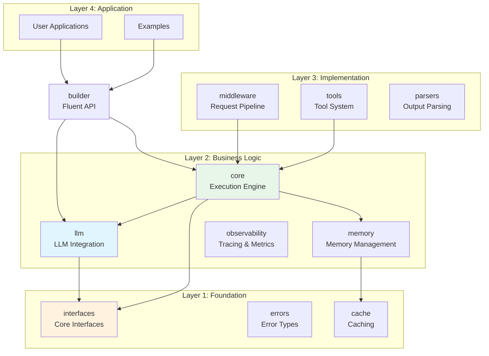
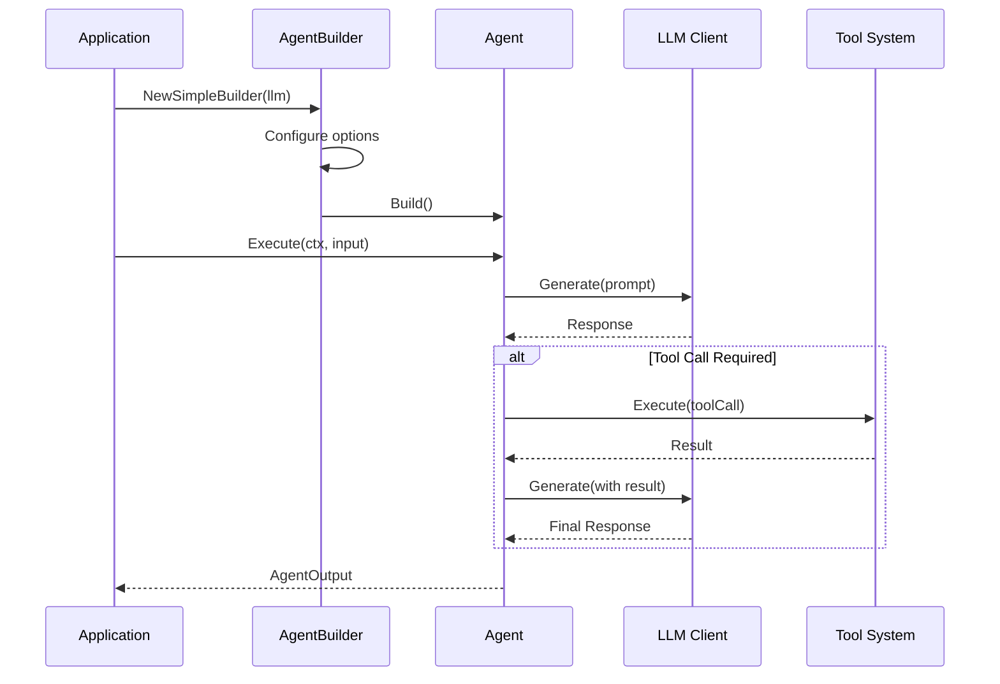

# GoAgent - AI Agent Framework for Go

[](https://go.dev/)
[](https://github.com/kart-io/goagent/actions/workflows/ci.yml)
[](LICENSE)
[](docs/)
[](https://github.com/kart-io/goagent/releases/latest)
[](https://goreportcard.com/report/github.com/kart-io/goagent)
[](https://pkg.go.dev/github.com/kart-io/goagent)
[](https://deepwiki.com/kart-io/goagent)

[English](README.md) | [中文](README_CN.md)

GoAgent is a recoverable, budgeted and observable agent orchestration kernel for Go services: native tool loops, typed workflow graphs with durable checkpoints and approvals, request budgets, OpenTelemetry events and MCP. Retrieval, document loaders, practical tools and multi-instance durable storage live in [goagent-contrib](https://github.com/kart-io/goagent-contrib).

新编排入口：`agent.AsRunnable()`。参见[执行契约与能力状态](docs/guides/EXECUTION_CONTRACT.md)和[GoAgent 评测](evaluation/agentbench/README.md)。

原生编排与工具：`workflow.Graph`、持久图 `AsRunnable`、分支级恢复及 `tools.Dispatcher`，参见[接入与退款案例](docs/guides/NATIVE_ORCHESTRATION.md)。

业务验证案例：[DevOps、文章审核、自动回复](https://github.com/kart-io/goagent-examples/blob/main/workflow/business-cases/README.md)，支持 Gemini / DeepSeek / MiniMax 真实模型调用，包含离线输入、审批恢复和跨进程崩溃测试。

Workflow orchestration: [typed graphs, branches, parallel joins and bounded loops](workflow/README.md).

Context governance: [tool-result offloading and history summaries](docs/guides/CONTEXT_POLICY.md).

Harness 装配与编码工具已迁入独立项目 `github.com/kart-io/goagent-harness`：Preset、计划模式、技能、子 Agent 组件与编码工具由上层项目维护；GoAgent 保留执行循环、工作流、恢复、预算和环境接口。旧包已从核心移除，依赖与接入方式见 [Harness 迁移指南](docs/guides/HARNESS_MIGRATION.md)。

宿主接入：[标准执行装配与可取消构建](docs/guides/HOST_INTEGRATION.md)、[离线示例](examples/execution-scope/main.go)、[执行开销实测](docs/evaluation/2026-10-31-execution-overhead/REPORT.md)。

执行可靠性、扩展点与资源治理：[扩展契约](docs/guides/EXTENSION_CONTRACT.md)、[预算、诊断与资源治理](docs/guides/EXECUTION_GOVERNANCE.md)。

## Features

- **Native Tool Loop** - Model-driven tool calling with durable, replayable tool calls
- **执行验证** - 提供可复现测试与性能报告，结论以对应版本和负载为准
- **Flexible Architecture** - 4-layer modular design with clear separation of concerns
- **LLM Abstraction** - Support for multiple LLM providers (OpenAI, Anthropic Claude, Cohere, HuggingFace, Gemini, DeepSeek)
- **Memory Management** - Conversation history and case-based memory
- **Tool System** - Extensible tool registry with parallel execution and dependency management
- **State Management** - Thread-safe state with checkpointing and persistence
- **Observability** - OpenTelemetry integration with distributed tracing
- **Durable Execution** - File-based `durable.Store` in core; multi-instance Postgres store in [goagent-contrib](https://github.com/kart-io/goagent-contrib/tree/master/durable/pgstore)

## Quick Start

### Installation

```bash
go get github.com/kart-io/goagent
```

### Basic Example

```go
package main

import (
    "context"
    "log"
    "time"

    "github.com/kart-io/goagent/builder"
    "github.com/kart-io/goagent/llm"
    "github.com/kart-io/goagent/llm/providers"
)

func main() {
    // Create LLM client
    llmClient, err := providers.NewOpenAIWithOptions(llm.WithAPIKey("your-api-key"))
    if err != nil {
        log.Fatal(err)
    }

    // Build agent with fluent API
    agent, err := builder.NewSimpleBuilder(llmClient).
        WithSystemPrompt("You are a helpful assistant").
        WithMaxIterations(10).
        WithTimeout(30 * time.Second).
        Build()

    if err != nil {
        log.Fatal(err)
    }

    // Execute agent
    result, err := agent.AsRunnable().Invoke(context.Background(), "Analyze the latest sales data")
    if err != nil {
        log.Fatal(err)
    }

    log.Printf("Result: %v", result)
}
```

### Using Pre-configured Agents

```go
// Create a RAG agent for document Q&A
ragAgent, err := builder.RAGAgent(llmClient, vectorStore)

// Create an analysis agent (low temperature, high precision)
analysisAgent, err := builder.AnalysisAgent(llmClient, dataSource)

// 构造监控提示词 Agent；不会启动后台定时检查
monitoringAgent, err := builder.MonitoringAgent(llmClient, 30*time.Second)
```

### Grounded RAG and incremental output

- `RAGAgent(client, retriever)` retrieves evidence and returns reference provenance in `retrieval_sources`.
- `WithRetriever(retriever, RetrievalConfig{...})` bounds document count and context size, and accepts hybrid or reranking retrievers.
- The OpenAI provider supports `CompleteStream` / `ChatStream` with text deltas, token usage, and asynchronous errors.

Retrievers (BM25, hybrid, reranking, Qdrant) are provided by [goagent-contrib/retrieval](https://github.com/kart-io/goagent-contrib/tree/master/retrieval) and satisfy `interfaces.DocumentRetriever`. See the [RAG and streaming guide](docs/guides/GROUNDED_RAG_AND_STREAMING.md).

## Architecture

GoAgent follows a 4-layer architecture for maintainability and scalability:



### Request Flow



See [Architecture Documentation](docs/architecture/) for details.

## Module Reference

| Module | Description | Documentation |
|--------|-------------|---------------|
| **[core](core/)** | Execution engine, state management, runtime | [README](core/README.md) |
| **[workflow](workflow/)** | Typed graph compilation, branches, parallel joins and bounded loops | [README](workflow/README.md) |
| **[llm](llm/)** | LLM provider integration (OpenAI, Anthropic, etc.) | [README](llm/README.md) |
| **[builder](builder/)** | Fluent API for agent construction | [README](builder/README.md) |
| **[tools](tools/)** | Tool system and registry | [README](tools/README.md) |
| **[memory](memory/)** | Memory management and vector storage | [README](memory/README.md) |
| **[middleware](middleware/)** | Request/response middleware | [README](middleware/README.md) |
| **[observability](observability/)** | Tracing and metrics | [README](observability/README.md) |
| **[cache](cache/)** | Caching system | [README](cache/README.md) |
| **[interfaces](interfaces/)** | Core interface definitions | [README](interfaces/README.md) |
| **[errors](errors/)** | Error types and handling | [README](errors/README.md) |
| **[parsers](parsers/)** | Output parsing | [README](parsers/README.md) |
| **[testing](testing/)** | Testing utilities and mocks | [README](testing/README.md) |

Retrieval, document loaders, database integrations and the multi-instance Postgres `durable.Store` are separate modules in [goagent-contrib](https://github.com/kart-io/goagent-contrib).

## 核心组件与调用契约

- `core.Runnable[I,O]` 是新编排协议，支持 Invoke、Stream、Batch 和组合。
- Builder 使用 `agent.AsRunnable()`，输入为 any，输出为 `*builder.AgentOutput`。它与 `core.Agent` 的输入输出类型不同。
- 工具实现 `interfaces.Tool`：Name、Description、ArgsSchema 与 `Invoke(ctx, *interfaces.ToolInput)`；经 Dispatcher 获得统一校验和持久调用路径。
- 记忆实现 `interfaces.MemoryManager`；会话历史、Agent 检查点与工作流操作日志不是同一种状态。
- `WithMiddleware` 消费 `core/middleware.Middleware`，不代表任意顶层 middleware 组件都能直接挂载。

完整签名见 [核心 API](docs/api/CORE_API.md)、[工具 API](docs/api/TOOL_API.md)、[LLM API](docs/api/LLM_API.md)、[中间件 API](docs/api/MIDDLEWARE_API.md) 与 [Builder 参考](docs/guides/BUILDER_API_REFERENCE.md)。

## 编排与恢复

普通步骤用 `workflow.Graph[T]`；Agent 通过 `workflow.Adapt` 成为节点。条件边只根据节点状态选择目标，模型调用和业务效果放在节点中。并行分支显式提供 Clone/Merge。

`CompileDurable` 提供节点/分支边界恢复；模型和工具的操作日志避免重复调用已保存的完成记录。外部效果仍需业务幂等，不承诺任意副作用 exactly-once。审批等待不等于业务完成，Stream Done 也不能替代 GraphSnapshot 的状态检查。

子 Agent 使用 `tools.NewRunnableToolFactory` 管理独立会话和资源。可续跑子图使用 `AsChildRunnable` 与 `Resumable` 协议，不是所有 Runnable 工具都自动获得嵌套审批恢复能力。见 [执行契约](docs/guides/EXECUTION_CONTRACT.md) 和 [可组合编排](docs/guides/COMPOSABLE_ORCHESTRATION.md)。

## Documentation

- **[Quick Start Guide](docs/guides/QUICKSTART.md)** - Get started in 5 minutes
- **[Architecture](docs/architecture/)** - System design and import layering
- **[LLM Providers](docs/guides/LLM_PROVIDERS.md)** - Supported LLM integrations
- **[Testing Best Practices](docs/development/TESTING_BEST_PRACTICES.md)** - Writing tests
- **[API Reference](docs/api/)** - Complete API documentation

See [docs/README.md](docs/README.md) for a complete guide.

## Examples

Explore working examples in the [`examples/`](examples/) directory:

- **Basic** - Simple agent creation and execution
- **Advanced** - Complex workflows with state management
- **Integration** - Multi-component systems
- **Streaming** - Real-time streaming responses
- **Observability** - Tracing and metrics

Run an example:

```bash
go run examples/basic/01-simple-agent/main.go
```

## 性能与验证

性能结论必须带上版本、负载和环境，不能把历史微基准当作所有业务的延迟、缓存命中率或并发扩展保证。

- [执行开销实测](docs/evaluation/2026-10-31-execution-overhead/REPORT.md)：离线预算模式和账本复制前后对比，含原始数据与限制。
- [框架性能对测](docs/evaluation/2026-10-27-framework-performance-v2/REPORT.md)：指定版本与合成负载下的对照。
- `InvokeFast` 是已有基础 Agent 的专用路径，不是 Builder 工具循环的通用优化开关。新业务优先遵循 AsRunnable 的执行契约。

## Contributing

We welcome contributions!

### Development Setup

```bash
# Clone repository
git clone https://github.com/kart-io/goagent.git
cd goagent

# Install dependencies
go mod download

# Run tests
go test ./...

# Run linter
golangci-lint run

# Run examples
go run examples/basic/01-simple-agent/main.go
```

### Code Quality

- Minimum test coverage: 80%
- All public APIs must have documentation
- Follow [import layering rules](docs/architecture/IMPORT_LAYERING.md)
- Run verification: `./scripts/verify_imports.sh`

## Roadmap

- [x] Additional LLM providers (Anthropic Claude, Cohere, Hugging Face)
- [x] Production vector database integration (Qdrant, in goagent-contrib)
- [ ] Graphical workflow designer
- [ ] Enhanced monitoring dashboard
- [ ] Agent versioning and A/B testing
- [ ] Performance optimizations (connection pooling, batch processing)

## Design Principles

1. **Interface First** - Clear interfaces supporting multiple implementations
2. **Composability** - Components can be flexibly combined and extended
3. **Type Safety** - Strong typing to catch errors at compile time
4. **Context Aware** - All operations support `context.Context`
5. **Observability** - Built-in tracing, metrics, and logging
6. **Ease of Use** - Sensible defaults and fluent APIs

## License

This project is licensed under the Apache License 2.0 - see the [LICENSE](LICENSE) file for details.

## Support

- **Documentation**: [docs/](docs/)
- **Issues**: [GitHub Issues](https://github.com/kart-io/goagent/issues)
- **Discussions**: [GitHub Discussions](https://github.com/kart-io/goagent/discussions)

## Acknowledgments

GoAgent is inspired by:
- [LangChain](https://github.com/langchain-ai/langchain) - Python AI framework
- [LangGraph](https://github.com/langchain-ai/langgraph) - Graph-based agent workflows
- [AutoGen](https://github.com/microsoft/autogen) - Multi-agent conversations

---

**Status**: See capability boundaries and validation scope
**Version**: 1.0
**Go Version**: 1.25.0+
**Last Updated**: 2026-10-26
