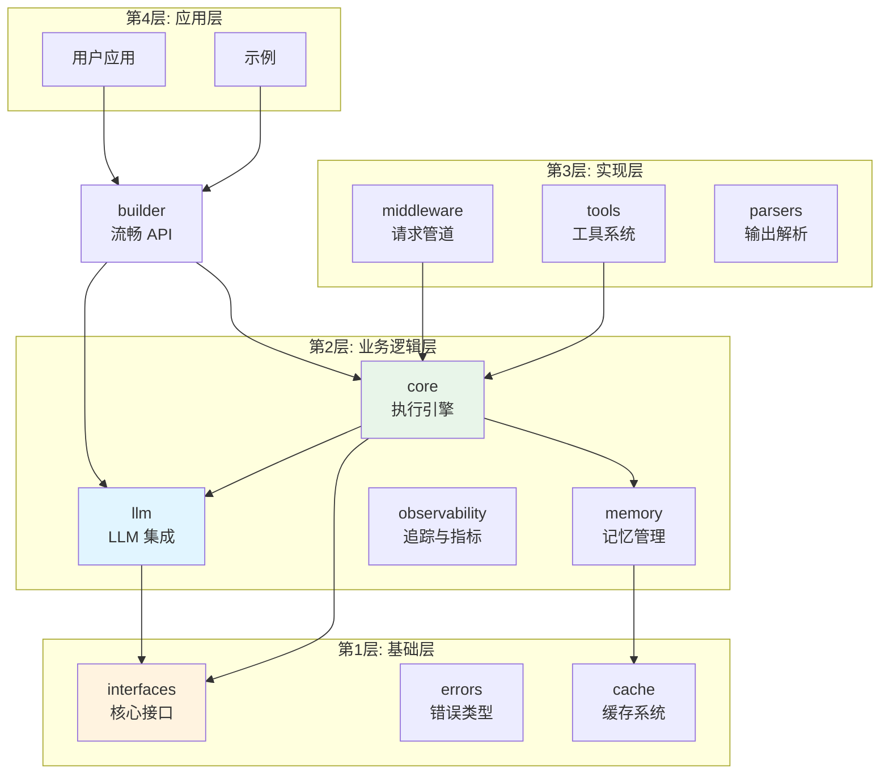
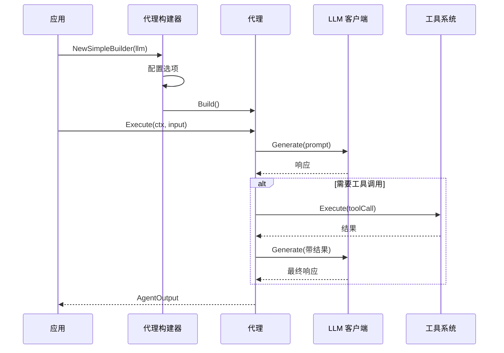

# GoAgent - Go 语言 AI Agent 框架

[](https://go.dev/)
[](https://github.com/kart-io/goagent/actions/workflows/ci.yml)
[](LICENSE)
[](docs/)
[](https://github.com/kart-io/goagent/releases/latest)
[](https://goreportcard.com/report/github.com/kart-io/goagent)
[](https://pkg.go.dev/github.com/kart-io/goagent)
[](https://deepwiki.com/kart-io/goagent)

[English](README.md) | [中文](README_CN.md)

GoAgent 是嵌入 Go 业务服务的可恢复、可计量、可观测 Agent 编排内核：原生工具循环、带持久检查点与审批的类型化工作流图、请求预算、OpenTelemetry 事件与 MCP。检索、文档加载、部分业务集成与多实例持久存储位于 [goagent-contrib](https://github.com/kart-io/goagent-contrib)。

推荐新编排使用 `agent.AsRunnable()`。参见[执行契约与能力状态](docs/guides/EXECUTION_CONTRACT.md)和[GoAgent 评测](evaluation/agentbench/README.md)。

原生编排与工具：`workflow.Graph`、持久图 `AsRunnable`、分支级恢复及 `tools.Dispatcher`，参见[接入与退款案例](docs/guides/NATIVE_ORCHESTRATION.md)。

业务验证案例：[DevOps、文章审核、自动回复](https://github.com/kart-io/goagent-examples/blob/main/workflow/business-cases/README.md)，支持 Gemini / DeepSeek / MiniMax 真实模型调用，包含离线输入、审批恢复和跨进程崩溃测试。

流程编排：[泛型图、条件分支、并行汇合与有界循环](workflow/README.md)。

上下文治理：[工具结果卸载与历史摘要](docs/guides/CONTEXT_POLICY.md)。

Harness 装配与编码工具已迁入独立项目 `github.com/kart-io/goagent-harness`：Preset、计划模式、技能、子 Agent 组件与编码工具由上层项目维护；GoAgent 保留执行循环、工作流、恢复、预算和环境接口。旧包已从核心移除，依赖与接入方式见 [Harness 迁移指南](docs/guides/HARNESS_MIGRATION.md)。

宿主接入：[标准执行装配与可取消构建](docs/guides/HOST_INTEGRATION.md)、[离线示例](examples/execution-scope/main.go)、[执行开销实测](docs/evaluation/2026-10-31-execution-overhead/REPORT.md)。

执行可靠性、扩展点与资源治理：[扩展契约](docs/guides/EXTENSION_CONTRACT.md)、[预算、诊断与资源治理](docs/guides/EXECUTION_GOVERNANCE.md)。

## 特性

- **原生工具循环** - 模型驱动的工具调用，工具调用可持久化并回放
- **执行验证** - 提供可复现测试与性能报告，结论以对应版本和负载为准
- **灵活架构** - 4 层模块化设计，职责分离清晰
- **LLM 抽象** - 支持多个 LLM 提供商（OpenAI、Anthropic Claude、Cohere、HuggingFace、Gemini、DeepSeek）
- **记忆管理** - 对话历史与案例记忆
- **工具系统** - 可扩展工具注册表，支持并行执行和依赖管理
- **状态管理** - 线程安全状态，支持检查点和持久化
- **可观测性** - OpenTelemetry 集成，分布式追踪
- **持久执行** - 核心提供基于文件的 `durable.Store`；多实例 Postgres 存储见 [goagent-contrib](https://github.com/kart-io/goagent-contrib/tree/master/durable/pgstore)

## 快速开始

### 安装

```bash
go get github.com/kart-io/goagent
```

### 基础示例

```go
package main

import (
    "context"
    "log"
    "time"

    "github.com/kart-io/goagent/builder"
    "github.com/kart-io/goagent/llm"
    "github.com/kart-io/goagent/llm/providers"
)

func main() {
    // 创建 LLM 客户端
    llmClient, err := providers.NewOpenAIWithOptions(llm.WithAPIKey("your-api-key"))
    if err != nil {
        log.Fatal(err)
    }

    // 使用流畅 API 构建代理
    agent, err := builder.NewSimpleBuilder(llmClient).
        WithSystemPrompt("你是一个有帮助的助手").
        WithMaxIterations(10).
        WithTimeout(30 * time.Second).
        Build()

    if err != nil {
        log.Fatal(err)
    }

    // 执行代理
    result, err := agent.AsRunnable().Invoke(context.Background(), "分析最新的销售数据")
    if err != nil {
        log.Fatal(err)
    }

    log.Printf("结果: %v", result)
}
```

### 使用预配置代理

```go
// 创建 RAG 代理用于文档问答
ragAgent, err := builder.RAGAgent(llmClient, vectorStore)

// 创建分析代理（低温度，高精度）
analysisAgent, err := builder.AnalysisAgent(llmClient, dataSource)

// 构造监控提示词 Agent；不会启动后台定时检查
monitoringAgent, err := builder.MonitoringAgent(llmClient, 30*time.Second)
```

### 可追溯 RAG 与增量输出

- `RAGAgent(client, retriever)` 实际执行检索，并在输出的 `retrieval_sources` 中返回来源；支持现有检索器、RAGRetriever 和向量存储。
- `WithRetriever(retriever, RetrievalConfig{...})` 限制文档数量和上下文字符数，可组合混合检索与重排序。
- OpenAI Provider 实现 `CompleteStream` / `ChatStream`，传递增量文本、Token 用量和流中错误。

检索器（BM25、混合检索、重排、Qdrant）由 [goagent-contrib/retrieval](https://github.com/kart-io/goagent-contrib/tree/master/retrieval) 提供，满足 `interfaces.DocumentRetriever`。详见 [RAG 与流式执行指南](docs/guides/GROUNDED_RAG_AND_STREAMING.md)。

## 架构设计

GoAgent 采用 4 层架构设计，确保可维护性和可扩展性：



### 请求流程



详见 [架构文档](docs/architecture/)。

## 模块参考

| 模块 | 说明 | 文档 |
|------|------|------|
| **[core](core/)** | 执行引擎、状态管理、运行时 | [README](core/README.md) |
| **[workflow](workflow/)** | 泛型图编译、条件分支、并行汇合与有界循环 | [README](workflow/README.md) |
| **[llm](llm/)** | LLM 提供商集成（OpenAI、Anthropic 等） | [README](llm/README.md) |
| **[builder](builder/)** | 代理构建流畅 API | [README](builder/README.md) |
| **[tools](tools/)** | 工具系统和注册表 | [README](tools/README.md) |
| **[memory](memory/)** | 记忆管理和向量存储 | [README](memory/README.md) |
| **[middleware](middleware/)** | 请求/响应中间件 | [README](middleware/README.md) |
| **[observability](observability/)** | 追踪和指标 | [README](observability/README.md) |
| **[cache](cache/)** | 缓存系统 | [README](cache/README.md) |
| **[interfaces](interfaces/)** | 核心接口定义 | [README](interfaces/README.md) |
| **[errors](errors/)** | 错误类型和处理 | [README](errors/README.md) |
| **[parsers](parsers/)** | 输出解析 | [README](parsers/README.md) |
| **[testing](testing/)** | 测试工具和 Mock | [README](testing/README.md) |

检索、文档加载、数据库及部分业务集成扩展、多实例 Postgres `durable.Store` 是 [goagent-contrib](https://github.com/kart-io/goagent-contrib) 中的独立模块。

## 核心组件与调用契约

- `core.Runnable[I,O]` 是新编排协议，支持 Invoke、Stream、Batch 和组合。
- Builder 使用 `agent.AsRunnable()`，输入为 any，输出为 `*builder.AgentOutput`。它与 `core.Agent` 的输入输出类型不同。
- 工具实现 `interfaces.Tool`：Name、Description、ArgsSchema 与 `Invoke(ctx, *interfaces.ToolInput)`；经 Dispatcher 获得统一校验和持久调用路径。
- 记忆实现 `interfaces.MemoryManager`；会话历史、Agent 检查点与工作流操作日志不是同一种状态。
- `WithMiddleware` 消费 `core/middleware.Middleware`，不代表任意顶层 middleware 组件都能直接挂载。

完整签名见 [核心 API](docs/api/CORE_API.md)、[工具 API](docs/api/TOOL_API.md)、[LLM API](docs/api/LLM_API.md)、[中间件 API](docs/api/MIDDLEWARE_API.md) 与 [Builder 参考](docs/guides/BUILDER_API_REFERENCE.md)。

## 编排与恢复

普通步骤用 `workflow.Graph[T]`；Agent 通过 `workflow.Adapt` 成为节点。条件边只根据节点状态选择目标，模型调用和业务效果放在节点中。并行分支显式提供 Clone/Merge。

`CompileDurable` 提供节点/分支边界恢复；模型和工具的操作日志避免重复调用已保存的完成记录。外部效果仍需业务幂等，不承诺任意副作用 exactly-once。审批等待不等于业务完成，Stream Done 也不能替代 GraphSnapshot 的状态检查。

子 Agent 使用 `tools.NewRunnableToolFactory` 管理独立会话和资源。可续跑子图使用 `AsChildRunnable` 与 `Resumable` 协议，不是所有 Runnable 工具都自动获得嵌套审批恢复能力。见 [执行契约](docs/guides/EXECUTION_CONTRACT.md) 和 [可组合编排](docs/guides/COMPOSABLE_ORCHESTRATION.md)。

## 文档

- **[快速入门指南](docs/guides/QUICKSTART.md)** - 5 分钟快速上手
- **[架构设计](docs/architecture/)** - 系统设计和导入分层
- **[LLM 提供商](docs/guides/LLM_PROVIDERS.md)** - 支持的 LLM 集成
- **[测试最佳实践](docs/development/TESTING_BEST_PRACTICES.md)** - 编写测试
- **[API 参考](docs/api/)** - 完整 API 文档

完整指南见 [docs/README.md](docs/README.md)。

## 示例

在 [`examples/`](examples/) 目录中探索工作示例：

- **基础** - 简单代理创建和执行
- **高级** - 复杂工作流与状态管理
- **集成** - 多组件系统
- **流式** - 实时流式响应
- **可观测性** - 追踪和指标

运行示例：

```bash
go run examples/basic/01-simple-agent/main.go
```

## 性能与验证

性能结论必须带上版本、负载和环境，不能把历史微基准当作所有业务的延迟、缓存命中率或并发扩展保证。

- [执行开销实测](docs/evaluation/2026-10-31-execution-overhead/REPORT.md)：离线预算模式和账本复制前后对比，含原始数据与限制。
- [框架性能对测](docs/evaluation/2026-10-27-framework-performance-v2/REPORT.md)：指定版本与合成负载下的对照。
- `InvokeFast` 是已有基础 Agent 的专用路径，不是 Builder 工具循环的通用优化开关。新业务优先遵循 AsRunnable 的执行契约。

## 贡献

欢迎贡献！

### 开发设置

```bash
# 克隆仓库
git clone https://github.com/kart-io/goagent.git
cd goagent

# 安装依赖
go mod download

# 运行测试
go test ./...

# 运行 linter
golangci-lint run

# 运行示例
go run examples/basic/01-simple-agent/main.go
```

### 代码质量

- 最低测试覆盖率: 80%
- 所有公共 API 必须有文档
- 遵循 [导入分层规则](docs/architecture/IMPORT_LAYERING.md)
- 运行验证: `./scripts/verify_imports.sh`

## 路线图

- [x] 更多 LLM 提供商（Anthropic Claude、Cohere、Hugging Face）
- [x] 生产级向量数据库集成（Qdrant，见 goagent-contrib）
- [ ] 图形化工作流设计器
- [ ] 增强监控仪表板
- [ ] 代理版本控制和 A/B 测试
- [ ] 性能优化（连接池、批处理）

## 设计原则

1. **接口优先** - 清晰的接口支持多种实现
2. **可组合性** - 组件可以灵活组合和扩展
3. **类型安全** - 强类型在编译时捕获错误
4. **上下文感知** - 所有操作支持 `context.Context`
5. **可观测性** - 内置追踪、指标和日志
6. **易用性** - 合理默认值和流畅 API

## 许可证

本项目采用 Apache License 2.0 许可证 - 详见 [LICENSE](LICENSE) 文件。

## 支持

- **文档**: [docs/](docs/)
- **问题**: [GitHub Issues](https://github.com/kart-io/goagent/issues)
- **讨论**: [GitHub Discussions](https://github.com/kart-io/goagent/discussions)

## 致谢

GoAgent 的灵感来源：
- [LangChain](https://github.com/langchain-ai/langchain) - Python AI 框架
- [LangGraph](https://github.com/langchain-ai/langgraph) - 基于图的代理工作流
- [AutoGen](https://github.com/microsoft/autogen) - 多代理对话

---

**状态**: 核心入口有回归验证，实验与弃用模块见能力说明
**版本**: 1.0
**Go 版本**: 1.25.0+
**最后更新**: 2026-10-26
