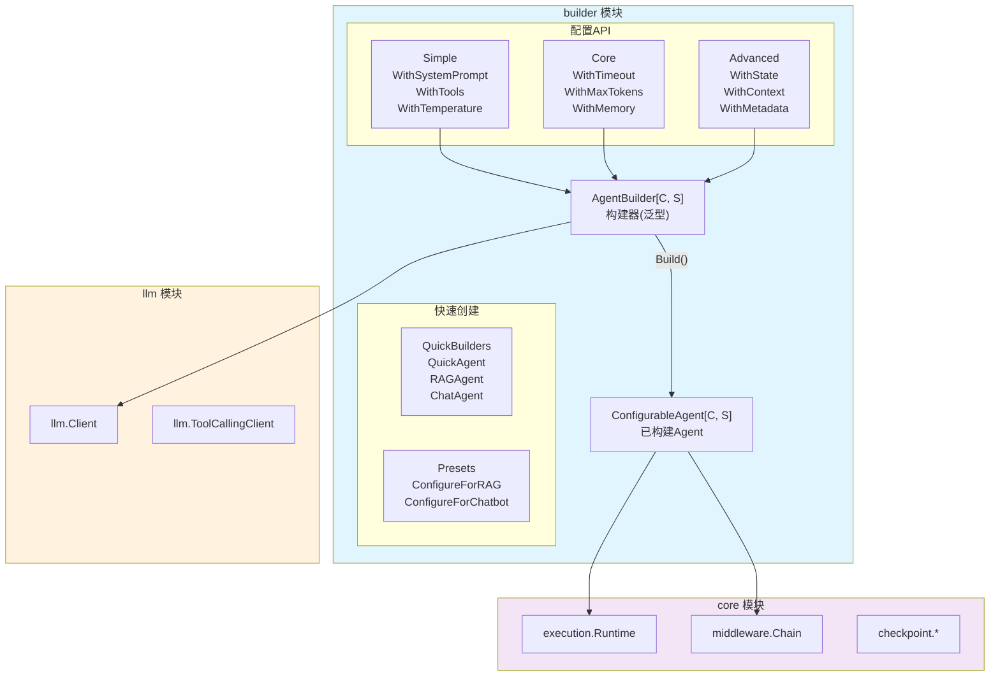
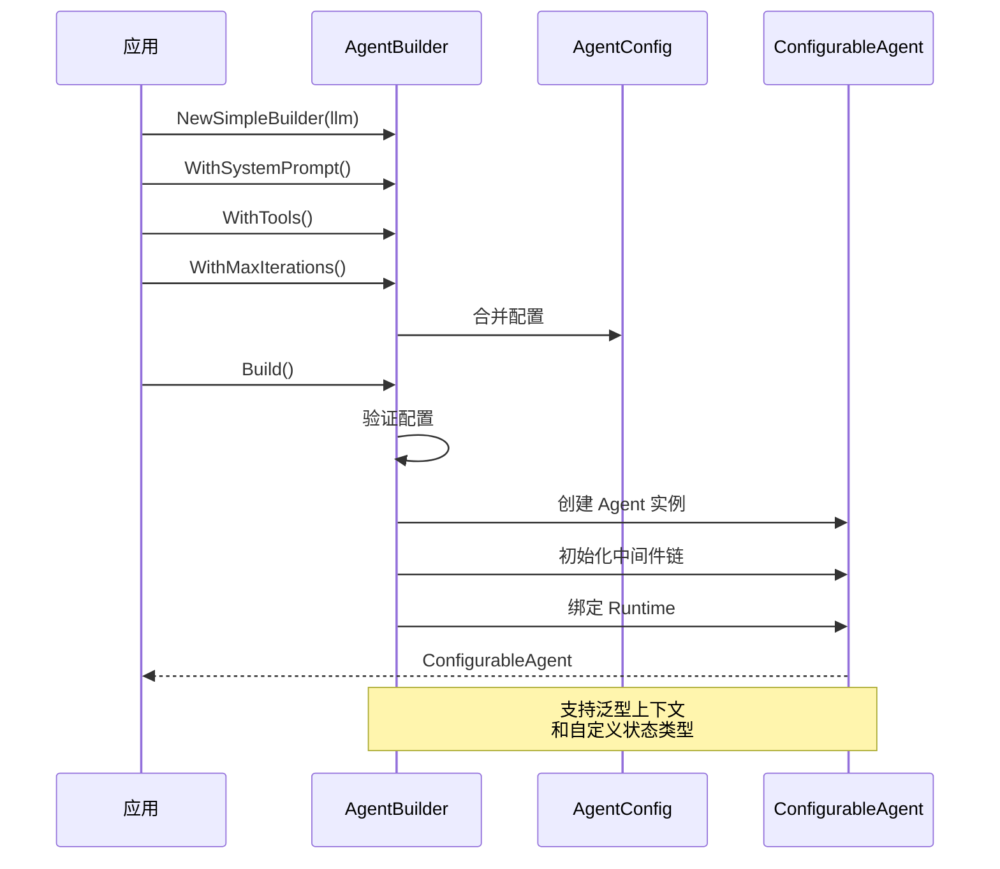

# builder Agent 构建器

本模块是 goagent 框架的 Agent 构造工厂，提供流畅 API（Fluent API）模式构建不同类型的 Agent。

支持结构化流的新业务通过 `agent.AsRunnable().Invoke/Stream` 执行，参见[快速入门](../docs/guides/QUICKSTART.md)和[执行入口能力对照](../docs/guides/EXECUTION_CONTRACT.md)。`Execute/ExecuteWithTools` 继续支持兼容调用。Execute 保留同步语义，对 ContextPolicy 或 ReturnDirect 明确报错；ExecuteWithTools 在流式 Provider 上委派统一入口，其他客户端保留兼容循环。所有执行入口共用会话串行保护和排队超时。

## 目录

- [架构设计](#架构设计)
- [核心组件](#核心组件)
- [使用方法](#使用方法)
- [API 层级](#api-层级)
- [推理策略](#推理策略)
- [代码结构](#代码结构)

## 架构设计

### 系统架构图



### 构建流程



### 架构分层

```text
┌─────────────────────────────────────────────────────────┐
│              应用层 (Application)                        │
│         使用 builder 构建和使用 Agent                    │
└─────────────────────────────────────────────────────────┘
                          ↓
┌─────────────────────────────────────────────────────────┐
│            API 层 (builder 模块)                         │
│  ┌──────────────────────────────────────────────────┐  │
│  │  快速创建API (80% 场景)                          │  │
│  │  - QuickAgent, RAGAgent, ChatAgent ...          │  │
│  └──────────────────────────────────────────────────┘  │
│  ┌──────────────────────────────────────────────────┐  │
│  │  通用构建API (95% 场景)                          │  │
│  │  - NewSimpleBuilder / NewAgentBuilder           │  │
│  │  - WithXxx() 流畅配置链                         │  │
│  └──────────────────────────────────────────────────┘  │
└─────────────────────────────────────────────────────────┘
```

## 核心组件

### 1. AgentBuilder 构建器

泛型构建器，支持自定义上下文和状态类型：

```go
type AgentBuilder[C any, S core.State] struct {
    llmClient    llm.Client
    tools        []interfaces.Tool
    systemPrompt string
    state        S
    store        store.Store
    checkpointer checkpoint.Checkpointer
    middlewares  []middleware.Middleware
    config       *AgentConfig
    callbacks    []core.Callback
    // ...
}
```

### 2. ConfigurableAgent 可配置 Agent

构建完成后的 Agent 实例：

```go
type ConfigurableAgent[C any, S core.State] struct {
    llmClient     llm.Client
    tools         []interfaces.Tool
    systemPrompt  string
    runtime       *execution.Runtime[C, S]
    chain         *middleware.MiddlewareChain
    config        *AgentConfig
    memoryManager interfaces.MemoryManager
    // ...
}
```

### 3. AgentConfig 配置

运行时配置选项：

| 配置项 | 默认值 | 说明 |
|--------|--------|------|
| `MaxIterations` | 10 | 最大迭代次数 |
| `Timeout` | 5min | 执行超时 |
| `MaxTokens` | 2000 | LLM 最大 token 数 |
| `Temperature` | 0.7 | 采样温度 |
| `EnableStreaming` | false | 流式响应 |
| `EnableAutoSave` | true | 自动保存状态 |
| `SaveInterval` | 30s | 自动保存间隔 |
| `Verbose` | false | 详细日志 |
| `MaxConversationHistory` | 20 | 对话历史轮数 |

## 使用方法

### 快速创建（推荐）

```go
// 最简单的方式
agent, err := builder.QuickAgent(llmClient, "你是一个智能助手")
if err != nil {
    log.Fatal(err)
}

// RAG Agent
agent, err := builder.RAGAgent(llmClient, retriever)

// 聊天 Agent
agent, err := builder.ChatAgent(llmClient, "用户名")

// 分析 Agent
agent, err := builder.AnalysisAgent(llmClient, dataSource)
```

### 流畅 API 构建

```go
agent, err := builder.NewSimpleBuilder(llmClient).
    WithSystemPrompt("你是一个专业的数据分析师").
    WithTools(calculatorTool, searchTool).
    WithMaxIterations(5).
    WithTimeout(2 * time.Minute).
    WithTemperature(0.5).
    WithOutputFormat(builder.OutputFormatJSON).
    Build()

if err != nil {
    log.Fatal(err)
}

// 执行
output, err := agent.Execute(ctx, "分析这些数据...")
```

### 高级配置

```go
agent, err := builder.NewAgentBuilder[MyContext, *MyState](llmClient).
    // 基础配置
    WithSystemPrompt("系统提示").
    WithTools(tools...).

    // 运行时配置
    WithMaxIterations(10).
    WithTimeout(5 * time.Minute).
    WithMaxTokens(4000).

    // 存储和状态
    WithStore(redisStore).
    WithCheckpointer(checkpoint.NewInMemorySaver()).
    WithState(initialState).
    WithSessionID("session-001").

    // 对话记忆
    WithMemory(memoryManager).
    WithMaxConversationHistory(50).

    // 中间件
    WithMiddleware(
        middleware.NewLoggingMiddleware(logger),
        middleware.NewTimingMiddleware(),
        middleware.NewRateLimiterMiddleware(100, time.Minute),
    ).

    // 回调
    WithCallbacks(
        core.NewMetricsCallback(metrics),
        core.NewTracingCallback(tracer),
    ).

    // 错误处理
    WithErrorHandler(func(err error) error {
        log.Printf("错误: %v", err)
        return err
    }).

    Build()
```

### 场景预设

```go
// RAG 场景预设
agent := builder.NewSimpleBuilder(llmClient).
    ConfigureForRAG().
    WithTools(retrieverTool).
    Build()

// 聊天机器人预设
agent := builder.NewSimpleBuilder(llmClient).
    ConfigureForChatbot().
    WithMaxConversationHistory(100).
    Build()

// 数据分析预设
agent := builder.NewSimpleBuilder(llmClient).
    ConfigureForAnalysis().
    WithTools(dataTools...).
    Build()
```

## API 层级

### Simple API（80% 场景）

最常用的配置方法：

```go
WithSystemPrompt(prompt string)       // 系统提示
WithTools(tools ...interfaces.Tool)   // 添加工具
WithMaxIterations(max int)            // 最大迭代
WithTemperature(temp float64)         // 采样温度
WithOutputFormat(format OutputFormat) // 输出格式
```

### Core API（95% 场景）

标准功能配置：

```go
WithTimeout(timeout time.Duration)    // 超时设置
WithMaxTokens(max int)                // Token 限制
WithVerbose(verbose bool)             // 详细日志
WithMaxConversationHistory(max int)   // 对话历史
WithCallbacks(callbacks ...Callback)  // 回调
WithErrorHandler(handler func(error) error) // 错误处理
WithMemory(memMgr MemoryManager)      // 对话记忆
WithStore(st store.Store)             // 键值存储
WithCheckpointer(cp Checkpointer)     // 检查点
WithMiddleware(mw ...Middleware)      // 中间件
```

### Advanced API（100% 场景）

高级定制配置：

```go
WithState(state S)                    // 自定义状态
WithContext(context C)                // 自定义上下文
WithMetadata(key string, value interface{}) // 元数据
WithTelemetry(provider interface{})   // OpenTelemetry
WithCommunicator(comm interface{})    // Agent 间通信
WithSessionID(sessionID string)       // 会话 ID
WithAutoSaveEnabled(enabled bool)     // 自动保存
WithSaveInterval(interval time.Duration) // 保存间隔
WithStreamingEnabled(enabled bool)    // 流式响应
```

## 推理策略

CoT、ReAct、ToT、GoT、PoT、SoT、MetaCoT 等推理策略及其 `With*` 预设、`*Agent` 构建函数已在 v0.17.0 删除，代码保留在 `v0.16.1`。需要工具调用时用 `WithTools` 走原生工具循环，多步流程用 `workflow` Graph，见[原生编排与工具体系](../docs/guides/NATIVE_ORCHESTRATION.md)。

## 代码结构

```text
builder/
├── builder.go              # 核心构建器
├── configurable_agent.go   # 已构建 Agent 实例
├── agent_options.go        # Agent 配置方法
├── config_options.go       # 运行时配置方法
├── runtime_options.go      # 运行时组件配置
├── tool_options.go         # 工具配置
├── presets.go              # 场景预设配置
├── quick_builders.go       # 快速创建函数
└── builder_test.go         # 单元测试
```

## 输出格式

支持多种输出格式：

```go
const (
    OutputFormatDefault   = ""          // 不指定格式
    OutputFormatPlainText = "plain_text" // 纯文本
    OutputFormatMarkdown  = "markdown"   // Markdown
    OutputFormatJSON      = "json"       // JSON
    OutputFormatCustom    = "custom"     // 自定义
)

// 使用
agent := builder.NewSimpleBuilder(llmClient).
    WithOutputFormat(builder.OutputFormatJSON).
    Build()

// 自定义格式
agent := builder.NewSimpleBuilder(llmClient).
    WithCustomOutputFormat("请以 YAML 格式输出结果").
    Build()
```

## 执行 Agent

```go
// 基础执行
output, err := agent.Execute(ctx, "你的问题或任务")

// 带工具调用的执行
output, err := agent.ExecuteWithTools(ctx, input)

// 生命周期管理
err := agent.Initialize(ctx)
defer agent.Shutdown(ctx)

// 获取状态
state := agent.GetState()

// 获取指标
metrics := agent.GetMetrics()
```

## 运行中交互与循环扩展点

以下能力只作用于原生工具流（`llm.ToolStreamClient` 且配置了工具）。

```go
h := agent.Start(ctx, "修复登录页的样式")
h.Steer("顺便检查移动端")   // 当前工具批次结束后作为 user 消息追加；模型即将结束时唤醒续跑
h.Inject("用户偏好深色主题") // 随下一次请求发送，不唤醒
h.Redirect("先别改 CSS")     // 取消进行中的模型请求，保留已流出的文本后重新请求；工具执行中降级为 Steer
h.Followup("再写个测试")     // 本轮结束后作为新一轮输入，续接对话
out, err := h.Wait(ctx)     // h.Interrupt(cause) 中止运行
```

| 选项 | 时机 | 能力 |
|---|---|---|
| `WithPreStep` | 领取收件箱输入之后、发送请求之前 | 改写消息（如压缩），或以 `Halt` 不请求模型直接结束 |
| `WithRequestHook` | 发送模型请求前 | 替换客户端（路由、换模型）、调整参数 |
| `WithRequestError` | 模型请求失败（`WithModelRetry` 的重试之后） | 依据 `llm.ClassifyError` 的分类决定重试、压缩（替换消息）或回退（替换客户端） |
| `WithTurnStopping` | 模型给出最终答复、没有待处理的 Steer | 返回一条 user 消息续跑（目标驱动、Stop 钩子） |
| `WithPromptSections` | 每轮开始时计算一次 | 追加到 system，同一轮内字节不变，保持提示词缓存前缀 |
| `WithPromptContexts` | 每步重算 | 作为一条 user 消息附在本次请求末尾，不进入之后的历史 |

持久运行中，PreStep、TurnStopping、提示词段落与上下文、收件箱的输入按步骤记入日志，恢复时回放而不重新计算；以 `Start` 开始的持久运行须同样以 `Start` 恢复。Request 钩子须是确定性的；RequestError 钩子与 Redirect 只在非持久运行中生效（持久运行中 Redirect 降级为 Steer）。

## 会话日志

`WithSessionLog(store)` 把会话记入 [`core/session`](../core/session/README.md) 的事件日志：模型历史从日志推导（不再读取记忆），每次模型请求前记录与日志不同的对话，PreStep 等对历史的改写记为 `history/rewrite`，因此每次请求都能由日志重建。持久运行可用 `session.DurableStore(store, id)` 作为 durable 日志，操作快照与对话位于同一份日志；`session.BuildTrajectory` 把日志导出为训练轨迹。只支持原生工具流。

## 扩展阅读

- [core](../core/) - 核心执行引擎
- [llm](../llm/) - LLM 客户端
- [tools](../tools/) - 工具系统
