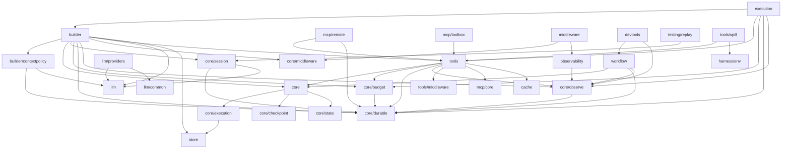

# GoAgent 架构概述

## 定位

GoAgent（`github.com/kart-io/goagent`）是 Go 的 Agent 执行内核：Builder 装配的原生工具循环、统一的工具执行路径（`tools.Dispatcher`）、可恢复的持久执行（`core/durable`）、追加写会话日志（`core/session`）、根预算（`core/budget`）、可选观察（`core/observe`）和类型化图编排（`workflow`）。宿主装配入口是顶层 `execution`。

不在本仓库的内容：

- Preset 与编码工具（原 `harness/preset`、`tools/coding`）在独立仓库 `github.com/kart-io/goagent-harness`，它依赖 GoAgent，见 [Harness 迁移指南](../guides/HARNESS_MIGRATION.md)。
- 大部分可运行的业务示例在 `github.com/kart-io/goagent-examples`；本仓库 `examples/` 只保留少量示例。

## 技术栈

- Go 1.25（`go.mod`：`go 1.25.0`）
- 模型：`github.com/sashabaranov/go-openai`（OpenAI 兼容协议）、`google.golang.org/genai`（Gemini），其余提供方（Anthropic、Cohere、HuggingFace、Ollama、Kimi、SiliconFlow 等）见 `llm/providers`
- MCP：官方 `github.com/modelcontextprotocol/go-sdk`
- 观测：OpenTelemetry（trace/metric/OTLP gRPC 导出）、Prometheus client
- 日志：`github.com/kart-io/logger`
- JSON：`github.com/bytedance/sonic`（经 `utils/json` 封装）

## 包依赖

下图由 `go list -f '{{.ImportPath}} {{.Imports}}' ./...` 整理（不含 `examples/`、`cmd/`、测试；省略几乎所有包都依赖的 `errors`、`interfaces`、`utils/json`）。箭头表示“导入”。



`scripts/apicheck` 强制执行的导入边界见 [导入层级说明](IMPORT_LAYERING.md)。

## 包职责

| 包 | 职责 |
|----|------|
| `interfaces` | 共享接口与常量：`Tool`、`ToolInput/ToolOutput`、`MemoryManager`、`DocumentRetriever` 等 |
| `errors` | 统一错误类型与构造函数（含 panic 错误） |
| `core` | `Runnable[I,O]`、`StreamRunnable`、`RunnablePipe/Sequence`、`Callback`、panic 处理注册表、生命周期与 Runnable 注册表 |
| `core/state`、`core/checkpoint`、`core/execution` | Agent 状态、检查点（`Checkpointer`、`InMemorySaver`）、`Runtime` 与旧流式类型 |
| `core/durable` | 显式、带版本的持久操作：`Do`、`Runner`、`Store`（`FileStore`）、等待与审批 |
| `core/session` | 追加写会话事件日志：`Store`（`MemoryStore`/`FileStore`）、`DeriveMessages`、`DurableStore` |
| `core/budget` | 根执行的模型请求、预留 Token、工具次数与期限预算，`New` 与 `NewDurable` |
| `core/observe` | 只读执行事件与 OTel 上下文传递，`Observer`、`AsyncObserver` |
| `core/middleware` | Agent 级请求/响应中间件链（`Middleware`、`MiddlewareChain`） |
| `core/flow` | 实验性的同步只读增量管道 |
| `builder` | `AgentBuilder` / `ConfigurableAgent`：原生工具循环、循环钩子、会话日志、持久回合、`Handle` |
| `plugin` | Agent 能力包：Host 启停、共享资源、Install 装进 Builder |
| `builder/contextpolicy` | 超长工具结果卸载（`Offload`）与证据存储（`ResultStore`） |
| `tools` | `Registry`、`Dispatcher`、`Pipeline`（Pre/审批/Guard/Around/Post）、`FunctionTool`、`NewRunnableTool` |
| `tools/compute`、`tools/http`、`tools/search`、`tools/shell` | 内置工具 |
| `tools/middleware` | 工具级中间件（日志、缓存、限流） |
| `tools/policy`、`tools/spill` | 按工具名/命令前缀的权限规则；超长结果落盘与 `read_spill` |
| `llm`、`llm/providers`、`llm/common`、`llm/cache`、`llm/constants` | 模型客户端接口与能力接口（`StreamClient`、`ToolStreamClient` 等）、各提供方实现、语义缓存 |
| `workflow` | 类型化有界控制流图 `Graph[T]`，`Compile` / `CompileDurable` |
| `workflow/refund` | 绑定事务的退款防护示范实现 |
| `execution` | 宿主装配：`Scope` 组合 RunID、会话、日志、预算、期限与观察者 |
| `memory`、`store`、`cache` | 对话/向量记忆、键值存储（`store/memory`）、通用缓存 |
| `mcp/core`、`mcp/remote`、`mcp/toolbox`、`mcp/tools` | MCP 工具抽象、官方 SDK 客户端适配、本地工具箱 |
| `middleware`、`observability` | Agent 中间件实现（LLM 工具选择、动态提示词、可观测性等）；OTel 遥测提供者、指标与跨服务追踪 |
| `parsers` | 输出解析器（JSON、结构化、列表、枚举等） |
| `harness/env` | 文件系统与命令执行的环境接口（本地、Docker、只读、检查点包装） |
| `devtools` | 观察事件记录与图报告 |
| `evaluation/...` | 离线评测：`agentbench`、`executionbench` |
| `testing/...` | `mocks`、`testutil`、`replay`（会话日志回放回归）、`panictest` |

## 核心概念

### Agent 与 Runnable

`builder.NewAgentBuilder[C, S](client)`（或 `NewSimpleBuilder`）配置后经 `Build()` / `BuildContext(ctx)` 得到 `*ConfigurableAgent`。推荐入口 `agent.AsRunnable()` 返回 `*core.StreamRunnable[any, *builder.AgentOutput]`，`Invoke` 与 `Stream` 共享 `ExecuteStream` 同一执行源。完整契约见 [执行契约](../guides/EXECUTION_CONTRACT.md) 与 [扩展契约](../guides/EXTENSION_CONTRACT.md)。

客户端实现 `llm.ToolStreamClient` 且配置了工具时，走原生工具循环：每轮一次 `CompleteToolsStream`，模型返回工具调用则执行并追加 `tool` 消息，返回文本则结束；`WithMaxIterations` 限制模型请求次数。

### 工具执行

工具实现 `interfaces.Tool`（`Name`/`Description`/`ArgsSchema`/`Invoke`）。注册到 `tools.Registry` 后由 `tools.NewDispatcher` 快照，`Dispatcher.Tools()` 交给 `WithTools`，Builder 与 `workflow` 节点共用这一条路径：Schema 校验 → `Authorize` → `Pipeline` 准入 → 执行（`durable.Do` 记录）→ `OnResult`。持久运行要求每个工具都支持持久调用（如 `Dispatcher.Tools()`）。

### 持久执行与会话日志

宿主在 ctx 上绑定执行键与日志：`durable.WithJournal(durable.WithExecutionKey(ctx, key), store)`，并用 `WithDurableScope` 给 Agent 稳定作用域。模型回合（`model/turn/N`）、工具调用（`tool/<CallID>`）和循环扩展点（`loop/pre/N`、`loop/stopping/N` 等）各为一条持久操作，相同执行键重新执行时回放已完成的操作。`session.DurableStore` 让这些快照与对话写进同一份会话日志，`WithSessionLog` 从日志推导历史。见 [core/session](../../core/session/README.md)。

### 预算、观察与宿主装配

`core/budget.Controller` 在根执行上限制模型请求与期限，经 ctx 传递；绑定日志时须用 `NewDurable`。`core/observe.Observer` 只读接收 agent/model/tool 事件。`execution.NewScope` → `Scope.Bind` → `execution.ConfigureBuilder` 把这些身份与资源一次装配好，见 [宿主接入](../guides/HOST_INTEGRATION.md)。

### 编排

`workflow.NewGraph[T]` 用 `AddNode`/`AddRunnable`/`AddEdge`/`AddBranch`/`AddParallel` 定义有界图，`Compile` 得到 `*core.StreamRunnable[T, T]`，`CompileDurable` 得到可暂停、审批与恢复的 `DurableGraph`。见 [原生编排](../guides/NATIVE_ORCHESTRATION.md)。

## 示例

以下代码以本仓库当前 API 编译通过：注册工具、经 Dispatcher 交给 Builder，并以持久模式运行。

```go
func run(ctx context.Context, client llm.Client, store session.Store, sessionID, runKey string) (*builder.AgentOutput, error) {
	reg := tools.NewRegistry()
	if err := reg.Register(tools.NewFunctionTool("lookup_order", "按订单号查询订单",
		`{"type":"object","properties":{"id":{"type":"string"}},"required":["id"]}`,
		func(ctx context.Context, args map[string]any) (any, error) {
			return map[string]any{"id": args["id"], "status": "shipped"}, nil
		})); err != nil {
		return nil, err
	}
	dispatcher, err := tools.NewDispatcher(reg, tools.DispatchConfig{ReturnArgumentErrors: true})
	if err != nil {
		return nil, err
	}
	// 持久运行：模型回合与工具调用记入会话日志，同一 runKey 重新执行时回放已完成的操作。
	ctx = durable.WithJournal(durable.WithExecutionKey(ctx, runKey), session.DurableStore(store, sessionID))
	agent, err := builder.NewSimpleBuilder(client).
		WithSystemPrompt("你是订单助手").
		WithTools(dispatcher.Tools()...).
		WithMaxIterations(5).
		WithSessionID(sessionID).
		WithSessionLog(store).
		WithDurableScope("order-assistant").
		BuildContext(ctx)
	if err != nil {
		return nil, err
	}
	return agent.AsRunnable().Invoke(ctx, "订单 A-1 到哪了？")
}
```

`client` 须实现 `llm.ToolStreamClient`；`llm/providers` 中 `OpenAIProvider`、`DeepSeekProvider`、`GeminiProvider` 实现了它。

## 相关文档

- [导入层级说明](IMPORT_LAYERING.md)
- [组件关系图](COMPONENT_DIAGRAM.md)
- [设计概述](../design/DESIGN_OVERVIEW.md)
- [快速入门](../guides/QUICKSTART.md)
- [LLM 提供商指南](../guides/LLM_PROVIDERS.md)
- [测试最佳实践](../development/TESTING_BEST_PRACTICES.md)
