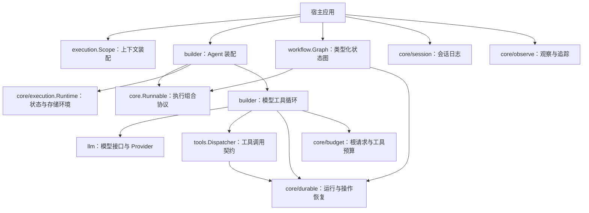

# GoAgent 架构概述

本文以当前仓库源码为准，描述已实现能力。研究、历史设计和评测报告中的规划不等同于当前公共 API。

GoAgent 是嵌入 Go 应用的 Agent 执行与编排框架，提供原生模型工具循环、类型化状态图、持久恢复、预算和观察。业务规则、专业角色与团队组织由宿主组合实现。

## 两种执行方式，共用组合接口

- **Agent 循环**：Builder 装配模型、工具和扩展点，经 `agent.AsRunnable()` 运行。原生工具循环由模型动态选择下一步。
- **状态图**：`workflow.Graph[T]` 用代码声明节点、条件分支、循环和显式并行汇合，编译成 Runnable。节点可以是普通函数、Agent 或子流程。
- **统一组合**：`core.Runnable[I,O]` 提供 Invoke、Stream、Batch、Pipe、配置与回调。异构输入输出通过 `workflow.Adapt` 显式映射。

图表示职责与主要集成点，不是逐文件 import 清单。真实导入约束见 [导入层级](IMPORT_LAYERING.md) 与 [检查器](../../scripts/apicheck/main.go)。

## 模块职责

| 模块 | 已实现职责 |
| --- | --- |
| `core` | 泛型 Runnable、组合器、基础状态与 Agent 类型 |
| `builder` | ConfigurableAgent、AsRunnable、Handle、循环钩子、检索与上下文装配 |
| `workflow` | Graph、Adapt、显式并行、节点/分支级恢复、审批和诊断 |
| `execution` | 宿主 RunID、SessionID、日志、预算、期限和 Observer 的薄层装配 |
| `llm` | Client、StreamClient、ToolStreamClient、消息与 Provider 实现 |
| `tools` | Tool 注册、Dispatcher、Pipeline、Runnable 工具适配 |
| `core/durable` | Store、运行/操作记录、稳定执行键、等待与恢复 |
| `core/session` | 追加式会话日志、历史推导、Fork/Rewind、durable 存储视图 |
| `core/budget` | 父子共享的模型请求、Token 预留、工具额度与期限 |
| `core/observe` | 只读事件、OTel 上下文关联、可选异步观察 |
| `core/middleware` | Builder 使用的请求处理链；与工具 Pipeline 分属不同层 |
| `memory`、`core/checkpoint` | 记忆接口实现和 Agent 会话状态检查点；不等同于工作流操作日志 |
| `harness/env` | 文件系统与执行环境能力 |
| `mcp`、`testing/replay`、`devtools` | MCP 接入、记录回归重放、拓扑及观察报告 |

## 状态与恢复边界

普通图节点 `Node[T]` 返回完整 T。引用字段不会自动深复制；并行分支显式提供 Clone 与 Merge。单条边只有一个后继，动态选择使用 AddBranch；多分支 AND 汇合使用 AddParallel。

`Compile` 是内存执行，`CompileDurable` 保存节点边界及分支结果。节点效果与图检查点不构成跨服务事务；业务副作用应通过 Dispatcher/durable 操作记录及业务幂等键管理。恢复时保留 RunID、作用域、配置版本和调用身份。

Router 应为纯函数：模型决策放在节点里，边只根据已保存状态选择目标。Stream Done 表示调用结束，不保证审批中的业务已完成；检查 GraphSnapshot.Waiting、Done 和 Preview。

会话消息日志、Agent 会话检查点、工作流状态、工具操作和长期记忆职责不同。Fork/Rewind 消息不会撤销外部效果或 durable 快照。框架不提供通用分布式任务调度或业务补偿。

## 独立仓库边界

- [goagent-harness](https://github.com/kart-io/goagent-harness)：Preset、技能、计划模式、上下文压缩、子 Agent 组件与编码工具。核心不反向依赖它。
- [goagent-contrib](https://github.com/kart-io/goagent-contrib)：检索、加载器、业务集成和多实例存储扩展。不能当作当前模块的内置包导入。
- [goagent-examples](https://github.com/kart-io/goagent-examples)：业务流程与真实/离线模型验证案例。

## 阅读顺序

[快速入门](../guides/QUICKSTART.md) → [核心 API](../api/CORE_API.md) → [Builder](../guides/BUILDER_API_REFERENCE.md) → [Workflow](../../workflow/README.md) → [执行契约](../guides/EXECUTION_CONTRACT.md) → [宿主接入](../guides/HOST_INTEGRATION.md)。
