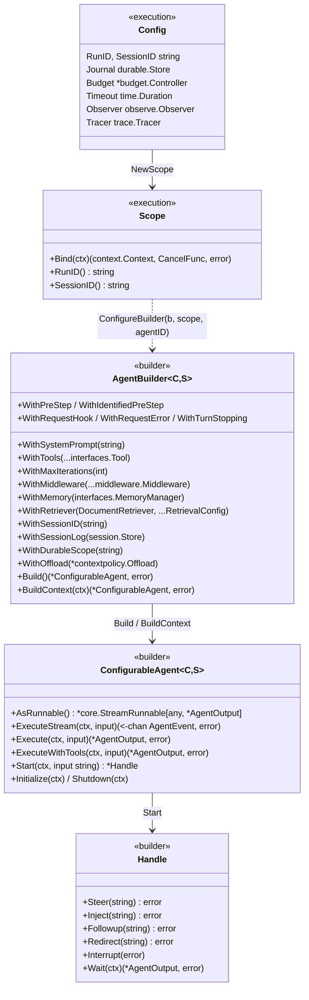
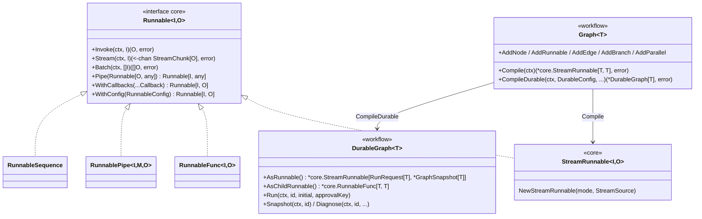
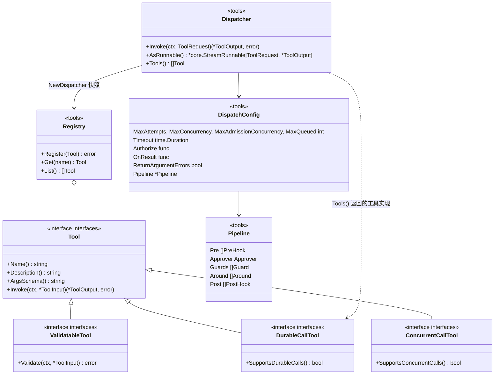
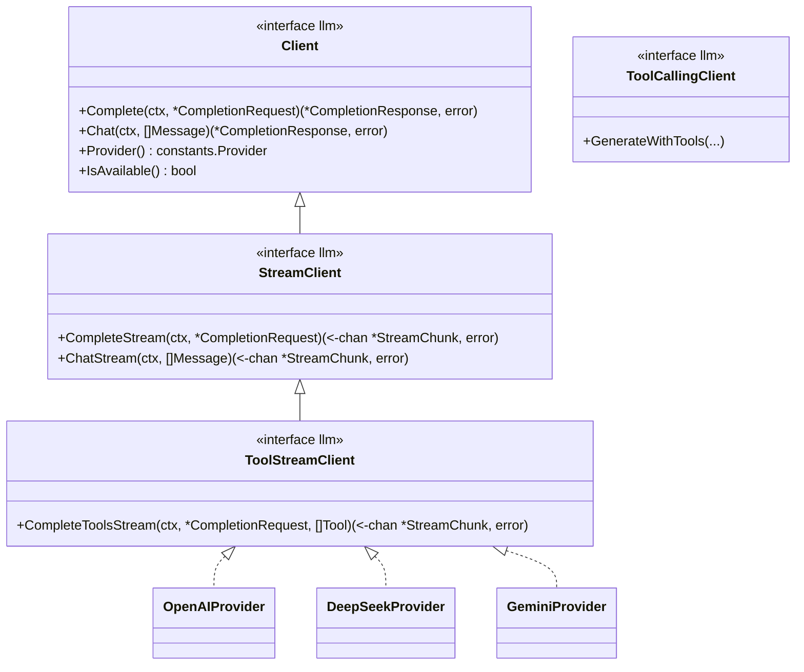
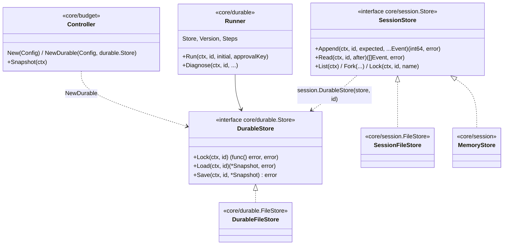

# GoAgent 组件关系图

图中的包、类型与方法均取自当前源码；只列出与组件关系有关的成员，完整签名以 `go doc` 为准。包级依赖图见 [架构概述](ARCHITECTURE.md#包依赖)。

## Builder 与宿主装配

`SimpleAgentBuilder` 与 `SimpleAgent` 是 `C=any, S=*core.AgentState` 的别名，`NewSimpleBuilder` 创建前者。

## Runnable 组合

`workflow.Adapt` / `AdaptStream` 把任意 `core.Runnable[I, O]`（如 `agent.AsRunnable()`）适配为图节点；`tools.NewRunnableTool` 反向把 Runnable 包装为工具。

## 工具系统

内置实现：`tools.FunctionTool`（`NewFunctionTool` / `NewTypedFunctionTool` / `NewFunctionToolBuilder`）、`tools/compute`、`tools/http`、`tools/search`、`tools/shell`、`tools/spill`、`contextpolicy.Offload`（读取工具）、`mcp/remote.Tools`（MCP 远程工具）。`tools/policy.Policy` 作为 `Pipeline` 的调用前钩子使用；`tools/middleware` 提供日志、缓存、限流工具中间件。

## LLM 客户端

能力探测用 `llm.HasStreaming`、`HasToolStreaming`、`HasToolCalling` 等函数。Builder 的原生工具循环要求 `ToolStreamClient`；只实现 `ToolCallingClient` 的客户端走旧的工具选择路径，不支持持久日志与根预算。

## 持久执行、会话与预算

`durable.Do(ctx, id, input, policy, run)` 是 Agent 持久子操作（模型回合、工具调用、循环扩展点）的共同入口，ctx 上须有 `WithJournal` 与 `WithExecutionKey`；`workflow.DurableGraph` 用 `DurableConfig` 中的 `durable.Store` 保存图快照。`testing/replay` 读取会话日志做回放回归。

## 相关文档

- [架构概述](ARCHITECTURE.md)
- [导入层级说明](IMPORT_LAYERING.md)
- [设计概述](../design/DESIGN_OVERVIEW.md)
