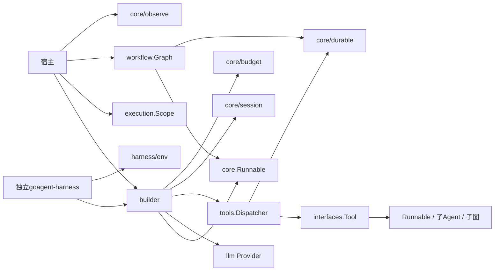
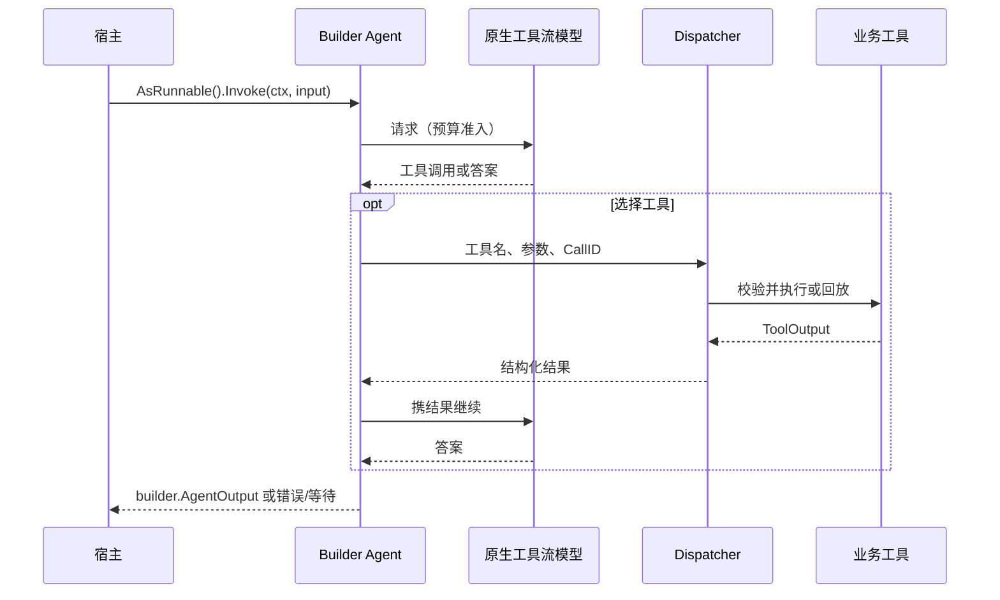

# GoAgent 组件关系

当前模块职责见 [架构概述](ARCHITECTURE.md)，API 见 [核心参考](../api/CORE_API.md)。图中仅包含当前仓库或明确独立的模块，不将旧 agents、multiagent、distributed、planning、retrieval 目录当成当前内置实现。

以上是集成关系，不表示所有箭头都为直接 Go import。精确导入约束见 [分层检查](IMPORT_LAYERING.md)。核心不依赖独立 Harness；业务示例位于 goagent-examples。

模型循环不是每轮必定调用工具。真正的业务完成须结合最终状态判断，审批等待和预览不能作为完成证据。
