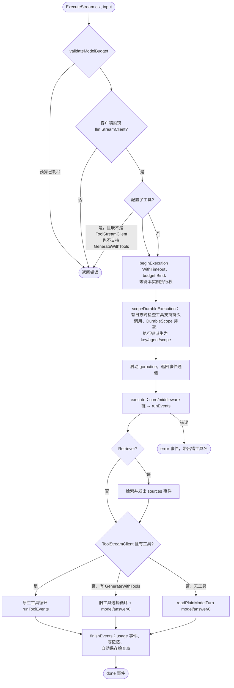
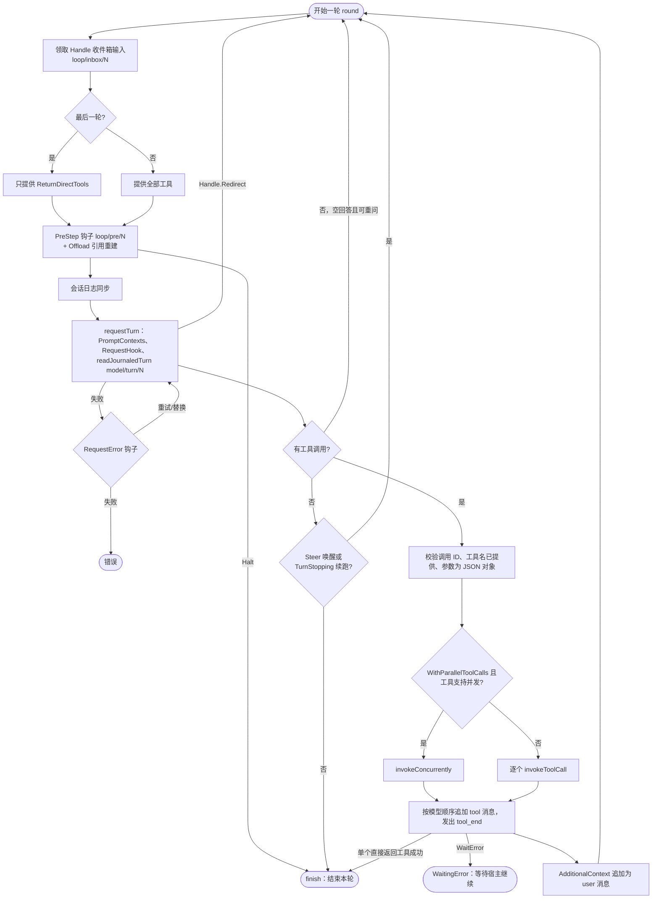
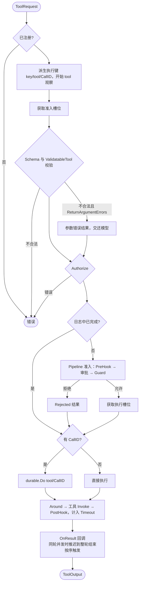
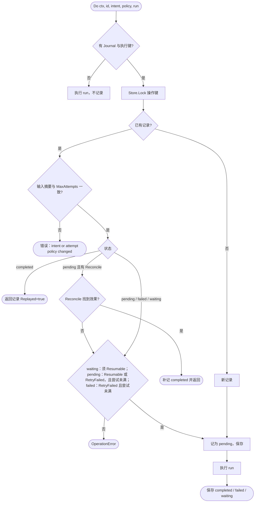
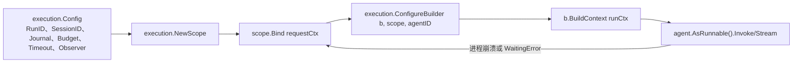

# GoAgent 流程图

流程按当前源码整理，节点名称对应实际函数；细节以源码为准。

## 1. 执行入口：ExecuteStream

`AsRunnable().Invoke/Stream` 都经过此入口（`builder/events.go`）。

会话日志（`WithSessionLog`）只支持原生工具循环；根预算与持久日志也不支持旧工具选择路径。

## 2. 原生工具循环

`runToolEvents`（`builder/tool_events.go`）每轮一次模型请求，`WithMaxIterations` 包含最终答案那一次。

额度用尽时返回“模型调用达到 MaxIterations 上限”的错误，最近一次工具失败时附上其信息。

## 3. Dispatcher 工具调用

`Dispatcher.invoke`（`tools/dispatcher.go`）。Builder 经 `Dispatcher.Tools()` 进入，`workflow` 节点可经 `Dispatcher.Invoke` 或 `AsRunnable()` 进入。

## 4. 持久操作 durable.Do

`core/durable/operation.go`。ctx 上没有日志或执行键时直接执行，不留记录。

## 5. 宿主装配与恢复

恢复时用相同 RunID、agentID、预算版本与配置重新执行这一链路，已完成的模型回合与工具调用被回放。见 [宿主接入](../guides/HOST_INTEGRATION.md)。

## 相关文档

- [时序图](SEQUENCE_DIAGRAMS.md)
- [设计概述](DESIGN_OVERVIEW.md)
- [架构概述](../architecture/ARCHITECTURE.md)
