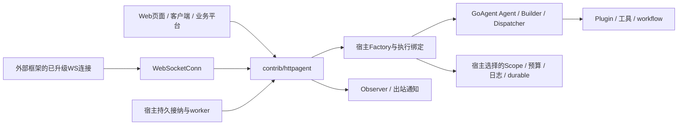

# HTTP Agent：内核与网络扩展的设计边界

本页是GoAgent仓库的正式设计入口。网络模块的完整已实现设计位于goagent-contrib的 [httpagent/docs/DESIGN.md](https://github.com/kart-io/goagent-contrib/blob/master/httpagent/docs/DESIGN.md)，公开接口基线为cfb3e85。使用与版本信息见 [接入指南](../guides/HTTP_AGENT.md)。

## 组件与定位

GoAgent不因新增HTTP或Web页面变成特定业务平台。主库保留通用执行内核，contrib隔离网络协议和第三方帧依赖，examples展示业务装配与页面；宿主负责身份、路由、存储、队列及共享资源。

## 必须保持的契约

| 设计点 | 原因 |
| --- | --- |
| Native显式绑定原生事件路径，Answer显式普通回答 | 保留工具循环，避免误判能力或失败后重执行业务 |
| 先登记再构建/升级 | 构建中停服、迟到资源和连接都必须有所有者 |
| 原生候选终态后等事件流关闭再冻结 | 结果可见不应意味着仍执行中的资源已被释放 |
| 未确认退出只报告未确认，不伪造业务终态 | 网络失败不能当作副作用未发生或运行已结束 |
| Cleanup、通知和受管Report全部保留资源责任 | Shutdown不能在仍有活动工作时宣称成功 |
| 终态、返回值和通知独立JSON快照 | 防止观察者或worker修改结果污染其他目标 |
| queued先持久接纳，独立worker调用同一Run | 快速ACK与业务执行分离，不以goroutine冒充队列 |
| WS读写依赖接口，Gorilla是默认具体实现 | 外部框架可适配连接，原接入方式不变 |

详细状态示意、HTTP/SSE提交时机、WS时序、队列背压与接纳/通知流程在扩展设计中维护。Config、协议字段和错误码以 [扩展API参考](https://github.com/kart-io/goagent-contrib/blob/master/httpagent/docs/API_REFERENCE.md) 为准，避免在主库重复维护签名表。

## 持久与并发责任

HTTP适配器不默认启动图引擎或持久化全部业务。Factory可组合现有执行Scope、日志、预算和durable能力。Acceptor/队列/outbox仍由宿主实现；Handler.Run只复用执行管道，不缓存已完成运行，稳定RunID不自动形成只执行一次保证。

一连接一个运行不等于多个连接/实例共用会话时串行。共享SessionID需要宿主锁/租约；工具副作用恢复仍依赖核心durable契约和业务幂等。

框架自行升级的WS连接在交付ServeWebSocket前由宿主完成Origin、认证与子协议校验，交付后Handler接管运行和关闭；未交付握手仍由框架管理。无需net/http升级入口的框架也可只实现WebSocketConn。

## 设计记录与证据

- [原始方案及后续实施修订](../superpowers/specs/2026-10-31-http-agent-design.md)：设计演进记录。
- [实施与验收计划](../superpowers/plans/2026-10-31-httpagent-webhooks.md)、[实现验收](../evaluation/2026-10-31-httpagent-implementation/REPORT.md)。
- [可替换WebSocket接口验收](../evaluation/2026-10-31-websocket-interfaces/REPORT.md)：默认实现、外部宿主包装及浏览器验证。

历史方案中的讨论以当时基线为准，当前公开文档以扩展使用指南/设计/API参考及对应源码为准。没有承诺生产队列后端、平台验签全适配、跨连接回放或强停任意Go函数。
