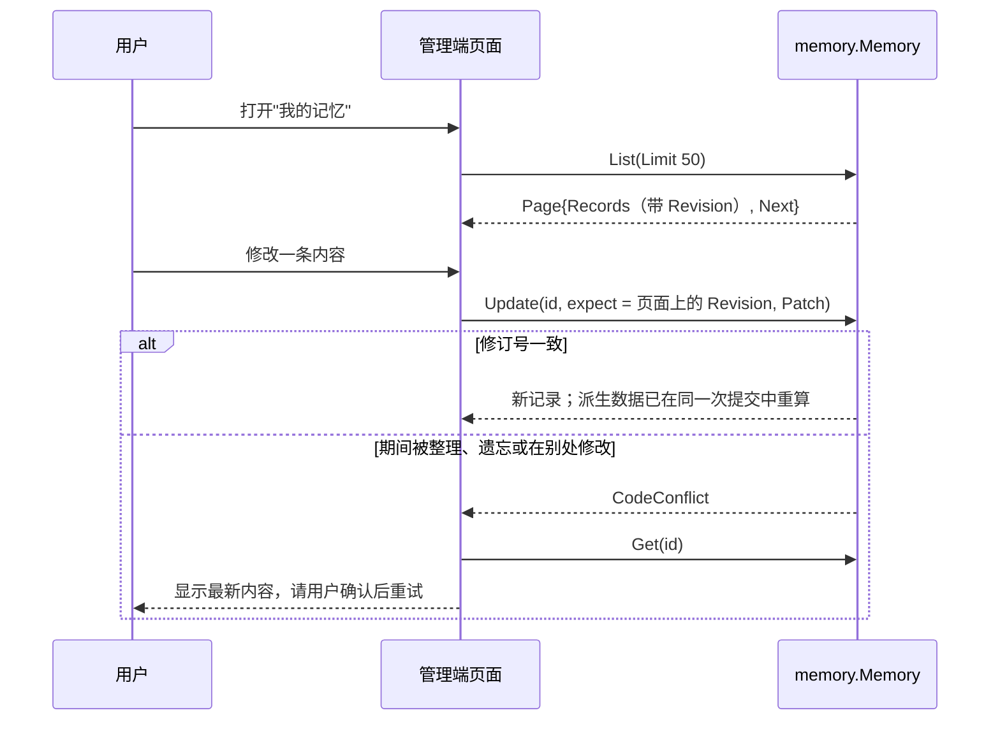
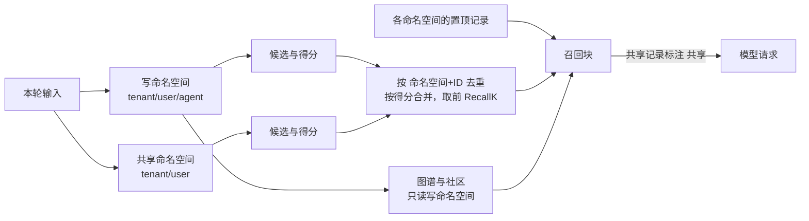

# 长期记忆的管理功能：实现文档

日期：2026-11-11。状态：待实施，排在 [长期记忆的删除优先](MEMORY_GOVERNANCE.md) 的 G2 之后。

本文的两项功能原本是删除优先文档的 G4、G5。它们与删除承诺无关，所以单独成文。本文沿用删除优先文档的存储与版本体系：命名空间 `state` 快照、作用域 ID、`Incarnation`、`Revision`，以及 `Update`。

## 1. 管理端分页列表

```go
type ListOptions struct {
    Kinds          []Kind
    IncludeInvalid bool
    Cursor         string
    Limit          int // 默认 DefaultMemoryListLimit（50），上限 MaxMemoryListLimit（200）
}

type Page struct {
    Records []Record
    Next    string
}

func (m *Memory) List(ctx context.Context, opts ListOptions) (Page, error)
```

- **读取**：读取当前作用域的 `state` 快照，在内存中过滤和排序。快照是一次性读出的，所以每一页内部是一致的。
- **排序**：固定为 `CreatedAt` 降序、`ID` 降序。`Remember` 只创建，`Update` 不修改 `CreatedAt`，所以排序键稳定。
- **游标**：编码了命名空间摘要、作用域 ID、过滤条件摘要、排序版本，以及上一页最后一条记录的 `CreatedAt` 和 `ID`。以下情况会返回 `CodeInvalidInput`：
  - 拿到别的命名空间使用。
  - 换了过滤条件使用。
  - 在 `Purge` 之后使用（作用域已经变了）。
- **一致性**：分页之间是弱一致的。翻页期间新写入的记录可能不会出现；在两页之间被物理删除的记录会消失；已经出现过的记录不会再次出现，但同一个 ID 在物理删除后重建的情况除外，因为重建后的记录有新的实例号。
- **不新增模型工具。**



测试：
- 没有并发写入时，分页既不重复也不遗漏。
- 过滤条件生效。
- 游标被用于别的命名空间、别的过滤条件，或在 `Purge` 之后使用时，返回错误。

## 2. 私有加共享的多命名空间读取

```go
// WithSharedNamespaces 追加只读的共享命名空间，如 {租户, 用户} 下多个 Agent 共用的偏好。
// 须与 WithNamespace 同时使用；写入、修改、遗忘只作用于 WithNamespace 绑定的写命名空间。
func WithSharedNamespaces(ctx context.Context, shared ...[]string) context.Context
```



- **约束**：共享命名空间必须合法，且不能与写命名空间相同，数量不超过 `MaxMemorySharedNamespaces`（4）。每个命名空间各读一份快照。
- **快照与授权**：
  - 共享命名空间在轮次开始时记入 `TurnMemory.Read`。
  - 快照中的引用会带上各自的命名空间和作用域 ID。
  - 恢复运行时，宿主按当前身份重新绑定命名空间；`Hydrate` 会丢掉命名空间已经不在当前绑定内的引用，也就是说授权一旦被移除，对应内容就不会再发给模型。
- **身份与去重**：召回结果、快照引用和 `memory_search` 的输出，都用 `(命名空间, ID)` 来标识记录，去重也按这对值进行。
- **写入只针对写命名空间**：
  - Worker 整理时只读写命名空间，共享记录不会成为整理目标。
  - `Get`、`Update`、`Forget` 只在写命名空间中查找。用共享记录的 ID 调用时，如果写命名空间里没有同 ID 的记录，就返回未找到；如果有，操作的是写命名空间里的那一条。
- **图谱只读写命名空间。** 跨空间的实体合并需要单独设计。
- **授权以宿主为准。** 命名空间只是宿主给出的字符串，本包不判断授权。

测试：
- 两个空间的记录按得分合并。
- 同 ID 不同空间的记录互不干扰。
- Worker 不修改共享记录。
- 写命名空间里没有同 ID 时，`Forget` 共享记录的 ID 返回未找到。
