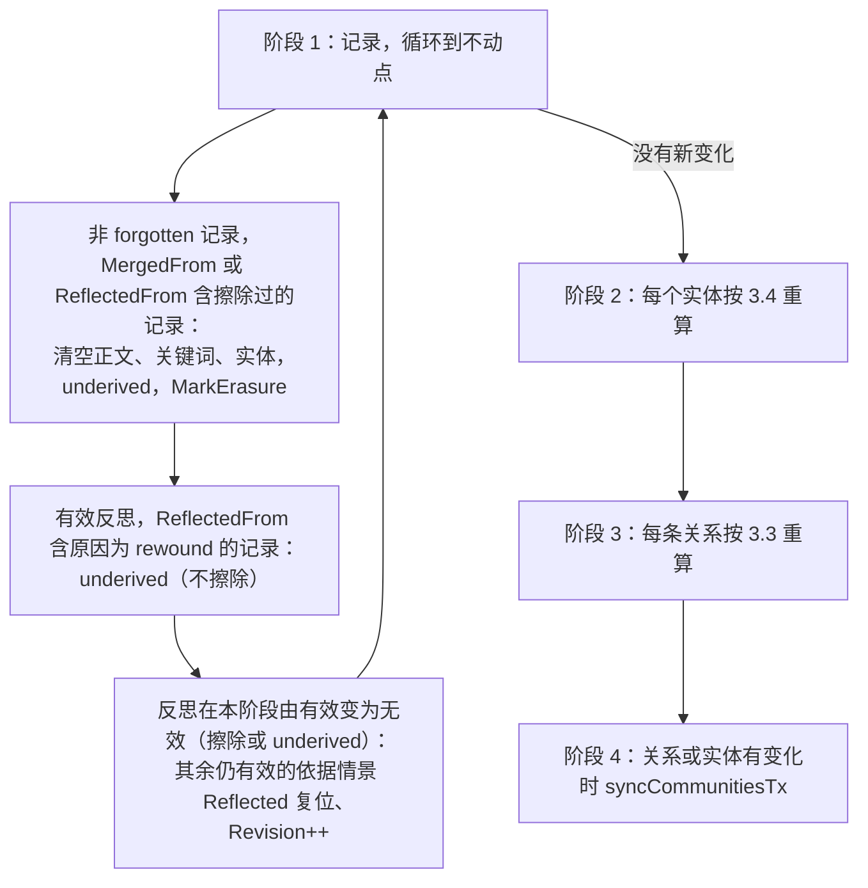
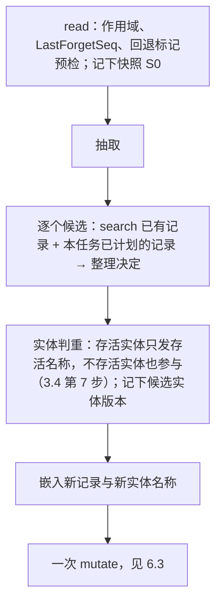

# 长期记忆 G2：派生与整理的实现设计

日期：2026-11-13。状态：第 3 版（含复审补充），待用户批准。基线：分支 `feat/memory-g0-recall`，HEAD `6cf097ee`（G0、G1 与 Request 钩子测试，已推送）。

本文是 [长期记忆的删除优先](MEMORY_GOVERNANCE.md) 第 4 节的实现设计。目标与取舍以那份文档为准，本文只写落地所需的盘点、数据模型、操作语义、拆分与验证。G1 的存储原语（`mutate`、`tx`、覆盖层、擦除）见 [G1 存储](MEMORY_G1_STORAGE.md) 与 [增量提交](MEMORY_G1_INCREMENTAL.md)，本文直接使用。

修订经过：
- 第 1 版经独立评审（Backend Architect agent）退回，62 分：4 项阻断、14 项重要、7 项建议、4 个疑问。
- 第 2 版逐条处理，对照见第 10 节。主要变化：
  - 级联由"按种子传播"改为"按状态求值"。
  - 实体名称的来源随合并转移，名称"存活"的状态物化保存。
  - 关系与名称的每个来源都带会话来源，回退直接删除这些来源。
  - 社区指纹纳入陈述与名称。
  - 整理的复核以任务开始前的状态为准。
  - 任务统计改用新字段 `Finished`，不改变 `DoneJobs` 的类型。
- 第 2 版经复审退回，74 分：3 项阻断、8 项重要。第 3 版的处理见第 12 节。主要变化：
  - `settle` 先算实体再算关系；陈述对所有关系重算。
  - 回退在删除任何来源之前记下有效关系集合。
  - 取消来源上限；版本落后的派生与来源直接删除。
  - 反思只因依据被遗忘或回退而失效。
  - 整理决定复核失败时降级为 add，不丢弃。
  - 状态编码升到 `memory-state-blob/3`。
- 第 3 版复审 85 分，结论"需讨论，倾向有条件通过"，无阻断。3 项重要意见已补入本版，复审认为补完即可进入 G2a，不必再整版复审。对照见第 13 节。
- 用户确认（2026-11-13）：回退点切开一个轮次时，整轮视为被回退，并为可见部分补登抽取任务（第 4 节第 3 步、第 5 节）。

**用户决策（2026-11-13）**：
1. 因遗忘而 underived 的合并记录与反思：清空正文并物理擦除。
2. G1 写入的旧关系与旧实体：读取时过滤，由 `Prune` 删除。
3. 任务结果保留统计。第 2 版的实现方式：新增结构体字段 `Finished`，见 2.4。
4. 实施前先做独立评审。

**范围**：
- 包含：关系的派生与陈述、实体名称来源、合并记录与反思的依据、级联重算、Worker 单次提交、回退标记与任务丢弃规则、`from` 抽取格式、任务统计。
- 不包含：纯聊天召回、下游仓库迁移、记忆投毒（治理文档 5.2）。

## 1. 现状盘点

以下均对照 `6cf097ee` 的代码确认。

| 项 | 现状 | 位置 | 与治理文档第 4 节的差距 |
|---|---|---|---|
| 关系来源 | `Edge.Source` 单个；`Fact` 是第一次抽取的措辞 | `memory/graph.go` `applyRelations` | 没有派生；同一关系再次抽取时直接跳过（`graph.go:334-339`） |
| 关系失效 | 只有 `InvalidAt` 与 `SupersededBy`，没有原因 | 同上 | 回退无法区分原因 |
| 实体 | `Name`、`Aliases` 直接合并，不记录来源；向量键固定 `ContentRev: 1`，假设名称不变（`indexing.go:84-125`） | `putEntity`、`mergeAliases` | 遗忘后别名仍在，并继续发给判重模型 |
| 合并记录 | `reconcile` 的 `update` 写新记录、使旧记录 superseded；新记录继承旧记录的 `Sources` | `memory/worker.go` | 没有 `MergedFrom` |
| 反思 | `reflect` 写结论并设置情景的 `Reflected`；情景版本变化时跳过这条情景，结论照写（`worker.go:424-427`） | 同上 | 结论没有依据 |
| `Forget`、`Update` | 只改记录 | `memory/memory.go` | 不级联 |
| `Rewound` | 记录与关系按来源判断；恢复替代者被回退的 superseded 记录与关系 | 同上 | 关系按来源而不是按派生判断；不写回退标记 |
| Worker | 每个候选一次 `derive` 提交，关系、社区、反思、`Prune`、`finishJob` 各一次 | `process` | 崩溃后可能留下"新记录已写、旧记录未失效" |
| 任务丢弃 | `mutateOnce` 锁内核对作用域与 `LastForgetSeq > TurnSeq`（`durable_state.go:231-238`） | — | 没有回退标记 |
| 社区 | 指纹只由成员 ID 与有效边 ID 计算（`community.go:104-108`）；摘要提交时只复核边版本（`community.go:213-215`） | `memory/community.go` | 陈述或名称变化时社区不会删除 |
| 对象拷贝 | `edgeKind.clone` 原样返回，`entityKind.clone` 只复制 `Aliases`（`state_tx.go:214-229`） | `memory/state_tx.go` | 新增的切片与映射字段必须深拷贝 |

可复用：
- `tx` 的表接口（`Get`/`Put`/`Delete`/`MarkErasure`）。
- `syncCommunitiesTx`。
- `jobBinding` 与 `mutateOnce` 中的任务核对。
- "锁外嵌入、锁内创建、提交后写索引"的写入模式。
- `queueIndex` 登记与 `Reindex(false)`：它会补写缺失的向量、删除过期的键。

## 2. 数据模型

### 2.1 类型

```go
// RecordRef 指向记录的一个版本。
type RecordRef struct {
    ID          string `json:"id"`
    Incarnation int64  `json:"incarnation"`
    ContentRev  int64  `json:"content_rev"`
}

// Origin 是关系或实体名称的一个来源：依据的记录，以及产生它的轮次（用于回退）。
type Origin struct {
    Record RecordRef `json:"record"`
    Source Source    `json:"source"`
}

// Derivation 是关系的一次派生。At 是对话时间（turnTime），整理转移时沿用原值。
type Derivation struct {
    Origin
    Fact string    `json:"fact"`
    At   time.Time `json:"at"`
}

// EntityName 是实体的一个名称（规范化前的原文）及其来源；Live 由级联物化。
type EntityName struct {
    Name    string   `json:"name"`
    Origins []Origin `json:"origins"`
    Live    bool     `json:"live"`
}

type Edge struct {
    // ...现有字段；Source 删除
    InvalidReason InvalidReason `json:"invalid_reason,omitempty"` // superseded | underived
    Sources       []Source      `json:"sources,omitempty"`        // 由 Derivations 物化，只用于 Retrieval.Sessions
    Derivations   []Derivation  `json:"derivations,omitempty"`
    // Fact：成立派生中 At 最新的一条（同时间按记录 ID）；派生被全部删除时清空
}

type Entity struct {
    // ...现有字段；Aliases 保留为物化值：除 Name 以外仍存在的名称
    Names []EntityName `json:"names,omitempty"`
    Live  bool         `json:"live,omitzero"` // 至少一个名称存活
    // ContentRev 只在 Name 改变时加一；向量键使用它（I14）
}

type Record struct {
    // ...现有字段
    MergedFrom    []RecordRef `json:"merged_from,omitempty"`    // 整理 update 时展示给模型的全部候选（I9）
    ReflectedFrom []RecordRef `json:"reflected_from,omitempty"` // 反思依据的情景
}

const ReasonUnderived InvalidReason = "underived"
```

- **派生成立**：`Record` 指向的记录存在、有效，并且 `Incarnation`、`ContentRev` 都与当前一致。
- **名称存活**：至少一个 `Origin` 成立。实体存活：至少一个名称存活。
- **擦除过的记录**：forgotten，或者因依据被遗忘而 underived 的记录（正文已清空）。判断条件是 `Content == "" && !Valid()`，写成辅助函数 `erased(r)`。记录已不存在（被 `Prune` 删除）时 `erased` 为 false：删除前它已无效，依据它的对象此前已按它当时的状态处理过。
- **版本落后**：派生或来源指向的记录存在，但 `Incarnation` 或 `ContentRev` 与当前不同。二者只增不减，所以落后的派生永远不会再成立。
- **去重与规模**：
  - 同一关系的派生、同一名称的来源，都按记录 ID 去重，后写的替换先写的。
  - 上限 256 条。超出时先删不成立的，仍超出才删 `At` 最早的成立项。第 2 版的 16 条上限会让枢纽实体在最近来源被回退后整体失效（第 12 节 I1）；完全不设上限又会让"用户"这类实体的来源与记录数同量级，每次提交都整体深拷贝、写入覆盖层（第 13 节 I1）。
  - `settle` 删除版本已落后、或记录已不存在的派生与来源（3.3、3.4），不会无界累积。

### 2.2 拷贝、规范化与大小（I2）

- `recordKind`、`edgeKind`、`entityKind` 的 `clone` 深拷贝全部切片，包括 `Derivations`、`Sources`、`Names` 与其中的 `Origins`、`MergedFrom`、`ReflectedFrom`。
- `normalize` 把空切片归为 nil。
- `size` 计入新字段的长度，使 `MaxStateBytes` 不被低估。
- 修改函数只经 `Get` 取值，取得的就是深拷贝；`settle` 遍历 `table.m` 时只读。

### 2.3 回退标记

state 增加一张表 `Markers map[string]rewindMarker`（键为 `会话\x00Seq`）和一个标量 `MarkerHorizon int64`。

```go
type rewindMarker struct {
    Session string    `json:"session"`
    To      int64     `json:"to"`
    Seq     int64     `json:"seq"`
    At      time.Time `json:"at"`
}
```

接入点（I11）：
- `state`：字段、`init`、`clone`。
- `stateScalars`：`MarkerHorizon`，以及 `scalars()`、`working()`、解码时的赋值、`decodeState` 的构造、`tx` 的访问器。
- `stateChunk`、`split`、`decodeState`：键在映射的键上，用带键的结构，与 `doneJob` 相同。
- `overlay`：字段、`items`、`merge`、`after`、`erasing`、`apply`、`withNamespace`，以及 `decodeOverlay` 的 `seqsOf` 列表与项数核对。
- `tx`：`newTx`、`changed`、`working`、`overlay`，以及新的 `markerKind`。

### 2.4 任务统计（I10）

`DoneJobs map[string]time.Time` 的值类型不变。gob 不能把旧的 `time.Time` 解码为结构体，改类型会使 G1 写入的 state 整体无法读取。

另加一张表 `Finished map[string]jobStats`，接入点与 `Markers` 相同：

```go
type jobStats struct {
    Records   int `json:"records,omitzero"`   // 写入的记录
    Relations int `json:"relations,omitzero"` // 写入的派生
    Dropped   int `json:"dropped,omitzero"`   // 缺少合法 from 的关系
    Conflicts int `json:"conflicts,omitzero"` // 放弃的整理决定
}
```

- 任务完成时与 `DoneJobs` 在同一次提交中写入，`Prune` 与 `DoneJobs` 一起删除。
- `Job(ctx, key)` 返回的 `Job` 增加 `Stats` 字段。
- 治理文档第 7 节"完成的任务只保留键"同步改为"只保留键、完成时间与统计"。

### 2.5 G1 写入的旧数据

- 没有 `Derivations` 的关系视为无效。`Edge.Valid()` 改为 `InvalidAt.IsZero() && len(Derivations) > 0`，`ValidAt` 同样要求有派生（S1）。
- 没有 `Names` 的实体，`Live` 为 false，不参与判重、召回与向量候选。
- 二者由 `Prune` 显式删除：没有派生的关系、没有名称的实体，不依赖保留期。现状 `Prune` 对 `InvalidAt` 为零值的关系因时长饱和而立即删除，这是偶然行为，改为显式条件并加测试。
- **编码版本**：新增与删除字段在 gob 中都能解码，但旧程序读到新 blob 会静默丢弃 `Derivations`、`Names`，写回后全部关系失效。所以 `stateBlobVersion` 升为 `memory-state-blob/3`（`state_codec.go:21`）：新程序能读 `/2` 与 `/3`，只写 `/3`；旧程序遇到 `/3` 拒绝读取。head 同样升为 `memory-head/3`（`state_head.go:25`）：覆盖层与 `MarkerHorizon` 存在 head 里，只升 blob 时旧程序仍会读新 head 并丢弃新字段。`state_head.go:241` 与 `:337` 的严格相等改为接受 `/2` 与 `/3`。夹具测试覆盖 G1 写入的 blob 与覆盖层，以及"head `/3` 引用 base `/2`"（升级后、第一次压缩前的状态）。

## 3. 级联重算

### 3.1 入口与原则

`settle(t *tx, now time.Time) settled` 是纯函数，在 `tx` 内运行，**按当前状态求值**，不依赖本次修改了哪些记录（I1、B4）。多次运行的结果相同，所以：
- 只改置顶、重要度、`Reflected` 时，结果不变，也不产生写入。治理文档 4.4"不触发级联"由此成立。
- 恢复路径上被带回的对象会被重新核对（B4）。

调用方：`Forget`、`Update`（正文变化时）、`Rewound`、`Prune`、Worker 提交、`reflect` 的提交。返回的 `settled` 列出需要在提交后删除的索引键、需要重新嵌入的实体，以及有没有关系或实体发生变化。

调用方用 `beforeSave` 判断：本次提交会删除或新增向量时，在 queue 分片中登记 `queueIndex`。这条规则从 `Forget` 推广到所有调用 `settle` 的路径，以及创建记录的 Worker 提交。提交后写索引失败或崩溃留下的缺失与残留，由维护执行 `Reindex(false)` 补齐（I13）。

### 3.2 过程



- **阶段 1 只会让记录失效**，所以循环次数不超过记录数。实体只依赖记录，关系依赖记录与实体，二者都不反过来影响记录，因此先实体、后关系，各遍历一次就收敛。
- **反思的失效条件**与治理文档 4.1、4.2 一致：只有依据被遗忘（擦除）或回退才失效。依据情景被合并替代、因 TTL 或容量过期、或已被 `Prune` 删除，反思不受影响：反思本来就是为了在情景衰减后留存结论。
- 第 1 条对所有非 forgotten 记录生效，包括已经 superseded 的合并记录（B4）。被替代的合并记录如果之后被回退带回，正文已经清空，它也就无法恢复。
- 反思"复位其余情景"只在由有效变为无效的那一次执行。如果每次都执行，复位后再次参与反思的情景会被反复复位。复位时 `Revision++`，使正在进行的反思在 6.5 的复核中放弃。
- 遍历在 `table.m` 上进行，取出要修改的对象再经 `Get` 拿到副本。

### 3.3 关系的重算

1. 删除 `Record` 指向擦除过的记录、或版本落后的派生（B3、复审 I8）。只有前者对这条关系执行 `MarkErasure`：被遗忘内容的陈述可能已进入基础快照。版本落后的只删除不擦除，与 G1 的 `Update` 不擦除旧正文一致，避免每次修改正文都触发擦除与压缩。
2. 删除 `Record` 已不存在的派生。
3. **陈述**对所有关系重算，与原因无关（复审 B2）：`Fact` 取成立派生中 `At` 最新的一条；没有成立的派生时取剩余派生中最新的一条；派生被全部删除时清空。`Fact` 变化时 `ContentRev++`。因此 superseded 关系也不会保留被遗忘的陈述。
4. **有效性**：
   - 原因是 superseded：保持失效。
   - 否则，`Subject` 与 `Object` 实体都存在且存活、并有成立的派生时有效（原因是 underived 则恢复，`InvalidAt` 与原因清空）；否则失效，原因为 underived。
5. `Sources` 由派生的 `Source` 物化。
6. 有任何变化时 `Revision++`。

### 3.4 实体的重算（B2、I3、I14）

1. 删除 `Record` 指向擦除过的记录、版本落后、或已不存在的记录的来源。来源被删空的名称同时删除。因擦除过的记录而有删除时，执行 `MarkErasure`（I3）。
2. 重算每个名称的 `Live`，以及实体的 `Live`。
3. 名称全部被删除时，删除实体（`Delete` 本身带擦除），提交后删除它的向量键。
4. `Name` 被删除，或者 `Name` 不再存活而另有存活的名称时，`Name` 改为第一个存活的名称（按 `Names` 的顺序），`ContentRev++`，提交后重新嵌入。只有别名变化时不改 `ContentRev`。
5. `Aliases` 由 `Names` 物化。
6. 不存活、但名称未被删除的实体保留，不参与召回与社区。它们在替代者被回退、记录恢复时可以重新存活。
7. 判重时，不存活的实体也作为候选，但只发送它的名称（这些名称的来源都未被擦除）。命中时把新来源加到这个实体上，它随之存活，而不是另建一个同名实体（复审 I5）。

**索引**：
- `entityKey` 改用实体的 `ContentRev`。
- `entitySpace.current` 与 `entityCandidates` 改为比较 `Incarnation` 与 `ContentRev`，并要求 `Live`。
- 不存活的实体，其向量不被采用。

### 3.5 社区（B1）

- **指纹**：由成员、成员的 `Name`、以及各条事实关系的 `ID:ContentRev` 计算。陈述或名称一变，指纹就变，`syncCommunitiesTx` 删除这个社区（`Delete` 带擦除）。
- **复核依据**：`summarized.basis` 增加成员实体的 `(Incarnation, ContentRev)`，提交时一并复核。
- G1 写入的社区，指纹在升级后必然不同，第一次同步时会被删除重写。

## 4. 回退

`Rewound(session, to)` 在一次 `mutate` 中：

**回退的判定**：来源 `s` 被回退，当且仅当 `s.Session == session && s.To > to`，即这一轮有任何消息被遮蔽。`rewound`（`record.go:78`）由 `s.From > to` 改为此条件，记录、派生、名称来源共用。

原条件只看轮次起点，漏掉回退点切开轮次的情况。`session.Rewind`（`core/session/recorder.go:215`）允许 `to` 取任意序号；"重新生成回答"时 `to` 是用户消息的序号，被遮蔽的助手回复与工具结果都在同一轮里。按原条件，这一轮已写入的记录保持有效，被遮蔽回复中的事实留在记忆里，重新生成的回答还会再抽取一遍。

1. 记下此刻有效的关系集合 V。必须在任何删除之前：第 4 步删除派生后，替代者可能已不满足 `Valid()`（复审 B3）。
2. 写回退标记，并把本会话中 `To > to` 的 pending 任务置为 dropped（第 5 节）。即使没有其他变化，也必须提交。
3. **补登可见部分**：被切开的轮次（`From ≤ to < To`）的可见部分 `[From, to]` 仍要学习，否则用户消息里的事实随整轮丢失。
   - 被切开的轮次从现有记录与关系派生的 `Sources` 中收集，按 `(From, To)` 去重；第 2 步置为 dropped 的被切开任务也计入。`DoneJobs` 只存键，不能用来找区间。
   - 每个轮次补登一个任务：`Key = 会话/From/to`，`From`、`Aborted` 沿用原值，`To = to`，`Scope` 为当前作用域，`TurnSeq` 为本次提交的 `Seq`，所以不会被本次的标记丢弃（判定要求 `m.Seq > TurnSeq`）。
   - 同一次提交在 `beforeSave` 中 `register(queueJobs)`，与 `Enqueue` 相同。键已存在于 `Jobs` 或 `DoneJobs` 时跳过。
   - 多次回退自然递归：再回退到 `to' < to` 时，补登任务产出的来源 `{From, to}` 又被切开，再补登 `{From, to'}`；回退到 `From` 之前则整轮失效，不再补登。
   - Worker 处理补登任务时照常用 `session.Active` 读取，被遮蔽的消息本来就不在 `[From, to]` 内。记录 ID 由任务键决定，重做不重复。
4. 记录：与 G1 相同。来源被回退的有效记录改为 rewound；替代者的原因是 rewound 的 superseded 记录恢复。
5. 删除 `Source` 被回退的派生与名称来源（I5）。被回退轮次的措辞因此不会留下，包括 `noop` 映射到旧记录时产生的派生。
6. `settle`。
7. superseded 关系的恢复（I4）：替代者属于 V 但在第 6 步之后无效，就恢复这条关系，再运行一次 `settle` 核对它自己的派生。
   - 本次调用中只发生了回退，所以"替代者在本次调用中失效"等价于"因回退而失效"。替代者此前因遗忘而失效时，它不在 V 中，不会恢复。
   - 已有同三元组的有效关系时不恢复，避免出现两条相同的有效关系（S3）。
8. 恢复的记录重写向量，失效的删除向量。实体改名的重新嵌入，与第 3 节相同。

## 5. 回退标记与任务丢弃

- **判定范围**：`j.To > m.To`，与第 4 节的回退判定一致。Worker 在回退前读完对话、回退后才提交时，读到的可能包含被遮蔽的消息，所以切开的轮次整轮丢弃，由第 4 节第 3 步补登的任务重新学习可见部分。
- **为什么还需要标记**：复审建议去掉标记，只在 `Rewound` 中把 pending 任务置为 dropped。这只覆盖已登记的任务；回退发生时仍在进行、之后才登记的轮次（`TurnSeq` 早于回退，`To > to`）没有任务可置。所以两者都做：未登记的由标记在登记与提交时拦截；已登记的同样会被标记拦截，直接置为 dropped（第 4 节第 2 步）是为了让 `Job` 的状态立即可见，并计入 `DroppedJobs`。
- **登记**：`Enqueue` 也做下面的判定。命中的标记全部满足 `m.To < j.From` 时整轮被回退，登记为 dropped；否则（有标记切开本轮）把 `To` 截到命中标记中最小的 `m.To`，键改为 `会话/From/To`，`TurnSeq` 取本次提交的 `Seq`，按截断后的任务登记。
- **判定**：`jobBinding` 增加 `session`、`from`。`mutateOnce` 的任务核对增加两项，满足任一项就返回 `errJobStale`：
  - 存在标记 `m`：`m.Session == j.Session && m.Seq > j.TurnSeq && j.To > m.To`。
  - `j.TurnSeq < MarkerHorizon`。
- **预检**：Worker 读取任务时先做同样的判断，免去模型调用。
- **回收**：`Prune` 删除 `At` 超过 `InvalidRetention` 的标记，并把 `MarkerHorizon` 推进到被删除标记的最大 `Seq`。
- **中止的轮次**：同样受这些判断约束。

## 6. Worker 单次提交

### 6.1 抽取格式

```json
{"memories":[...], "relations":[{"from":0, "subject":{...}, "predicate":"…", "object":{...}, "fact":"…", "exclusive":true}]}
```

- `relation.From` 的类型是 `*int`（S4）。
- 缺少 `from`、`from` 越界，或 `from` 映射不到 `RecordRef` 的关系一律丢弃，计入 `jobStats.Dropped`。

### 6.2 计划（锁外）



- **任务内去重**（I7）：
  - 已计划要创建的记录，与已有记录一起作为后续候选的相似项。相似度用已算出的向量和二元组重合度计算；ID 是确定性的，即 `stableID(任务键, 下标)`。
  - 后续决定的目标是已计划的记录时：
    - `noop`：`from` 映射到那条计划记录。
    - `update`：在计划中直接改写那条记录的正文，`MergedFrom` 取并集，不新建记录。
    - `invalidate`：从计划中去掉那条记录，再按 `add` 处理。
- **Basis**：每条决定记下展示给模型的全部候选的 `(Incarnation, ContentRev, 有效)`，取自 S0。实体判重记下每个候选实体的 `(Incarnation, Revision)`。

### 6.3 提交（锁内）

`fn` 开头重置全部累加量，包括统计、需要提交后处理的索引变化、下标到 `RecordRef` 的映射，使 `ErrLeaseLost` 重做时结果相同（I8）。

1. **任务仍待处理**：`Jobs[key]` 不存在或已不是 pending 时，返回 `errNoChange`，不写入（I8）。
2. **复核 Basis**：先对全部决定执行，任何写入都还没发生，基准就是任务开始前的状态（I6）。
   - **D1**：update、invalidate、noop 的展示候选中，任一条的 `Incarnation`、`ContentRev` 或有效性与 S0 不同，这条决定不成立。add 不检查 D1：它的正文就是候选自身，展示的记录只影响分类，而展示的记录被遗忘时整个任务已被 `LastForgetSeq` 丢弃。
   - **D2**：目标已被本任务前面通过复核的决定采用时，不成立。
   - 不成立的决定**降级为 add**，计入 `Conflicts`（复审 I3）。这与现状一致：`worker.go:304-309` 在目标变化时只跳过否定，新记录照写。降级后正文用候选自身的 `c.Content`（不用模型合并后的正文，其中可能含已变更候选的旧文本），`Sources` 只含本轮，`MergedFrom` 为空。`from` 映射到新记录。
3. **逐条写入**：

   | 决定 | 写入 | 下标 → RecordRef |
   |---|---|---|
   | add | 创建新记录 | 新记录 |
   | update | 创建合并记录，`MergedFrom` 与 `Sources` 都取全部展示候选的并集（`Sources` 再加本轮，按 `(Session, From, To)` 去重）：任一展示候选的轮次被回退，合并记录随之 rewound（复审 I4）；目标 superseded；目标的派生与名称来源各追加一条指向新记录的副本，沿用原陈述、`At` 与 `Source`（B2、S2） | 新记录 |
   | invalidate | 创建新记录；目标 superseded；不转移 | 新记录 |
   | noop | 不写 | 目标的当前版本 |

4. **关系**：
   - 实体：
     - 判重结果为"重复"、且候选实体的版本与 Basis 不同时，改为不重复。Worker 串行，只有用户操作在判重期间改动该实体时才会触发，接受由此产生的重复实体。
     - 只把本任务引用中出现的名称写入实体，每个名称带本条关系的 `Origin`。不再把锁外副本整个合并进去，避免复活已删除的别名（I8）。
     - 实体不存在时按引用创建。
   - 同三元组的有效关系已存在时，追加派生，按记录 ID 去重。不存在时新建。查找用锁内一次构建的三元组索引（遍历 `table.m`，只读），不对每条关系逐条 `Get` 全部边（复审 I7；现状 `graph.go:334-337` 即是逐条遍历）。
   - 排他谓词的替代与"迟到的旧事实"沿用现有逻辑，原因为 superseded。
5. **`settle`**。
6. **任务完成**：从 `Jobs` 移入 `DoneJobs`，写入 `Finished`。

提交之后：写入新记录与新实体的向量并复核，删除 `settled` 列出的键。

### 6.4 提交之后的维护步骤（I13）

`syncCommunities`、`reflect`、`Prune` 不再使用任务绑定的 context，改用只绑定命名空间的 context：
- 它们是命名空间维护，不属于这个任务。
- 它们各自按 Basis 复核：社区复核关系与实体版本，反思复核情景版本。
- 它们的错误作为 Worker 本轮的错误交给 `onError`，不写入任务，也不计入 `DroppedJobs`。

### 6.5 反思与失败教训

- **反思**：结论的 `ReflectedFrom` 取参与的情景。提交时任一情景已不是展示时的 `(Incarnation, ContentRev)`，或已无效，就整次放弃。
- **失败教训**：`learnFromFailure` 不依据记录。它作为中止轮次任务的唯一写入，走 6.3 的同一次提交，受相同的任务核对。

## 7. 不兼容变更

| 变更 | 影响 | 迁移 |
|---|---|---|
| `Edge.Source` 删除，改为 `Sources`；新增 `InvalidReason`、`Derivations`；`Fact` 由派生决定；`Valid()`、`ValidAt()` 要求有派生 | 读 `Edge.Source` 的调用方编译失败；G1 写入的关系不再有效 | 改读 `Sources`；图谱随新对话重建 |
| `Entity` 新增 `Names`、`Live`；`Aliases` 改为物化值；`ContentRev` 只随 `Name` 变化 | G1 写入的实体不再使用；实体向量需重建 | 升级后运行 `Reindex(true)` |
| `Record` 新增 `MergedFrom`、`ReflectedFrom`；新增 `ReasonUnderived` | 按原因分支的调用方需处理新值 | — |
| 抽取 JSON 的关系必须带 `from` | 自定义 `Instructions` 中给出关系示例的需同步修改 | 按新格式输出 |
| `Job` 新增 `Stats` | — | — |
| 状态编码升为 `memory-state-blob/3` | 升级后不能回滚到旧程序：旧程序拒绝读取 | 回滚前从备份恢复 G1 时的 state |
| `Rewound` 总会提交（写标记） | 每次调用至少一次写入 | — |
| 社区指纹的计算方式改变 | 升级后第一次同步重写全部社区摘要，需要模型调用 | — |

每一项都写入 `CHANGELOG.md`。治理文档第 4.1 节（`Derivation.At`、回退删除派生）、第 5.3 节、第 7 节在 G2e 中同步修改（S7）。

## 8. 验证

**单元测试**，覆盖治理文档 4.4 的全部条目，并补上以下各项：

- **遗忘**：
  - 只由被遗忘记录派生的关系失效。有其他派生的关系仍有效，`Fact` 改为另一条派生的陈述，相关社区被删除（B1 场景一）。
  - 来自被遗忘记录的别名被删除，基础快照中被擦除，判重请求中不再出现；`Name` 被删除时实体改名，旧向量不再被采用（I3、I14）。
  - 由被遗忘记录合并出的记录被清空。指向它的派生被删除，沿用的陈述也被擦除（B3）。
  - 概括被遗忘情景的反思被清空，其余情景的 `Reflected` 复位，且只复位一次。
  - 链式：A 合并出 B，B 合并出 C，遗忘 A 后 B、C 都被清空。
  - B4 场景：A 被 B 合并，C 否定 B，遗忘 A，再回退 C。B 不恢复，也不出现 A 的内容。
- **只改置顶或重要度**：不产生关系与实体的写入。
- **Update 修改正文**：只由它派生的关系失效。
- **整理合并**：
  - `update` 之后，派生自目标的关系与实体名称仍有效，并指向新记录。
  - 合并记录被遗忘后，这些关系失效（没有其他派生时）。
  - 因矛盾被替代的记录，其派生不转移。
- **回退**：
  - 被回退轮次产生的派生与名称来源被删除，包括 `noop` 映射到旧记录的情况（I5）。
  - 被替代的记录在替代者被回退后恢复，派生关系随之恢复。
  - 替代关系此前因遗忘失效时，被替代的关系不恢复；本次因回退失效时恢复。
  - 已有同三元组的有效关系时，被替代的关系不恢复（S3）。
- **任务丢弃**：
  - 轮次期间 `Purge`。
  - 轮次开始后 `Forget`，包括在轮次进行中、登记之后、Worker 读完对话之后、提交之前。
  - 读完对话后、提交之前回退。
  - 回退落在另一会话，或者 `to` 不覆盖本轮时，任务不丢弃。
  - `Prune` 回收标记后，`TurnSeq < MarkerHorizon` 的任务丢弃。
- **单次提交**：
  - 在 `beforeSave` 注入 `ErrLeaseLost`，重做的结果相同。
  - 提交前崩溃，重做后不重复。
  - 任务已不是待处理时，提交不写入。
  - D1 只因任务开始前已存在的变化而放弃，不会因本任务前面的决定而放弃（I6）。
  - D2 只采用第一条。
  - 同一轮中相近的两条候选只产生一条记录（I7）。
  - 锁外判重期间，另一会话删除了实体的别名，提交不会把它带回（I8）。
  - `Finished` 的统计正确。
- **不变量** `checkInvariants` 增加：
  - 有效关系至少有一条成立的派生，端点实体存在且存活。
  - 存活的实体，`Name` 存活。
  - 没有任何派生或名称来源指向擦除过的记录。
  - 擦除过的记录没有正文。
- **复审补充**：
  - 遗忘后，superseded 关系的 `Fact` 不含被遗忘记录的陈述（复审 B2）。
  - 实体因遗忘不再存活时，一次 `settle` 后它的关系已失效（复审 B1）。
  - 替代关系的全部派生来自被回退轮次时，被替代的关系恢复（复审 B3）。
  - "用户"实体有 50 条记录作为来源，回退最近 20 条后仍存活（复审 I1）。
  - 依据情景被合并替代或过期，反思仍有效；被回退，反思 underived 且保留正文（复审 I2）。
  - D1 不成立时降级为 add，候选内容仍写入（复审 I3）。
  - 展示候选的轮次被回退时，合并记录 rewound（复审 I4）。
  - 不存活实体的同名引用复活原实体，不新建（复审 I5）。
  - G1 写入的 blob 与覆盖层能被新程序解码；新程序只写 `/3`（复审 I6）。
  - 记录 `Update` 后，旧版本的派生被删除并擦除（复审 I8）。
  - 回退期间仍在进行、之后才登记的轮次，登记即为 dropped。
- **第 3 版复审补充**：
  - 降级为 add 的记录，正文是候选原文，`MergedFrom` 为空（第 13 节 I2）。
  - 新程序打开"head `/3` 引用 base `/2`"的状态；旧版本号的严格核对已放宽（第 13 节 I3）。
  - 枢纽实体有 5k 条记录作为来源时，来源不超过 256 条，Worker 提交加锁时长计入性能报告（第 13 节 I1）。
  - `Rewound` 置为 dropped 的任务计入 `DroppedJobs`。
- **切开轮次的回退**（用户确认的改动）：
  - 任务已完成后回退到用户消息：这一轮的记录、派生、名称来源都失效；补登 `[From, to]` 的任务，处理后用户消息中的事实重新写入，被遮蔽回复中的事实不再出现。
  - Worker 读完对话后、提交前回退到轮次中间：原任务提交被拒绝，补登任务完成后只含可见部分。
  - 回退时任务仍 pending：原任务置为 dropped，补登任务替代。
  - 先回退到 `to`、再回退到 `to' < to`（仍在轮次内）：先后补登两个任务，最终只留下 `[From, to']` 的内容；再回退到 `From` 之前，整轮失效且不再补登。
  - 回退时轮次仍在进行、之后才 `Enqueue`：登记的任务被截到 `m.To`。
  - 回退到轮次结尾之后（`to ≥ To`）：这一轮不受影响，不补登。
- **性质测试**：随机生成遗忘、更新、回退、整理提交的操作序列，每步后断言 `settle` 再运行一次不产生任何写入，且不变量成立。
- **拷贝**：在 `-race` 下运行。`mutate` 提交失败后，缓存中的 state 与提交前逐字节相同（I2）。

**性能**（G2a 结束时）：
- 用 `state_bench_test.go` 现有的 5k 规模数据集（已含与记录同量级的边和实体），开启 `Communities`。
- 测量 `Forget`、`Update`（正文变化）的加锁时长，与 `6cf097ee` 对比，门槛 p50 增加不超过 2ms。
- Worker 提交单独定门槛：一次提交含 5 条记录、10 条关系，加锁时长 p50 不超过基线（现状同等工作量各次提交之和）的 1.5 倍。`edgeKind.clone` 改为深拷贝后 `Get` 会分配，所以全表扫描（`settle`、三元组索引、`syncCommunitiesTx`）一律遍历 `table.m` 只读，只对要修改的对象 `Get`。
- 超过时先看主要成本是否来自 `syncCommunitiesTx` 的标签传播。它只在关系或实体有变化时运行，反向索引对它没有帮助。其余部分再考虑增量维护的反向索引（S5）。

**回归**：`go build ./...`、`go vet ./...`、`go test ./...`，`memory` 包加 `-race`。

**评测**（G2e，执行前确认费用）：用 `scripts/memeval` 重新灌入 LOCOMO 分层 200 题，graph 准确率应落在 46–60%。提示词变了，回放缓存不能复用。

## 9. 实施拆分

| 阶段 | 内容 |
|---|---|
| G2a | 数据模型（2.1、2.2、2.5）、`settle`、`Forget`/`Update`/`Prune` 级联、实体索引键、社区指纹、不变量、性能测量 |
| G2b | `Rewound` 新规则（第 4 节，含 `rewound` 改为 `s.To > to` 与补登可见部分）、回退标记与任务丢弃（第 5 节，含 `Enqueue` 截断）、`Markers` 表 |
| G2c | `from` 抽取格式、关系派生与实体名称写入、同三元组追加派生 |
| G2d | Worker 单次提交（第 6 节）、`Finished` 表、反思与失败教训 |
| G2e | 文档、CHANGELOG、治理文档同步、真实模型评测 |

每个阶段单独提交，并通过第 8 节中对应的测试。

## 10. 第 1 版评审意见的处理

| 意见 | 处理 |
|---|---|
| B1 社区不随陈述或名称变化删除 | 指纹纳入成员名称与边的 `ContentRev`，basis 纳入实体版本（3.5） |
| B2 合并不转移实体来源，图谱流失 | `update` 同时转移名称来源；只删除指向擦除过的记录的来源；不存活的实体保留，不删除（3.4、6.3） |
| B3 沿用的陈述在合并记录被清空后残留 | 删除指向"擦除过的记录"的派生，不限于 forgotten（3.3） |
| B4 superseded 的合并记录经回退带回被遗忘内容 | 改为按状态求值，对全部非 forgotten 记录生效（3.1、3.2） |
| I1 `changes` 没有旧值 | 不再依赖种子，`settle` 按状态求值（3.1） |
| I2 浅拷贝污染缓存 | `clone`、`normalize`、`size` 覆盖全部新字段；加入缓存逐字节比对的测试（2.2、第 8 节） |
| I3 删除别名不擦除 | 实体有任何来源或名称被删除时 `MarkErasure`（3.4） |
| I4 回退恢复条件无法计算 | 以"本次调用中由有效变为无效"为条件；删除死值 rewound（第 4 节） |
| I5 `noop` 映射使被回退轮次的措辞存活 | `Origin` 带 `Source`，回退删除对应的派生与名称来源（2.1、第 4 节） |
| I6 D1 被本任务的决定误伤，比较 `Revision` 过严 | 先对全部决定复核，再写入；比较 `(Incarnation, ContentRev, 有效)`；add 不检查 D1（6.3） |
| I7 失去任务内去重 | 已计划的记录作为后续候选（6.2） |
| I8 复核不完整 | 核对任务仍待处理；判重的候选版本变化时改为不重复；只写本任务引用的名称；`fn` 开头重置累加量（6.3） |
| I9 `MergedFrom` 只含目标 | 改为全部展示候选（2.1） |
| I10 `DoneJobs` 改类型会使旧 state 无法解码 | `DoneJobs` 不变，新增 `Finished` 表（2.4） |
| I11 `Markers` 接入点不全 | 按评审列出的位置补全（2.3） |
| I12 派生与来源无上限 | 按记录去重，上限 16，`Prune` 清理悬空引用（2.1）；第 3 版取消上限，见第 12 节 |
| I13 提交后步骤的错误无处记录；`settle` 的索引变化不登记 | 维护步骤用不带任务绑定的 context，错误交给 `onError`；所有 `settle` 路径登记 `queueIndex`（3.1、6.4） |
| I14 实体向量键假设名称不变 | `ContentRev` 只随 `Name` 变化，向量键与采用条件都用它（3.4） |
| S1 `Valid()` 调用点、`ValidAt` | `ValidAt` 同样要求有派生；调用点在 G2a 逐一修改：`community.go:39,47,118`、`graph.go:336`、`rank.go:55`、`recall.go:295`、`memory.go:624,626,699`；`rank.go:69-80` 的实体名称匹配改为只用存活实体的存活名称 |
| S2 `Derivation.At` | 取对话时间，转移时沿用（2.1、6.3） |
| S3 恢复后出现重复的同三元组 | 已有同三元组的有效关系时不恢复（第 4 节） |
| S4 `from` 缺失与 0 无法区分 | 改用 `*int`（6.1） |
| S5 性能 | 基准开启 `Communities`，说明规模；社区同步只在有变化时运行（第 8 节） |
| S6 死值 expired | 关系的原因只有 superseded、underived |
| S7 治理文档同步 | 列入 G2e（第 7 节） |
| 疑问 1 容量淘汰使关系消失 | 符合预期：关系依附于记录。列为局限（第 11 节） |
| 疑问 2 `Update` 修错别字也会使关系失效 | 符合治理文档 4.1，列为局限。`MergedFrom` 与 `ReflectedFrom` 只看是否被擦除，不看 `ContentRev` |
| 疑问 3 实体删除不产生种子 | 按状态求值后不再有种子；端点不存在或不存活时不成立，并加入不变量（3.3、第 8 节） |
| 疑问 4 4.4 的条目未列全 | 第 8 节已逐条列出 |

## 11. 局限

| 局限 | 说明 |
|---|---|
| 关系依附于记录 | 记录因 TTL、容量淘汰或 `Update` 修改正文而失效时，派生自它的关系也失效，要靠新对话重建 |
| `MergedFrom` 取全部展示候选 | 任一相似记录被遗忘，合并记录就被清空。有意保守 |
| 判重期间实体被用户改动 | 判重结果作废，产生同名重复实体 |
| G0 迁入的记录没有 `MergedFrom` 与 `ReflectedFrom` | 无法追溯迁移前的合并与反思 |
| 每轮遗忘或回退仍会丢弃整个任务 | 沿用治理文档 5.3 |
| 被切开的轮次多一次模型调用 | 补登任务完成前，记忆中暂缺这一轮的内容 |

## 12. 第 2 版复审意见的处理

| 意见 | 处理 |
|---|---|
| B1 先算关系后算实体，一次不收敛 | 先实体、后关系（3.2）；加入性质测试（第 8 节） |
| B2 superseded 关系保留被遗忘的陈述 | 陈述对所有关系重算（3.3 第 3 步） |
| B3 回退的 V 在删除派生之后才记录 | V 在任何删除之前记录（第 4 节第 1 步） |
| I1 16 条上限使枢纽实体整体失效 | 取消上限，靠删除落后与悬空的来源控制规模（2.1） |
| I2 反思失效条件宽于治理文档 | 只因依据被擦除或回退失效；复位时 `Revision++`（3.2） |
| I3 D1、D2 不成立时丢弃信息 | 降级为 add（6.3） |
| I4 回退后合并记录仍含被回退候选的内容 | 合并记录的 `Sources` 取全部展示候选的并集（6.3） |
| I5 不存活实体导致同名重复 | 判重包含不存活实体，命中即复活（3.4 第 7 步） |
| I6 旧程序静默剥离新字段 | 升到 `memory-state-blob/3`，加旧数据解码夹具（2.5） |
| I7 性能门槛不现实 | 三元组索引、全表扫描只读 `table.m`；Worker 提交单独定门槛（6.3、第 8 节） |
| I8 失效的派生永不清理 | `settle` 删除版本落后的派生与来源并擦除（3.3、3.4） |
| 建议：去掉回退标记 | 部分采纳：`Rewound` 直接丢弃已登记的 pending 任务；标记保留，用于回退时仍在进行的轮次（第 5 节） |
| 建议：旧实体与旧关系的删除时机 | `Prune` 显式删除（2.5） |
| 建议：`erased` 对缺失记录的语义 | 缺失记录不算擦除（2.1） |
| 建议：转移副本的 `Source` | 沿用原 `Source`（6.3） |
| 建议：settle 性质测试 | 已加入（第 8 节） |
| 疑问：判重期间实体变化改为不重复 | 接受，列入局限（第 11 节） |
| 疑问：复位 `Reflected` 是否 `Revision++` | 是（3.2） |

## 13. 第 3 版复审意见的处理

| 意见 | 处理 |
|---|---|
| I1 取消上限后枢纽实体的来源与记录数同量级 | 上限 256，先删不成立的再删最早的（2.1）；性能测试加 5k 来源场景 |
| I2 降级为 add 的正文与来源未写明 | 用候选原文，`Sources` 只含本轮，`MergedFrom` 为空（6.3） |
| I3 只升 blob 版本不够 | head 也升 `/3`，新程序接受 `/2`；加"head `/3` 引用 base `/2`"夹具（2.5） |
| 建议：版本落后的派生擦除代价高 | 只删除不擦除；擦除只针对擦除过的记录（3.3、3.4） |
| 建议：合并记录 `Sources` 去重 | 按 `(Session, From, To)` 去重（6.3） |
| 建议：跨越回退点的任务 | 经用户确认改为 `j.To > m.To`，记录的判定同步改为 `s.To > to`，可见部分补登任务重新学习（第 4、5 节） |
| 建议：`DroppedJobs` 计数 | `Rewound` 置 dropped 的任务计入（第 5 节） |
| 建议：标记与置 dropped 的重叠 | 已说明（第 5 节） |

## 14. G2a 实施记录

实施时与上文不同、或上文未写明的地方：

| 位置 | 实施 | 理由 |
|---|---|---|
| 第 9 节拆分 | `from` 抽取格式、关系派生与实体名称写入（原 G2c）并入 G2a | 关系没有派生即不成立（2.5），不写派生则 G2a 之后图谱不可用 |
| 3.3 第 3 步、3.4 第 3 步 | 派生被全部删除的关系直接删除，与名称被全部删除的实体一致 | 没有派生的关系永不成立，保留只会占空间；回退删除派生后，关系随之删除，而不是失效保留 |
| 3.4 索引 | `entitySpace.current` 只比较 `Incarnation` 与 `ContentRev`，不要求 `Live` | 不存活的实体仍是判重候选（3.4 第 7 步），需要保留向量；它的关系都已失效，召回中不会出现 |
| 3.5 指纹 | 指纹与摘要依据还包含事实关系两端（含成员以外的枢纽实体）的名称与版本 | 摘要写入了这些名称，它们改名时摘要同样过时 |
| 6.3 判重复核 | 锁外解析出的实体在提交时已被删除的，按原 ID 重建；"候选版本变化改为不重复"留到 G2d | 名称只写本任务引用的部分（I8 的主要风险）已经做到；完整复核依赖单次提交 |
| 提交前日志 | 只有 `Forget` 在 `beforeSave` 登记待删除的索引键；`Update`、`Prune`、Worker 的级联在提交后更新索引 | `beforeSave` 在 `fn` 之前运行，拿不到级联结果；提交后失败时由 `Reindex` 修复，被采用的键始终经过 `current` 核对 |
| 第 4 节恢复记录 | 被替代的记录已被擦除（依据被遗忘）时不恢复 | B4：恢复后正文为空，随即又被级联清空，徒增一次写入与嵌入 |
| 第 8 节性能 | Worker 提交的门槛在 G2d 测量 | 单次提交在 G2d 实现，G2a 的 Worker 仍是多次提交 |
| 3.5、阶段 4 | 锁内不运行 `syncCommunitiesTx`：级联只删除成员涉及变化的社区（变化的实体、变化关系的两端；改名实体的邻居也算），重新划分与摘要由 Worker 之后的 `syncCommunities` 完成 | 标签传播是全图计算，5k 实体时单次约 100ms，占加锁时长的 85%；删除已足以保证过时摘要不被召回（B1） |
| 第 3 节级联范围、S5 | 级联只检查本次修改过的对象和依赖它们的对象（派生或名称来源指向修改过的记录、端点是修改过的实体）。候选来自基础快照的反向依赖 `depIndex`（随基础快照缓存，第一次级联时构建），加上覆盖层与本次修改中的对象，再按当前值核对。`Prune` 与不变量检查用 `cascadeAll` 检查全部对象 | 每次提交都运行级联，提交前的状态已收敛；5k 记录、10k 关系时全量检查约 5ms，不用反向索引、逐个筛选依赖也要约 2.4ms |
| 第 8 节测量 | 5k 数据集、开启 `Communities`，加锁 p50（基线 `6cf097ee` → G2a）：真实中文 Update 1.8 → 3.1ms、Forget 2.2 → 3.0ms；低压缩率 Update 1.7 → 2.5ms、Forget 2.3 → 2.6ms | 均在 +2ms 门槛内 |

## 15. G2b 实施记录

实施时与上文不同、或上文未写明的地方：

| 位置 | 实施 | 理由 |
|---|---|---|
| 第 4 节回退判定 | `rewound` 取 `max(s.From, s.To) > to` | 测试与早期数据中有 `To` 为 0 的来源，按 `s.To > to` 会漏判 |
| 第 4 节第 3 步收集 | 被切开的轮次还从实体名称来源中收集 | 名称来源同样记录轮次，收集范围与第 5 步删除的范围一致 |
| 第 4 节第 3 步 `Aborted` | 已完成的轮次按是否产出过教训记录（ID 为 `stableID(任务键, "lesson")`）判断 | `DoneJobs` 只存键，取不到原任务的 `Aborted`；补登成非中止任务会从失败的轮次中抽取事实 |
| 第 4 节第 3 步补登条件 | 轮次中有记录被遗忘过（`erased`），或待处理任务已因遗忘失效（`LastForgetSeq > TurnSeq`）时不补登 | 补登任务的 `TurnSeq` 晚于遗忘，会从对话中重新学回被遗忘的内容 |
| 第 4 节第 3 步登记队列 | `beforeSave` 在 `fn` 之前、对同一份修改前的 state 调用 `cutTurns`，有补登任务时登记 | `beforeSave` 拿不到 `fn` 的结果；两次调用输入相同，结果一致 |
| 第 5 节登记 | 登记之后发生过遗忘的任务原样登记，不截断，由 Worker 按 `LastForgetSeq` 丢弃 | 截断会把 `TurnSeq` 抬到本次提交，越过遗忘 |
| 第 5 节计数 | `DroppedJobs` 只在任务真正变为 dropped 时计数：`Rewound` 置为 dropped 的、`Enqueue` 登记即 dropped 的、`finishJob` 本次置为 dropped 的 | 原先 Worker 遇到 `errJobStale` 就计数；`Rewound` 已置为 dropped 的任务若正在处理，会被计两次 |
| 第 5 节判定 | `jobBinding` 增加 `session` 与 `to`（不是 `from`）；锁内核对与 Worker 预检共用 `jobStale` | 判定只用到 `j.To > m.To` |
| 第 8 节测试 | 增量提交的参考模型测试中，基础快照很小，每次提交都立即压缩，读取从不经过覆盖层；标记的覆盖层还原另由 `TestMarkersPersistThroughOverlayAndCompaction` 覆盖 | 该参考模型测试对其他表的覆盖层还原同样没有覆盖，属既有缺口，未在本阶段改动 |

## 16. G2d 实施记录

实施时与上文不同、或上文未写明的地方：

| 位置 | 实施 | 理由 |
|---|---|---|
| 6.3 第 6 步统计 | 统计类型导出为 `JobStats`（`Records`、`Relations`、`Dropped`、`Conflicts`），`Job()` 查询已完成任务时经 `Job.Stats` 返回；`Finished` 与 `DoneJobs` 同一次提交写入，由 `Prune` 一起删除 | 宿主与评测需要看到降级和丢弃的数量；未导出则只能读内部状态 |
| 6.2 任务内去重 | 已被本任务前面的 update、invalidate 计划替代的已有记录，不再出现在后续候选的相似项中；计划记录只与同类别的候选比较，相似度取向量余弦与字符对重合度的较大者 | 被替代的记录在提交后无效，后续决定指向它只会在 D2 降级 |
| 6.3 第 2 步计划目标 | 决定的目标是本任务的计划记录时，复核要求那条计划记录仍会创建（未被前面的 invalidate 去掉），且正文仍是计划时的样子；update 降级时，它在计划中改写过的那条计划记录记为正文已变，后续指向它的决定一并降级 | 后续候选看到的是合并后的正文，update 降级后实际写入的不是这段正文，依据它做的决定不再成立 |
| 6.2 决定解析 | 模型返回的目标不在展示列表中时：noop 跳过该候选，update、invalidate 按 add 处理 | 与 G1 的 Worker 一致 |
| 6.1 丢弃计数 | 谓词或两端名称为空的关系直接丢弃，不计入 `Dropped`；`Dropped` 只计 `from` 缺失、越界或映射不到记录的关系 | 前者是抽取格式不完整，与提交时的状态无关 |
| 6.4 维护时机 | `syncCommunities`、`reflect`、`Prune` 在一个队列项的全部任务处理完后各运行一次，不是每个任务一次 | 它们是命名空间级的全量计算，按任务重复运行只增加加锁次数 |
| 测试辅助 | 原 `Memory.applyRelations` 不再有生产调用方，移到 `graph_test.go` 作为测试辅助，内部走与 Worker 相同的 `planRelations`、`writeRelations`、`settle` | 级联与图谱测试需要单独写入关系 |
| 第 8 节测试 | `Finished` 的覆盖层与基础快照还原由 `TestFinishedPersistsThroughOverlayAndCompaction` 覆盖 | 参考模型测试不经过覆盖层（第 15 节最后一行），去掉覆盖层对 `Finished` 的应用时它仍通过 |
| 第 8 节测量 | 5k 数据集、`Graph` 开启、反思关闭，每轮 5 条记录、10 条关系，60 轮，一轮全部 head 提交的加锁时长之和，p50（基线 `6cf097ee` → G2d）：真实中文 40.5 → 3.7ms、低压缩率 41.4 → 3.7ms；p95 52.7 → 6.9ms、51.5 → 7.1ms；每轮提交次数 7.0 → 1.1 | 门槛为基线的 1.5 倍，实测约为基线的 9%；任务本身只提交一次，每轮平均多出的 0.1 次来自维护中的 `Prune` 与覆盖层压缩 |
