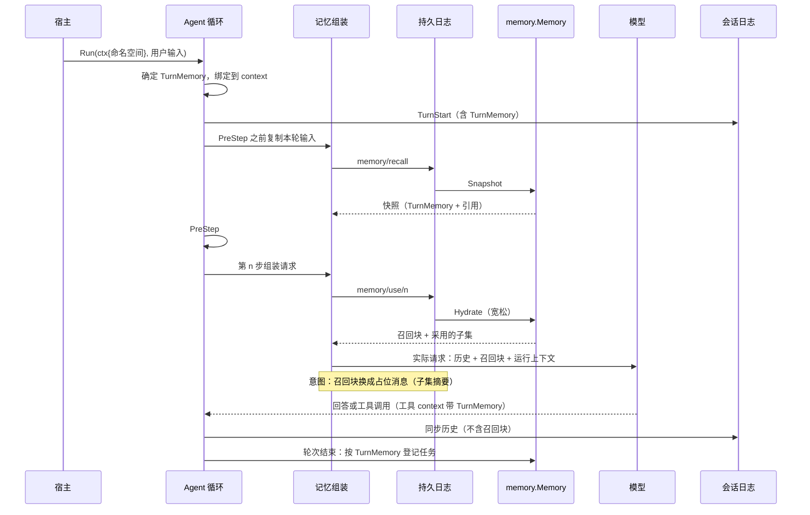
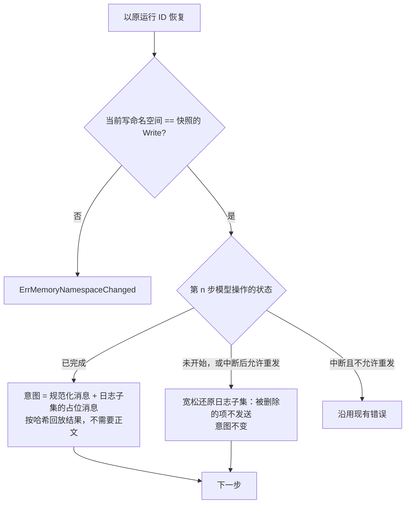
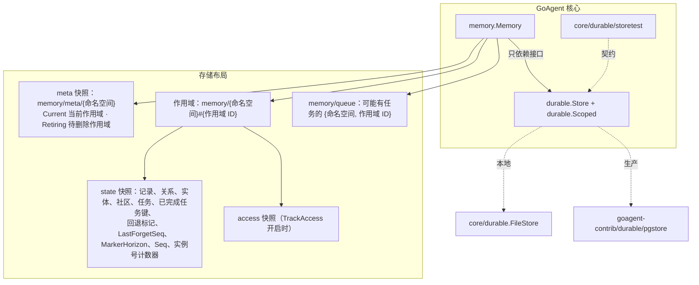
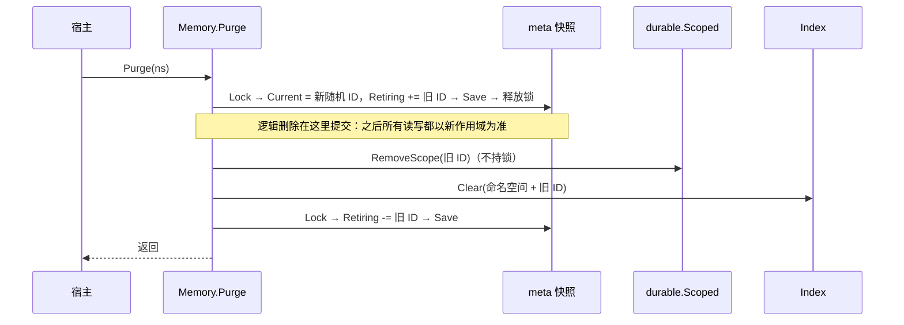
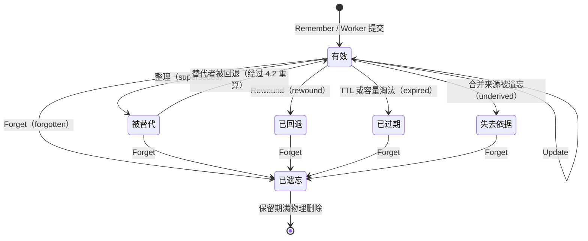
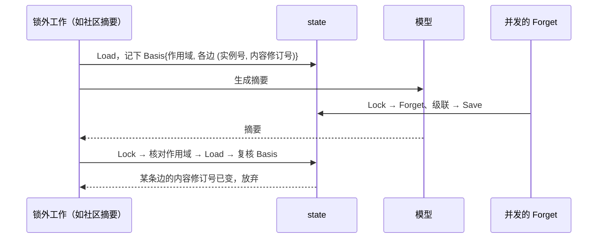
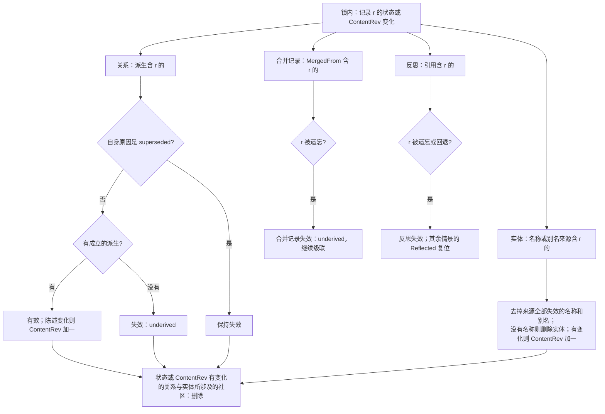
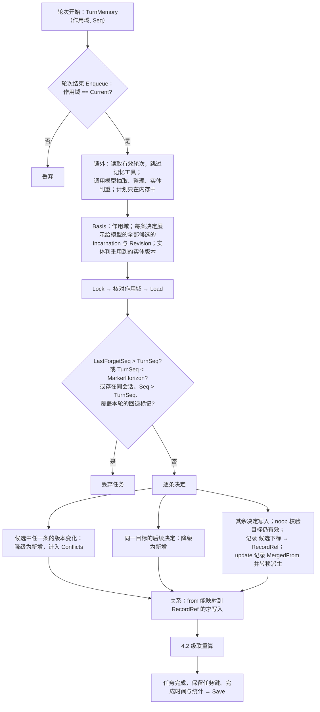

# 长期记忆的删除优先：实现文档

日期：2026-11-11。状态：待实施，第 5.1 版。

修订经过：
- 前三版经 Codex 两轮审查，以及 Software Architect、Backend Architect 两个 agent 的独立审查。
- 第四版改为复用 `durable.Store`，三方复审都接受了这个架构。
- 第五版按三方对第四版的意见修订边界与时序，架构不变。
- 5.1 版对照代码自查：轮次绑定改以 `TurnStart` 为唯一来源；任务队列改为持 state 锁登记与移除；定义派生成立的条件，整理合并时转移派生；读取后复核作用域。

管理端列表与多命名空间读取见 [长期记忆的管理功能](MEMORY_ADMIN.md)，前置设计见 [记忆系统设计](MEMORY_DESIGN.md)。

## 0. 结论

本文只解决一件事：**被删除的记忆不再出现**，范围见 0.1。分三个阶段：

1. **G0 召回注入**
   - 自动召回块不进入会话日志与持久日志。
   - 模型请求的意图用"本步引用"的摘要代替召回正文。
   - 引用绑定命名空间。
   - 抽取跳过记忆工具。
   - 从历史中过滤掉升级前遗留的召回块。
2. **G1 存储**
   - 只依赖 `durable.Store` 与 `durable.Scoped` 接口，每个命名空间一份快照，用 `Lock → Load → Save` 修改。
   - `Purge` 切换到随机生成的新作用域；旧作用域先进入待删除列表，再用 `RemoveScope` 删除，删除可以重复执行。
   - 所有读写都以元数据中的当前作用域为准。
3. **G2 派生与整理**
   - 关系、实体、合并记录、反思、社区随被删记录一起失效。
   - 抽取任务和轮次开始时的状态序号比较：本轮开始后发生过遗忘、回退或 `Purge`，就丢弃任务。
   - 整理在一次提交中完成。

本地用核心自带的 `FileStore`，生产环境用外部的 `goagent-contrib/durable/pgstore`，两者都已通过 `core/durable/storetest`。原分支 `feat/persistent-factual-memory` 已存档为 tag `archive/persistent-factual-memory`，不合并。

| 阶段 | 依赖 |
|---|---|
| G0 召回注入 | 无 |
| G1 存储 | 无（G0 的引用与轮次绑定在 G1 增加作用域与序号） |
| G2 派生与整理 | G1 |

问题的完整清单在第 5 节。

### 0.1 删除承诺的范围

| 数据所在 | `Forget` 之后 | `Purge` 之后 | 阶段 |
|---|---|---|---|
| 记录 | 不再召回；后台任务无法让它复活；正文保留到 `Retention.InvalidRetention`（默认 30 天）后物理删除 | 立即不可读；旧作用域进入待删除列表并被删除 | G1 |
| 由它派生的关系、实体名称与别名、合并记录、反思、社区摘要 | 失效、删除或重算，不再召回，也不再在实体判重时发给模型 | 同上 | G2 |
| 抽取任务 | 在遗忘之前开始的轮次，其任务会被丢弃 | 旧作用域中的任务随之删除；`Purge` 之前开始的轮次，其任务会被丢弃 | G1、G2 |
| 向量索引 | 只采用与当前版本一致的向量；过期的键会被清理 | 旧作用域的索引空间被清空；崩溃后可能残留孤儿向量，由 `Reindex` 清理 | G1 |
| 自动召回块 | 不进入会话日志与持久日志；恢复时不会把它发给模型；历史中升级前遗留的召回块会被过滤 | 同左 | G0 |
| 已经进入对话的副本：模型回答、`memory_search` 等工具的输出 | **不在承诺范围内**。彻底删除需要宿主删除对应的会话与运行 | 同左 | 宿主 |
| 删除提交前已组装好的模型请求，以及它的原样重试 | 不撤回。删除以提交为界，之后组装的请求不再包含被删内容 | 同左 | — |

## 1. 现状问题

以下问题都已对照代码确认。

### 1.1 召回正文进入会话日志与持久日志（最严重）

`builder.WithLongTermMemory` 用带身份的 PreStep，把召回块作为 user 消息插在本轮输入之前（`builder/long_term_memory.go`）。`runPreStep` 把整组消息记为持久日志 `loop/pre/<模型步骤号>` 的结果（`builder/loop_hooks.go`）。之后 `runToolEvents` 用 `slog.sync` 把这组消息同步进会话历史（`builder/tool_events.go`）。

结果是召回块成了历史的一部分，后续每次请求都会继续携带它。压缩之类的 PreStep 可能改写它，但不能保证删除。恢复运行时，旧召回块还会从持久日志里回放。

Worker 抽取时会按 `RecallPrefix` 前缀跳过召回块（`memory/worker.go` 的 `renderTurn`），所以抽取本身不会重复记录。

### 1.2 被删内容会经其他途径重新抽取

- `renderTurn` 只过滤 `RecallPrefix`，`memory_search` 的工具结果照常进入抽取的对话记录。
- 模型回答中复述了召回的内容，这些内容也会被抽取。
- 模型在 `Purge` 之后调用 `memory_save`，写入的是 `Purge` 之前看到的内容。
- RequestError 钩子拿到的消息里含有召回块（`builder/loop_hooks.go` 的 `RequestFailure.Messages`）。压缩功能的 `Recover` 会把它写进摘要，作为替换消息返回（`builder/compaction.go`），召回内容由此进入后续消息。

### 1.3 并发写入互相覆盖

- 召回时读出记录、改 `LastAccess` 后整条写回。如果读写之间发生了 `Forget`，写回会让记录复活。
- `Reindex` 同样是整条写回。
- 反思先读出情景记录，再调用模型，然后整条写回 `Reflected`（`memory/worker.go` 的 `reflect`）。
- 实体判重在模型调用之后，用调用前读到的实体写回（`memory/graph.go` 的 `resolveEntities`）。
- 调用方没给出 `CreatedAt` 时，`Remember` 遇到同 ID 会直接覆盖，并重设 `CreatedAt`。
- Worker 整理时先写新记录、再让旧记录失效，两步之间没有一致性保证。
- `ProcessPending` 在模型调用结束后，用列表阶段拿到的旧任务副本写回任务，可能让已删除的任务复活。

### 1.4 Purge 不阻止后台写回

`Purge` 依次删除索引项、清空图谱、清空记录，过程中不取消任务、不检查代际，也没有事务。

任务存放在全局的 `{"memory","jobs"}` 下，`Purge` 删不到。任务键也不含命名空间，`Enqueue` 的全局去重会静默丢掉另一个命名空间里同键的任务。

### 1.5 派生数据不随记录删除

- `Forget` 不处理图谱。关系只有一个来源，和记录之间没有关联。
- 同一关系再次被抽取时会直接跳过，`Fact` 永远保留第一次抽取时的措辞。
- 实体的名称、别名和向量直接合并，不记录来源（`memory/graph.go`），只有 `Purge` 才会删除。
- 整理时 `update` 合并出的新记录带有被合并记录的正文，被合并的记录被遗忘后，新记录仍然有效。
- 社区指纹只由成员和边 ID 计算。社区摘要在读边、等模型、写回之间没有任何复核。
- 反思生成的记录没有来源。

### 1.6 回退与遗忘的语义

- 失效记录看不出失效原因。已被替代的记录再被遗忘时，`Forget` 直接返回；之后如果回退替代者，这条记录会被恢复。
- 回退会直接恢复被替代的关系，不检查来源。
- Worker 只在任务开始时读取有效轮次。被中止的任务直接使用原始事件。

### 1.7 索引

- `Remember` 先写索引再写正文，同 ID 更新时如果正文写入失败，会留下"旧正文、新向量"。
- 向量和命中结果都不带版本，旧 `Reindex` 写入的向量会覆盖新向量。
- 删除失败的向量无法修复，`Purge` 删不到孤儿向量，`Reindex(false)` 也发现不了缺失的向量。
- `MemoryIndex` 用 NUL 字符拼接命名空间，不同的命名空间可能拼出同一个键。

### 1.8 响应缓存跨用户命中

`middleware.CacheMiddleware` 的键是 `fmt.Sprintf("%v", request.Input)`，命中时直接跳过 handler。共享缓存实例时，相同输入会拿到别人的回答。

### 1.9 存储没有事务契约

记录、图谱、任务分开存放，没有跨类别的原子写入。仓库里 `store.Store` 唯一的实现是进程内存储。

## 2. G0：召回注入

不依赖 G1、G2，修复 1.1、1.2 中可以独立修复的部分，以及 1.8。

### 2.1 轮次绑定

每个轮次有一份 `TurnMemory`：

```go
// TurnMemory 是一个轮次的记忆绑定，在轮次开始时确定，整轮不变。
type TurnMemory struct {
    Write []string   // 写命名空间
    Read  [][]string // 读命名空间（G0 只有写命名空间；共享读取见 MEMORY_ADMIN.md）
    Scope string     // G1 起：写命名空间的当前作用域 ID
    Seq   int64      // G1 起：写命名空间 state 的序号
}
```

- **何时确定**：在 `openSessionTurn` 写入 `TurnStart` 时确定（`builder/session_log.go`），它早于 `runToolEvents`。随后绑定进本轮的 context：工具经 `tools/dispatcher.go` 派发时沿用这个 context，所以记忆工具能拿到它；轮次结束时登记任务也用它。
- **唯一来源是 `TurnStart` 事件**：长期记忆要求配置会话日志，所以每个轮次都有 `TurnStart`。
  - 新轮次：计算绑定，写入 `TurnStart`。
  - 恢复未结束的轮次、回放已完成的轮次：从已有的 `TurnStart` 读出绑定，不重新计算，因此不会取到 `Purge` 之后的新作用域或新的 `Seq`。
  - 被中止的轮次，要到下一次 `openSessionTurn` 才登记上一轮的任务，这时从它的 `TurnStart` 读出原绑定；读不到（升级前的事件）就丢弃任务。
  - `memory/recall` 快照中的 `Turn` 只是这份绑定的副本，用于计算占位消息的哈希，不作为来源。
- **非持久运行**：用同样方式在轮次开始时确定。
- **宿主在 Builder 之外直接调用 `m.Tools()`**：context 里没有 `TurnMemory` 时，按调用当时的写命名空间和作用域处理，文档写明这一点。

### 2.2 注入

1. **注入点**：`WithLongTermMemory` 不再注册 PreStep。召回块在 `requestTurn` 组装请求时插入（`withContext`）：
   - 去掉"未配置 `PromptContexts` 就直接返回"的提前退出。
   - 召回块的还原放在 `journaled(loop/context)` 之外。
   - 插入时复制消息切片，不改动原切片。
2. **位置**：最后一条运行上下文消息之前；没有运行上下文消息时放在末尾。
3. **查询**：在 `runPreStep` 之前，复制本轮实际的输入消息，作为召回的查询。
4. **快照与每步子集**：
   - 第 0 步调用 `Snapshot`，结果以 `memory/recall` 为键写入日志。
   - 每次组装请求时，用 `Hydrate` 宽松还原，把实际采用的引用子集以 `memory/use/<模型步骤号>` 为键写入日志。
   - 这两步可以重复执行，设置 `RetryInterrupted`。
   - 选择引用走不刷新访问时间的路径。
5. **意图的固定结构**：持久运行中，模型请求的意图（`builder/durable_turn.go`）在计算前按以下规则规范化，实际发给模型的请求不变：
   - 删掉实际请求中的召回消息。召回消息靠轮次状态中保存的那段召回文本、按全文相等认出，不靠下标或前缀。
   - 只要日志里本步的子集不为空，就在第 2 点规定的位置放一条占位消息：`[相关长期记忆] sha256(Protocol, Identity, Write, 本步子集)`。本步子集取自日志里的原始记录，不是恢复时宽松还原后剩下的子集。
   - 子集为空时没有占位消息。

   因此意图只由日志决定。即使恢复时引用全部被删、实际请求里没有召回消息，意图也保持不变。`readJournaledTurn` 增加一个参数，传入本步的召回文本与占位消息；RequestError 之后重新组装（`builder/loop_hooks.go` 的替换路径）也传入同一个值。
6. **Request 钩子**：钩子在组装之后运行。钩子不得改写或移动召回消息，否则意图会变；删除召回消息不改变意图（同第 5 条）。
7. **RequestError 钩子**：把消息交给钩子之前，先去掉召回消息；钩子返回替换消息后重新组装时，再把召回块插回去。这样压缩等恢复逻辑不会把召回内容写进摘要。
8. **恢复时的重发**：沿用现有策略。已完成的模型操作按意图哈希回放；被中断的模型操作，只有开启了 `ResendInterruptedModel` 才会重发（`builder/model_call.go`），否则仍按原样报错。删除不会带来新的恢复失败，但也不改变原有的恢复限制。
9. **抽取跳过记忆工具**：`renderTurn` 按 assistant 消息的 `ToolCalls` 和 `MessageData.Tool.Name`，跳过记忆工具（`memory_search`、`memory_save`、`memory_forget`）的调用和结果。同一条 assistant 消息里的普通正文照常保留。
10. **过滤遗留的召回块**：从会话日志推导历史时（`builder/session_log.go`），去掉以 `RecallPrefix` 开头的 user 消息，止住升级前已经写进历史的召回块。
11. **只作用于原生工具流**：与现状相同，没有注册工具时请求走 `readPlainModelTurn`，不召回。长期记忆需要召回时，宿主应注册工具（例如 `m.Tools()`）。
12. **响应缓存互斥**：`Build` 时，如果配置了长期记忆，并且 `b.middlewares` 中有 `*middleware.CacheMiddleware`，返回配置错误。宿主自定义的缓存需要遵守文档写明的要求。

### 2.3 API

```go
type RefKind string // record | relation | community

// Ref 是召回快照中的一项，不含正文。G1 起增加 Scope、Incarnation 与 ContentRev。
type Ref struct {
    Kind      RefKind  `json:"kind"`
    Namespace []string `json:"namespace"`
    ID        string   `json:"id"`
}

type Snapshot struct {
    Protocol string     `json:"protocol"` // MemoryRecallProtocol，渲染规则改变时随之改变
    Identity string     `json:"identity"` // Memory.Identity
    Turn     TurnMemory `json:"turn"`
    Refs     []Ref      `json:"refs"`
}

func (m *Memory) Snapshot(ctx context.Context, query string) (Snapshot, error)

// Hydrate 按 refs 的顺序还原召回块，不重新打分或截断，返回实际采用的子集。被丢弃的项包括：
// 已删除或已失效的；命名空间不在当前绑定内的。
// 当前写命名空间与 s.Turn.Write 不同时返回 ErrMemoryNamespaceChanged。
// s.Protocol 或 s.Identity 与当前不同时，召回视为空（意图仍按日志计算）。
func (m *Memory) Hydrate(ctx context.Context, s Snapshot, refs []Ref) (Retrieval, []Ref, error)
```

- **命名空间改变时拒绝执行**：恢复运行时绑定了另一个写命名空间，说明宿主的身份解析出了问题，所以直接返回 `ErrMemoryNamespaceChanged`，而不是退化为空召回。这样可以避免把 A 命名空间的引用解析成 B 命名空间里同 ID 的记录。
- **快照为空时同样核对**：空快照也会核对写命名空间。
- **`Retrieve`**：改为先 `Snapshot` 再 `Hydrate`。

### 2.4 流程





### 2.5 测试

- **不落盘**：召回块不出现在会话历史中，也不出现在 `loop/pre/*`、`loop/context/*` 中；`memory/recall`、`memory/use/*` 只含引用与绑定信息。
- **意图只由日志决定**：
  - 同一子集配不同正文，得到相同的意图。
  - 子集里的项被全部删除、恢复时召回消息消失，意图仍然相同。
  - 子集为空时没有占位消息。
- **持久运行恢复**：在不同步骤中断，覆盖以下情况：
  - 已完成的步骤回放。
  - 未开始的步骤，宽松还原后再发送。
  - 中断的步骤，按 `ResendInterruptedModel` 的设置处理。
  - 期间遗忘了召回中的记录，恢复后的请求里不包含它，运行也不因此失败。
- **命名空间**：恢复时换了写命名空间，返回 `ErrMemoryNamespaceChanged`；快照为空时同样如此。
- **轮次绑定**：
  - `memory_save` 从工具 context 拿到 `TurnMemory`。
  - 恢复未结束的轮次时，绑定取自原 `TurnStart`，不重新计算。
  - 被中止轮次的任务，使用 `TurnStart` 里记录的绑定；没有绑定的旧事件，任务被丢弃。
- **钩子与重试**：
  - Request 钩子改写或移动召回消息时，恢复报意图冲突且不重发已完成的步骤（`TestLongTermMemoryRequestHookChangingRecallBreaksResume`）。
  - RequestError 钩子拿到的消息里没有召回块，替换之后召回块仍在。
- **抽取与历史**：
  - 记忆工具的调用和结果不进入抽取的对话记录，同一条消息里的普通正文照常保留。
  - 历史中以 `RecallPrefix` 开头的遗留消息会被过滤。
- **配置**：长期记忆与 `CacheMiddleware` 同时配置时，`Build` 返回配置错误。

## 3. G1：存储

### 3.1 布局与作用域



- **配置**：
  - 新增 `Config.Durable durable.Store`，带 `json:"-"` 标签，必须同时实现 `durable.Scoped`，`New` 时校验。
  - 移除 `Config.Store` 与 `Config.Graph`（接口），后者改为 `Config.Graph bool`。
  - `Index` 仍是独立接口。实体向量移入 `Index`，不放在快照里，以控制快照大小。
- **加锁顺序**：固定为 meta → state → queue。调用 `RemoveScope` 时，不得持有任何锁。FileStore 的 `RemoveScope` 会等待持锁者释放，持锁调用会把自己卡死。
- **修改 state**：`Lock(state) → Load(meta) → 核对 → Load(state) → 修改 → Save`。核对的规则见 3.2。
  - `Save` 的结果未知时（例如连接中断），重新 `Load` 判断是否已经提交，不要直接重做。
- **读取**：读取不加锁。`Load` 一定读到最近一次成功写入的完整快照，这是 `core/durable/runner.go` 的契约：FileStore 用 rename 实现，pgstore 用单条查询。
  - 读取顺序为 `Load(meta) → Load(state) → 再 Load(meta)`。两次读到的 `Current` 不同，说明期间发生了 `Purge`，重新读取。否则一次在 `Purge` 提交前读 meta、提交后读 state 的召回，会在 `Purge` 返回之后仍发出旧作用域的内容。
  - 召回与列表每次都要解码整份 `state`。读取开销比现状大，因为现在的召回只读记录。第 5.3 节给出了规模上限与测量要求。

### 3.2 作用域核对与 Purge

**作用域核对**：所有读写都以 meta 中的 `Current` 为准。

- **写入**：拿到 state 锁之后，再读一次 meta。如果锁住的作用域已经不是 `Current`，就放弃这次写入。也不在非当前作用域中新建 state：`Load` 返回不存在时，只有作用域是 `Current` 才会初始化。
  - 这条核对不依赖墓碑保留多久，所以在 `PruneRemoved` 回收墓碑之后，迟到的写入仍会被拒绝。
  - 墓碑是第二道防线。宿主设置的 `PruneRemoved` 保留期，应当大于持久运行允许的最长恢复窗口。
- **读取**：`Hydrate` 与召回丢弃作用域不是 `Current` 的引用。
- **轮次绑定**：轮次绑定的作用域不是 `Current`，说明这一轮跨越了 `Purge`。这时 `memory_save` 返回工具错误，交给模型处理；`Enqueue` 丢弃任务。



- **提交点**：`Purge` 的提交点是 meta 的保存。之后的步骤失败时，`Purge` 返回错误，但删除已经生效，旧作用域仍留在 `Retiring` 中。
- **清理**：Worker 每轮循环、下一次 `Purge`、`Memory` 启动时，都会对 `Retiring` 中的作用域重做 `RemoveScope` 与 `Index.Clear`。这两步可以重复执行，完成后再把作用域移出列表。
- **崩溃恢复**：在保存 meta 与 `RemoveScope` 之间崩溃时，旧作用域不再是 `Current`，读写都会拒绝它；它的数据由清理流程删除。
- **两种存储的行为**：
  - FileStore 的 `RemoveScope` 会等待旧作用域的持锁者结束，持锁者可能先保存成功。
  - pgstore 在墓碑提交之后拒绝保存，但已经进入提交事务的写入可能先完成。

  这两种情况下，写入都落在随后会被删除的旧作用域里，不会进入新作用域。
- **新作用域可以立即使用**：两种实现都会按需创建作用域。

### 3.3 版本与记录状态

记录、关系、实体、社区都带以下三个字段：

| 字段 | 含义 | 何时变化 |
|---|---|---|
| `Incarnation` | 实例号。计数器与对象在同一次 `Save` 中提交，作用域内不复用 | 创建时 |
| `Revision` | 任何字段变化都加一 | 每次写入 |
| `ContentRev` | 会被渲染或发给模型的内容变化时加一 | 记录的 `Content`；关系的有效陈述；实体的名称与别名；社区的名称与摘要 |

引用一律写成 `(命名空间, 作用域, ID, Incarnation, ContentRev)`。

`state` 还有一个序号 `Seq`，每次 `Save` 加一。轮次开始时把它读进 `TurnMemory.Seq`。



- **forgotten 是终态**：任何回退、恢复、过期都不会改写它。
- **旧数据没有失效原因**，按 superseded 处理。

### 3.4 锁外计算、提交复核

需要调用模型或嵌入的工作，在锁外完成，并记下所依据的数据版本（Basis）。提交时在锁内逐项复核，任一不符就放弃。

| 写入方 | 锁外计算 | Basis | 不符时 |
|---|---|---|---|
| `Remember`（宿主调用） | 嵌入 | 当前作用域 | `CodeConflict` |
| `Remember`（`memory_save` 工具） | 嵌入 | `TurnMemory.Scope` | 工具错误 |
| `Update` | 嵌入（正文变化时） | 作用域；调用方给出的 `Revision` | `CodeConflict` |
| `Forget`、`Rewound` | — | 全在锁内 | — |
| 刷新访问时间 | — | `access` 快照：`Lock → Load → 合并 → Save`，批量写入，失败时忽略；按 `(ID, Incarnation)` 记录；默认关闭（`TrackAccess`） | 忽略 |
| Worker 整理 | 抽取、整理、实体判重 | 见 4.3 | 见 4.3 |
| 社区摘要 | 模型写摘要 | 作用域；成员与相关边的 `(Incarnation, ContentRev)` | 放弃 |
| 反思 | 模型写结论 | 作用域；情景记录的 `(Incarnation, Revision)`。提交时同时设置这些记录的 `Reflected` | 放弃 |
| 实体向量 | 嵌入 | 实体的 `(Incarnation, ContentRev)` | 放弃，由 `Reindex` 补上 |
| 记录向量 | 嵌入 | 见 3.5 | 见 3.5 |



**`Remember` 改为只创建**：ID 已存在时返回 `CodeConflict`。

**新增 `Update`**：

```go
// Patch 中为 nil 的字段不修改；全部为 nil 时返回 CodeInvalidInput。
type Patch struct {
    Content    *string
    Importance *float64
    Pinned     *bool
    Keywords   *[]string
}

// Update 原位修改一条有效记录；expect 须等于当前 Revision，否则 CodeConflict。
// 正文变化时 ContentRev 加一、重写向量，并按 4.2 重算派生数据。
func (m *Memory) Update(ctx context.Context, id string, expect int64, p Patch) (Record, error)
```

### 3.5 索引：带版本的投影

- **命名空间**：传给 `Index` 的命名空间是 `命名空间 + [作用域 ID]`，召回只检索当前作用域。
- **向量键**：`记录ID#实例号.ContentRev#嵌入模型摘要`。召回时只采用与当前记录一致的向量，候选数量沿用现有的 `k*4`。
- **写入**：
  1. 锁外计算嵌入。
  2. 记录提交后写入向量。
  3. 重新 `Load` state，删除这条记录中已经确认过期的键。只删过期的键，不按"除自己以外的版本"去删，避免旧的写入方删掉新版本的向量。
  4. 如果自己写入的版本已经不是当前版本，删掉刚写的键。
- **修复**：`Index` 增加 `IDs` 与 `Clear`。`Reindex(false)` 按当前 state 补齐缺失的键，并删除过期的键。
- **命名空间编码**：空间键改用 `store/namespace.go` 的长度前缀编码；命名空间的组成部分不得包含 NUL。

### 3.6 任务队列

`memory/queue` 只登记"可能有任务"的 `{命名空间, 作用域 ID}`，不存任务，也不存正文。

- **Enqueue**：`Lock(state) → 核对作用域 → Lock(queue) → 缺少登记时写入 → 释放 queue → 在 state 中写入任务 → Save → 释放 state`。
- **Worker 移除登记**：`Lock(state) → Load(state) → Lock(queue)`；没有待处理的任务，或作用域已不是 `Current` 时，移除登记。
- **为什么不会丢任务**：登记与移除都持有同一把 state 锁，两者不会交错。登记总在任务写入之前提交，所以崩溃最多留下一条没有任务的登记，由 Worker 下次移除，不会出现有任务却没有登记的情况。加锁顺序仍是 state → queue。
- **去重**：任务完成后，任务键在 state 中保留到 `InvalidRetention` 期满，只保存键。重复登记会被拒绝，比如持久回放时再次登记同一轮。任务键包含命名空间。

### 3.7 测试

存储层的原子性、锁与作用域删除，由 `durable.Store` 的实现通过 `storetest` 保证。本包用 `FileStore` 测试以下内容。

- **可控交错**：在锁外计算与提交之间插入另一方，断言被删除的数据不会复活。覆盖以下组合：
  - 召回与 `Forget`
  - `Reindex` 与 `Update`
  - `Purge` 与 Worker 提交
  - `Purge` 与社区摘要
  - `Forget` 与社区摘要
  - `Forget` 与反思
  - `Forget` 与实体判重
- **Purge**：
  - 在保存 meta 与 `RemoveScope` 之间注入崩溃：旧作用域不可读、不可写，之后的清理会把它删除。
  - 墓碑被 `PruneRemoved` 回收后，迟到的写入被作用域核对拒绝，不会重建 state。
- **队列**：
  - Enqueue 与 Worker 移除登记并发时不丢任务。
  - 在写入登记与保存任务之间注入崩溃：只留下多余的登记，之后被移除。
  - 同一轮重复登记被拒绝。
- **版本化向量**：
  - 旧 `Reindex` 写入的向量不被采用，也不会删掉新版本的向量。
  - `Reindex` 能补上缺失的向量。
- **access**：访问时间的写入持有锁；在 pgstore 上同样可用（用契约测试中的持锁检查验证）。

## 4. G2：派生与整理

### 4.1 派生

类型、级联的步骤与回退的细节见 [G2 设计](MEMORY_G2_DERIVATION.md) 第 2–4 节，这里只列规则。

- **抽取格式**：抽取的 JSON 中，每条关系增加 `from` 字段，指向同一 JSON 里 `memories` 数组的下标。缺少合法 `from` 的关系直接丢弃，丢弃数量计入任务统计 `Job.Stats.Dropped`。
- **关系**：

  ```go
  type Edge struct {
      // ...ID、Subject、Predicate、Object、ValidFrom、InvalidAt、SupersededBy 等；Source 删除
      InvalidReason InvalidReason `json:"invalid_reason,omitempty"` // superseded | underived
      Sources       []Source      `json:"sources,omitempty"`        // 由 Derivations 物化
      Derivations   []Derivation  `json:"derivations,omitempty"`
  }

  // Derivation 是关系的一次派生：依据的记录、产生它的轮次、该次的陈述与对话时间。
  type Derivation struct {
      Origin                       // Record RecordRef；Source Source
      Fact string    `json:"fact"`
      At   time.Time `json:"at"`
  }
  ```

  - **派生成立的条件**：`Record` 指向的记录存在、有效，并且 `Incarnation` 与 `ContentRev` 都与当前一致。正文被 `Update` 改过，旧派生就不再成立；被替代、回退、过期、遗忘的记录，其派生也不成立。
  - **派生的删除**：指向被擦除记录或落后版本的派生删除；来自被回退轮次（`Source` 被回退）的派生删除，被回退轮次的措辞不会留下。派生全部删除的关系随之删除。
  - 关系有效的条件：它自身的失效原因不是 superseded，两端实体存在且存活，并且至少有一次派生仍然成立。否则失效，原因为 underived。
  - **整理合并时转移派生**：Worker 以 `update` 合并出新记录时，在同一次提交中，为所有派生自被合并记录的关系追加一条派生，指向新记录，沿用原陈述、`At` 与 `Source`。原派生保留，替代者被回退时可以恢复。只有 `update` 合并会转移；因内容矛盾而被替代的记录不转移，它的派生随之不成立。这样图谱不会随整理逐步流失。
  - 有效陈述取成立的派生中 `At` 最新的一条。有效陈述变化时，`ContentRev` 加一。
- **实体**：每个名称（`Names`）单独记录来源（`Origin`）。来源全部不成立的名称不存活；来源被全部删除的名称删除，名称全部删除时删除实体。至少一个名称存活时实体存活（`Live`）。`Name` 不再存活时改为第一个存活的名称，`ContentRev` 加一，实体向量随后在锁外重新计算；`Aliases` 由 `Names` 物化。
- **合并记录**：整理时 `update` 合并出的记录带 `MergedFrom []RecordRef`。任一依据被擦除（遗忘，或自身因依据被遗忘而擦除），合并记录的正文清空，原因为 underived，因为它的正文里含有被遗忘的内容；可以链式传递。
- **反思**：反思记录带 `ReflectedFrom`。任一依据情景被擦除，反思正文清空；被回退，反思失效（underived）但保留正文。依据被合并替代或过期不影响反思。反思失效时，其余情景记录的 `Reflected` 复位，只复位一次，让它们可以重新参与反思。
- **旧数据**：
  - 旧关系没有 `Derivations`，视为无效，升级后不再召回，由 `Prune` 删除。
  - 旧实体没有 `Names`，不存活，由 `Prune` 删除；旧社区的指纹必然变化，第一次同步时删除重写。

### 4.2 级联重算



- **同一次保存**：级联与触发它的写入在同一次 `Lock → Load → Save` 中完成，所以召回读到的社区总是与图一致。
- **恢复也走重算**：回退时恢复的记录或关系，都要经过这次重算。派生自已遗忘记录的关系不会被恢复。
- **全量扫描**：全部数据都在同一份快照里，扫描就是内存遍历。

### 4.3 Worker 整理



- **以轮次开始为界**：被删除的内容，可能经召回块、模型回答、工具结果进入本轮对话。所以三种删除都和轮次开始时的 `TurnMemory.Seq` 比较：
  - 轮次期间发生过 `Purge`：作用域不同，丢弃任务。
  - 轮次开始后发生过任何 `Forget`：`state.LastForgetSeq > TurnSeq`，丢弃任务。
  - 轮次开始后发生过覆盖本轮的回退：丢弃任务。回退点切开本轮时同样丢弃，由回退补登的任务重新学习可见部分。

  这样做比按相似度判断可靠，代价是损失这一轮的抽取结果。被中止的任务直接使用原始事件，同样受这些判断约束。
- **回退标记**：`Rewound` 在锁内写入标记 `{会话, To, Seq}`，判断是否覆盖本轮的条件与记录回退一致（`s.To > to`：本轮有任何消息被遮蔽）。回退点切开一个轮次时（`From ≤ to < To`），`Rewound` 在同一次提交中为可见部分 `[From, to]` 补登抽取任务，轮次中途被回退、之后才登记的任务在 `Enqueue` 时截到 `to`。详见 [G2 设计](MEMORY_G2_DERIVATION.md) 第 4、5 节。标记按 `InvalidRetention` 回收，回收时把 `MarkerHorizon` 推进到被回收标记的最大 `Seq`。如果任务的 `TurnSeq` 小于 `MarkerHorizon`，说明对应的标记可能已被回收，保守起见直接丢弃。
- **计划不持久化**：计划里含有抽取出的正文，不落盘。崩溃后重新调用模型。
- **一次提交，复核全部依据**：Basis 包括模型看到的全部候选，所以合并出的内容不会吸收已被遗忘的记录。复核不成立的决定降级为新增：正文用候选原文，不合并，来源只含本轮。同一轮中相近的候选只产生一条记录。
- **维护在任务之后**：社区重写、反思与 `Prune` 在一批任务提交之后运行，使用只绑定命名空间的 context，各自复核依据；它们出错时作为 Worker 本轮的错误返回，不写入任务。
- **单一 Worker**：保留现有约束，同一份存储只运行一个 Worker。任务的领取与状态更新都在锁内完成。

### 4.4 测试

- **遗忘一条记录后**：
  - 只由它派生的关系失效。
  - 还有其他派生的关系仍然有效，但改用其他派生的陈述，相关社区被删除。
  - 实体中来自它的别名被删除。
  - 由它合并出的记录失效。
  - 概括它的反思失效，其余情景记录的 `Reflected` 复位。
- **只改置顶或重要度**：不触发级联。
- **派生成立**：
  - `Update` 修改正文后，旧派生不再成立，只由它派生的关系失效。
  - 整理以 `update` 合并后，派生自被合并记录的关系仍然有效，指向新记录；合并记录被遗忘后，这些关系失效（没有其他派生时）。
  - 因矛盾被替代的记录，其派生不转移。
- **回退**：被替代的记录在替代者被回退后恢复，派生关系随之恢复；被遗忘的记录在任何回退后都不恢复。
- **抽取任务的丢弃**：
  - 轮次期间发生过 `Purge`：本轮任务被丢弃。
  - 轮次开始后发生过 `Forget`，包括在轮次进行中、登记之后、提交之前：本轮任务被丢弃。
  - 轮次开始后才写入的回退标记，覆盖本轮：任务被丢弃，被中止的轮次同样如此。
  - `TurnSeq < MarkerHorizon` 的任务被丢弃。
- **整理决定**：
  - 展示给模型的候选在提交前被修改：这条决定降级为新增。
  - 同一目标有两条决定：只采用第一条，后一条降级为新增。
- **崩溃后重试**：重新调用模型，结果中不出现重复记录。

## 5. 存在的问题

### 5.1 本文修复

| 问题 | 阶段 |
|---|---|
| 召回正文进入会话日志与持久日志；历史中有升级前遗留的召回块（1.1） | G0 |
| 记忆工具结果被重新抽取；RequestError 钩子把召回块写进摘要（1.2） | G0 |
| 响应缓存跨用户命中（1.8，长期记忆场景） | G0 |
| `Purge` 后 `memory_save` 写入旧内容（1.2） | G0（轮次绑定）、G1（作用域核对） |
| 并发写入覆盖、复活已遗忘的记录、反思与实体的陈旧写回（1.3） | G1、G2 |
| `Purge` 不阻止后台写回；任务不随 `Purge` 删除；任务键冲突（1.4） | G1 |
| 索引不一致、旧向量覆盖新向量、残留与缺失、命名空间拼接冲突（1.7） | G1 |
| 存储没有原子写入（1.9） | G1 |
| 模型复述的被删内容被重新抽取（1.2） | G2 |
| `Forget` 不处理关系、实体别名、合并记录、反思与社区（1.5） | G2 |
| 回退恢复已遗忘的记录与不检查来源的关系；提交前不复核回退（1.6） | G1、G2 |
| Worker 两步整理不一致、用旧任务副本写回（1.3） | G2 |

### 5.2 本文不修复

| 问题 | 后续处理 |
|---|---|
| 已经进入对话的副本（0.1） | 宿主删除会话与运行 |
| 不用长期记忆时，响应缓存仍可能跨用户命中 | 单独修复 `CacheMiddleware` 的键，或限定它只用于无状态 Agent |
| 记忆投毒：写入工具由模型自主调用 | 单独设计来源区分；写入工具可由宿主关闭或要求确认 |
| 对抗题弃答能力下降、召回预算未用满、社区摘要收益不明显 | 用 `scripts/memeval` 继续调优 |
| 评测统计偏乐观；评测绕过 Builder | 以更大样本为准；G0 用 Builder 测试验收 |
| 管理端列表、多命名空间读取 | 见 [长期记忆的管理功能](MEMORY_ADMIN.md) |
| 下游仓库未迁移 | 发版后迁移 goagent-examples 与 goagent-harness |

### 5.3 本方案的局限与风险

| 局限或风险 | 应对 |
|---|---|
| 每次写入都重写整份 `state`，召回与列表每次都要解码整份 `state` | G1 实施时测量快照大小、加锁时长与任务吞吐，写入评测报告；建议设置 `MaxRecords`；实体向量已移出快照 |
| `memory/queue` 是全局快照，所有命名空间登记任务时都要竞争它 | 只在登记缺失时才写入，绝大多数 Enqueue 只读不写；吞吐不足时改为按作用域分片 |
| 必须使用实现了 `Scoped` 的 `durable.Store` | `FileStore` 与 `pgstore` 都已实现；`New` 时校验 |
| 墓碑的保留期 | 作用域核对不依赖墓碑；墓碑作为第二道防线，保留期应大于持久运行的最长恢复窗口 |
| 轮次开始后发生任何遗忘或覆盖本轮的回退，就丢弃整轮抽取结果 | 有意保守：以损失一轮学习为代价，换取被删内容不会被重新学回；回退点切开本轮时，可见部分由补登的任务重新学习 |
| 旧关系、旧实体、旧社区升级后不再使用 | 有意取舍，图谱随新对话重建 |
| 关系缺少 `from` 时丢弃 | 计入 `Job.Stats.Dropped`，用评测回归检查 |
| 被遗忘的记录正文保留到保留期满 | 0.1 已写明；需要立即删除时用 `Purge` |
| Request 钩子不得改写或移动召回消息 | 文档写明，测试中验证 |
| 恢复时被中断的模型调用是否重发，沿用 `ResendInterruptedModel` | 删除不带来新的恢复失败，原有限制不变 |
| 旧的失效记录没有失效原因 | 影响仅限升级前的数据 |
| 同一轮中调用 `memory_forget`，这一轮的其他内容也不会被抽取 | `LastForgetSeq` 规则的直接后果，有意保守 |
| 召回块不在 RequestError 钩子的消息里，上下文溢出时压缩无法缩减它 | 召回块受 `RecallRunes` 限制；溢出主要来自历史 |
| 遗留召回块的过滤作用于全部历史，用户自己输入的、以 `RecallPrefix` 开头的消息也会被去掉 | 前缀专用，影响可以忽略 |
| 纯聊天路径（未注册工具）不召回 | 与现状相同；需要召回时注册工具 |
| 冲突时整理决定降级为新增，不重新判断，可能留下与旧记录重复的新记录 | 由后续对话重新整理；冲突数计入 `Job.Stats.Conflicts` |
| 同一份存储只能运行一个 Worker | 保留现有约束 |
| 锁外判重期间实体被用户操作改动时，判重作废，按引用新建实体 | Worker 串行，只有并发的用户操作会触发；接受由此产生的重复实体 |
| 升级到 G2 后状态编码为 `memory-state-blob/3`，旧程序拒绝读取 | 回滚前从备份恢复升级前的 state |

## 6. 实施与验收


- **G0 已实施**（分支 `feat/memory-g0-recall`）。遗留事项：
  - 已补上"Request 钩子改写或移动召回消息时，测试能发现意图冲突"的测试（2.5 节）。
  - 已知限制：纯聊天路径（未注册工具）不召回，与升级前相同（2.2 节第 11 条）。
- **与 G1 的衔接**：G1 完成后，`TurnMemory`、`Ref` 会增加字段，`Snapshot.Protocol` 的版本随之改变。升级前开始、还在进行中的运行，恢复时协议不一致，召回视为空；意图仍按日志计算，不受影响。
- **G1 中途的状态**：`Update` 修改正文时不会触发级联，这一点在 G2 补上。
- **G2 已实施**（G2a–G2d），与设计的差异见 [G2 设计](MEMORY_G2_DERIVATION.md) 第 14–16 节。
- **每个阶段单独提交。** 验收条件：`go build ./...`、`go vet ./...`、`go test ./...` 全部通过，并且本阶段列出的测试全部完成。
- **G2 完成后**，重新灌入数据，用 `scripts/memeval` 跑 LOCOMO 分层 200 题。准确率应落在 [2026-11-10 结果](../evaluation/2026-11-10-memory/README.md) 的 95% 区间内（graph 为 46–60%）。

## 7. 不兼容变更与迁移

| 变更 | 影响 | 迁移 |
|---|---|---|
| `WithLongTermMemory` 不再使用 PreStep；召回块不进历史，改为插在运行上下文之前 | 升级前开始的持久运行，恢复时可能以意图冲突或会话同步不一致失败 | 升级前让运行结束，或放弃后重新开始 |
| 新增 `TurnMemory` 与 `ErrMemoryNamespaceChanged`；`TurnStart` 事件增加记忆绑定 | 宿主需要处理新错误 | 恢复时绑定与原运行相同的命名空间 |
| Request 钩子不得改写或移动召回消息 | 改写或移动召回消息的钩子会引起意图冲突 | 调整钩子 |
| 长期记忆与 `CacheMiddleware` 互斥 | 同时配置的 Builder 构建失败 | 去掉其中一个 |
| `Config.Store`、`Config.Graph`（接口）、`RecordStore`、`NewRecordStore`、`NewGraph` 删除；新增 `Config.Durable`（带 `json:"-"` 标签）；`Config.Graph` 改为 `bool`；新增 `Config.TrackAccess` | 自定义存储与图谱实现，以及 `scripts/memeval/main.go`、`builder/long_term_memory_test.go` 等调用方编译失败 | 传入实现了 `Scoped` 的 `durable.Store` |
| 数据迁到 `durable.Store` | 旧的 `store.Store` 数据不会被读取 | 提供一次性迁移函数 `MigrateFromStore`：只迁入记录，不迁入关系、实体、社区；迁移完成后清空旧 `store.Store` 中的记忆数据，并对旧的索引空间执行 `Clear`；返回旧的待处理任务清单，由宿主决定是否重新登记 |
| `Memory.Job(ctx, key)` 改为按命名空间查找；完成的任务只保留键、完成时间与统计（`Job.Stats`） | 调用方须绑定命名空间；任务完成后查不到其他详细信息 | 改用 `Job.Stats` |
| `Index` 增加 `IDs`、`Clear`；向量键带版本，命名空间加入作用域；实体向量移入 `Index` | 旧向量不再被采用 | 升级后运行 `Reindex(true)` |
| 命名空间的组成部分不得包含 NUL | 含 NUL 的命名空间被拒绝 | 改用其他分隔方式 |
| `Remember` 只创建；新增 `Update` | 依赖覆盖写入的调用方会得到冲突 | 改用 `Update` |
| 记录、关系、实体、社区增加版本与失效原因；`Edge.Source` 改为 `Sources`，`Edge.Fact` 改为由 `Derivations` 决定；`Valid()`、`ValidAt()` 要求有派生；`Retrieval.Sessions` 改为读取 `Sources` | 旧关系不再有效、不再召回 | 图谱随新对话重建 |
| `Entity` 新增 `Names`、`Live`，`Aliases` 改为物化值，`ContentRev` 只随 `Name` 变化 | 旧实体不再使用；实体向量需重建 | 升级后运行 `Reindex(true)` |
| `Record` 新增 `MergedFrom`、`ReflectedFrom`；新增失效原因 `ReasonUnderived` | 按失效原因分支的调用方需处理新值 | — |
| 状态编码升为 `memory-state-blob/3`、`memory-head/3` | 升级后不能回滚到旧程序，旧程序拒绝读取 | 回滚前从备份恢复升级前的 state |
| `Rewound` 总会提交（写回退标记），回退点切开轮次时整轮失效并补登可见部分 | 每次调用至少一次写入；补登的任务由 Worker 处理，需要模型调用 | — |
| 社区指纹的计算方式改变 | 升级后第一次同步重写全部社区摘要，需要模型调用 | — |
| 抽取 JSON 中关系必须带 `from` | 自定义提示词需同步修改 | 按新格式输出 |
| `memory_save` 受轮次作用域约束 | 跨越 `Purge` 的轮次中调用会返回工具错误，由模型看到并处理 | 无需处理 |

每一项都写入 `CHANGELOG.md` 的不兼容变更，附迁移步骤。

## 8. 不做的事

- 不自建事务层或重做日志。
- 不持久化整理计划。
- 恢复时不做严格的内容校验。已完成的步骤靠意图哈希保证；命名空间改变时直接拒绝执行。
- 不清理已经进入会话日志、持久日志的副本。
- 不提供带记忆感知的响应缓存。
- 不用相似度判断被遗忘的内容，一律按轮次开始时的序号保守丢弃。
