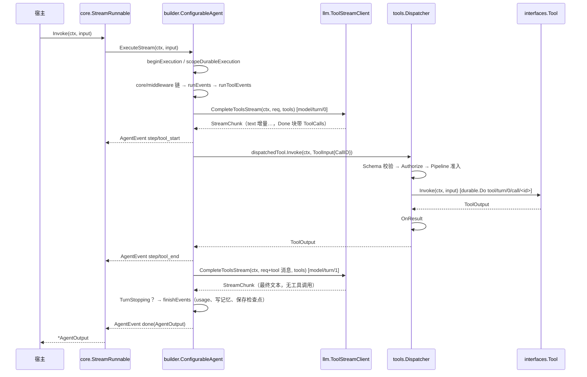
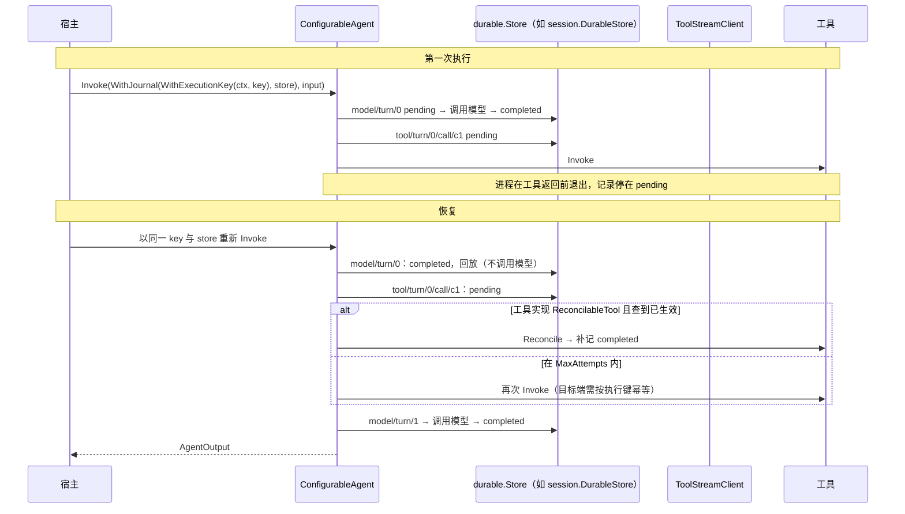
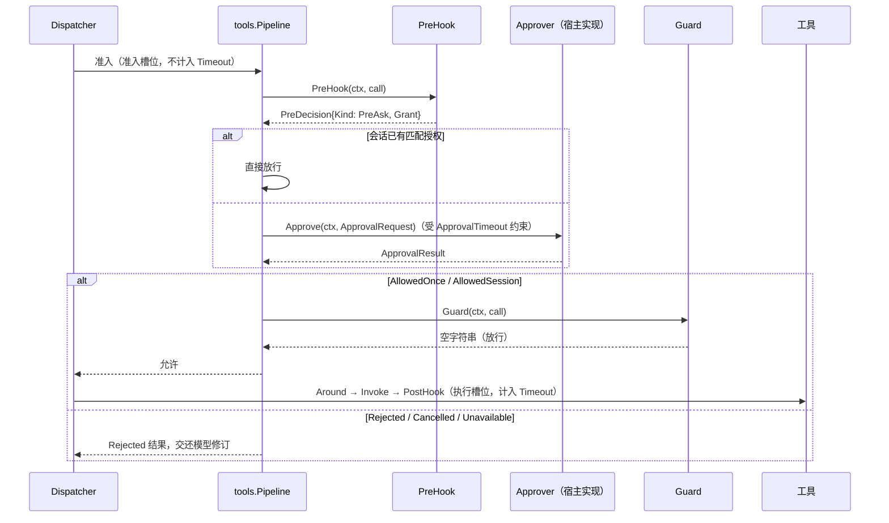
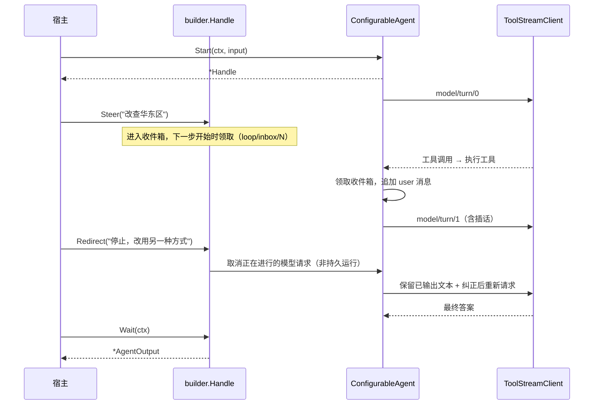
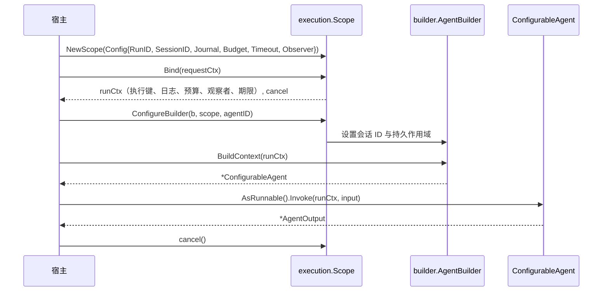

# GoAgent 时序图

参与者均为当前源码中的类型；流程判定细节见 [流程图](FLOW_DIAGRAMS.md)。

## 1. 原生工具循环中的一次工具调用

未绑定日志时 `durable.Do` 直接执行，工具调用的 `CallID` 为空。

## 2. 持久运行的崩溃恢复

宿主以相同执行键与日志重新执行；已完成的操作直接回放，不再调用模型或工具。

`WithSessionLog` 时会话日志续写同一轮，消息不重复；输入或尝试策略改变时以 `operation intent or attempt policy changed` 失败。

## 3. Pipeline 审批

`PreDeny` 直接得到 Rejected 结果；`PreStop` 返回 `*tools.StopError` 终止运行；`PreSubstitute` 改为执行声明的替代工具。准入阶段不写日志，回放已完成调用时跳过。

## 4. 运行中插话（Handle）

`Start` 只支持原生工具流。`Inject` 随下一次模型请求发送，但不唤醒即将结束的轮次；`Followup` 在本轮结束后作为新一轮输入续接对话；`Interrupt(cause)` 取消运行。没有进行中的模型请求或处于持久运行时，`Redirect` 降级为 Steer。

## 5. 宿主装配

## 相关文档

- [流程图](FLOW_DIAGRAMS.md)
- [设计概述](DESIGN_OVERVIEW.md)
- [架构概述](../architecture/ARCHITECTURE.md)
