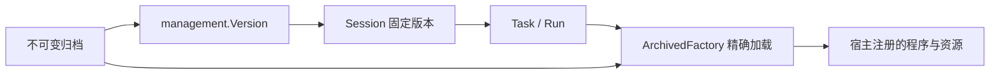

# 不可变 AgentRevision 与会话版本绑定

`revision` 是宿主层的内容归档包，`management/adapters.ArchivedFactory` 将归档接到既有管理执行链。
保存配置版本时指定 `RevisionID`，创建会话时从不可变 `management.Version` 复制该身份；发布新版本只改变后续默认创建的会话。
已有 Session、该 Session 的新 Task、待审批任务和 Fork 都继续使用原版本。`GetRun` 的 `Task.RevisionID` 可追溯当时归档。



这里复用现有 Version、会话日志和 Worker；不引入第二套任务服务。A2A、HTTP 和 MCP 接入同一个管理服务时，自然遵守相同绑定规则。
单独使用 Builder 或 `core/session.Store` 不会自动获得管理层的发布和绑定行为。

## 归档内容

| 字段 | 内容与约束 |
| --- | --- |
| `Definition.Config` | 已解析的 JSON 配置对象；精确保留大整数，拒绝重复键 |
| `Prompts` / `Tools` | 最终提示词与工具定义；提示词不再从可覆盖的工作区重新读取 |
| `Models` / `Policy` | 模型配置与权限策略的 `ID`、`Version`；宿主必须按精确版本解析 |
| `Skills` / `Files` | 技能名到归档目录的映射，以及 SKILL.md、参考资料、模板等实际文件字节 |
| `Runtime` | 程序类型、版本、SHA-256，以及可执行文件路径或固定摘要的镜像引用 |
| `AgentRevision.ID` | 全部定义与文件的内容摘要；调用方不能另指定或覆盖 |

`revision.Seal` 可只在内存中封存，`Verify` 校验；`revision.Open` 创建文件归档句柄，`Put` 封存并持久保存，`Load` 按 ID 读取，`Close` 释放句柄。
所有快照均复制输入，不借用调用方后续可能修改的映射或字节。JSON 数字保留原文，`1` 与 `1.0` 可以产生不同摘要。

模型配置引用不等于模型权重归档：外部模型服务的可用性和同名模型的行为变化仍受提供方影响。
凭据使用宿主版本化引用，避免把密钥正文放进明文归档。权限策略版本用于重建原装配。管理 API 请求及输入/审批续接仍经过 Authorizer；运行器内部工具权限与实时撤权由宿主落实，归档引用本身不提供该保证。

## 装配与发布顺序

1. 在宿主确定配置、提示词、工具定义、模型和策略版本，读取需要固定的 Skills 文件。
2. 使用 `archive.Put(ctx, definition, files)` 获取不可变 `snapshot.ID`。
3. 注册 `map[revision.Runtime]adapters.RevisionLoader`，通过 `NewArchivedFactory` 构造管理 Factory。键包含完整 Runtime 身份，不只比较版本字符串。
4. 在 `management.Config.Factories` 中注册该 Factory；调用 `SaveVersion`，传入相同的 Config、Runtime.Version 对应的 ImplementationVersion 和 RevisionID。
5. 保存、发布均校验归档完整性、配置一致性和精确加载器可用性。通过后再调用 `PublishVersion`。
6. 创建新 Session 默认选择当前发布版本；可显式指定仍保留的版本。随后发布 v2，不改变既有 v1 Session。

```go
snapshot, err := archive.Put(ctx, definition, files)
if err != nil {
    return err
}
version, err := service.SaveVersion(ctx, actor, management.SaveVersionRequest{
    IdempotencyKey: "save-v2", AgentID: agent.ID, Version: "v2",
    RunnerKind: "archived", ImplementationVersion: definition.Runtime.Version,
    Config: definition.Config, RevisionID: snapshot.ID,
})
if err != nil {
    return err
}
_, err = service.PublishVersion(ctx, actor, management.PublishRequest{
    IdempotencyKey: "publish-v2", AgentID: agent.ID, Version: version.Version,
    ExpectedRevision: agent.Revision,
})
return err
```

`RevisionID` 参与 `Version.ConfigHash`，所以同一程序只修改提示词或技能，也会改变管理层恢复身份。
同名 Version 不允许覆盖；同一幂等键换一个 RevisionID 会冲突。
未声明 RevisionID 的版本仍使用原 Factory 合约，其配置记录本身不可变，但不会自动补齐旧资源归档。需要归档的部署应创建并发布新的版本，旧 Session 不做原地迁移。

## 实际加载旧版本

`RevisionLoader.Check` 校验能力，不分配需要清理的资源；`Build` 收到独立的 `RevisionEnvironment`：

- `Revision` 是已验真的完整快照。
- `Root` 包含本次加载的归档文件，可读取提示词外的模板和程序工件。
- `Skills` 是只包含显式声明技能的 Catalog，可按名称加载旧技能正文与参考文件。

宿主使用这些固定内容构造已有 NativeFactory、GraphFactory 或自己的 Runtime。`Binding.Cleanup` 先清理宿主资源，再关闭 Skills 和目录句柄、移除私有目录；Runtime 不应在清理后继续使用借用资源。
`Build` 返回前发生 panic 时，宿主须自行清理尚未交出的资源。

| Runtime.Kind | 如何恢复旧程序 |
| --- | --- |
| `native` | 新宿主仍注册旧版本实现；GoAgent 不会从摘要生成或动态链接已删除的 Go 代码 |
| `executable` | `Artifact` 指向归档中的程序字节，封存时校验 SHA-256；宿主明确授权并启动物化后的程序 |
| `oci` | `Image` 必须固定为 `image@sha256:...`；宿主保留镜像层并负责拉取和容器生命周期 |

[可运行示例](../../examples/agent-revisions/README.md) 实际编译两个 Go 程序版本，归档程序与提示词，删除原构建产物，关闭并重开归档后分别执行 v1 和 v2。
它不需要模型或 Docker。跨会话、审批和输入续接的部署模拟位于 `management/revision_test.go`：真实重开归档并重建 Service/Worker，管理与会话 Store 使用内存夹具，不等同于进程退出后的全存储恢复。

加载器缺失或归档损坏时不选择最新版本。执行前校验失败会阻塞持久命令并保留原任务；宿主恢复精确依赖后，Worker 可继续处理。
`ArchivedFactory` 在尚未调用宿主 Build 的归档读取、校验或物化阶段失败，且清理成功时，可恢复原命令并延迟重试。宿主 Build 只有能保证本次未执行任务、无业务副作用且资源已释放，才可返回 `*management.RetryableBuildError`；普通错误、panic、清理失败或已返回 Runtime 不会自动重试。该声明不取消此前 attempt 的副作用核对要求。业务副作用仍必须使用已有 durable、execution.Scope 和 Inspect 证据机制；归档不能替代执行日志或外部操作幂等。

构建阻塞期间的取消会保留此前执行的核对责任，已完成证据优先于取消。`attention` 或待恢复任务若尚未接纳任何执行/恢复命令，取消返回 Conflict，保留人工核对入口；先通过现有可信核对流程接纳恢复命令，再请求取消。不会先设置取消标志而封死后续 ResumeTask。

## 存储与部署责任

文件归档应放在受宿主管理的持久目录。它先同步临时文件，以硬链接原子创建目标，最后同步目录，不覆盖同 ID 内容；文件系统须支持硬链接和目录同步。
读取验证完整性，不静默修复被改写的文件。关闭等待已有操作结束，不抢占正在进行的文件系统调用。

当前大小限制为：单文件 16 MiB，定义 4 MiB，完整归档 64 MiB（含文件的 Base64 编码），最多 10000 个文件。
较大的程序应使用固定摘要的 OCI 镜像或宿主注册的 native 实现；镜像层和模型服务不由此文件归档复制。

归档没有删除或自动 GC 接口。发布新版不能清理仍被 Session、Task、审批或历史审计引用的旧归档及程序。
备份需同时覆盖管理 Store、Session Store、归档目录及外部版本化资源；Archive 本身不提供租户授权，服务端按授权后的 Version 读取，宿主不得直接把文件目录公开给不可信调用方。

`workflow.RecoveryManifest` 和 Harness 的 Manifest / PinManifest 继续校验实际装配。宿主应从归档资源构造组件，再执行原有一致性检查；本包不修改这些执行内核合约。

设计参考：[kagent 核心概念](https://kagent.dev/docs/kagent/1.x/about/core-concepts/)、[Agent Harness](https://kagent.dev/docs/kagent/1.x/agents/agent-harness/)。GoAgent 复用不可变修订与会话绑定的原则，宿主负责部署和程序加载。
