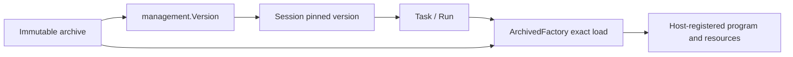

# Immutable AgentRevision and Session Version Binding

[English](AGENT_REVISIONS.md) | [中文](AGENT_REVISIONS_CN.md)

`revision` is a host-level content archive package, and `management/adapters.ArchivedFactory` connects archives to the existing management execution chain.
Specify `RevisionID` when saving a configuration version; when a session is created, that identity is copied from the immutable `management.Version`. Publishing a new version only changes sessions created by default afterwards.
Existing Sessions, new Tasks in those Sessions, tasks waiting for approval, and Forks all keep using the original version. `Task.RevisionID` from `GetRun` traces back to the archive used at the time.



This reuses the existing Version, session log, and Worker; no second task service is introduced. When A2A, HTTP, and MCP connect to the same management service, they naturally follow the same binding rules.
Using the Builder or `core/session.Store` on its own does not automatically get the management layer's publishing and binding behavior.

## Archive Contents

| Field | Content and constraints |
| --- | --- |
| `Definition.Config` | Parsed JSON configuration object; large integers are preserved exactly and duplicate keys are rejected |
| `Prompts` / `Tools` | Final prompts and tool definitions; prompts are no longer re-read from an overridable workspace |
| `Models` / `Policy` | `ID` and `Version` of the model configuration and permission policy; the host must resolve them by exact version |
| `Skills` / `Files` | Mapping from skill names to archive directories, and the actual file bytes of SKILL.md, reference material, templates, etc. |
| `Runtime` | Program kind, version, SHA-256, and an executable path or an image reference pinned by digest |
| `AgentRevision.ID` | Content digest of all definitions and files; callers cannot specify or override it |

`revision.Seal` can seal in memory only, and `Verify` validates; `revision.Open` creates a file archive handle, `Put` seals and persists, `Load` reads by ID, and `Close` releases the handle.
All snapshots copy their input and do not borrow maps or bytes that the caller may modify later. JSON numbers keep their original text, so `1` and `1.0` can produce different digests.

A model configuration reference is not an archive of model weights: the availability of an external model service and behavior changes of a model with the same name remain subject to the provider.
Credentials use host versioned references, to avoid putting secret contents into a plaintext archive. The permission policy version is used to rebuild the original assembly. Management API requests and input/approval resumption still go through the Authorizer; tool permissions inside the runner and real-time revocation are enforced by the host, and the archive reference itself does not provide that guarantee.

## Assembly and Publishing Order

1. On the host, determine the configuration, prompts, tool definitions, and model and policy versions, and read the Skills files that need to be pinned.
2. Use `archive.Put(ctx, definition, files)` to get an immutable `snapshot.ID`.
3. Register a `map[revision.Runtime]adapters.RevisionLoader` and build the management Factory with `NewArchivedFactory`. The key contains the full Runtime identity, not just the version string.
4. Register that Factory in `management.Config.Factories`; call `SaveVersion`, passing the same Config, the ImplementationVersion corresponding to Runtime.Version, and the RevisionID.
5. Both saving and publishing check archive integrity, configuration consistency, and the availability of an exact loader. Call `PublishVersion` only after these pass.
6. Creating a new Session selects the currently published version by default; a version that is still retained can be specified explicitly. Publishing v2 afterwards does not change existing v1 Sessions.

```go
snapshot, err := archive.Put(ctx, definition, files)
if err != nil {
    return err
}
version, err := service.SaveVersion(ctx, actor, management.SaveVersionRequest{
    IdempotencyKey: "save-v2", AgentID: agent.ID, Version: "v2",
    RunnerKind: "archived", ImplementationVersion: definition.Runtime.Version,
    Config: definition.Config, RevisionID: snapshot.ID,
})
if err != nil {
    return err
}
_, err = service.PublishVersion(ctx, actor, management.PublishRequest{
    IdempotencyKey: "publish-v2", AgentID: agent.ID, Version: version.Version,
    ExpectedRevision: agent.Revision,
})
return err
```

`RevisionID` is part of `Version.ConfigHash`, so changing only the prompts or skills of the same program also changes the management layer's recovery identity.
A Version with the same name cannot be overwritten; reusing the same idempotency key with a different RevisionID is a conflict.
Versions that do not declare a RevisionID still use the original Factory contract; their configuration record itself is immutable, but old resources are not archived retroactively. Deployments that need archiving should create and publish a new version; old Sessions are not migrated in place.

## Actually Loading an Old Version

`RevisionLoader.Check` validates capabilities and does not allocate resources that need cleanup; `Build` receives a separate `RevisionEnvironment`:

- `Revision` is the verified complete snapshot.
- `Root` contains the archive files for this load, so templates and program artifacts beyond prompts can be read.
- `Skills` is a Catalog that contains only the explicitly declared skills, from which old skill bodies and reference files can be loaded by name.

The host uses this pinned content to build an existing NativeFactory, GraphFactory, or its own Runtime. `Binding.Cleanup` first cleans up host resources, then closes the Skills and directory handles and removes the private directory; the Runtime should not keep using borrowed resources after cleanup.
If a panic occurs before `Build` returns, the host must clean up resources it has not yet handed over.

| Runtime.Kind | How the old program is restored |
| --- | --- |
| `native` | The new host still registers the old version's implementation; GoAgent does not generate or dynamically link deleted Go code from a digest |
| `executable` | `Artifact` points to the program bytes in the archive, and SHA-256 is checked at sealing; the host explicitly authorizes and starts the materialized program |
| `oci` | `Image` must be pinned as `image@sha256:...`; the host keeps the image layers and is responsible for pulling and the container lifecycle |

The [runnable example](../../examples/agent-revisions/README.md) actually compiles two versions of a Go program, archives the programs and prompts, deletes the original build output, closes and reopens the archive, and then runs v1 and v2 separately.
It needs neither a model nor Docker. A deployment simulation across sessions, approvals, and input resumption is in `management/revision_test.go`: it really reopens the archive and rebuilds the Service/Worker, while the management and session Stores use in-memory fixtures, which is not equivalent to full storage recovery after a process exit.

When a loader is missing or an archive is corrupted, the latest version is not selected. A pre-execution check failure blocks the durable command and keeps the original task; once the host restores the exact dependencies, the Worker can continue processing.
When `ArchivedFactory` fails in the archive read, validation, or materialization stage before calling the host Build, and cleanup succeeds, the original command can be restored and retried later. The host Build may return `*management.RetryableBuildError` only if it can guarantee that the task was not executed in this attempt, that there are no business side effects, and that resources have been released; ordinary errors, panics, cleanup failures, or an already returned Runtime are not retried automatically. This declaration does not lift the side-effect check requirement for earlier attempts. Business side effects must still use the existing durable, execution.Scope, and Inspect evidence mechanisms; archives cannot replace execution logs or idempotency of external operations.

Cancellation while a build is blocked keeps the check responsibility for earlier executions, and completed evidence takes precedence over cancellation. If an `attention` task or a task awaiting recovery has not yet admitted any execute/resume command, cancellation returns Conflict and keeps the manual check entry point open; first admit a resume command through the existing trusted check flow, then request cancellation. A cancel flag is never set first in a way that blocks a later ResumeTask.

## Storage and Deployment Responsibilities

File archives should be placed in a durable directory managed by the host. The archive first syncs a temporary file, creates the target atomically with a hard link, and finally syncs the directory, without overwriting content with the same ID; the file system must support hard links and directory sync.
Reads verify integrity and do not silently repair rewritten files. Close waits for existing operations to finish and does not preempt file system calls in progress.

The current size limits are: 16 MiB per file, 4 MiB for the definition, 64 MiB for the full archive (including the Base64 encoding of files), and at most 10000 files.
Larger programs should use an OCI image pinned by digest or a host-registered native implementation; image layers and model services are not copied by this file archive.

Archives have no delete or automatic GC interface. Publishing a new version cannot clean up old archives and programs that are still referenced by Sessions, Tasks, approvals, or historical audit records.
Backups must cover the management Store, Session Store, archive directory, and external versioned resources together; Archive itself provides no tenant authorization, the server reads by the authorized Version, and the host must not expose the file directory directly to untrusted callers.

`workflow.RecoveryManifest` and the Harness Manifest / PinManifest continue to validate the actual assembly. The host should build components from archived resources and then run the existing consistency checks; this package does not change those execution-kernel contracts.

Design references: [kagent core concepts](https://kagent.dev/docs/kagent/1.x/about/core-concepts/), [Agent Harness](https://kagent.dev/docs/kagent/1.x/agents/agent-harness/). GoAgent reuses the principles of immutable revisions and session binding; the host is responsible for deployment and program loading.
