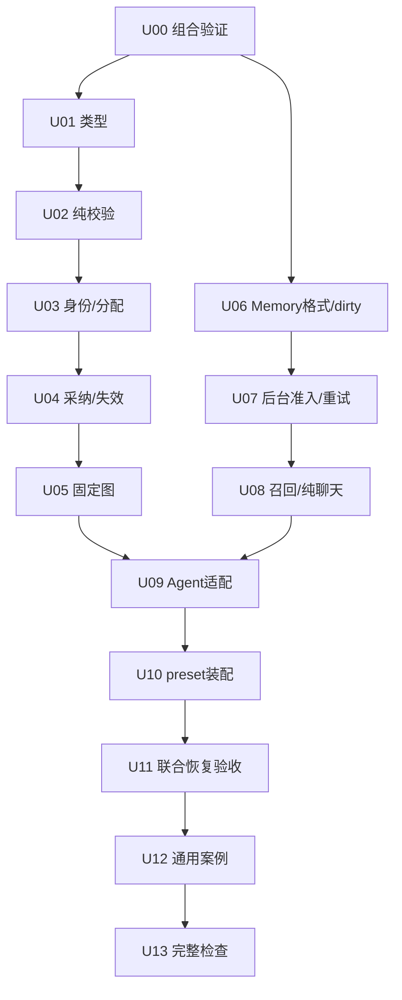

# Agent任务执行与记忆增强实施方案

状态：第二轮专业审核为CHANGES REQUESTED，撤回上一轮工程放行结论。新增M1/M2/E1/E2/E3与验收工具V1六项待处理问题，见第8节。此前174条映射是历史通过记录；新增5项运行代码回归尚未实现或通过。未推送、合并或发布。

目标：实现目标澄清、结构化计划、依赖调度、成员执行、证据验收和有界重规划；补齐记忆后台重试、成本治理和引用装配。

领域契约：[规划接口设计](../specs/2026-11-22-deepagent-planning-design.md)、[记忆设计](../../design/MEMORY_DREAMING_ADOPTION.md)。本文件是唯一执行入口。

## 1. 范围与约束

基线：GoAgent `2449c0d3`、Harness `f7d637c`。`G/`、`H/`分别代表两仓根目录。实施前记录实际HEAD和工作区变更。

- Harness新增planning并复用核心执行机制；planning不依赖preset，核心不反向依赖Harness。
- 工作流拓扑和并行槽在运行创建时固定；Goal、Plan、Wave和Attempt是持久业务状态。
- 所有数据首轮采用有界JSON/文本；权限、身份、成员版本和执行键由宿主确定。
- Memory持久增量写入完整`/4`格式，保留`/2`、`/3`读取，禁止新旧写者混跑。
- 稳定API保持兼容；纯聊天旧轮次沿用旧意图和无自动召回协议。
- 每项任务先证明失败，再实现并验证；只提交可编译、检查通过的变更。
- 不新增第三方依赖。用户文档中英同步，导出godoc英文。

本次实现通用执行闭环和记忆可靠性。overview只在记忆设计中保留候选方向，不安排生成器、数据表或效果评测任务。

### 1.1 官方调研与方案选择

调研日期：2026-11-22。以下是结合本仓库源码的取舍，不是外部框架对本项目收益的证明。

| 功能 | 可选做法 | 本项目采用 |
|---|---|---|
| 简单或步骤已知的任务 | 直接Agent、固定工作流，或动态规划 | 复用现有Runnable/工作流；已确认Goal跳过Resolver，固定Planner和规则Reviewer实现既有接口。无需另加自动Router。[架构建议](https://www.anthropic.com/research/building-effective-agents) |
| 并行编排 | LangGraph Send动态分派，或固定槽 | 保留固定槽+持久Wave，复用现有分支检查点；默认单槽，显式开启多槽。可并行与否以依赖/资源和项目对照结果决定。[编排模式](https://docs.langchain.com/oss/python/langgraph/workflows-agents) |
| 子Agent上下文 | isolated或fork父对话 | 保留fresh Assignment，只提供冻结目标与已选材料；无需增加fork或异步steering。[子Agent语义](https://docs.langchain.com/oss/python/deepagents/subagents) |
| 外部副作用恢复 | 节点重试或业务幂等/核对 | 保留持久AttemptKey、attention和Reconcile；换执行引擎也不会自动得到外部恰好一次。[容错边界](https://docs.langchain.com/oss/python/langgraph/fault-tolerance) |
| 长期记忆 | profile、collection或文件记忆 | 复用现有Record集合/图谱/社区；先补可靠进展和预算，不新建profile、Wiki或向量库。依据与后续候选见[记忆设计](../../design/MEMORY_DREAMING_ADOPTION.md)。 |
| 效果判断 | 仅测框架开销，或独立任务评估 | U12增加直接Agent/规划单槽/规划多槽对照，记忆布局单独消融；不把离线控制流通过率称为质量提升。[评估方法](https://www.anthropic.com/research/demystifying-evals-for-ai-agents) |

先完成原生机制及这些缺口；overview、去抖和更细写入准入仅保留后续候选，不因外部工具具备某功能就加入实施范围。

## 2. 数据、成本与恢复边界

| 数据 | 保存方式 | 删除边界 |
|---|---|---|
| 自动召回记忆 | 日志保存Snapshot/Refs，请求时Hydrate；宿主不直接复制正文进State或请求意图 | 删除/失效项退出后续请求；已发送请求无法撤回 |
| 已授权业务材料和证据 | 保存正文、摘要、来源定位和版本 | 不由Memory.Forget改写，按业务数据契约处理 |
| 模型已生成的计划、结果和回答 | 按执行日志保存 | Forget不撤销这些输出或外部效果 |

memory.Ref/Source不能直接转成planning.SourceInput/EvidenceRef。经验成为当前证据前，须经宿主材料入口或独立验证。

| 调用 | 预算 |
|---|---|
| GoalResolver、Planner、Executor、Reviewer及重规划 | 同一前台持久Controller；槽内只派生执行键，不另建根预算 |
| 在线Recall及memory_save/replace内部embedding | 宿主在线Client单独准入；未配置时关闭付费路径，保留文本召回 |
| 后台抽取、修复、反思、社区及维护embedding | 独立维护窗口Controller，显式预留并记录known/unknown用量 |

后台额度耗尽后保存BlockedBudgetRootKey；宿主停止旧循环并重建Memory绑定新Controller。相同窗口重启不恢复额度，新窗口只解除预算阻塞，不清普通失败次数和历史账本。

未知外部效果先Reconcile，无法确认则attention。重规划、换TaskID或Memory删除都不能解除该屏障。首个write分配后冻结写集合及传递上游契约；未就绪输入在产物验收后、对应write首次分配前补齐实际摘要，不能用空摘要绕过。业务成功必须同时满足图结束与Outcome=succeeded。

## 3. 接口与实施顺序

接口字段由领域设计定义；先完成纯校验器，再实现其使用方。

| 接口 | 契约 |
|---|---|
| GoalResolver | Resolve(context.Context,GoalResolveInput) (GoalResolution,error) |
| Planner | Plan(context.Context,PlanningInput) (PlanDraft,error) |
| Executor | Execute(context.Context,Assignment) (TaskResult,error) |
| Reviewer | Review(context.Context,ReviewInput) (Review,error) |
| 纯校验 | ValidateGoal、ValidateGoalPolicy、ValidateDraft、ValidateEvidence、ValidateTaskResult、ValidateReview、ValidateRepair |
| 调度 | Fingerprint、AttemptKey、Allocate、AdoptPlan、NewGraph |
| 记忆 | MarkDerivationsDirty、ExplainSnapshot |

规划默认：1槽、64任务、256 Wave、3次重规划、3次业务尝试、4轮目标解析；单产物64KiB、正文合计1MiB、State合计8MiB。多槽由宿主显式配置并在运行期间固定。MaxSteps=`12+4*MaxGoalRounds+4*MaxWaves+4*MaxReplans`，检查溢出。



U01–U05与U06–U08可分线开发。memory.go、worker/state/recall由同一负责人顺序整合；preset/build.go、subagent.go、child.go同样保持单一负责人。核心与Harness在U09/U11汇合，避免并行修改共享文件。

## 4. 执行任务

每项按“失败测试→实现→定向检查→所属包完整检查→绿色提交”执行。以下测试名是待实现要求。

### U00：验证现有机制组合

文件：H/integration/planning_compatibility_test.go。

- [x] 记录两仓HEAD、Go版本、GOWORK和Harness核心依赖。
- [x] TestPlanningCompatibility覆盖两个固定槽、日志化Agent、人工等待、重建恢复、已完成槽不重跑及根预算不变。
- [x] 临时workspace组合通过才继续；独立依赖缺接口记为发布门禁，不提交永久replace。

### U01：冻结规划类型

文件：H/planning/model.go、api.go、doc.go及测试。

- [x] 定义Goal/Plan/State/Assignment/Review、Source/Evidence、Group/Capability、Issue/Repair、窄接口和CandidateError。
- [x] TestPlanningTypesRoundTripAndClone、TestConfigDefaultsAndBounds验证JSON往返、深复制、默认值和容量上限。

### U02：实现纯校验器

文件：H/planning/validate.go、identity_json.go、evidence.go、review.go、repair.go及测试。

- [x] 校验严格JSON、Goal参数、DAG、Group父链、能力、输入输出引用、验收及交付物覆盖。
- [x] 宿主生成产物身份/摘要；来源仅引用冻结Assignment输入。Review拒绝缺证据、错误SubjectDigest和accept+unknown/fail。
- [x] 先校验身份/Outcome；produced要求完整输出，rejected允许空产物，实际保留产物仍全校验；write拒绝不证明无效果。TestRejectedWithoutArtifactsReachesReview、TestOversizeResultIsBoundedRejection、TestWriteRejectionDoesNotProveNoEffect覆盖分流与写屏障。
- [x] TestRejectCycleAndUnknownDependency、TestUndeclaredSourceArtifactIsRejected、TestAcceptRejectsFailedUnknownAndRejectedResult、TestRepairTargetsMustMatchVisibleIssue。

### U03：身份与ready分配

文件：H/planning/identity.go、ready.go及测试。

- [x] 指纹覆盖所选GoalInputIDs/摘要、能力、依赖产物、验收语义及Member.ID/EffectClass；Task.MemberID必须匹配目录身份。Slot/分组/优先级重排不改变旧attempt身份。
- [x] TestChangingMemberWithSameTemplateInvalidatesAcceptedResult验证相同Version/Manifest/Claims下换成员不复用，覆盖read_only换write不跳过执行。
- [x] GoalDigest覆盖完整GoalSpec，目标文字、约束、交付物或验收项变化均改变摘要；TestGoalDigestIncludesAllGoalFields验证确认/审批封存范围。
- [x] Allocate冻结材料、参数、成员版本、Manifest及Claims；冲突写任务不同批。
- [x] 宿主冻结无Inputs的GoalContext并核对完整目标投影；TestAssignmentPreservesGoalConstraintsWithoutExtraSources验证Planner遗漏“仅草稿”时执行输入仍带该限制，同时不携带未选材料。
- [x] TestAttemptKeyStableAcrossPlanRevision、TestChangingSelectedGoalInputsInvalidatesAttempt、TestConflictingWritesDoNotShareWave。

### U04：计划采纳与失效传播

文件：H/planning/replan.go及测试。

- [x] 只复用依据仍有效的accepted产物；来源改变使传递下游失效。
- [x] 修订中已有ID与`new:<label>`分开；TestReplanNewTaskReferencesAreRewritten验证同候选新增证据任务及其引用一起分配/重写/提交，伪造旧ID拒绝，恢复不重复编号。
- [x] 禁止通过新ID、替换写任务或记忆删除绕过写屏障。
- [x] 持久WriteFreeze保护尚未就绪write的传递上游契约，已有产物摘要只追加不替换；TestWriteFreezeProtectsUnreadyAncestorAcrossRestart覆盖A已分配、B依赖R尚无产物时，改R必须block。
- [x] TestReplanReusesAcceptedArtifact、TestSupersededSourceInvalidatesDependentClaims、TestWriteTaskCannotBeRecreatedWithNewID、TestUnknownEffectCannotCreateAttempt。

### U05：固定图与等待恢复

文件：H/planning/graph.go、slots.go、goal_flow.go及测试。

- [x] 实现目标解析/澄清/确认、规划、校验、select、固定槽execute、review、revise、final_review和终止节点。
- [x] Wave先提交后执行；空槽零调用，Clone隔离，全部收敛再Merge；等待不取消兄弟，真实失败优先。
- [x] TestSingleMemberSingleSlotCompletesPlanning覆盖默认单成员/单槽的依赖、验收、重规划及恢复；最大活跃Executor为1。并行验收显式配置两槽或四槽。
- [x] TestFixedGraphRunsDependencyWaves、TestPartialWaitDoesNotReallocateWave、TestRealFailureWinsOverWait、TestGoalAnswerBindsRequestAndQuestionSet、TestGraphBoundsAllLoops。

### U06：Memory格式与dirty登记

文件：G/memory的durable_state/state_tx/state_codec/state_head/state_cache、job、worker；新增derivation.go及迁移测试。

- [x] `/4`只包含本次需要的DerivationWork、RequestSeq及原有对象，完整覆盖读写、overlay、压缩、容量、删除和回退；不预建Representation表。
- [x] state锁内先登记队列再提交dirty；实现MarkDerivationsDirty，由宿主对已知namespace显式登记升级。
- [x] MarkDerivationsDirty显式解除技术暂停；内部输入变更不自动解除。TestExplicitDerivationRetryPreservesBudgetAndRequestSeq验证重试不清维护阻塞/账本/请求序号。
- [x] 持久记录BlockedBudgetRootKey、退避和普通失败次数；新增持续模型重试等待U07准入后启用。
- [x] TestStateV2AndV3MigrateToV4、TestOldReaderRejectsV4、TestDirtyFieldsSurviveCompaction、TestCrashBetweenQueueAndDirtyCommitLeavesDiscoverableWork。

### U07：后台预算与可靠重试

文件：G/memory/background_budget.go、worker.go、indexing.go、job.go、memory.go、community.go、graph.go及测试。

- [x] 每次chat/JSON修复/维护embedding在网络调用前预留；使用清洁维护ctx及显式nil lineage，未知用量不退款。
- [x] 验证单调用单物理请求客户端、估算器版本、MaxOutputTokens；HTTP计数必须与预留一致。
- [ ] MaxDerivationsPerPass只在社区/反思单元之间让出；逐社区复核提交，不把JSON修复拆到下一轮。TestCommunityProgressSurvivesPassLimitAndRestart用三社区、每轮一单元验证三轮三次有效请求，重启不重做已存摘要；另以修复响应验证一个单元内仍可多次真实准入。
- [x] 完整请求input_oversized在调用前明确暂停，不静默截断；TestOversizedDerivationPausesBeforeRequest覆盖反思超长。窗口耗尽保留未完成Job且不计技术失败；TestBudgetPausePreservesPendingExtraction验证切窗后继续，不清旧费用。
- [ ] 清理先于付费修补，额度耗尽保留index-repair登记；无新会话也重试dirty，1秒至5分钟退避，普通失败5次暂停。
- [x] TestDerivationFailureWithoutNewJobsRemainsDirty、TestBackgroundPhysicalRequestsMatchReservations、TestEraseStillCompletesWhenEmbeddingBudgetExhausted、TestSameMaintenanceWindowCannotResetQuota、TestNewMaintenanceWindowUnblocksBudgetOnly。

### U08：引用装配与纯聊天兼容

文件：G/memory/memory.go、recall.go；G/core/session/event.go；G/builder/events.go、memory_recall.go、capabilities.go及测试。

- [x] ContextLayout限制Pinned预算，ExplainSnapshot解释同一次选择且不含正文；Hydrate保持原Refs顺序，不重选。
- [x] Config.ContextLayout采用context_layout,omitempty；TestContextLayoutBoundsAndZero、TestPinnedCannotBypassCoreLimitThroughRecall验证零值/越界及分区不能被回流绕过。
- [x] TurnStart新增omitempty RecallMode；新plain-memory/1或plain-none/1，旧纯聊天不新增召回操作或改变请求意图。
- [x] 新协议区分首次请求尚未创建引用与已有model/use却缺recall，后者报错而非降级。
- [x] TestExplainUsesSameSelectionAndContainsNoBody、TestNilLayoutPreservesOldIdentity、TestLegacyPlainCompletedTurnReplaysWithoutMemoryOps、TestLegacyPlainInterruptedTurnKeepsOriginalIntent、TestNewPlainRecallProtocolMissingRecordCannotFallback。

### U09：解析、规划与复核Agent

文件：H/planning/agent.go、agent_goal.go、agent_planner.go、agent_review.go及测试。

- [x] 实现NewAgentGoalResolver/Planner/Reviewer：fresh会话、稳定scope/版本、日志化调用后解码、CandidateError与技术错误分流。
- [x] 请求输入只由已提交State与固定Config构建，不附实时预算Usage；TestPlannerReplayIgnoresLiveBudgetChanges覆盖模型完成但节点未提交的崩溃窗，恢复意图一致且模型不重发。
- [x] Resolver仅选择宿主实际提供的材料；缺输入/口径时澄清，Reviewer按证据验收。
- [x] U08后证明零工具Agent实际收到非空记忆，再Forget验证后续请求移除；宿主不复制自动召回正文进PlanningInput。
- [x] TestResolverReplayDoesNotCallModel、TestReviewerSubjectDigestMustMatchFrozenAttempt、TestPlannerPlainMemoryIsActuallyInjectedThenRevoked、TestModelInterruptDefaultNeedsAttention。

### U10：preset成员装配

文件：H/preset/planning.go、child.go、build.go、subagent.go及测试。

- [x] 实现planning-members、受信Host成员目录/Factory及Assembly访问器；PlanningBuilderFactory保留Journal且默认关闭中断模型重发。
- [x] 继承父权限和沙箱上限，PinManifest，fresh资源与关闭；首轮仅支持宿主持久工作目录。
- [x] 标准Executor把冻结GoalContext提供给执行Agent，不只传Task.Instruction；TestExecutorReceivesFrozenGoalContext验证实际请求含目标约束，不能用Planner复述替代宿主传递。
- [x] 审批绑定Goal/Plan/Attempt及具体动作；未知工具不暗换，规划成员显式替换在审批/效果前拒绝（现有Dispatcher不能安全绑定替代工具持久策略）。
- [x] TestPlanningExecutorPreservesJournal、TestPlanningPermissionRevokedBeforeWrite、TestPlanningApprovalBindsGoalPlanAndAttempt、TestUnknownToolDoesNotGuessSubstitute。

### U11：联合与进程验收

文件：H/integration/planning_test.go、planning_process_test.go、planning_memory_test.go。

- [x] 执行第5节全部联合测试，不以没有实际注入/调用的空路径证明成功。
- [x] 子进程通过明确栅栏覆盖Wave提交、分支提交、部分回答、效果已发生但回执未落盘；相同目录重启，检查键、预算、效果次数和等待点。
- [x] 独立模拟在线查询/写记忆embedding，证明各自实际调用且不借维护额度；普通离线案例关闭Index/Embedder。

### U12：通用离线案例与文档

文件：H/planning/progress.go；H/examples/planning-agent/main.go、evaluation.go、cmd/eval/main.go、testdata及测试；用户README/指南。

- [x] 提供dag/replan/wait/sources四种场景；sources用本地合成材料验证并行处理→证据验收→汇总，不绑定财务领域。
- [x] 等待示例退出后从同目录恢复，提交答案严格匹配该等待的schema。
- [x] TestSourceScenarioCarriesLocators、TestSummaryWaitsForAcceptedEvidence、TestSourceContentChangeInvalidatesReport。
- [x] 中英说明状态、权限、成本、删除边界、上限与旧版本恢复。
- [ ] 增加本地评估入口，按下述契约输出manifest/results.jsonl/summary.json；TestEvaluationKeepsFailuresAndLabelsPrivate、TestEvaluationVariantsHaveEqualLimits、TestEvaluationCountsPhysicalRequests校验离线运行器、失败留存、答案隔离及账本计数。
- [ ] TestEvaluationManifestIncludesIngestAndGradingFailures覆盖灌入/中途题目/Judge失败：已完成结果保留，失败与未开始项仍进入预登记分母。

评估CLI接受`-dataset PATH -out NEWDIR -backend plan|scripted|live -repeats N`；默认backend=plan、repeats=3，只生成运行计划，scripted使用离线脚本，只有显式live才调用宿主已配置模型。首批12道冻结合成题（简单提取、独立多材料、强依赖、冲突/不足证据各3题），参考答案/评分标签不进入模型请求。manifest固定模型/温度、材料与提示版本、上下文上限、根请求/token限额、重复次数和独立namespace/RunID；每组相同上限，不能给多槽追加额度。三组是现有直接Agent、规划单成员单槽、相同规划配置四槽；单槽仍包含规划/复核成本。每题至少3次，变换组运行顺序，保留失败、超时和额度耗尽于分母；恢复用例另列，不能拿日志回放充作独立试验。

manifest预列全部`experiment/variant/case/question/repeat`试验键及数据摘要、评分版本、输出位置；结束时每键恰有一个终态，重复报错，缺项补not_run。summary分别列planned/completed/failed/not_run，主成功率分母固定为planned，不能直接汇总memeval的部分返回结果。3次重复只用于初步波动观察，不证明显著收益。

逐题评分核对最终环境/产物是否满足目标、已标注事实与来源是否支持结论、材料不足时是否拒答；判分器独立于本次Reviewer。rubric固定expected_facts、required_source_locators、must_abstain、expected_final_effects及版本，各维度pass/fail/unknown，必需项unknown不能总通过；合成题先使用代码判分，不强制LLM Judge。复用G/evaluation检索/引用指标及agentbench输出格式，但引用合法性不是事实支持分。记录调用数、known/unknown用量、耗时、Outcome；总量以持久Controller和本地物理请求计数核对，Observe只辅助诊断。不要共用会串行锁住整条流的evaluation.BudgetClient测并行延迟，也不把frameworkbench当质量评估。

记忆实验复用G/memory/memeval的System/Runner适配，另设关闭记忆、现有nil布局、新ContextLayout三组；固定相同上下文上限。nil/新布局必须复制同一份已形成有效Memory存储快照到隔离Store，只改变布局；关闭记忆组使用同一原始历史。分别重新抽取只能标为端到端比较，不能把差异单独归因布局。形成、前台和独立Judge分列成本；适配器必须对Runner内置重试逐请求准入/计数，或显式关闭，不能只统计最终成功调用。Judge失败记grading_failed并保留原答案和费用；参考答案只给独立判分器，不能给Answerer或运行期Reviewer。删除后退出请求作为硬性回归；答案正确性、证据命中、上下文占用及实际费用另报。未运行真实模型时只验运行器与控制契约，不承诺布局/并行收益。

### U13：完整检查与独立依赖

- [x] 执行第6节核心与跨仓检查，并按下述验收映射逐项核对日志；不能只看命令退出码。
- [x] 在`.claude/agent-system-checks/required-tests.json`记录`{acceptance_id, repo, package, test, log}`条目：覆盖U00–U12所有指定测试、规划设计A01–A23及I01–I07；一项可映射多个测试，同一测试可支撑多项，但必须核对具体断言覆盖该情景。实现时冻结清单，新增或改名测试同步更新。
- [ ] 保存核心与Harness所属包、完整检查及独立依赖检查的`go test -json -count=1`日志。执行Agent逐条核对清单：匹配仓库、Package和完整Test名，必须有pass；缺失、skip（含子测试）、fail、非零退出或非法日志均失败。独立依赖日志单独核验，不借workspace记录。没有完整映射及通过证据不得勾选U13。
- [ ] 核心所需API发布版本可获取后，Harness更新go.mod/go.sum并GOWORK=off测试/构建/vet；本地workspace通过不能替代独立依赖通过。
- [x] 合成存储验证`/2`、`/3`迁移、停旧写者、备份与删除日志回放。回退不得只替换二进制；旧图、审批、预算和attention保留处置入口。
- [x] 分开记录工程契约验收与模型效果评估。真实模型对照未执行时明确“控制流/恢复契约通过，模型质量收益未验证”；不阻塞离线工程验收，也不得对外宣称更好或更省。


## 5. 联合验收

| 编号/测试 | 必须成立 |
|---|---|
| I01 TestPlanningDistinguishesSourcesRecallAndGeneratedOutput | 业务来源、直接召回、模型输出使用不同哨兵，保存/删除规则各自正确 |
| I02 TestPlanningForgetBetweenRecallAndNextRequest | 先非空注入，删除后新请求移除；已完成模型不重发 |
| I03 TestPlanningAndMaintenanceBudgetsAreIndependent | 前台、在线查询/写记忆及后台路径实际调用，各自准入，禁止转借和重启清账 |
| I04 TestForgetCannotReleaseUnknownWriteBarrier | Memory删除不清attention、不换attempt、不重写未知效果 |
| I05 TestMemoryV4PreservesLegacyPlainPlanningReplay | 旧轮次保持意图；新协议缺记录不降级；迁移与恢复一致 |
| I06 TestRecalledMemoryCannotBecomeAuthorizedBusinessSource | 实际非空召回不能被模型自行认证为业务材料 |
| I07 TestMaintenanceWindowChangeDoesNotResetFailureAttempts | 换窗口只解除预算阻塞，不重置技术失败或前台状态 |

## 6. 本地验证

实现后从G根目录执行。下列脚本只自动核验I01–I07，不能替代U13的全量验收映射核对。每次跨仓检查自行创建workspace，不依赖前一次shell：

```bash
env -u GOROOT -u PYTHONOPTIMIZE GOTOOLCHAIN=go1.27.3 python3 - <<'PY'
from pathlib import Path
from tempfile import TemporaryDirectory
import datetime, json, os, subprocess
core = Path.cwd().resolve()
harness = core.parent / 'goagent-harness'
required = {
    'TestPlanningDistinguishesSourcesRecallAndGeneratedOutput',
    'TestPlanningForgetBetweenRecallAndNextRequest',
    'TestPlanningAndMaintenanceBudgetsAreIndependent',
    'TestForgetCannotReleaseUnknownWriteBarrier',
    'TestMemoryV4PreservesLegacyPlainPlanningReplay',
    'TestRecalledMemoryCannotBecomeAuthorizedBusinessSource',
    'TestMaintenanceWindowChangeDoesNotResetFailureAttempts',
}
if not (core/'go.mod').exists() or not (harness/'go.mod').exists():
    raise SystemExit('须在GoAgent根目录运行并提供相邻Harness')
out = core/'.claude'/'agent-system-checks'/datetime.datetime.now(datetime.timezone.utc).strftime('%Y%m%dT%H%M%S%fZ')
out.mkdir(parents=True, exist_ok=False)
env = dict(os.environ, GOTOOLCHAIN='go1.27.3', GO_TEST_MODE='true')
env.pop('GOROOT', None)
with TemporaryDirectory() as temp:
    subprocess.run(['go','work','init',str(core),str(harness)], cwd=temp,
                   env=dict(env,GOWORK='off'), check=True)
    with (out/'tests.jsonl').open('w') as log, (out/'stderr.log').open('w') as err:
        result = subprocess.run(['go','test','-json','-count=1','-race','-timeout=600s','./integration'],
            cwd=harness, env=dict(env,GOWORK=str(Path(temp)/'go.work')),
            stdout=log, stderr=err, timeout=900)
passed, skipped, failures = set(), set(), []
with (out/'tests.jsonl').open() as log:
    for line in log:
        event = json.loads(line)
        name = event.get('Test','')
        if event.get('Action') == 'fail': failures.append(name)
        if event.get('Package') != 'github.com/kart-io/goagent-harness/integration': continue
        if event.get('Action') == 'pass': passed.add(name)
        if event.get('Action') == 'skip': skipped.add(name)
if result.returncode or required-passed or failures or any(
    name == test or name.startswith(test+'/') for name in skipped for test in required):
    raise SystemExit('验收失败，检查日志：'+str(out))
print('指定联合验收通过：',out)
PY
```

核心最终检查依次执行一次；新增改动后重跑受影响项：

```bash
env -u GOROOT GOTOOLCHAIN=go1.27.3 make test
env -u GOROOT GOTOOLCHAIN=go1.27.3 go build ./...
env -u GOROOT GOTOOLCHAIN=go1.27.3 go vet ./...
env -u GOROOT GOTOOLCHAIN=go1.27.3 bash scripts/verify_imports.sh
env -u GOROOT GOTOOLCHAIN=go1.27.3 bash scripts/check_api_compat.sh 2449c0d3
env -u GOROOT GOTOOLCHAIN=go1.27.3 make test-frameworkbench
```

实际API基线在U00记录。Harness独立依赖门禁：

```bash
env -u GOROOT GOTOOLCHAIN=go1.27.3 GOWORK=off GO_TEST_MODE=true go -C ../goagent-harness test -json -count=1 -race -timeout=600s ./...
env -u GOROOT GOTOOLCHAIN=go1.27.3 GOWORK=off go -C ../goagent-harness build ./...
env -u GOROOT GOTOOLCHAIN=go1.27.3 GOWORK=off go -C ../goagent-harness vet ./...
```

## 7. 完成条件

- [ ] U00–U13、A01–A23及I01–I07有对应文件、验收映射、检查命令和实际通过记录；必需测试缺失、skip或只有包通过均不算完成，联合脚本通过不代表整体完成。
- [ ] 核心迁移/擦除/旧协议、后台成本/重试、权限和未知写屏障回归通过。
- [ ] Harness组合检查与独立依赖检查均通过，用户文档与实际能力一致。
- [x] 没有将静态文档检查、离线脚本结果或未执行的效果实验写成产品收益。

上一轮本地验收记录（历史，不构成本轮放行）：核心全量make test后，最终跨实例修复再次执行完整memory/...（429个测试及子测试）与builder相关回归（48个）；核心build/vet/API/imports及独立frameworkbench通过。Harness workspace全量通过；以当前核心源码生成本地模块后，GOWORK=off全量race 607个测试及子测试、17包通过，build/vet通过。174条必需测试映射全部通过且无必需skip。上述本地打包模块不是正式发布：当前公开v0.60.0独立依赖验证失败，待批准发布v0.61.0、更新Harness go.mod/go.sum后重新完成正式独立检查。可选Docker/SSH、Linux专属和性能套件未计为通过；真实模型质量/费用收益未验证。

## 8. 第二轮专业审核后的待修复清单

2026-11-23，对G `30819cb8`、H `513f3f0`作独立专项复核。规划/权限域38项探针及定向测试通过，未确认新Critical/Important。Memory和评估入口分别确认以下边界；没有改动运行代码或既有测试。复现probe的PASS表示成功观察到错误行为，不能计为修复通过。

| 编号 | 位置与已复现后果 | 最小修改范围 | 必需回归 |
|---|---|---|---|
| [ ] M1，高 | G/memory/derivation_worker.go:142–150：state满容量，失败元数据增长被拒；同一时钟7轮付费请求但Attempts仍0，无退避 | 只允许有界控制状态结算保存，复用现有shrinking或显式预留控制空间；正文继续受容量限制 | TestDerivationFailureAtStateCapacityPersistsBackoff：满容量保留失败次数/RetryAt/Paused，未到重试时间零新请求，正文上限仍有效 |
| [ ] M2，高 | G/memory/derivation_worker.go:130–163：未开社区能力的同版Worker把no-op记Done并清队列；有能力实例后续零社区 | 不支持的类别不得被当作完成，保留dirty交给有能力实例；若选择禁止异构配置须显式校验拒绝 | TestCommunityWorkerDoesNotAcknowledgeUnsupportedWork：两种先后顺序正确收敛，默认未启用零付费且不空转 |
| [ ] E1，中 | H/examples/planning-agent/cmd/eval/main.go:14、59：首个请求后Ctrl-C，36项计划只有0条结果且summary缺失 | 复用memory-eval的signal.NotifyContext，ctx贯穿Write，等待调用/结算收尾再退出 | TestInterruptWritesAllPlannedTrialTerminals：localhost栅栏后SIGINT，planned所有键恰有一个终态，成本与分母保留 |
| [ ] E2，中 | H/examples/planning-agent/internal/memoryeval/meter.go:74–86：Usage已在buffer公布，取消分支随机丢失已知5 tokens | 有界收集已发布用量，取消仍作为错误；结算不受已取消ctx阻断，禁止无限等流 | TestCancellationRetainsBufferedUsageEvidence：同样已发布证据在取消时稳定记录5 tokens，准入仍1次 |
| [ ] E3，中 | H/examples/planning-agent/internal/memoryeval/run.go:123–135：重复session ID导致第二段被Job幂等跳过，off与两memory组历史不等价却都completed | 创建目录、调用模型前校验每case的session ID非空且唯一；不偷偷合并或改ID | TestDuplicateSessionIDsRejectedBeforeFormation：空/重复键均拒绝，零目录产物及模型调用 |
| [ ] V1，中 | G私有verify_acceptance.py：绿色test/package JSON加exit=1，校验器仍报告通过，因为未读取退出状态 | 每次命令保留真实exit，缺失/非零/非法都失败；不能从package pass倒推或补造exit0 | 自动负例：绿色JSON+非零exit必须失败，缺失exit也失败；完成后重核全部映射 |

执行顺序：先M1/M2，再E1/E2/E3，再V1和整体验收。五个新增Go回归已登记为pending；必须先编写正确行为断言，证明旧行为失败，再做修复与定向race。只有对应完整Test名实际pass、所属包完整pass、命令exit0且无必需skip才可勾选；“no tests to run”不能算通过。本轮仅审核与文档更新，没有执行这些运行代码修复。

低优先说明：physical_requests目前实际为Client提交数；非法URL可出现transport=0而计数=1，这是测量命名问题，预算保守预留仍正确。优先准确标为provider submissions；若需真实HTTP数，单列独立transport观察，不能释放预留来凑相等。默认12次形成请求限制应在跑长历史前配置，不是预算绕过。MaxArtifactTotalBytes按单次TaskResult正文合计，Goal.Inputs另用相同值，整个含历史State由MaxStateBytes控制；双语README已澄清。来源校验两个入口均有保护意义，本轮不为去重而删除校验或引入新框架。

正式公开依赖门禁继续未通过；本轮还存在上述工程问题，不建议合并或发布。旧报告和失败日志保留，详细专业报告及复现源存放本机`.claude/reviews/2026-11-23-second-audit/`，不另建公共过程报告。
