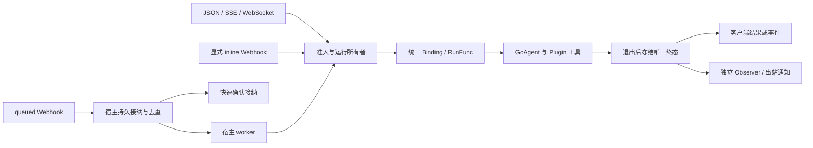

# GoAgent HTTP 服务适配设计

日期：2026-10-31。状态：**审核后修订稿，待整体确认，产品功能尚未实现**。本轮复核基线为 `57c0f05`，发现、来源与实际探针见[审核报告](../../evaluation/2026-10-31-httpagent-design-audit/REPORT.md)。此前早期 Builder Check 不代表包含 WebSocket 的完整版本已通过审核。

## 1. 目标、位置与方案取舍

用户已明确要求：外部系统通过 HTTP 调用 Agent；提供 Web 页面、WebSocket 入口、Hooks 及双向 Webhook。具体 API、默认值和交付保证由本设计提出。

实现放在独立模块 `github.com/kart-io/goagent-contrib/httpagent`，使用 net/http，WebSocket 复用当前依赖基线 gorilla/websocket v1.5.3；不自行实现帧协议。案例位于 goagent-examples/orchestration/httpagent。主库继续提供执行内核；Plugin 贡献业务工具、提示词、钩子和共享资源，HTTP 适配器负责协议与生命周期。

| 方案 | 结论与理由 |
| --- | --- |
| net/http Handler + JSON/SSE/WS，共用执行绑定 | 推荐；可挂入宿主现有路由，避免新增执行引擎 |
| Plugin.Start 内启动并调用尚未构建的 Agent | 不作为默认装配；Host.Start 在 Install/Build 前，存在循环依赖 |
| 直接宣称 OpenAI、ACP 或 A2A 兼容 | 不采用；各自输入、会话、事件语义不同，本次未要求对应协议 |
| AG-UI 前端适配 | 已调研，保留独立 Codec/Adapter 扩展；当前事件缺少完整 tool call ID/参数流，不能将改名后的事件冒充完整兼容 |

正常装配：启动 Plugin Host → 构建请求级 Factory/执行绑定 → 挂载 Handler 和演示静态页面 → 启动 http.Server。HTTP 包不自动监听端口，不绑定前端框架。



## 2. 先统一执行语义，再选择传输

**禁止将 Builder.Execute 直接当成所有入口的标准执行函数。** 当前 Execute 是普通同步回答路径，不隐式执行工具，且拒绝 durable、根预算及部分原生工具选项。ExecuteStream 才承载原生工具循环；同步等待结果也应消费同一条事件执行路径。

Factory 显式返回执行绑定，语义如下；具体导出名称可在实现时调整，不能改变保证：

```go
type RunRequest struct {
    ID string
    Input any
    Source string // invoke、stream、webhook、ws 或 worker
    Webhook string
}
type EmitFunc func(builder.AgentEvent) error
type RunFunc func(context.Context, any, EmitFunc) (*builder.AgentOutput, error)
type Binding struct {
    Run RunFunc
    Streaming bool
    Mode string // unified 或 answer_only
}
type Cleanup func(context.Context) error
type Factory func(context.Context, RunRequest) (Binding, Cleanup, error)
```

- **unified 绑定**：由适配器消费 ExecuteStream，向 Emit 传递非终态事件，捕获 done/error 后继续等待生产者通道关闭，最终才返回 Output/error。所有入口使用同一个 RunFunc；/invoke 仅不向客户端转发中间事件，工具、预算和 Hook 语义保持一致。不能直接用收到 done 就返回的 AsRunnable.Invoke 作为资源已退出的证据。
- **answer_only 绑定**：宿主明确选择普通 Execute 的回答语义，Streaming=false。不承诺原生工具循环、原生循环 Hooks、持久执行或根预算；不得根据一次流式失败自动切到这个模式。
- Factory 依据实际模型及构建配置选择模式：至少检查 llm.HasStreaming；需要原生工具与循环 Hooks 时检查 llm.HasToolStreaming。所有 ConfigurableAgent 都有 ExecuteStream 方法，方法集断言不能证明底层能力。可在构建前返回适配器的有类型 unsupported 错误；不能靠匹配错误文本判断能力。
- Streaming=false 时，/stream 在 Run 调用前返回 501；WS 仍可调用同一 RunFunc，最终只返回 done/error，不伪造增量。流式启动失败属于本次运行失败，不重新调用其他入口。
- RunFunc 的 Emit 错误必须取消生产者，RunFunc 在生产者真正退出后才返回；等待期间客户端传输可以先因超时关闭，但不能把传输结束当成 Run 返回或业务终态。忽略 context 的自定义实现保留运行与资源所有权；HTTP 超时不能把仍在执行的资源释放或复用。

## 3. HTTP、数据与错误

| 入口 | 行为 |
| --- | --- |
| POST /invoke | `{"input": ...}`；同步等待统一 Run，返回 `{"schema_version":1,"run_id":"...","output":<Output>}` |
| POST /stream | 相同输入；统一 Run 的非终态及最终结果通过 SSE 传输 |
| GET /ws | HTTP/1.1 Upgrade 为 WebSocket，执行/取消消息采用第 6 节协议 |
| POST /webhooks/{name} | 宿主注册的入站接收器，按第 8 节接纳外部事件 |

普通输入必须提供且非 null，允许任意有效 JSON 值。顶层未知字段、多文档、非法 JSON 返回 400；使用 json.Number 避免大整数失真。大小上限作用于实际读取字节，默认 1 MiB。入站接收器读取原始 body 后自行解码，不强制套用普通 input 包装。

每次获得准入的运行由适配器生成 UUID run_id，响应 X-GoAgent-Run-ID、JSON/SSE/WS 与通知共用。WS 的 run_id 在 accepted 中返回，不伪称能在已经结束的 Upgrade HTTP 响应头中返回后续每次运行 ID。request_id 只用于 WS 客户端消息关联，不具有幂等含义。业务 SessionID 和持久运行身份由宿主单独配置。

Output 明确包含 result、metadata、duration_ms、timestamp、token_usage；不序列化 AgentOutput.State。Event DTO 明确声明 schema_version=1、run_id、递增 seq、type，以及按类型出现的 delta、sources、step、tool、usage、output、error。error 统一为 `{code,message}`，不直接序列化 Go error。类型表以 sources、step、text、usage、done、error 为 v1 已知事件；未知内部类型交给显式自定义编码器，否则报告协议错误，不静默当作文本。

事件先编码为不可变 JSON 字节，再进入传输队列/通知；不能只浅拷贝可变 Output/map。正常结果预编码失败，终态为 failed/output_encoding_failed。失败不意味着工具副作用已回滚，不自动重执行业务。事件结构变更使用新的 schema_version；WS 协商子协议 goagent.v1；本次不承诺断线回放，即使有 seq 也不接受 Last-Event-ID 为恢复凭证。

| 情况 | HTTP 状态/错误码 |
| --- | --- |
| 非法输入、映射错误 | 400 / invalid_request |
| 请求体超限 | 413 / input_too_large |
| 路由或方法错误 | 404、405；405 带 Allow |
| 不支持流式 | 501 / unsupported_capability，Run 前返回 |
| 准入/队列容量不足 | 429 / busy；业务不执行 |
| 服务已开始关闭或接纳组件暂不可用 | 503 / unavailable |
| 明确的执行期限到达 | 504 / timeout |
| Factory/Runner/编码失败 | 500 / 对应稳定错误码 |

响应已提交后，只能发送协议 error，不能再改 HTTP 状态码。未知 EOF 映射 stream_incomplete，不能猜测为成功或超时。客户端断开后停止向其写响应；实际执行尚未退出时，不把 HTTP 超时错误当作已冻结的 run.failed/cancelled，生命周期终态须待退出后确认，投递错误单独记录。

## 4. 唯一终态、取消与资源状态

每个运行具有一个所有者。执行状态：registered → building → running → finalizing → frozen；资源状态独立为 owned → draining → closed。queued 仅用于宿主已持久接纳的 Webhook，不表示 Agent 已执行。

1. 原子检查开放状态/容量并登记所有者，**早于 Factory、accepted 写入和任何宿主回调**。Factory 构造中、等待执行门和部分失败也计入 Shutdown。
2. 原始 done/error 仅为候选终态，正常与取消路径都必须等待生产者关闭；默认等待上限 5 秒。无终态 EOF 为 stream_incomplete；生产者迟迟不关闭则取消，并报告 execution_unconfirmed 传输/清理异常：JSON 尚可响应时返回 504 和未确认错误；SSE/WS 关闭客户端流而不发送伪业务终态，页面显示“未确认完成”。所有者仍保留清理责任及容量占用，等待真实退出后才冻结业务终态并发送生命周期通知。
3. 唯一所有者在生产者退出后检查已知取消/期限、校验 Output、预编码事件，并通过唯一提交点冻结 completed/failed/cancelled 之一。终态冻结前已观察到的取消优先；冻结后发生断线、cleanup 或投递错误不再生成第二个终态。
4. 终态冻结后才向客户端/Observer/出站 Sender 交付对应事件。传输失败独立报告，不能重跑 Run。传输层未能把结果送达时客户端可能无法确认业务效果，页面不得自动重新提交。
5. cleanup 在 Factory/Run 实际退出后执行一次，使用独立、有界 context；部分构建失败若返回 cleanup，也必须执行。cleanup 失败或超时报告清理错误；不伪称资源已全部释放。
6. 请求取消、断线和外部期限传递给 Factory/Run。采用适配器共同的外层期限；示例 Builder 不设置更早的隐藏期限。自定义 Runner 内部期限若只表现为 EOF，映射 stream_incomplete；只有明确的 DeadlineExceeded 才映射 timeout。

HTTP Handler 可以停止等待，但正在执行或延迟清理的工作必须仍由所有者登记，不能成为无主 goroutine。默认 MaxActiveRuns=64，包含构造/执行/等待退出/cleanup 及仍未完成的观察与通知；超时未退出者不释放槽位。连接执行槽在执行与必要 cleanup 完成后释放；全局运行槽要等该所有者的全部跟踪工作（含通知）退出才释放；无限制等待由有限槽位约束，不创建无界排队。

## 5. SSE 与 Web 页面

SSE 使用 `event: <type>\ndata: <Event JSON>\n\n`，UTF-8、逐事件 flush；15 秒无事件时发送注释心跳，不改变业务 seq。响应使用 text/event-stream 并禁用缓存；不会声明自动重连/重新执行。

SSE 与 JSON 写入都设置有界 write deadline，默认每次写/flush 10 秒，并检测错误。使用 http.ResponseController（兼容 Unwrap 的中间件）；SSE 开始前检查 Flush/Deadline 能力，不支持则在 Run 前返回 unsupported_transport。不能用忽略 Flush 错误的旧接口代替成功证据。已有 Server.WriteTimeout 须与流式写策略一致；响应头提交后不能靠调整已过期截止时间恢复连接。应用执行期限不等于 socket 写期限。

Web 页面在 examples 同源挂载，包含输入、发送、实时文本、工具状态、最终结果、错误、取消和 SSE/WS 切换。POST SSE 用 fetch 读取，使用标准 UTF-8 流式解码和可复用 SSE parser；正确处理 CRLF/LF、注释、多 data 行、分块半帧及 UTF-8 字符分片。EOF 前没有业务终态显示“未确认完成”，不将连接关闭当完成。停止使用 AbortController；HTTP 失败或断线不自动重提。

分离部署由宿主中间件配置 CORS、OPTIONS 和暴露 X-GoAgent-Run-ID；示例说明代理缓冲、空闲连接超时和流式转发配置。页面同时覆盖输出编码失败及取消终态，不仅展示正常文本。只有实际提供 tool 事件时才显示工具执行卡片，不伪造调用 ID 或审批状态。

## 6. WebSocket

使用 goagent.v1 JSON 应用子协议；示例要求 HTTP/1.1 Upgrade，不宣称支持 HTTP/2 Extended CONNECT。同一连接连续运行、同时最多一个任务；不同连接独立。默认 MaxConnections=128，握手前进行连接容量和关闭状态检查，连接注册与 Shutdown 互斥；升级中也纳管。

```json
{"type":"run","request_id":"client-1","input":"查询订单"}
{"type":"cancel","run_id":"服务端ID"}
```

- 合法 run 先登记运行并生成 ID，单一 writer 确认 accepted 帧写入成功后再执行 Factory/Run。accepted 表示进程内已登记，不表示持久入队或任务一定成功。写入失败取消所有者，不启动业务。
- accepted：`{type:"accepted",request_id,run_id,schema_version:1}`；事件：`{type:"event",run_id,event:<Event DTO>}`；协议错误：`{type:"error",request_id,error:{code,message}}`。协议错误不属于另一个有效运行的终态。
- 额外 run 在活动所有者退出前返回 busy。正常/取消终态在生产者退出后发送；必要 cleanup 完成并释放槽位后发送 `{type:"ready"}`。页面收到 ready 才允许下一次运行，避免终态与资源释放间的竞态。
- cancel 只作用于该连接匹配的活动 run_id，原子登记取消意图并取消 execution context；返回的业务终态使用 Event.error.code=cancelled。不能取消其他连接或 HTTP/Webhook 任务。终态已冻结时返回 already_finished，不追发 cancelled。
- 原始消息大小默认 1 MiB，二进制业务帧拒绝。非法 JSON/类型返回协议错误；超大帧或坏帧按 WS 协议关闭连接。重连和重复 request_id 不具有恢复或幂等含义。
- 保持一个 reader 和一个 writer。reader 在 Factory/Run/通知进行时仍处理 cancel 与控制帧。控制帧按 SDK 允许方式处理，Ping/Pong 不被业务队列阻塞。ping 默认 30 秒，pong 等待 60 秒；写期限默认 10 秒。
- 每连接输出同时限制 64 个事件、4 MiB 排队字节、单事件编码后 1 MiB；所有入队受 execution context 取消约束。超限断开并取消运行，不能仅按帧数声称字节内存有界。超大最终结果报告 output_too_large，不伪装已送达；配置可调整。
- reader/write/heartbeat 失败显式取消活动运行；不能依赖升级前 Request.Context 自动发现断线。重连无自动回放或重执行业务。Origin 策略与 HTTP CORS 分开由宿主配置。

## 7. Hooks 与观察者

| 层级 | 接口与效果 |
| --- | --- |
| HTTP 中间件 | 标准 Handler 包装；业务身份注入/输入处理；须保留 ResponseController.Unwrap 或必要能力 |
| Plugin/Agent | 既有 Contribution、Callback、Middleware、PreStep、RequestHook、RequestErrorHook、TurnStopping；保持其错误与回放语义 |
| 工具调用 | Dispatcher 的 Pipeline.Pre/Around/Post/Approver，保持原有裁决和持久调用规则 |
| 适配器 Observer | 独立的 run.started/completed/failed/cancelled 观察接口，不能改变执行终态或触发业务重试 |

Observer 与业务 Callback 是不同类型。Callback.OnStart 在当前 Builder 构建期触发，不能直接当“每次 HTTP 执行开始”；OnEnd 错误可影响业务结果，也不能承载失败无影响的 Webhook Sender。

Observer 接收冻结的事件快照，有有界 context；返回错误和 panic 均单独报告并隔离，不能中断已经确认的结果。run.started 定义为成功准入、开始构造执行的阶段，Factory 失败也有对应 run.failed；非法输入、未接纳的请求和已排队但尚未开始的任务不伪造 started。运维 ErrorReporter 不递归调用 Observer。

| 执行模式 | 工具/循环 Hook | 生命周期 Observer |
| --- | --- | --- |
| unified + 原生工具流 | 沿用核心已支持的工具与循环 Hook | HTTP/SSE/WS/worker 一致 |
| unified + 无原生工具配置 | 按实际模型能力工作，不承诺全部工具 Hook | 一致 |
| answer_only | 普通 Execute 支持的 Callback/中间件；不承诺原生循环 Hook | 一致 |

Hook 必须并发安全并配合 context；不能强制结束忽略 context 的 Go 函数。报告错误不影响业务不等于不消耗时间，观察与投递预算独立跟踪并参与 Shutdown。

## 8. 入站 Webhook：接纳与执行分开

原稿默认等待 Agent 完成后才应答，无法普遍满足外部平台的快速确认要求。修订为两种**显式模式**，不静默降级：

- **queued 模式（推荐用于第三方平台）**：接收器解析/校验原始事件，提取稳定 source/event_id，调用宿主注入的 Acceptor。Acceptor 负责持久接纳、重复事件原子判定及稳定 run_id；成功后立即返回 202，兼容要求固定 200/响应 challenge 的平台可由接收器显式定义应答。HTTP 202 本身不保证持久性，此处持久接纳是本适配层与宿主约定。
- Acceptor 缺失或配置不完整时，NewHandler 返回配置错误，不用内存 goroutine 冒充 queued。容量不足返回 429，暂不可用/接纳结果未知返回 503；重复提交相同事件须复用接纳记录，不启动第二次业务。source/接收器/租户共同限定去重键；重复 ID 且不同 payload 按冲突报告，不覆盖。
- 宿主 worker 在接纳提交后，用独立于接收 HTTP 请求的 context 进入同一 Factory/Run，沿用运行 ID、Hook、Observer 和出站通知。worker 生命周期由宿主队列管理，HTTP 断开不能撤销已持久接纳的事件。队列不由本模块新造；实现必须提供 Acceptor/worker 接口和真实接纳测试，不能只有 TODO。
- **inline 模式**：宿主显式选择、接受调用方等待 Agent 完整结果；断线/超时取消。只承诺自有系统同步触发，不将其描述为通用 GitHub/Slack/Stripe 兼容入口。无 Acceptor 的自包含示例可以使用此模式，但必须明确标识。

queued 应答表示接纳，run.started 表示 worker 真正开始；二者不是同一事件。入站去重不等于工具 exactly-once；worker 崩溃恢复与副作用保证仍由宿主队列和既有 durable 工具策略承担。

## 9. 出站 Webhook

由宿主配置目标 URL、HTTP Client、请求头、超时和事件选择。请求体不接受临时 callback_url。信封使用 schema_version=1、event_id、run_id、event_type、occurred_at、data；默认订阅 completed/failed/cancelled，可选 started。

默认一次有界 best-effort 投递；同一次运行的冻结终态为所有目标复用同一 event_id。每个目标最多尝试一次，后续宿主重投保留 ID。只有冻结的业务终态进入 Sender；清理与网络错误不生成第二个业务终态。

Sender 不在 WS reader/writer 内执行，也不直接装成 Callback。它参与所有者的投递跟踪，逐目标超时默认 5 秒，单运行总投递预算默认 5 秒；剩余预算不足的目标标为未投递并报告，不无限串行累加。默认 HTTP Client 不自动跟随重定向，也不配置应用层自动重试；接收 HTTP 2xx 才算本次响应成功。响应体有界处理并关闭。网络不确定性不等于外部未接收，不能承诺 exactly-once。

发送失败单独报告，不改已冻结结果，不重跑 Agent。需要崩溃后重投时，由宿主用同一 DeliverySink 接口接入持久 outbox；未配置时明确没有该保证。持久 Sink 返回表示已接纳；默认 best-effort 使用运行所有者内的有界同步尝试，JSON 响应在预算内尝试后返回，SSE/WS 终态可先发送，Shutdown 及全局运行槽仍跟踪至投递退出；WS ready 在必要资源清理后发出，不等待远端通知目标变为健康。

## 10. 停服与共享会话

不能先同步等待 http.Server.Shutdown 完成，再取消 Handler：前者不会取消活动请求，也不负责已升级 WS。

推荐顺序：

1. Handler.BeginShutdown 原子关闭所有准入，取消已登记的构造/执行，通知并关闭已登记 WS；不等待退出。
2. 调用 http.Server.Shutdown 停止监听并等待 HTTP，同时 Handler.Shutdown 等待运行、生产者、cleanup 与已登记投递退出；可并行等待，共用宿主总停服期限。BeginShutdown 和 Shutdown 均须幂等。
3. 两者结束且资源跟踪为空后，才关闭 Plugin Host、模型客户端与共享存储。超时返回可诊断错误，保留实际清理责任，不能宣称已安全释放。

普通请求默认按运行隔离。Factory 若构造多个使用同一 SessionID 的 Agent，单个 Agent.executionGate 不能提供跨实例串行保证；宿主须提供会话锁或持久租约。入站 worker、Web 页面和多个 WS 连接共享业务会话时亦然，不能仅靠一连接一运行保护共享状态。

## 11. 默认值与验收

默认值均为本方案选择，可配置且在构造时校验：输入/WS 单消息 1 MiB、最大事件 1 MiB、每 WS 队列 64 项/4 MiB、活动运行 64、WS 连接 128、执行期限 5 分钟、生产者退出/cleanup 各 5 秒、写期限 10 秒、SSE 空闲心跳 15 秒、WS ping/pong 30/60 秒、单运行总通知预算 5 秒。

实施采用先失败后修复测试。验收必须包含：

- 真实 Builder + Plugin 工具在 JSON/SSE/WS/入站 inline/worker 入口都执行同一工具，预算、持久日志和原生 Hook 语义一致。
- 只有同步模型但具有 ExecuteStream 方法时，能力声明正确，/stream 在 Run 前 501；流启动失败不触发同步重执行。
- 构造中关闭、部分 Factory 失败、accepted 写失败、取消与 done 竞争、正常 done 后生产者不退出（传输关闭且无伪终态，所有者保留，真实退出后仅通知一次）、未知 EOF、隐藏内部期限、cleanup 超时及二次 Shutdown。
- 真实 TCP/SSE/WS 测试慢客户端、Flush/Deadline 不支持的中间件、心跳、字节级队列上限、超大输出和已升级连接回收；HTTP/WS 请求错误不是别的运行终态。
- queued 的持久接纳后快速应答、重复源事件复用 ID、接纳失败不 ACK、HTTP 断开后 worker 仍执行、worker 使用同一运行接口；inline 不冒充平台异步接纳。
- 出站真实 HTTP 2xx/非 2xx/超时/重定向、总投递预算、Observer panic/错误、Webhook 不重跑业务、稳定事件 ID 和终态只提交一次。
- 多个 Factory 实例共享同一业务会话时的宿主锁/租约验证。
- 真实浏览器检查 SSE/WS、中文字符跨块、工具状态、取消与断线未确认状态；不能用 curl 冒充页面验收。

contrib 新模块执行完整 go test -race、vet、lint；同步脚本自动枚举模块。示例使用可获取的已发布版本或已推送提交，禁止提交机器 replace 路径。HTTP/WS 本地探针与脚本模型不代表线上模型质量验收。

## 12. 交付边界

本轮交付协议适配、执行绑定、Web 页面示例、双向 Webhook 接口、Hooks 组合及验证，不新增执行引擎、通用任务队列、完整聊天平台或未要求的协议兼容。

queued 接纳与可靠 outbox 的后端由宿主注入；实际平台适配必须根据其确认时限、事件 ID 和 challenge 语义验收。暂未选定具体队列后端，不能把注入接口描述为已具备开箱即用的可靠后台服务。

审核结论：原稿有必须先修订的执行语义与接纳问题；本稿已明确技术边界，可据此细化实施计划。接口实现、压力行为和完整端到端保证仍须由上述验收证明。


## 13. 修订复核记录

独立代码契约复核确认，原 7 项核心发现已由统一 Binding、显式能力、构造前登记、先取消后等待、独立 Observer 和共享会话约束覆盖。复核又指出“生产者不退出时立即发送 timeout 终态”与“必须 EOF 后冻结”冲突；已采用传输未确认策略：先关闭客户端等待、不发送伪业务终态，保留所有者至真实退出后冻结一次。此记录不替代产品实现及取消/泄漏验收。


## 14. 实施后的契约补充

实现与验收见 [实施报告](../../evaluation/2026-10-31-httpagent-implementation/REPORT.md)。核心依赖已确认为正式 v0.32.2；新 contrib/httpagent 尚未推送，当前示例以独立嵌套模块及项目外 workspace 验证，外部依赖可下载性留待发布后验收。该实施决策替代第11节对本轮已发布依赖的要求，不宣称模块已发布。

最大事件限制覆盖实际传输包装，最小可配置值512字节；WS request_id 和宿主提供的 run_id 最长128字节，完整 WS 终态帧在结果冻结前校验。无法传输终态时关闭连接，不发送暗示运行已完成的 ready。SSE 能力检查成功后即可发送注释心跳，无需等待首个业务事件。

冻结时先创建不可变通知快照，worker 返回值为独立副本；通知和 cleanup 并行推进且都归所有者跟踪。JSON 在总通知预算内等待本次尝试，WS ready 等待必要 cleanup。超时诊断 Report 回调也必须退出后所有者才释放，Shutdown 不能遗漏仍活动的回调。

queued 同事件/不同 payload 的接纳冲突使用409。不能提供写期限能力的中间件，在执行或持久接纳前返回501。跨实例共享会话的锁/租约仍为宿主契约，当前五入口集成证明按运行隔离的原生工具、持久预算/日志和 Hook，未声称验证宿主自定义锁。
