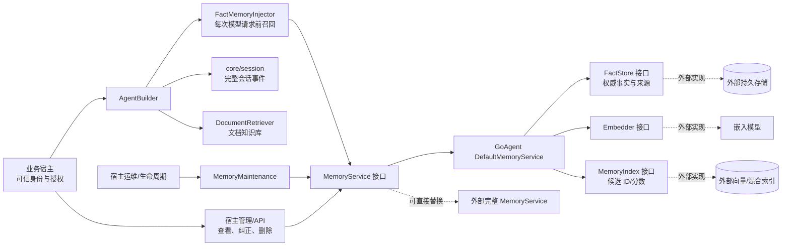
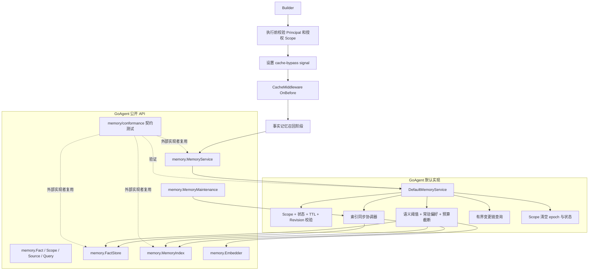
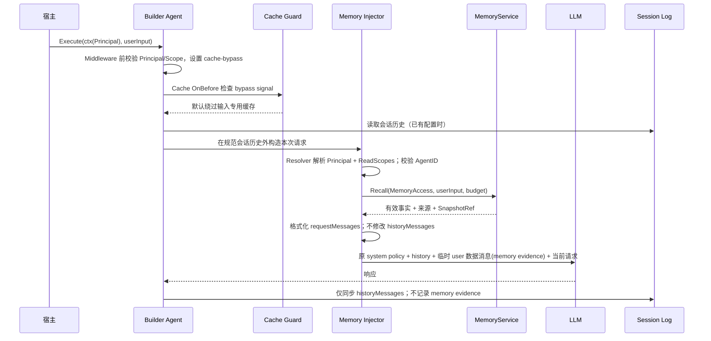
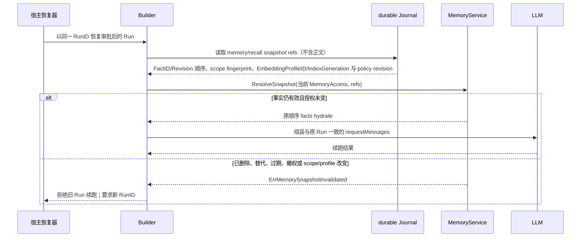
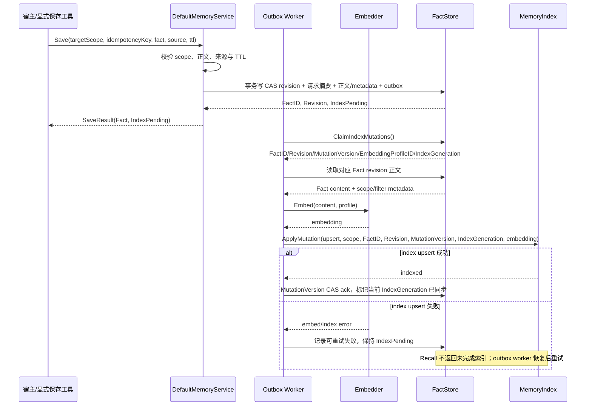
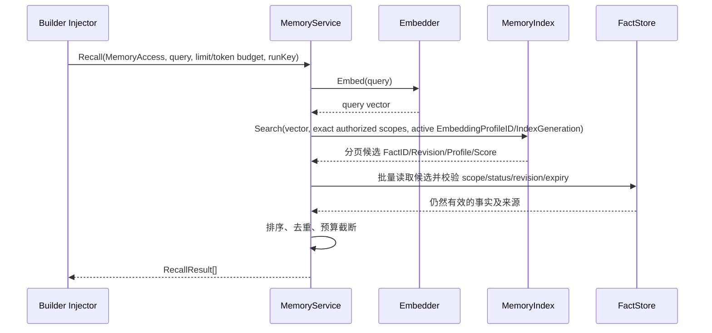
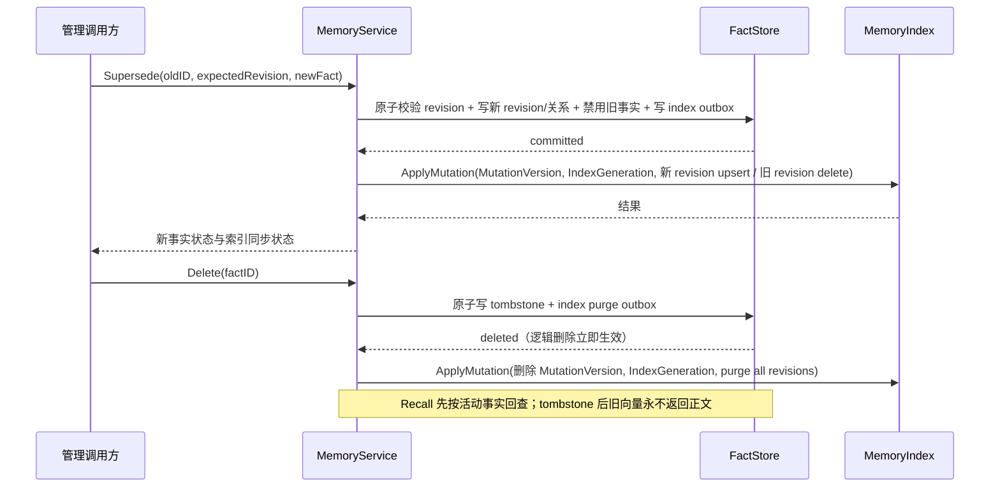
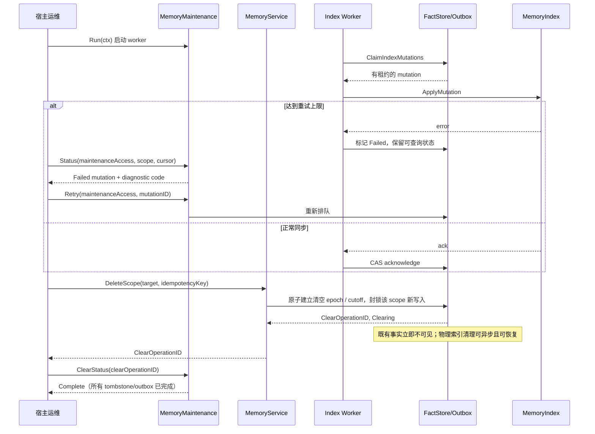
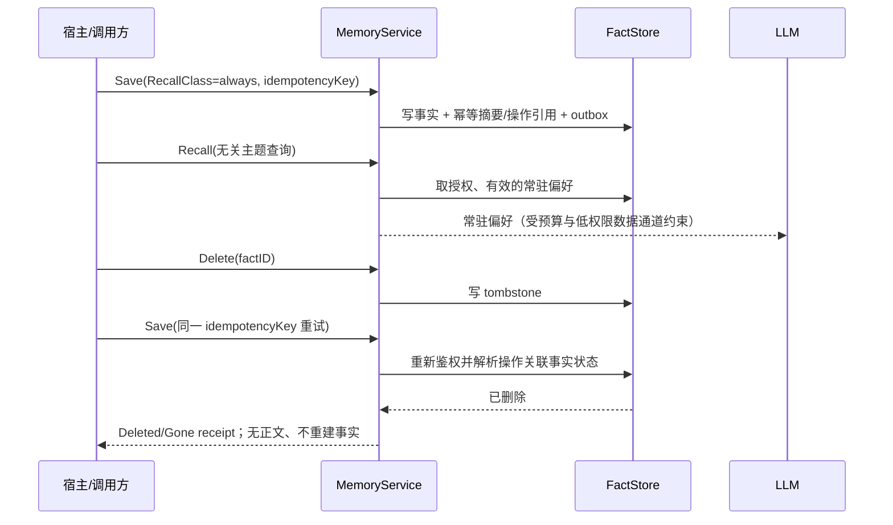

# GoAgent 持久事实记忆服务架构与设计

日期：2026-11-08。状态：经独立 Go 架构评审修订的推荐设计，供实施计划使用。

需求来源：[持久事实记忆服务需求](2026-11-08-persistent-factual-memory-requirements.md)。本文给出组件边界、公开扩展点、数据流和一致性规则；具体导出符号与数据库 schema 在实施计划中确定。

## 1. 设计目标

在 GoAgent 核心仓库提供稳定的事实记忆抽象、默认服务编排与 Builder 上下文集成，同时允许外部模块替换整个服务，或只替换持久事实 Store、检索 Index 和 Embedder。服务以持久事实记录为真源，向量索引只负责候选召回。

本设计维持三类数据的边界：

- `core/session` 继续记录完整交互事件和执行轨迹。
- 新的事实记忆服务保存经显式提交或确认、以后仍有用的内容。
- `interfaces.DocumentRetriever` 继续用于 RAG 文档检索，不纳入事实 CRUD 生命周期。

## 2. 已确定的设计选择

### 双层扩展边界

GoAgent 导出高层 `MemoryService` 契约供 Builder 与宿主消费；外部模块可直接实现该接口。GoAgent 同时提供默认组合服务，外部可以仅实现底层 `FactStore`、`MemoryIndex` 或 `Embedder` 后交给默认服务编排。

```text
调用方 / Builder
       │ MemoryService
       ├─────────────────────────────┐
       ▼                             ▼
GoAgent 默认服务                外部完整 MemoryService
       │
       ├── FactStore   <── 外部数据库/持久存储适配
       ├── MemoryIndex <── 外部向量/混合检索适配
       └── Embedder    <── 外部嵌入模型适配
```

此方案保留外部完整替换能力，同时让使用 GoAgent 默认服务的宿主复用统一的事实生命周期、作用域过滤和 Builder 注入规则。仅有低层 Store/Index 扩展无法覆盖所有特殊后端；仅有高层 Service 扩展又会迫使每个适配器重复实现生命周期和检索编排，因此两层同时开放。

### 核心与外部 Provider 的责任

- 核心拥有公开数据类型、服务接口、错误、选项、默认服务编排、上下文集成与 Provider 契约套件。
- 外部完整 `MemoryService` 自行实现其持久化、过滤、来源、生命周期和索引一致性，并通过同一契约套件验证。
- 外部底层 Provider 仅实现公开 Store/Index/Embedder 接口，由 GoAgent 默认服务负责组合。
- GoAgent 不强制绑定 Postgres、pgvector、Qdrant 或某个模型 SDK。参考持久化实现可由独立模块提供。
- 禁止依赖未导出方法、具体实现类型断言、全局注册副作用或 `goagent-contrib` 私有类型作为扩展前提。

## 3. 系统上下文架构



`MemoryService` 是稳定的消费边界。默认实现把事实管理与检索编排留在 GoAgent；外部若需不同模型、加密或存储策略，可直接注入自己的完整服务。`FactStore` 和 `MemoryIndex` 均是可替换实现，不通过会话日志或向量服务隐式保存正文。维护接口由宿主按服务生命周期启动；scope 清空在 Store 事务建立 epoch 和 cutoff 后立即不可见，目标 scope 的新写入在异步索引清理完成前被拒绝。

## 4. GoAgent 内部组件关系



包依赖方向为 `builder -> memory -> core/interfaces`。`memory` 不导入 `builder`；`builder` 只调用公开 `MemoryService`，避免形成循环依赖。现有 `interfaces.MemoryManager` 保持对话历史用途，不扩展为事实库。

## 5. 推荐的公开契约形状

以下是职责草图，不是已经冻结的 Go 签名。命名、分页游标和 option 形态应由实施计划根据当前 API 风格落定。

```go
type MemoryService interface {
    Save(context.Context, WriteScope, IdempotencyKey, FactInput) (SaveResult, error)
    Get(context.Context, MemoryAccess, FactID) (Fact, error)
    List(context.Context, MemoryAccess, FactFilter, PageRequest) (FactPage, error)
    Update(context.Context, WriteScope, FactID, Revision, FactPatch) (Fact, error)
    Supersede(context.Context, WriteScope, FactID, Revision, IdempotencyKey, FactInput) (SaveResult, error)
    Delete(context.Context, WriteScope, FactID, Revision) (DeleteResult, error)
    DeleteScope(context.Context, ClearAccess, MemoryScope, IdempotencyKey) (ClearOperation, error)
    Recall(context.Context, MemoryAccess, string, RecallOptions) (RecallResult, error)
    ResolveSnapshot(context.Context, MemoryAccess, SnapshotRef) (RecallResult, error)
    ListChanges(context.Context, MemoryAccess, FactID, PageRequest) (ChangePage, error)
}

type MemoryScopeResolver interface {
    Resolve(context.Context, agentID string) (MemoryAccess, error)
}

type FactStore interface {
    ApplyFact(context.Context, WriteScope, FactMutation) (FactMutationResult, error)
    Get(context.Context, MemoryAccess, FactID, Revision) (Fact, error)
    List(context.Context, MemoryAccess, FactFilter, PageRequest) (FactPage, error)
    ListChanges(context.Context, MemoryAccess, FactID, PageRequest) (ChangePage, error)
    ClaimIndexMutations(context.Context, int) ([]IndexMutation, error)
    AckIndexMutation(context.Context, IndexMutation, IndexMutationResult) error
    BeginScopeClear(context.Context, ClearAccess, MemoryScope, IdempotencyKey) (ClearOperation, error)
    GetClearOperation(context.Context, MemoryAccess, ClearOperationID) (ClearOperation, error)
    ClaimClearOperations(context.Context, int) ([]ClearOperation, error)
    AckClearOperation(context.Context, ClearOperationID, ClearProgress) error
    ListMaintenance(context.Context, MaintenanceAccess, MaintenanceFilter, PageRequest) (MaintenancePage, error)
    RetryMutation(context.Context, MaintenanceAccess, MutationID) error
    CreateRebuild(context.Context, MaintenancePrincipal, EmbeddingProfile) (Rebuild, error)
    GetRebuild(context.Context, MaintenanceAccess, RebuildID) (Rebuild, error)
    AdvanceRebuild(context.Context, RebuildID, RebuildProgress) error
    ActiveIndexProfile(context.Context) (IndexProfileState, error)
    SwitchActiveGeneration(context.Context, IndexGeneration, RebuildID, StoreSequence, uint64) error
}

type MemoryIndex interface {
    ApplyMutation(context.Context, IndexMutation) error
    Search(context.Context, IndexQuery) (IndexPage, error)
}

type EmbedderResolver interface {
    Resolve(context.Context, EmbeddingProfileID) (Embedder, error)
}

type MemoryMaintenance interface {
    Run(context.Context) error
    Status(context.Context, MaintenanceAccess, MaintenanceFilter, PageRequest) (MaintenancePage, error)
    Retry(context.Context, MaintenanceAccess, MutationID) error
    ClearStatus(context.Context, MaintenanceAccess, ClearOperationID) (ClearOperation, error)
    StartRebuild(context.Context, MaintenanceAccess, EmbeddingProfile) (RebuildID, error)
    RebuildStatus(context.Context, MaintenanceAccess, RebuildID) (Rebuild, error)
}

type ClearAccess struct {
    Principal Principal
    TargetScopes []MemoryScope
    Capabilities []string // 由宿主认证层签发；允许清空目标 scope，不要求仍有普通写权限
}

type Embedder interface {
    Embed(context.Context, string) ([]float32, error)
    Profile() EmbeddingProfile // 模型身份/版本、维度、距离度量；索引代际单独管理
}
```

索引版本和水位分工为四套互不替代的状态：`IndexGeneration` 在整个索引 profile 重建并切换时递增；`MutationVersion` 对每个 FactID 单调递增，用于该事实乱序 mutation 和 tombstone 水位；`StoreSequence` 对整个 MemoryService 的持久写变更全局单调递增，用于全局重建 cutoff/追平；EmbeddingProfileID 描述模型/维度/距离度量，profile 变更创建新的 IndexGeneration。EmbedderResolver 可在在线重建期间同时提供新旧 Profile 的 Embedder。v1 对启用事实记忆的 Builder 完全绕过响应缓存，因此不创建或复用“缓存 generation”，也不拿上述任一版本代替缓存隔离。

抽象约束：

1. 所有导出接口仅包含导出方法；外部 package 可定义独立类型满足接口。
2. Builder 注入高层服务和宿主实现的 `MemoryScopeResolver`，例如 `WithFactMemory(service, resolver, options...)`。Resolver 在每次调用时从受信任认证上下文解析 Principal 与授权 scopes；不能直接把请求 body 中的 tenant/user 字段作为凭据。缺少租户/用户身份时失败关闭。
3. 区分 `Principal`（当前调用者）与目标 `MemoryScope`（数据归属）：首批只支持 `agent_private(tenant,user,agent)` 和 `user_shared(tenant,user)`。宿主 Resolver 返回包含 `ReadScopes`、`WriteScopes` 的 `MemoryAccess`；共享写入必须明确目标 scope，读取只能在 `ReadScopes` 中检索。未知模式、缺失身份、AgentID 不匹配或超出授权集合均为授权错误。
4. Scope 用于数据隔离，不替代业务鉴权。宿主负责生成授权作用域；Service/Provider 仍须在索引/存储查询中强制过滤，不能依赖调用方过滤全局结果。
5. 公共契约定义错误类别、context 取消、并发调用、生命周期关闭、revision 冲突和分页语义。外部实现可保留自己的底层错误作为 cause，但不得泄露正文或凭据。
6. `FactStore` 与 `MemoryIndex` 的过滤字段需完整表达 Principal、授权 scopes、事实状态、index generation 和 embedding profile。
7. Save/Supersede 必须接受稳定的调用方幂等键；键按租户、操作种类和规范化 scope 隔离。同键同摘要返回不可变操作收据，同键异摘要返回 conflict；收据不缓存事实正文，重放重新授权。过期后删除正文外的原结果，但保留不可逆 key digest tombstone，重放返回 `ErrIdempotencyExpired`；不得复用过期键或重新创建事实。FactID 由服务端生成不能代替写入幂等键。

### 建议的数据对象

```text
Principal:    TenantID, UserID, AgentID
MemoryScope:  TenantID, OwnerKind(agent | user), OwnerID, AgentID(optional for user_shared)
MaintenanceAccess: TenantID, OperatorID, AuthorizedScopes, Capabilities（独立于普通用户 MemoryAccess）
ClearAccess: Principal, TargetScopes, Capabilities（针对明确目标 scope 的清空授权；不等同于普通 WriteScope）
MemoryAccess: Principal, ReadScopes[], WriteScopes[]（由宿主授权解析）
WriteScope:   MemoryAccess, Target（必须属于 WriteScopes）
Fact:        ID, Scope, Content, Metadata, Source, Status, Revision,
             CreatedAt, UpdatedAt, ExpiresAt, SupersedesID, RecallClass(normal | always), Priority, IndexState,
             MutationVersion
EmbeddingProfile: ID, ModelProvider, ModelName, ModelVersion, Dimension, DistanceMetric
Source:      Kind(session | document | human), SourceID,
             SessionID/DocumentID, Position/EventSeq, ConfirmedBy/At
SnapshotRef:    ordered (FactID, Revision, MutationVersion, Score) references, scope fingerprint,
                query/policy version, EmbeddingProfileID, IndexGeneration
RecallResult:  hydrated Fact[], Score, MatchKind, SnapshotRef
```

`FactMutation` 包含目标 fact、expected revision、Actor、稳定幂等键和规范化请求摘要；Store 对事实 CAS、幂等操作引用/摘要、append-only ChangeRecord 与 IndexMutation outbox 原子提交。FactStore 的 `ListChanges` 读取同一事务产生的变更流。幂等收据只包含操作 ID、原始 revision、索引接纳状态等不可变字段，不缓存 Fact 正文；重放时先鉴权并检查当前状态：仍有效时返回原操作收据，已更新/替代/过期时仍返回收据但不包含当前或历史正文，已删除返回稳定 Deleted/Gone，撤权返回授权错误。最小去重 tombstone 不得随正文删除而删除；保留策略、键域及过期键错误必须公开。`ClaimIndexMutations` 采用有租约的持久领取，`AckIndexMutation` 对当前 MutationVersion 才更新该 Fact 的索引状态；已被更高版本淘汰的 mutation 仍必须原子确认为终态 Obsolete 并释放容量，不能改变现行索引；失败结果按公开退避策略重试。`IndexMutation` 包含 FactID、Revision、单调 MutationVersion、全局 StoreSequence、EmbeddingProfileID、目标 IndexGeneration 与 upsert/tombstone 动作；已被更高 MutationVersion 取代的 outbox 项进入终态 `Obsolete`，释放容量但不推进旧索引状态。`IndexQuery` 包含精确授权 scopes、活动 EmbeddingProfileID/IndexGeneration、过滤条件和 page cursor；Index 按作用域过滤后分页返回候选 ID，不能返回跨 scope 候选供上层再筛选。

`agent_private` 要求 tenant、user、agent 三项一致；`user_shared` 要求 tenant、user 一致且当前 Agent 位于 `MemoryAccess.ReadScopes`。Recall 可查询 `ReadScopes` 中的多个作用域并合并排序，返回结果仍标注每条事实的来源 scope。Save/Update/Supersede/Delete 一次只接受一个明确的目标 scope，且必须属于 `WriteScopes`；不提供空 scope 表示“全部共享”。

`Revision` 用于乐观并发控制。`ListChanges` 返回有界分页的动作、revision、Actor、时间、来源引用和替代关系；不得包含历史正文，删除审计仅保留不可逆 ID/引用。游标绑定主体、scope、filter 和排序版本，非法或复用到不同查询的游标明确报错。List/ListChanges 使用固定排序与起始高水位限定候选成员，并在每页按当前权限和生命周期 hydrate；删除/撤权成员可以消失，原位更新返回当前 revision，不承诺历史正文快照，剩余成员不重复。修改可采用原位修订，替代会形成新的逻辑事实并关联旧事实；无论物理 schema 如何设计，旧事实都必须退出默认召回。删除后的审计仅留 ID、动作、操作者和时间，不保留已删除正文。去重键摘要在事实正文删除后继续保留；期限由公开配置决定，过期键返回 `ErrIdempotencyExpired` 且不能重新创建事实。

## 6. Builder 请求与身份流

事实记忆是逐次请求的上下文资源，而不是 Builder 的全局静态用户身份。Builder 保存服务引用、`MemoryScopeResolver` 和召回策略；Resolver 在每次调用的可信 context 中解析 Principal 与 `MemoryAccess`。AgentID 来自 Builder/Agent 配置并与 Principal 校验一致。缺少身份或授权作用域时立即拒绝，不走 best-effort 空召回。



Recall 的普通语义结果必须达到配置的相似度阈值，允许返回空集；Score 统一归一到 [0,1] 且越大越相关，Index adapter 将 distance metric 转换为该分数，不支持转换时初始化不得启用阈值召回。宿主可在事实上显式标记 `RecallClass=always`，使稳定偏好（如首选语言）不依赖用户下一条问题的语义相似度。常驻事实仍经过 scope/授权、状态、TTL、同一预算和低权限 user 数据通道，按 Priority 和确定顺序截断。

召回内容只附加到发送给模型的 `requestMessages`，不进入规范 `historyMessages`。事实通过临时 `user` 数据消息发送，放在会话历史之后、真实当前请求之前，并用固定边界标明它是宿主提供的引用资料，要求模型把内容视为不可信数据。这里的 user role 仅是模型协议的数据通道，不表示最终用户说过这些话；它不写入 `sessionTurn.begin/sync/end` 或 `Handle.transcript`，也不会进入后续会话历史。不得使用 `system` role 承载事实，因为 OpenAI 兼容、Gemini 和 Anthropic Provider 都可能将其合并进高优先级 system instruction。该规则覆盖原生工具循环、普通流、Followup、Redirect 和重试。注入默认关闭，未配置服务时现有请求不变。

同一次普通逻辑调用固定一份 RecallResult/SnapshotRef，并在该调用的模型轮次中复用；新用户请求才开始新快照。对启用了 durable journal 的 Run，还须用稳定子操作键持久记录 SnapshotRef 与 scope/policy fingerprint，不保存事实正文；恢复时以同一组 `(FactID, Revision)` 重新 hydrate。事实已删除、过期、撤权或 scope/profile 改变时，拒绝恢复并返回明确的 `ErrMemorySnapshotInvalidated`，不得换用新的事实继续旧 Run。删除优先于恢复。

**缓存要求：**当前 `CacheMiddleware` 默认只以 `request.Input` 作为 key，且 cache hit 会跳过 Builder handler。v1 启用事实记忆时，所有响应缓存必须同时执行 no-read 和 no-store；不支持 bypass signal 的外部缓存不能与事实记忆组合。主体和 scope 校验发生在任何缓存读取之前。v1 不提供 memory-aware response cache，避免跨主体复用答案与事实变更后的陈旧答案。

核心 `CacheMiddleware` 通过公开 context signal 支持 Builder 请求级绕过。该 signal 表示 no-read 和 no-store：Cache `OnBefore` 不能查缓存，`MiddlewareChain` 的直接 `storeResponse` 以及独立 `CacheMiddleware.OnAfter` 都不能写缓存。自定义响应缓存若不识别该 signal，不能与事实记忆同时启用；不能只在 handler 内设置旁路标记，因为 cache hit 会直接跳过 handler。

### Durable Run 恢复



Journal 只保存不可逆的引用信息和 hash，不保存正文或 embedding。恢复用当前主体再次授权；已撤权或删除的数据优先不再提供，旧 Run 失败关闭。该规则保持 `durable.Do` 的模型 intent 稳定，避免审批等待期间事实变化导致相同模型操作键收到不同请求。

## 7. 写入与索引同步

事实记录是权威来源，索引可重建。默认服务要求 FactStore 在同一持久事务里 CAS 写事实 revision、幂等键/请求摘要与待处理的 index mutation outbox。该原子 outbox 是默认 Store 契约的必要能力，不由每个调用方任意选择。索引记录按 `(FactID, Revision, IndexGeneration)` 唯一标识，绝不使用同一 FactID 覆盖所有 revision。



重试必须使用相同幂等键和规范化请求摘要；仅返回服务端 FactID 不能覆盖“提交成功但响应丢失”的情况。同键异内容必须冲突。保存事实与索引状态分开表达；索引失败可返回 `IndexPending` 的持久 SaveResult，而不是模糊的 error-only 部分成功。索引同步器对 outbox 使用租约/领取、幂等 mutation、MutationVersion CAS ack 和有界重试；进程启动时继续未确认项。EmbeddingProfileID 变化时新建全局 IndexGeneration。在线重建先持久化 `Building` 状态和全局 StoreSequence cutoff；旧 generation 继续服务，EmbedderResolver 同时解析旧/新 Profile 的 Embedder；worker 将 cutoff 前事实按新 Profile 写入新 generation，并将 cutoff 后 mutation 双写/追平。Fact 的当前 generation 不存于权威 Fact 行，generation 属于索引投影/重建状态。只有扫描完成且新代际确认的 StoreSequence 追平水位覆盖切换瞬间之前所有变更时才原子切换 ActiveGeneration；失败时保留旧 generation 和可重试状态。重建中删除继续立即逻辑失效，并将 tombstone 应用到两代索引。

## 8. 召回流程与检索边界



`EmbeddingProfile` 固定模型 Provider/版本、维度与距离度量，不包含索引代际。保存和查询必须使用同一 EmbeddingProfileID；profile 不同的向量不可混合排序。更换 profile 时创建新的 IndexGeneration 并重建，完整后原子切换，失败期间旧代际继续服务或明确 unavailable。

Index 按授权 scope、EmbeddingProfileID 和活动 IndexGeneration 过滤后返回分页候选 ID，不直接作为内容响应。默认服务逐页回查权威 Store，重新校验授权 scope、Revision/MutationVersion、删除/替代状态、TTL、profile 和 IndexGeneration；低于 Store 当前 MutationVersion 的候选不计入 limit，过期候选也不计入 limit，继续取页直至凑足结果或达到明确的扫描上限。每个 `(FactID, IndexGeneration)` 保留 MutationVersion 高水位（包括 tombstone），迟到的低 MutationVersion Upsert 必须被拒绝。物理向量键含 `(FactID, Revision, IndexGeneration)`；删除向量后仍保留 tombstone 水位。不能原生条件写的外部索引适配器须在自己的持久层串行化 mutation 并保存同等水位。关键词检索可由 Store 或 Index 提供，但结果遵守相同过滤和回查规则。

## 9. 修改、替代与删除



删除成功的外部可观察语义是“立即不可读取/不可召回”；物理向量清理可异步完成，但必须可重试、可监控，不能改变逻辑删除结果。宿主应有能力查询清理积压；具体管理 API 可由外部业务服务提供，不在本期提供 HTTP 管理界面。

### 索引维护和作用域清空流程



### 常驻偏好与幂等重放



## 10. 一致性、故障与生命周期

- `FactStore` 是事实正文、来源、状态、revision、TTL 和索引待办的唯一权威来源。
- `MemoryIndex` 保存精确授权 scope、FactID、Revision、MutationVersion、EmbeddingProfileID 与 IndexGeneration；索引数据可从 Store 重建。
- 默认 Store 必须原子提交事实状态与 outbox mutation。outbox 有持久领取/租约、有限重试、幂等 Apply、MutationVersion CAS ack；这属于默认组合服务契约。
- IndexGeneration 是整个 MemoryService 的全局代际，不按 tenant/scope 分片；MutationVersion 针对 FactID 单调递增并用于拒绝乱序写入、确认 outbox 与保留删除水位；StoreSequence 是独立的全局变更序号，用于重建全局 cutoff 与追平水位，不能用 per-Fact MutationVersion 代替。两者不能互相替代。
- 输入和资源有界：Fact 内容上限 64 KiB、规范化 Metadata 上限 16 KiB；默认页大小 50、最大 200；索引 Worker 并发默认 4、最大 32；每个 tenant 的未处理 outbox 初始目标值 100,000。数值是可配置默认值而非所有 Provider 的统一硬上限；构造时 Provider 必须声明自身容量并拒绝超过能力的配置。普通 Save/Update 在容量不足时原子拒绝；Delete/DeleteScope 使用独立保留的清理/补偿容量，始终先使事实逻辑不可见。
- 分页使用固定排序与签名游标，游标绑定 tenant、Principal、scope/filter 和排序版本；跨查询复用、篡改或过期游标明确拒绝。首次请求高水位只限定候选成员集合，不承诺历史正文快照；每页按当前权限和生命周期 hydrate，删除/撤权条目可消失，原位更新返回当前 revision，剩余成员不得重复。游标到期后要求重新查询。
- 保存或更新：先持久化事实和待办，再幂等更新 Index；索引失败显式返回 `IndexPending` 状态，不能静默宣称完全可检索。较新 MutationVersion 使旧 mutation 过时时，旧项转为终态 `Obsolete` 并释放积压容量；其 ack 不得回滚当前索引状态。
- 删除或替代：先使旧 revision 在 Store 中失效，之后清理索引；删除 tombstone 立即阻止 Get/List/Recall hydrate；物理 purge 可异步但有可观测期限和重试状态。
- DeleteScope 由 MemoryService 发起，接受独立 ClearAccess 和明确目标 scope；宿主先封禁普通写入，再授权 ClearAccess。在 Store 事务中建立清空 epoch/截止高水位并立即使范围内既有事实不可见；清理任务由 MemoryMaintenance Worker 领取、推进并持久确认，可跨重启恢复。清理期间拒绝目标 scope 新写入，直到状态为 Complete；宿主注销流程先撤销/封禁该 scope 写权限，再以明确 ClearAccess 调用清空。Session 删除和 Fork 不隐式触发事实记忆删除或复制。
- 外部完整 `MemoryService` 可以采用不同内部实现，但必须对外满足上述可观察语义与契约测试。
- 记忆读取的失败策略独立于现有对话 `MemoryFailurePolicy`，避免把会话日志保存与事实召回混为一类。推荐显式配置 `best_effort` / `strict`，启用持久事实记忆默认 `strict`；best-effort 只可吞后端/索引暂时性错误，scope、身份、撤权、snapshot invalidated 等安全/一致性错误始终返回。
- 同一 Run 的 durable snapshot refs 只持久化 ID、Revision、MutationVersion 顺序、scope fingerprint、EmbeddingProfileID/IndexGeneration 与 policy version，不持久化事实正文。恢复时 rehydrate；如果事实已删除、过期、修改、撤权或 profile/IndexGeneration 改变，明确失败并要求新 execution key。
- Builder 在进入 MiddlewareChain 前解析并校验 Principal/MemoryAccess。v1 事实记忆启用时一律 no-read/no-store：公开 bypass signal 必须由核心 CacheMiddleware 的 OnBefore、MiddlewareChain 直接 storeResponse 路径、CacheMiddleware.OnAfter 及自定义响应缓存共同遵守。v1 不支持 memory-aware response cache；IndexGeneration 和 MutationVersion 均不能作为缓存失效版本。
- 服务和 Provider 的 Close 由拥有它们的宿主负责；Builder 不关闭共享 MemoryService。所有操作遵守 context 取消和超时。
- `MemoryMaintenance` 是公开非 HTTP 运维边界，使用独立 `MaintenanceAccess` 管理员权限；普通用户授权不足以触发全局重建、重试或清空。宿主管理 `Run` 生命周期，可按权限分页读取积压/失败/重建状态、重试失败 mutation、启动重建并读取进度。重试耗尽仍保留可诊断状态；进程重启后任务可继续。
- 指标记录操作、耗时、错误、索引积压及重建状态；日志不记录记忆正文、embedding、秘密或完整查询。

## 11. 接口实现者一致性验证

GoAgent 提供独立的契约测试套件，外部实现者可以从外部 package 调用，不依赖核心私有测试 helper。至少覆盖：

1. 外部类型编译期实现完整 `MemoryService`，并经 Builder 注入成功；低层 Store/Index Provider 可由默认组合服务装配。
2. 事实在服务关闭/重建后恢复；主体身份、AuthorizedScopes、私有/共享 scope 在 Get/List/Recall 全部精确生效。
3. 幂等键同请求回放、异请求冲突；非法/冲突 revision 更新不覆盖新数据，替代只保留一个 active 事实。
4. TTL、删除 tombstone 和 stale vector 回查均阻止过期/删除内容召回；乱序 mutation 和重复 ack 不回退 generation。
5. Store/Embedder/Index 错误、context cancel、outbox 重试和关闭行为符合公开错误语义。
6. durable 重启时稳定复用相同 snapshot refs；修改、撤权、过期或删除时安全地拒绝旧 Run 续跑。
7. 启用事实记忆时 CacheMiddleware no-read/no-store；记忆 Agent 写出的答案不能被共享同一缓存的普通 Agent 命中。
8. 不同 EmbeddingProfileID/IndexGeneration 的向量不参与同一召回排序；profile 切换只在重建后生效，MutationVersion 的乱序更新不能回滚事实索引状态。
9. 同一实现被多 goroutine 调用时满足接口声明的并发安全要求。
10. 常驻偏好、相关性阈值、幂等删除回放、索引失败恢复、作用域清空并发/重启、注销流程、变更链查询、容量背压和稳定分页，逐项符合需求 PM-30～PM-35。

契约套件应通过显式测试配置注入时钟、ID、embedding 和索引，以保证确定性；真实数据库/模型的验收属于外部 Provider 自己的扩展测试。

## 12. 留给实施计划的细节

实施计划可确定公开签名、错误码、outbox 租约/退避参数、去重 tombstone 保留周期、默认容量及 Provider 的具体数据库。任何默认容量须按 Provider 能力配置，不能冒充所有外部实现的统一硬上限。外部实现仍须通过上文 conformance suite；至少选定一个可重启的真实 Provider 作为持久化验收 fixture，才能完成发布验收。

