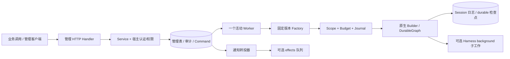

# 统一管理服务技术设计

> 执行更新（2026-11-08）：用户已授权执行，首批实现与案例验收已完成，见[实施结果](../../evaluation/2026-11-08-unified-management/REPORT.md)。原规划与调研文字保留作为基线，实际接口调整、合并测试和未覆盖边界以实施报告为准。
日期：2026-11-08。状态：原始技术设计基线；实施差异、组合验证和当前边界见[实施结果](../../evaluation/2026-11-08-unified-management/REPORT.md)。

输入：[需求](2026-11-08-unified-management-requirements.md)与[调研](../../research/2026-11-08-unified-management-feasibility.md)。输出：[实施计划](../plans/2026-11-08-unified-management.md)。本设计取代 `.claude/unified-management/design.md` 中的初步方案；特别是顶层任务不直接包装 background、Fork 仅限静止的完整轮次、单活动 worker 不自动租约抢占。

## 1. 架构与落点

建议新建 `github.com/kart-io/goagent-contrib/management` 独立模块，Go 1.27.0。管理数据库参考实现使用 Postgres 17、pgx/v5 v5.10.0；执行日志复用 contrib pgstore；GoAgent 依赖锁定能通过组合验证的已发布版本或提交。首批不增加 Redis、消息中间件或另一个 Agent 运行时。



管理模块拥有受管 Task 的生命周期；执行循环、工具调度和回放仍由 GoAgent 提供。HTTP Handler 只接纳持久命令，不能再调用 httpagent.Run 启动同一业务。原来的即时调用入口可继续存在，但应使用独立身份与会话准入，不能绕过管理会话的串行约束。

生产实现放相邻 contrib 仓库；这组设计文档先留在核心仓库便于共同评审。实施首步先读取目标仓库自己的工作规范。`management` 根包不依赖 Harness；Harness 适配放可选独立子模块 `management/harness`，避免仅使用核心的业务被迫引入 Harness。首批核心模块和 Postgres 后端必须能独立工作。

## 2. 数据与不变量

所有管理表主键/外键都带 `tenant_id`；资源 ID 使用服务端 UUID 字符串。操作者 ID 取可信 Actor。时间使用 UTC，修订号从 1 单调递增，更新必须匹配 expected_revision。以下列是首批必须存在的逻辑结构，不规定物理列顺序。

| 表 | 关键列 | 约束与索引 |
| --- | --- | --- |
| `mg_agents` | tenant/id、name、enabled、published_version、revision、created_at | 租户内 id 唯一；发布版本只能属于当前 Agent |
| `mg_versions` | tenant/agent/version、runner_kind、implementation_version、config JSONB、config_hash、created_by/at | 三元唯一，不允许覆盖；发布前完成配置与能力校验 |
| `mg_sessions` | tenant/id、agent/version、log_id、status、parent_id/fork_seq、source_hash、active_task_id、revision、created_by/at | status=preparing/ready/attention；log_id 为服务端生成的全局不透明 ID，不使用租户可重名的客户端 ID |
| `mg_tasks` | tenant/id、session/agent/version、run_id、execution_key、input JSONB、input_hash、state、wait_epoch、revision、result_ref、error_kind、created_at、finished_at | run_id/execution_key 全局唯一；(tenant,session,created_at,id)、(tenant,agent,state,created_at,id) 索引 |
| `mg_attempts` | tenant/id、task_id、number、worker_id、started_at、finished_at、outcome、trace_id | (tenant,task,number) 唯一；不作为模型账本主键 |
| `mg_approvals` | tenant/id、task_id、epoch、wait_ref JSONB、intent_hash、summary JSONB、state、decision JSONB、actor/reason/decided_at、revision | (tenant,task,epoch,wait_ref_hash) 唯一；state=pending/approved/rejected/expired/superseded |
| `mg_commands` | tenant/id、task_id 或 session_id、kind、expected_revision、payload JSONB、state、available_at、attempts、error_kind、created_at | kind=create_session/fork/start/cancel/resume；state=pending/applying/applied/blocked/conflict/attention；按状态/available_at 索引 |
| `mg_idempotency` | tenant、operation、key、request_hash、resource_id、response JSONB、expires_at | (tenant,operation,key) 唯一，默认保留 30 天 |
| `mg_audit` | tenant/id、resource_type/id、operation、actor、reason、before/after_revision、command_id、created_at | 追加写；不得混入凭据、原始第三方错误或内部恢复键 |
| `mg_outbox` | tenant/id、kind、target、payload JSONB、state、created_at | 事务提交后的通知投递，记录桥接是否已确认 |
| `mg_workers` | slot、owner_id、generation、state、started_at、last_seen_at | 首批固定 slot=default；一个 owner，不按 heartbeat 自动释放 |

完整输入必须持久化才能恢复，仅保存 input_hash 不足以恢复；原始结果保存在执行完成信封，管理表保留引用。输入、历史与结果由宿主选定数据库加密和数据保留策略；日志与查询使用脱敏摘要。业务 Agent 配置中的 SecretRef 不是凭据内容。

`TaskID` 为全局 UUID；`RunID=TaskID`，`ExecutionKey=durable.ChildKey("management/task", TaskID)`。模型预算 RootKey 使用 RunID，恢复继续使用原预算配置和原绝对截止时间，不因重启延长。Session 固定版本。AttemptID 每次真正调用 Runtime 新建；Query Run 返回一个逻辑运行及其尝试，不为每次恢复重建一个无关 Run。

## 3. 状态与顺序

| 当前状态 | 触发 | 后续状态与约束 |
| --- | --- | --- |
| queued | 获得会话所有权、槽位，版本/启用校验通过 | running，登记 Attempt 后才调用 Runtime |
| queued | 取消 CAS 成功 | canceled，不调用 Factory/Runtime |
| running | 返回纯等待，完成等待目录提交 | waiting_approval 或 waiting_input；保留 active_task_id，释放执行槽 |
| running | 返回有效结果且完成信封已保存 | succeeded，补索引并释放会话占用 |
| running | 返回明确错误 | failed；未知效果或缺失恢复证据为 attention |
| running | 接纳业务取消 | canceling，持久命令并请求本地 cancel |
| canceling | Runtime 真实退出 | 成功结果为 succeeded；取消错误为 canceled；其他错误按证据分类 |
| waiting_* | 合法决定/恢复命令并获准执行 | queued（保留同一 active_task_id），随后重新执行 |
| waiting_* | 取消 | canceled，同时 supersede 未处理待办，不再续跑 |
| running / canceling | 宿主停服 | 结束本次 Attempt，Task 标记 recovery_needed 元数据；不伪造业务失败或取消 |
| attention | 人工核对且适配器报告可安全恢复 | 同一键重新进入；无法核对则继续 attention |
| succeeded / failed / canceled | 重复取消、恢复或决定 | 返回既有结果或 409，不改变终态 |

waiting_approval 表示当前至少一个等待点需要审批；剩余等待点可能还需输入，API 返回每个点的类型。并行等待一次处理一个点，恢复后重新对齐等待集合；不得把只决定一个点解读为其他点也已批准。

等待实例身份 `WaitInstanceID` 为 TaskID、kind、叶子执行键、局部 interrupt_id/graph_key 与 intent_hash 的稳定摘要。`mg_tasks.wait_epoch` 只是分配新实例代次的单调计数器；`mg_approvals.epoch` 是该实例首次建立时取得的值，不表示全 Task 当前所有等待共用的轮次。重启、同一集合重投影、输入验证失败不推进已有实例的代次。消费 A 后 B 的身份、代次和决定都保留；出现新 C 只给 C 分配新值。只有具体实例被消费、撤销或替换才作废它的命令，绝不能用 Task 最新 wait_epoch 与 B 的旧值比较后误判 B 已过期。循环中的新等待必须由核心访问键或唯一局部 ID 区分；无法区分则进入 attention。

会话调度在短 SQL 事务内锁定 `mg_sessions`，只有 `active_task_id` 为空或指向自己时才准入；按 `(created_at,id)` 选择最早 queued Task。waiting 与 attention 保留逻辑占用，取消/完成后才释放。运行时另外持有 `session.Store.Lock(logID,"management/execution")` 至生产者和会话写入者退出，Fork 也使用相同锁。所有受管写入入口必须遵守这套准入，底层 Store 不替任意外部写入者建立业务顺序。

## 4. 接纳与跨存储恢复

### 4.1 SQL 接纳事务

写请求先鉴权与校验，再在同一管理事务内处理幂等键、资源状态/修订号、审计、Command 和可选 outbox。成功提交后才返回 201/202。相同键重试先核对 request_hash，相同返回原资源，不同为 409；JSON 哈希使用严格解码、UseNumber 后的稳定规范化表示，拒绝重复对象键，不能依赖 map 的随机顺序或 float64 舍入。

事务不包含模型请求、工具执行或 pgstore 的独立事务。API 超时且提交结果未知时，客户端用原幂等键重试；服务端不得换新 Task 来掩盖未知提交。

### 4.2 命令应用

worker 轮询 pending/blocked 命令，用短事务领取，再在事务外执行。只有一个活动 worker，但多个命令协程仍必须 CAS；任何命令只可在每个 Task 的前序命令处理后应用。取消具有独立控制通道，不能排在同一 Task 的长期 Run 调用后等待。

命令已领取不等于业务已开始。重启后先 Inspect：已完成只补管理结果；仍等待原实例才应用恢复输入；对应实例已消费则核对决定并补应用确认，已撤销或替换则 supersede 旧命令；无法判断进入 attention。其他并行实例的变化不能作废本命令。已批准但未应用时，Task 仍显示等待，并通过 command_state 显示 pending/blocked。

### 4.3 完成信封

原生 Builder/图返回后，适配器在本次 Run 返回前保存一份 schema_version=1 的完成信封，包含 TaskID、版本摘要、原输入摘要、Outcome、Result JSON 或结果引用、ErrorKind 和实际退出时间；键为 `durable.ChildKey(ExecutionKey,"management/outcome/v1")`。存储为 Session 对应 Journal 内的 `durable.Snapshot`，持有该 ID 的锁并保存，不能创建第二份脱离会话 Fork 的检查点。

如果模型已经完成、完成信封尚未写成即崩溃，适配器只能利用 Builder 已完成轮次的只读回放或图 Done 快照重建信封；不得重新请求模型。没有充分证据时进入 attention。若信封完成而 SQL 索引未完成，Inspect 返回信封，worker 仅补索引、审计和 outbox。

输入/结果单体建议上限分别 1 MiB/4 MiB；结果超过限制不截断成成功，返回 output_limit 并保留已有执行证据。limits 在版本能力校验与运行配置中显式声明；原始工具效果不能因输出编码/大小错误再次执行。

### 4.4 Session 创建与 Fork

Session 创建先保存 preparing 和 create_session 命令，202 后可查询进度；worker 用固定 log_id 创建带管理来源标识的日志，确认后标记 ready。重复应用先读来源标识，不覆盖其他日志。

Fork 请求先验证源会话无未结束 Task、版本一致、指定序号是正常 turn/end 边界；`up_to=0` 表示取当前最后合法边界，接纳时将实际序号和前缀摘要冻结。Fork 同样创建 preparing 目标，通过命令执行 `session.Store.Fork`；持源执行锁，目标已存在时比对完整复制前缀而非直接报成功。失败或摘要不同进入 attention。底层 Fork 不承担管理事务，worker 必须能恢复“日志已复制、元数据未 ready”的位置。

无对话轮次的纯图适配器可创建空 Session；首批不提供其日志 Fork 能力，发布时明确 capability。HTTP 对不支持 Fork 的资源返回 422，不假装有可用的轮次边界。

## 5. 审批与恢复协议

管理待办通过 Runtime 的纯等待证据建立。公开 ApprovalID 为 UUID，内部 WaitRef 包含 kind、叶子执行键、interrupt_id 或 graph_key、intent_hash；只在可信存储/worker 内部出现。审批 API 只接受 ApprovalID、expected_revision、decision、reason，不接受任意恢复键或 ActorID。

普通 `ResumeTask` 只接受 kind=input 的公开等待点，且必须具有 task.resume 权限；遇到 kind=approval 一律返回 409/approval_decision_required。审批输入只能由已经原子保存的 DecideApproval 决定生成，worker 和 Runtime 消费前通过 ApprovalReader 核对该记录、处理权限与意图，不能只相信 RunSpec 中的 JSON。attention 恢复只接受宿主已保存的核对记录引用，不允许借此注入审批输入；API 不能让拥有 task.resume 却没有 approval.decide 的主体绕过审批。

批准/拒绝 CAS 成功后在同一 SQL 事务写决定、审计和 resume 命令。命令带 ApprovalID 和等待 epoch，worker 在应用前重新校验 Agent、版本、权限与意图；如果新的策略不再允许，不执行效果，命令 blocked/attention 并暴露原因，审计保留原决定。

| 等待类型 | 应用方式 | 确认丢失时的核对 |
| --- | --- | --- |
| AwaitInput/动态工具审批 | 注入原等待点的 durable.WithResume 输入，再以原执行键重入；批准和拒绝都是合法的结构化答复 | 用 durable.InterruptAnswer(store,key,id) 核对固定输入，不重复应用；答复必须匹配 ApprovalID/意图 |
| 持久图的节点前审批 | workflow.ResumeRequest 使用当前 Key，ResumeHandler 写入决定并路由明确拒绝分支 | Snapshot 若仍等原 Key 才重交；已经前进时用普通 Run 恢复 |
| 无合法等待路径、损坏输入或混合真实失败 | 不建立可操作的普通审批；报告 attention 或 failed | 不用错误文本猜测内部键，不调用未知 Resume |

工具审批拟在可信 Approver 内使用 AwaitInput；输入为 `{approval_id,decision,intent_hash}`，只支持单次批准。稳定中断 ID 由 Task、工具调用执行键/CallID、参数摘要与策略版本派生，不直接使用模型 ID 作为全局身份。等待 info 中仅含安全摘要。首次等待可能先存在于日志、后被投影到 SQL，因此相同 WaitRef 必须得到同一待办，重启可补目录。

普通输入被核心 validate 拒绝时保持同一 waiting_input 实例，命令以 conflict/validation_rejected 结束并返回安全原因；用户可用新幂等键和最新修订号提交更正输入。已经固定的合法输入不可覆盖。审批决定无法被适配器合法消费时，保留决定审计并将命令 blocked/attention，不通过重新批准或自动反复重试消除矛盾。

这一适配路径属于 E1/E2 必须验证的组合，不视作现有开箱功能。Factory 校验拒绝分支、等待传播、输入消费能力；缺失能力的版本不能发布为“支持持久审批”。普通 core.InterruptManager 不作为管理审批事实源。

## 6. 对外 Go 接口

下列名称是拟新增契约，不是当前仓库已存在 API。详情 DTO 的字段与前述数据表一致；可写请求只包含业务字段和 expected_revision，不允许写 state、Actor、RunID 或 ExecutionKey。

| 接口 | 签名与职责 |
| --- | --- |
| 权限 | `Authorizer.Authorize(ctx context.Context, actor Actor, action Action, resource ResourceRef) error` 与 `Authorizer.Scope(ctx context.Context, actor Actor, action Action, resourceType ResourceType) (Visibility,error)`；Actor 含 TenantID/Subject，ResourceRef 含类型、ID、父资源和固定版本 |
| 注册 | `Service.RegisterAgent(ctx, actor, RegisterAgentRequest) (Agent,error)`；`SaveVersion(ctx,actor,SaveVersionRequest) (Version,error)` |
| 发布启停 | `PublishVersion(ctx,actor,PublishRequest) (Agent,error)`；`SetAgentEnabled(ctx,actor,SetEnabledRequest) (Agent,error)` |
| 会话 | `CreateSession(ctx,actor,CreateSessionRequest) (Session,error)`；`ForkSession(ctx,actor,ForkSessionRequest) (Session,error)` |
| 任务 | `SubmitTask(ctx,actor,SubmitTaskRequest) (Task,error)`；`CancelTask(ctx,actor,CancelTaskRequest) (Task,error)`；`ResumeTask(ctx,actor,ResumeTaskRequest) (Command,error)` |
| 决定 | `DecideApproval(ctx,actor,DecisionRequest) (Approval,error)` |
| 单资源查询 | `GetAgent/GetSession/GetTask/GetApproval/GetRun(ctx,actor,id string)`，返回对应实体及 error |
| 列表查询 | `ListAgents/ListSessions/ListTasks/ListApprovals/ListRuns(ctx,actor,Query)`，返回对应 `Page[T]` 及 error |
| 历史 | `History(ctx,actor,HistoryRequest) (HistoryPage,error)`；事件序号游标，按类型与权限投影，不直接暴露 boundary/snapshot |
| 生命周期 | `Worker.Run(ctx context.Context) error`；`Worker.BeginShutdown()`；`Worker.Shutdown(ctx context.Context) error`；`Handler http.Handler` 不自动监听端口 |

Query 包含 AgentID、SessionID、TaskID、Statuses、CreatedFrom/To、Cursor、Limit；Page[T] 包含 Items、NextCursor。游标包含最后一条 `(created_at,id)` 与查询条件摘要，错误游标返回 400。权限限制必须在 LIMIT 之前生效，不能先取一页再过滤。

Visibility 是受限声明式结构：`All bool`、`ResourceIDs []string`、`AgentIDs []string`、`SessionIDs []string`。当前 action/type 下，可见集合为这些允许项的并集，始终与 TenantID 和用户筛选条件取交集；空结构拒绝全部。Repository 将它编译成参数化 SQL，不接受宿主传原始 SQL。Agent/Session 的下级资源通过已校验关系继承范围；实现不支持某个层级谓词时返回配置错误，不能忽略它。读操作的 Authorize 必须与 Scope 等价，策略版本变更使旧游标失效；逐资源复核只用于发现并拒绝过期策略，不可作为分页后过滤。只提供任意布尔回调、无法表达范围的权限后端不能开放列表 API，构造时明确报错。

Visibility 另带 `PolicyVersion string`，其值加入游标条件摘要。Authorizer 的 action、resourceType 决定各允许项的含义；未知类型或不适用的过滤项必须拒绝，不能当作 All。

请求 DTO 约定如下。所有 POST 请求通过 Go 服务调用时也必须携带 IdempotencyKey，HTTP 从请求头填入；以下 ID/Version/Reason/Key 均为 string，Revision/UpTo/AfterSeq 均为 int64，Config/Input 使用 json.RawMessage，Limit 为 int。ID 非空、Revision 大于零，Reason 最长 1024 个 Unicode 字符。

| 请求类型 | 字段 |
| --- | --- |
| RegisterAgentRequest | IdempotencyKey、Name |
| SaveVersionRequest | IdempotencyKey、AgentID、Version、RunnerKind、ImplementationVersion、Config |
| PublishRequest | IdempotencyKey、AgentID、Version、ExpectedRevision |
| SetEnabledRequest | IdempotencyKey、AgentID、ExpectedRevision、Enabled bool |
| CreateSessionRequest | IdempotencyKey、AgentID、Version（空表示锁定当前发布版本） |
| ForkSessionRequest | IdempotencyKey、SessionID、ExpectedRevision、UpTo（零表示最后合法边界） |
| SubmitTaskRequest | IdempotencyKey、SessionID、Input |
| CancelTaskRequest | IdempotencyKey、TaskID、ExpectedRevision、Reason |
| ResumeTaskRequest | IdempotencyKey、TaskID、ExpectedRevision、WaitID、Input、ReconciliationRef；普通输入与核对引用二选一 |
| DecisionRequest | IdempotencyKey、ApprovalID、ExpectedRevision、Decision（approve/reject）、Reason |
| HistoryRequest | SessionID、AfterSeq、Limit、Types []string |

`New(config Config) (*Service,error)` 校验 Store、SessionStore、HistoryReader、Authorizer、Factories，以及资源/保留上限。Factories 为 `map[string]Factory`，键对应 RunnerKind；worker 与 Service 使用同一配置。worker 在启动前校验所有已启用版本的实现引用；请求路径不临时注册未知 Runner。

attention 的核对记录由宿主提供 `ReconciliationReader.Lookup(ctx context.Context, actor Actor, ref string) (Reconciliation,error)`；Reconciliation 包含 ID、TenantID、TaskID、VersionHash、OperationRefs、Resolution（applied/not_applied/abort）、VerifiedBy、VerifiedAt 与不可变 EvidenceHash。Service 只接受与任务和未知操作完全匹配、有权核对的可信记录，worker 通过适配器执行对应的核对/安全恢复协议，不能因为 Resolution=not_applied 就绕过操作本身的重试策略。缺失 Reader 时可以查看 attention，但请求恢复返回 422/reconciliation_unsupported。核对不是普通用户填写一句理由就能生成的证据。

管理存储 `Store.WithinTx(ctx context.Context, fn func(Tx) error) error` 负责明确结束事务。Tx 提供原子资源读取/插入、修订 CAS、幂等读写、审计/命令/outbox 写入；数据库实现保持实体规则在 Service，SQL 约束是第二道校验。只读 Repository 提供上述 Get/List/History 的数据访问，禁止 Service 暴露裸 pgx.Tx。Tx 的重复方法族统一为 `GetX(ctx,tenantID,id string) (X,error)`、`InsertX(ctx,value X) error`、`CASX(ctx,value X,expectedRevision int64) error`；仅用于可变实体 Agent/Session/Task/Approval/Command。Version、Audit、Attempt 完成记录采用独立插入/固定更新协议，不用通用 CAS 绕过不可变约束。多 Agent 下 Version 查询显式使用 `(tenantID,agentID,version)`，不能套用二元 ID 查错资源。

运行扩展采用以下拟新增类型，`json.RawMessage` 使用项目统一 JSON 约定：

```go
type Factory interface {
    Validate(context.Context, Version) (Capabilities, error)
    Build(context.Context, Version, Resources) (Binding, error)
}
type Binding struct {
    Runtime Runtime
    Cleanup func(context.Context) error
}
type Runtime interface {
    Run(context.Context, RunSpec) (RunResult, error)
    Inspect(context.Context, RunSpec) (RunEvidence, error)
}
```

Resources 包含 TaskID/RunID、SessionLogID、Scope、Journal、Budget、ApprovalReader 和宿主资源解析器；RunSpec 包含固定 Task 输入、版本摘要和待应用的内部 ResumeInputs。RunResult 包含 Outcome、Output、Waits、ResultRef、ErrorKind；Outcome 为 completed/waiting/interrupted/attention。RunEvidence 区分 absent/waiting/completed/unknown，包含输入消费证据与完成信封引用；Inspect 不调用模型、工具或 Reconcile。失败仍通过 error 返回，worker 先识别纯 durable.Waits，再区分取消、可恢复中断和真实失败。

Factory.Validate 必须校验 JSON 配置、Runner 实现引用、模型/工具流能力、版本保留与所选审批协议。Build 可部分失败，仍返回已分配的 Cleanup。Runtime.Run 必须等待生产者退出才返回；Cleanup 错误单独报告，不覆盖业务完成信封。预算与 Journal 由 worker 创建并在重建时复用，Factory 不偷偷替换身份或关闭共享存储。

## 7. HTTP 契约

基础路径 `/v1`。资源更新正文带 expected_revision；所有创建/命令 POST 要求 `Idempotency-Key`，范围为 `(tenant, HTTP操作模板＋资源ID, key)`。不存在与不可见资源统一 404，未认证 401，已知可见资源无操作权限 403。错误信封 `{error:{code,message,request_id}}`，不输出内部键和原始存储/模型错误。

| 方法与路径 | 主要正文/查询 | 成功 |
| --- | --- | --- |
| POST/GET `/agents`；GET `/agents/{id}` | name；Query | 201 / 200 |
| POST/GET `/agents/{id}/versions` | version、runner_kind、implementation_version、config；Query | 201 / 200 |
| POST `/agents/{id}/publish` | version、expected_revision | 200 |
| POST `/agents/{id}/enable` 或 `/disable` | expected_revision | 200 |
| POST/GET `/sessions`；GET `/sessions/{id}` | agent_id、可选 version；Query | 202 preparing / 200 |
| GET `/sessions/{id}/history` | after_seq、limit、可选 types | 200 |
| POST `/sessions/{id}/fork` | up_to、expected_revision | 202 preparing |
| POST/GET `/tasks`；GET `/tasks/{id}` | session_id、input；Query | 202 queued / 200 |
| POST `/tasks/{id}/cancel` | expected_revision、reason | 202 canceling 或已确定的 200 |
| POST `/tasks/{id}/resume` | expected_revision、kind=input 的 wait_id 与 input，或 attention 核对引用；拒绝审批等待点 | 202 Command |
| GET `/approvals`、`/approvals/{id}` | status，Query | 200 |
| POST `/approvals/{id}/decision` | expected_revision、decision=approve/reject、reason | 200 决定＋command_state |
| GET `/runs`、`/runs/{id}` | Query | 200 |

非法 JSON/未知字段/重复键/无效游标返回 400，请求超 1 MiB 返回 413，版本或能力配置不能满足请求返回 422，修订/幂等冲突返回 409，配额/积压上限返回 429，依赖暂不可用返回 503。成功接纳命令不要求模型健康；版本构建失败由 Task/Command 明确呈现。响应中包含 request_id、资源 revision，创建与异步命令返回 Location。

列表默认 50、最大 200。原始 session.Store.Read 没有 limit，不能把全量读取后切片描述为有界历史查询；参考 pgstore 查询实现通过 log_id/seq 使用带 LIMIT 的 SQL 读取，再映射脱敏事件，且保持与原 Store 的事件编码一致。通用宿主需注入有界 HistoryReader；缺失时构造阶段拒绝开放历史 API。

本期不新增 SSE 重放或复用 httpagent 的连接 seq 当持久事件游标。运营客户端通过 Task/Command/Approval 查询一致的持久状态。

## 8. 运行观测、权限与保留

Run 视图返回 Task、Attempts、最终结果引用、错误分类、等待时长、执行时长、TraceID 与 `budget.Controller.Attribution(ctx)` 的证据摘要。费用/CPU/内存字段可为 null，并携带 source/complete/unknown_entries；汇总采用模型账本稳定键与证据 revision 去重，不相加每次恢复返回的累计值。

跨 Agent 汇总只累加 self，inclusive 仅用于单棵调用树分析。使用持久预算的自归属、子 Agent 和 Unattributed 分项，不将未归属数据凭空归给顶层 Agent。Observer 事件尽力投递，报告 dropped/incomplete；元数据读不到时返回 unavailable/unknown，不把它当零消耗。

首批 Authorizer 最少覆盖 agent.read/write/publish/enable、session.read/write/fork、task.read/submit/cancel/resume、approval.read/decide、run.read。资源关系必须先校验 TenantID，列表使用相同可见范围。worker 的权限主体由可信宿主生成，恢复命令保留发起人以便按当前策略复核；所有人类决定均保留可追溯身份。

默认幂等保留 30 天、Task/结果保留 90 天、审计保留 180 天，均可配置；清理不能删除未结束任务、未应用决定或活跃等待所依赖的版本/检查点。保留期是建议默认值，不代表业务合规要求。过期幂等键可重新接纳，API 文档必须说明这一边界。

## 9. 单执行宿主、停服与后续扩展

首批不运行自动抢占的多 worker。启动在管理数据库中 CAS 注册唯一 owner；活动 owner 不随 heartbeat 超时删除，第二个 owner 拒绝启动。正常停服全部执行退出后释放 owner。异常退出后由宿主运维先证实旧进程已停止，再通过受信 `RecoverWorkerSlot(ctx, Actor, expectedOwner, expectedGeneration, reason)` CAS 回收；该方法只作为宿主运维接口，不对普通管理 HTTP 开放。心跳只用于诊断。owner generation 也附在管理写入中，拒绝旧 owner 更新；这仍不能替代外部效果去重。

BeginShutdown 先关闭 worker 新执行准入，再取消本轮 Runtime、通知桥接和已登记构造；Shutdown 有界等待 Runtime/producer、Cleanup 和 bridge 退出，最后才允许宿主关闭 Plugin Host、模型、存储和连接池。可继续接纳的新请求必须由宿主明确配置，否则停服中的 API 返回 503。业务取消标志与停服取消 cause 区分，后者不把可恢复 Task 设为 canceled。

后续多 worker 需要新增按 Task/Session 的租约、持有者隔离、分片发现和跨实例取消路由，实测 pgstore 的普通消息、快照、管理状态及外部效果四类写入；管理界面可消费现有 API，属于另一个交付。单 worker 不限制 API 共享查询的实例数，但上线前必须给出容量实测，本文不预设吞吐或恢复时间保证。
