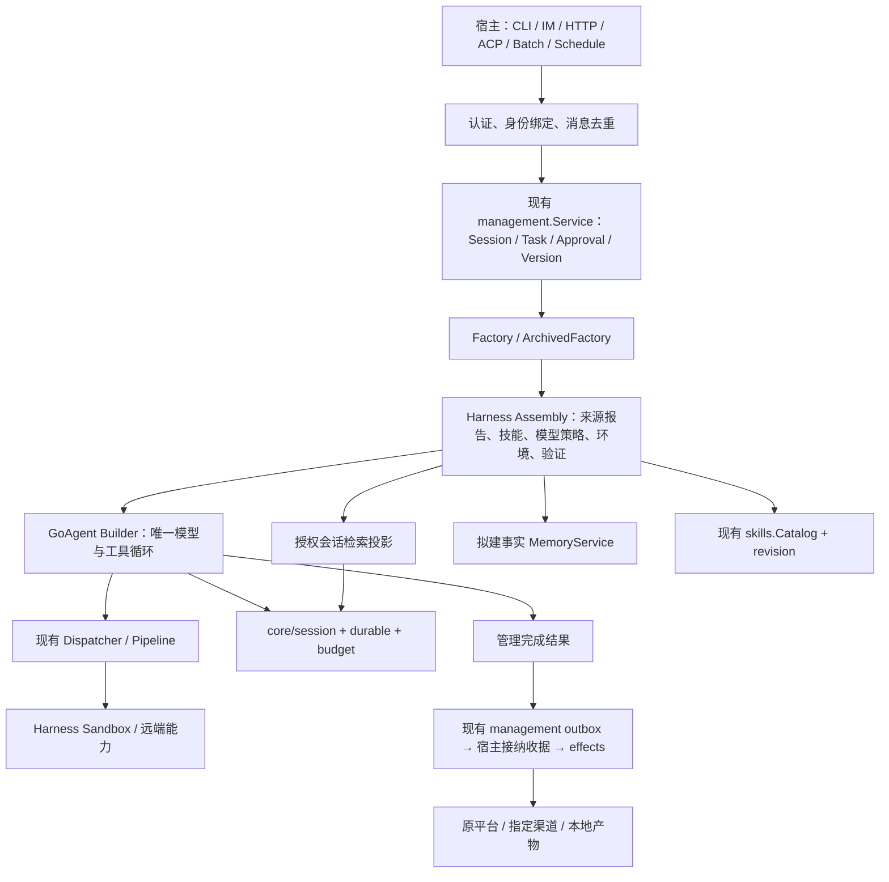

# GoAgent / Harness 的 Hermes 采纳设计

日期：2026-11-10。状态：待评审的增量设计；本轮仅更新文档，未实现下列新增能力。

依据：[17 张图逐项阅读、固定源码与本地能力对照](../../research/2026-11-10-hermes-design-review.md)。本文的角色名、记录和流程是拟议契约，不是已导出的 Go API。事实记忆不再单独建服务，改为在长期记忆上补齐可管理性，见[长期记忆的删除优先](../../design/MEMORY_GOVERNANCE.md)；原 2026-11-08 设计存档于 tag `archive/persistent-factual-memory`。

## 1. 意图与取舍

目标是在当前执行内核之上，让不同入口能使用可解释、可恢复的上下文、模型、技能和任务服务。优先解决跨组件的身份和一致性问题。成功标准是可验证的数据流与故障行为，不按 Hermes 模块数验收。

考虑过三种方式：

| 方式 | 收益与代价 | 结论 |
| --- | --- | --- |
| 按图重建完整个人助手 Runtime | 表面能力齐全，但重复已有循环、管理服务、审批与后台工作 | 不采用 |
| 每个宿主自行拼装 | 改动小，但技能解析、来源解释、路由与投递规则持续分叉 | 只适合业务特定部分 |
| 核心保持执行契约，Harness 补可复用组件，宿主组合入口与调度 | 复用现有实现，需要明确跨仓版本和边界 | 本文推荐，作者选择，待评审 |

不承诺 Hermes 协议/API 兼容，不加入 Python AST 自动发现、动态插件内核、自动授予技能权限或无审批的自我修改。ACP、各 IM 平台和云沙箱后端均按独立需求交付；A2A 不能代替 ACP。

## 2. 分层与唯一事实源

| 数据 | 权威来源 | 规则 |
| --- | --- | --- |
| Session/Task/Approval/Version | management Store | 平台和调度不另建可变任务状态 |
| 模型/工具执行事实 | session/durable | Observer、搜索索引、平台消息不能替代日志 |
| 发布的提示、技能、程序和配置 | revision 及版本化资源 | Session 绑定旧版本；更新不覆盖已有会话 |
| 事实记忆 | 拟建 FactStore | 索引只给候选，召回回查权限和生命周期 |
| 搜索索引 | 会话事件的可重建投影 | 不修改原日志，不推断审批，不回放副作用 |
| 定时计划/触发记录 | 宿主 Schedule Store | 每次触发关联现有 Task，不接管执行循环 |
| 投递状态 | management outbox 管交接，接纳收据管去重，effects 管实际效果 | 各阶段单一真源，业务完成、持久接纳与送达分开 |

## 3. H1：统一技能加载，保留 Harness 的装配职责

现状：GoAgent 已有只读 `skills.Catalog`、`tools/skill` 和归档加载；Harness `preset/skills.go` 另行解析 frontmatter、遍历文件并生成正文摘要。这会出现格式支持、大小限制、错误分类和整包固定能力差异。

拟议行为：

1. Harness 继续决定默认目录、来源先后、工作区外读取授权、模型可见列表与 `disable-model-invocation` 语义。
2. 目录经既有信任检查后交给核心 Catalog。Harness 删除重复解析和资源读取实现，保留其策略适配层。
3. 持久部署从 RevisionLoader 提供的归档 Catalog 装配；普通本地部署可使用受限目录 Catalog，明确正文是发现时快照、资源按需读取。
4. 将三类状态分开：可列举、可加载、可执行。隐藏索引不等于撤销读取权；`AllowedTools` 不授予工具权限。
5. Manifest 记录 loader 契约版本、来源选择摘要、模型可见技能集合，以及归档整包摘要或明确的“资源可变”状态。旧 `sha256(body)[:12]` 与新 SKILL.md Digest 含义不同，不原位替换其持久含义。
6. Catalog 关闭责任显式区分：Harness 创建者由 Assembly 关闭；宿主借入者由宿主在所有 Assembly 结束后关闭。Assembly 不关闭共享归档句柄。

兼容性：先更新 Harness 的 GoAgent 依赖与支持矩阵，再切组件契约版本。旧运行使用旧 loader/归档恢复，或在升级前结束；不默认把旧 Manifest 当新格式接受。不修改已有活跃运行的技能包。

验收 H1：BOM/CRLF、重复 YAML 键、引用超限、越界链接、隐藏技能仍按读取策略拒绝、目录替换、Close 竞争、两个 Assembly 共享借用 Catalog、归档资源变更后的旧版本读取，以及旧 Manifest 拒绝错误迁移。基于现有核心契约套件验证，不再给 Harness 复制一套解析测试。

## 4. H2：上下文来源与组装报告

现状约束：`PromptSection` 只保证同一轮固定，不自动保证跨轮、跨进程、整个 Session 固定；`PromptContext` 是每步末尾附加消息。Revision 固定发布工件，不自动包含实时环境或动态事实。

新增 Harness 层的“上下文组装报告”，不再造 PromptBuilder 引擎。每个来源记录：

- 稳定 SourceID、种类、可展示位置、来源信任、适用工作区/主体范围。
- 原文摘要与渲染摘要、渲染器/审查器版本、字节数与估算 token、预算裁决。
- 进入静态指令还是动态数据、排序/覆盖规则、选中/被覆盖/拒绝原因。
- 固定范围：发布修订、单次运行或单步；不在默认诊断里输出正文或秘密。

来源规则：

| 内容 | 放置与生命周期 |
| --- | --- |
| 可信身份、宿主规则、已发布项目指令、技能索引、工具说明 | Revision 固定来源，Assembly 固定渲染；按原 PromptSection/系统提示装配 |
| 根目录到目标子目录的指令链 | Harness 可选解析；边界限宿主工作区；顺序显式记录；特定目录指令不能提升权限 |
| git 状态、待办、审批模式、剩余额度、实时事实召回 | 带来源的动态数据通道；不反复改写 system 前缀 |
| 网页、工具结果、历史检索、生成技能候选 | 数据或待审候选；不能仅因文件叫 MEMORY/AGENTS 就成为宿主指令 |

不要求创建 SOUL.md/MEMORY.md/USER.md 等特定文件。内容扫描可替换，返回明确诊断；通过扫描不能提升信任。受管部署中被策略判定为必须审查的工件，审查不可用则阻塞该工件发布，保留候选及原因。

预算按可信规则、当前任务、必要工具配对、相关事实/检索、可选背景分配；保留任务与成对调用结果，减少可选背景。必需项放不下时在请求前返回容量错误；可选项省略须记录原因及可再次读取的引用。沿用 PreStep/Offload/compaction，摘要不能抹掉未知效果或未通过的检查。

恢复：静态输入从原 Revision 取得；环境探测快照单独固定到运行资源，由宿主持久保存并在重建时传回，不能重新探测后伪装成原快照。实时环境变化通过新的动态段报告。需要进入模型的动态文本继续走现有日志。拟建事实记忆遵守其删除/撤权后拒绝旧快照的特殊恢复规则，不能被“历史重放”覆盖。

报告拆成稳定身份和运行诊断两部分。只有固定的 SourceID、RevisionID、归档相对路径/宿主声明的逻辑来源、静态原文与渲染摘要、渲染器/策略版本、固定排序与静态预算配置进入 Manifest 的组件 Info。临时物化目录、绝对宿主路径、采集时间、每步动态内容、动态预算裁决及展示文本不进入 Manifest 摘要。归档来源使用 RevisionID + 归档相对路径，非归档工作区来源使用明确工作区身份 + 相对路径；持久化的环境快照另以原运行资源摘要固定。诊断保存这些稳定身份的引用，不能让重建时的新临时路径导致旧运行失配。

验收 H2：同修订两次组装结果稳定；动态 git/审批变化不改变静态前缀；定位一个来源可解释其入选原因；工作区外/越权来源被拒；必需内容超预算不发送模型；恢复使用原快照且报告新的实时变化。

## 5. H3：模型路由先固定，按步自适应后置

第一阶段仅提供 Harness/宿主的版本化路由策略。输入为固定 AgentRevision、任务能力要求、宿主授权的路由集合和预算配置；输出为 RouteID、策略版本、Provider/模型/协议、端点身份、凭据范围引用、能力与 token 限额。不能把凭据值写入归档、日志或报告。

默认在构建执行前固定选择；如必须按步选择，仅允许依据已持久的步输入与固定策略做确定性计算。RequestHook 负责应用已确定的选择，不在恢复时读取实时价格、轮询健康或随机选择新模型。

本轮设计保留现有边界：

- 纯聊天的基础 Client 与原生工具流分开校验，不能通过声明 capability 代替可执行接口。
- 能力不足、凭据引用不可用或精确路由配置缺失时明确失败；不悄悄改目标端点或租户。
- 同一模型操作内只有原样重试。持久 RequestError 不换客户端、不重写消息。
- 已输出的流不透明重试；启用现有部分输出缓冲时按其契约处理。重试仍计入根预算。
- 切换 Provider 不能盲拷贝 ProviderState、推理签名或服务端续接 ID。第一阶段不支持持久运行中跨 Provider 自动回退。
- 价格只是带时间/来源的估算，不作为资金上限保证；预算由现有控制器执行。

未来需要实时自适应/回退时，单列核心最小扩展：将 route decision 与每次模型尝试持久记录，定义失败尝试、预算、输出重置、ProviderState 转换和恢复身份。没有该记录契约前不实现“包装一个 RouterClient 就自动回退”；模型意图必须看见实际目标。

验收 H3：同 Run 重启后仍选相同路由；配置漂移在付费调用前失败；无工具能力不能承接工具任务；重试用量正确；凭据轮换只在同一授权引用/端点范围内；跨 Provider 回退在持久运行中明确拒绝。

## 6. H4：会话搜索、事实记忆、工作上下文、技能分开

| 状态 | 用途 | 拟议集成 |
| --- | --- | --- |
| 工作上下文/摘要 | 本次推理的有限窗口 | 现有 PreStep、Offload、Harness compaction |
| 完整会话事件 | 查证过去发生了什么 | core/session 真源 + 有界 Search 投影 |
| 稳定事实/偏好 | 后续任务召回、纠正、删除 | 既有持久事实 MemoryService 设计 |
| 可复用方法 | 按需加载经过验证的过程 | Catalog + H5 候选发布流程 |

现有 memory 包包含对话与向量封装，不等于已实现新的 FactStore/MemoryService。H4 的会话搜索不依赖事实服务先落地。

拟议 SessionSearch 消费边界可由可选核心接口表达；数据库/FTS 实现在 contrib 或宿主，工具适配及提示说明在 Harness。不增加 session.Store 的强制方法，不用 List + Read 全库扫描冒充有界搜索。

一次搜索接受可信 Actor/授权集合、query、来源类型/时间范围、游标、命中和字节/token 上限；提供方先在授权范围内搜索，再分页返回 SessionID、事件序号范围、分支来源、摘要和投影水位。工具不能接受模型自报 tenant。读取命中时再校验当前权限与事件是否仍可访问，原始快照/审批内部数据不外泄。

投影使用事件序号与水位幂等更新，可重建；落后或不可用须显式报告，不声称全量已搜索。分支相同来源按证据范围去重，但只有当前主体可见的分支可贡献内容。自动任务结果可独立过滤/降权，不能影响授权。

持久调用经 Dispatcher 记录：已完成结果重放与即时撤权/删除可能冲突。第一阶段默认只开放非持久搜索，或仅针对由宿主承诺在运行期限内不可撤销的不可变授权档案；不能把受可撤销授权的正文直接写成可永久回放的工具结果。若要支持一般持久搜索，应先扩展为 refs + 每次恢复重新授权 hydrate 的契约，与事实记忆快照失效规则一致。

验收 H4：跨租户和跨私聊检索无泄漏；授权过滤在分页限制前生效；事件配对/分支证据可追溯；超长工具结果只给窗口；投影重放不重复；撤权后不回放旧正文；落后水位和扫描预算明确呈现。

## 7. H5：技能沉淀是候选发布流程

拟议生命周期：候选 → 静态校验 → 隔离验证 → 待审 → 已发布 → 停用/替代。提炼器消费已完成任务的可见轨迹和验证产物；一次“模型说成功”不构成验证证据。

候选保存来源 Task/Run/事件范围、适用条件、方法、所需工具与平台、验证命令与结果引用、包摘要和生成器版本。剔除秘密、私人原文、任务特定路径及无授权的数据；候选不进入活跃 Catalog。

发布由宿主当前授权决定，使用 expected revision + 幂等键；写入不可变工件并形成新的 AgentRevision/Version。审查绑定完整包摘要和验证配置，附属文件改变使旧审查失效。验证服务或授权依赖不可用时保持待审，不自动放行。可配置人工或已明确授权的自动发布策略，默认不自动激活。

旧 Session 继续用原 Catalog；新 Session 使用发布版本。需要立即停用危险技能时，先在宿主执行准入撤销其工具/资源权，再选择终止或阻塞活跃运行；不可变归档不是继续执行的许可。

去重以适用条件和方法相似性提出合并建议，不自动删除旧技能。记录成功/失败证据、最近验证时间、替代关系和回退版本。验证用隔离环境、固定资源和留出的任务样本；失败不得通过自动放宽沙箱/审批消除。

验收 H5：候选不可被模型发现或加载；修改参考文件使审查失效；未通过验证不能发布；同键异包冲突；新版本只影响新会话；旧版本可读但被撤权动作不能继续执行。

## 8. H6：入口和平台身份由宿主绑定

新增平台适配先复用 management/protocol 的共同身份。宿主可信地解析传输账号、Tenant/Subject、Agent、平台会话/线程与可见性，再得到内部 SessionID。稳定去重键至少绑定租户、接收账号、平台和事件 ID；同键异内容冲突。

两个平台上的账号不因姓名相同自动合并。私聊与群聊默认隔离；只有经授权的绑定才可共用内部 Session 和记忆范围。结果目标由可信入口/订阅配置决定，模型文本不能把回复转投其他人或渠道。

忙时输入显式选择：新排队 Task、同一活跃 Handle 的 Steer、或持久等待的 Resume/DecideApproval。Handle 是进程内对象；跨实例路由和忙时插话桥尚非 management 自动提供的能力。跨入口“继续”须保留 Task/Wait/Approval 身份，不伪造新任务绕开审批。

投递是独立效果：Task 成功后创建稳定投递身份，目标支持幂等则复用它；模糊 ACK 进入核对/attention，不因“仅是消息”默认重发。分片消息各有序号和状态；重试只补失败/未确认部分，不能重跑 Agent。

首版直接复用现有 management outbox：Worker 在终态事务中写入 Delivery，OutboxDispatcher 至少一次调用宿主 DeliverySink.Accept；不另建完成结果扫描器。Accept 成功仅表示已持久接纳，管理 outbox 的 done 不表示平台已送达。

管理 Store 与 effects.Store 不保证同一事务，因此宿主在 effects 使用的同一个 durable.Store 中保存接纳收据。收据键为 TenantID + Delivery.ID，绑定 ResourceID、Kind、不可变结果摘要、授权目标快照及各分片效果键。Accept 持有收据锁，已有同内容收据直接成功，异内容冲突；不存在时用 effects.Queue.Commit 将收据的 durable.Write 与全部分片效果原子保存，之后才返回成功。锁顺序固定为收据锁 → Queue 内部锁。

management 的 Payload 表示完成通知；若需读取结果或解析目标，先以受信身份取得固定版本和不可变结果并校验授权，之后固定到收据。不能用同一 Delivery 在重试时解析出不同目标或不同内容。发送时 effects.Authorize 仍重新检查实时权限。

effects 的同键待执行会替换内容，执行中可再排一个，终态记录也会被跳过并最终清理；稳定效果键本身不是交接去重。收据与入队原子提交后，即使效果已完成或被清理，重复 Accept 也不得再次入队。收据保留覆盖生产者 outbox 的全部重投/人工重驱窗口；来源记录仍可能重驱时不可删除收据。若无法证明窗口已关闭，保留无正文的去重墓碑；超出明确保留契约的旧 Delivery 进入核对，不能当作新投递接受。实际 ACK 未知仍由 effects 的 Reconcile/attention 处理，不把“已接纳收据”当作送达证明。

验收 H6：平台重复回调只产生一个任务；私聊/群聊不串历史；跨 HTTP/MCP 查询同一任务；审批不能由普通消息绕过；终态事务后、原子接纳后且 outbox ACK 前、实际发送后各自崩溃都保持正确；effects 终态已清理后重复 Accept 不再次发送；未知发送不盲重发；普通断线不取消任务。

## 9. H7：日历调度复用 Task，区别于 background

Schedule、Occurrence 和 Delivery 都留在宿主或可选集成层；不在核心构造器里偷偷启动 ticker。background 的子工作和等待期限继续保持原用途。

拟议 Schedule 至少固定：owner/tenant、AgentVersion/Revision、时区和时间表达式、输入、技能包引用、预算、目标、启停 revision、重叠与错过触发策略。默认每次触发新 Session；复用会话须显式配置，按已有会话串行规则接纳。

OccurrenceKey 包含 schedule ID、计划代际和计划触发 UTC 时间，不使用实际启动时间。领取时持久固定 FireSpec：上述配置和摘要、触发时间、目标、各阶段幂等键。修改计划不改已接纳的触发；禁用先阻止未接纳触发，已接纳 Task 是否取消走显式取消命令。

跨库恢复流程：持久领取/固定 FireSpec → 幂等 CreateSession → 等会话准备好 → 幂等 SubmitTask → 保存 TaskID → 等完成 → 投递。每步重启沿用原 FireSpec 与键，不重新读取最新版计划。Submit 前再按当前授权复核，撤权后保留 blocked 原因；不因固定旧版本而保留已撤销权限。

首版明确采用有期限的未知接纳恢复：每个跨库创建/提交步骤在第一次外呼前保存 FirstAttemptAt 与固定幂等键；从该时刻起最多 24 小时内可重试未知应答。部署验证 management 的 IdempotencyRetention 大于该窗口加允许时钟偏差/维护余量，否则拒绝启用调度。超过窗口且本地尚无对应 SessionID/TaskID 时转 attention，要求可信核对映射，禁止自动重新 CreateSession/SubmitTask；不能因旧幂等键过期重新接纳。已保存的 ID 只按 ID 查询，资源已清理也转核对，不能创建替代任务。Occurrence 的触发去重墓碑至少覆盖计划代际的全部补跑/重驱期限，删记录不等于允许重新触发。

固定计划引用的版本后来不是当前 PublishedVersion 时，沿用现有 CreateSession 的 agent.publish 授权要求。首版不自动给调度主体增加该权限：权限不足将该触发 blocked，要求宿主明确更新计划到新版本，或由有权主体授权继续使用旧版本。不得静默切最新版；已创建 Session 继续绑定原版本。

初始建议默认：IANA 时区必填；不存在的本地时刻跳过，重复本地时刻只取较早的 UTC 对应时刻，按 UTC 去重；错过只合并最近一次，且只补 24 小时内；同计划一次只运行一个未终结触发（等待审批也算），下一次跳过并记录。每次任务初始上限为 10 分钟、20 次模型请求及 64K 预留 token；这些是宿主可配置建议值，发布配置必须明确，不构成已实现的默认。首版限定单调度 owner，不能用超时自动接管冒充多实例排他。

无人值守任务需要人工审批时进入原 waiting 流程，不自动批准；每次触发有独立预算。重试投递不重新创建任务。目标不支持异步推送时显式选择本地产物或拒绝配置，不能标记为已送达。

验收 H7：DST 与时区测试、两次 tick 去重、每个跨库崩溃点恢复、幂等记录清理/长期停机后不重复创建、发布新版后旧计划按权限 blocked、更新/停用竞争、等待审批跨日、额度耗尽、发送 ACK 丢失，以及新 Session 不携带旧私聊上下文。

## 10. 执行与安全契约保持集中

不改 Pipeline 顺序：参数校验 → Pre → 审批 → Guard → Around/工具/Post。Guard 不被人的批准、技能、插件或调度放宽；参数不能在批准后被静默改写。替代调用继续重新校验并经过管线。

工具出现可恢复业务错误时优先由工具/适配器返回类型化 Rejected，经现有 Dispatcher 记录；取消、租约丢失、存储错误、未知副作用继续中止或 attention。现有 Builder 的 ToolErrorFeedback 在 durable 运行中不转换普通 error；不能一律吞错完成记录。

沙箱不因模型换路由、装载技能、后台执行而变宽。文件系统与命令后端必须属于同一环境身份；支持矩阵区分实际可兑现的文件、网络、持久重连、取消与清理能力，后端不可兑现时明确拒绝。

## 11. 交付顺序与完成证据

| 阶段 | 内容 | 归属与前置 | 必须拿出的证据 |
| --- | --- | --- | --- |
| H0 | 本文、来源清单、逐图对照与基线 | 本轮文档工作 | 17/17 覆盖，链接与状态校验 |
| H1 | Catalog 统一与版本迁移 | Harness；先升级核心依赖 | 核心契约复用、旧运行恢复、资源所有权 |
| H2 | 来源报告与冻结范围 | Harness + 宿主归档；在 H1 后接技能来源 | 提示快照、超预算、恢复与撤权案例 |
| H3 | 固定路由组件 | Harness/宿主；可并行于 H4，不依赖新核心 API | 真实 Provider 能力/usage 案例与离线恢复测试 |
| H4 | 有界会话检索 | 可选接口/工具 + contrib/宿主索引 | 真实存储分页/隔离、撤权与索引落后案例 |
| H5 | 技能候选到发布 | Harness/宿主；H1/H2 + Revision | 隔离验证、留出任务、版本与撤权案例 |
| H6 | 一个具体平台接入 | 宿主；现有 management、effects | 重复输入与投递崩溃的真实组合案例 |
| H7 | 一个定时 Agent 案例 | 宿主；H6 投递桥，可不依赖特定 IM | FireSpec 跨库恢复、DST、审批和重叠测试 |

事实记忆作为已有独立计划推进，不用 H4 搜索替代其 CRUD、一致性与删除承诺。实时跨 Provider 回退保持后续独立规格。各阶段只声明实测通过的环境和行为；静态读码、内存夹具、真实数据库、真实模型分别报告。

## 12. 留给实施者与本轮边界

实施者可确定导出 Go 符号、DTO、包内文件拆分、索引 schema、退避参数和诊断格式；不能改变上述身份、恢复、授权或原子范围。先做 H1/H2 的独立实施计划，后续按具体业务选择 H3～H7，避免一次引入所有新组件。

本轮未修改执行代码、未升级依赖、未运行模型/数据库验收，也未把候选设计标为现有能力。设计通过后再生成代码实施计划。
