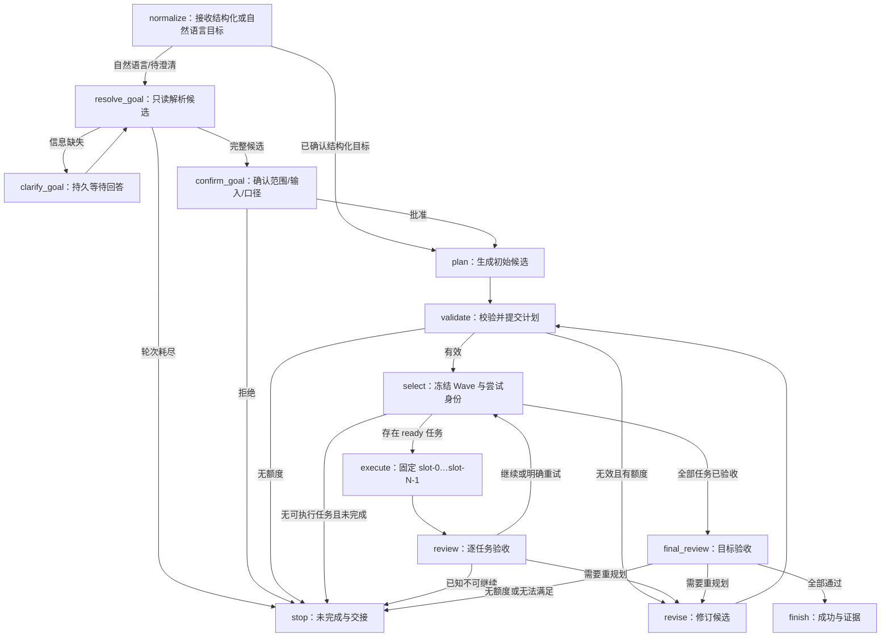

# DeepAgent 结构化规划与监督闭环技术设计

日期：2026-11-22。状态：可供实施评审的设计提案，尚未实现。

代码基线：GoAgent `2449c0d3`；相邻 GoAgent Harness `f7d637c`。本文存放于 GoAgent，主要代码实施位置为 **GoAgent Harness**。下文 `G/` 指 GoAgent 根目录，`H/` 指相邻 `goagent-harness` 根目录。所有 `planning.*` 和 `preset.Planning*` 均为本文提出的新接口，不是现有 API。

执行入口：[统一实施方案](../plans/2026-11-22-agent-system-execution.md)。本文定义领域接口和行为契约。

## 1. 目标、范围与完成标准

把当前的执行机制组合为：结构化目标 → 生成并校验计划 → 按依赖分批执行 → 验收产物 → 有界修正或重规划 → 输出带证据的结果。

完成标准：

1. 一个目标拆成有依赖的任务；独立且无资源冲突的任务并行，依赖任务只有在上游产物验收通过后执行。
2. 计划、批次分配、执行尝试、产物和验收结论可恢复；已完成操作按现有日志契约回放。
3. 验收失败可以明确重试或产生新计划版本，复用仍有效的已验收产物；不确定的外部效果进入人工核对，不能盲目重做。
4. 初始规划、任务执行、复核和重规划共享同一持久根预算、权限上限与运行身份。
5. 离线脚本模型可以验证全部控制流；真实模型质量另外评测，不能由离线通过率推导。

本次不实现多实例任务抢占、自动补偿外部副作用、动态修改工作流引擎、自动训练或发布技能、通用办公/OCR工具集。它们不影响上述闭环成立。

## 2. 现状证据与可复用边界

| 图片层次 | 当前代码事实 | 本方案新增部分 |
|---|---|---|
| 目标 | `G/builder/output_validation.go` 可验证最终输出，但不会额外请求模型 | `GoalSpec`、交付物、逐项验收及澄清输入 |
| 规划 | `H/preset/plan.go` 是只读计划模式与 Markdown 审批 | 结构化 `PlanDraft/Plan`、版本、校验、预算内重规划 |
| 拆解 | `G/workflow/graph.go` 预定义控制流；`H/tools/coding/todo.go` 只有内容与状态 | 任务 DAG、输入产物契约、ready 计算、批次分配 |
| 子 Agent | `G/multiagent` 已有工厂、Loop、Router、SupervisorTools | 已注册成员与任务的确定性绑定、fresh 会话、尝试身份 |
| 工具 | `G/tools/dispatcher.go`、`runnable_tool.go` 提供唯一执行路径 | 复用，不另建模型或工具执行循环 |
| 记忆 | `G/builder/long_term_memory.go`、`G/memory/worker.go` 已有召回、教训和反思 | 给规划提供带来源的可选经验；任务事实留在权威状态 |
| 监督 | `G/multiagent/loop.go` 和输出验证已提供扩展点 | Review 决策、证据覆盖、修正边界、计划修订 |

复用三种已有模式：`multiagent/step.go` 的每次新建会话与关闭；`workflow/durable_parallel.go` 的输入先落盘、分支独立提交；`management/adapters/graph.go` 的图运行与输入恢复适配。

重要限制：

- `G/workflow/durable.go` 的指纹包含拓扑、并行分支、配置和版本；修改旧图不能恢复原运行。
- `H/preset/subagent.go` 的普通前台委派默认清除 Journal；不可直接把它作为本方案的可恢复 Executor。
- `H/background` 已有后台所有权与通知，不承担本方案的权威任务账本；完成记录可清理，不能作为永久去重依据。
- `H/effects` 已有 outbox 和核对机制；是否采用取决于具体外部写工具，不复制它，也不宣称外部恰好一次。
- Harness 当前 `go.mod` 仍引用 GoAgent `v0.49.3-0.20261107151110-dae60f4779d4`；相邻 checkout 的新接口须先完成版本核验，不能假定已可用。

## 3. 执行架构

动态计划保存在固定持久图的业务状态中，运行时以多个Wave映射到固定并行槽。依赖方向为宿主→Harness planning/preset→GoAgent公开API；planning不导入preset，核心不反向依赖Harness。



技术故障、未知效果、取消和 budget 错误沿原有错误/attention路径传播；不伪装成 `stop` 的正常业务结果。图中 `stop` 只表示已知业务阻塞、人工拒绝或业务上限耗尽。`stop/finish → END`。

## 4. 公共数据与接口契约（新增）

### 4.1 `H/planning/model.go`

以下为公共类型设计草图；实现时逐字段补充 JSON tag 与英文 godoc。状态全部只含可 JSON 往返的数据，不保存函数、接口、channel 或资源指针。

```go
type Constraint struct { ID, Rule string }
type Criterion struct { ID, Description string; EvidenceRequired bool }
type Deliverable struct { ID, Description, MediaType string }
type Scope struct { Included, Excluded []string }
type GoalParameter struct { Key, Value, Origin string }
type Assumption struct { ID, Statement string; Confirmed bool }
type SourceInput struct {
    ID, Title, MediaType, Origin, Digest string
    Content json.RawMessage
}
type OutputProfile struct { Language, Format, Audience string }
type GoalSpec struct {
    ID, Objective string
    Revision int
    Constraints []Constraint
    Deliverables []Deliverable
    Criteria []Criterion
    Scope Scope
    Inputs []SourceInput
    Parameters []GoalParameter
    Assumptions []Assumption
    Output OutputProfile
}
type OutputSpec struct { Name, MediaType, DeliverableID string; MaxBytes int }
type InputRef struct { DependencyID, OutputName string }
type ResourceClaim struct { Key, Mode string } // Mode: read/write
type TaskSpec struct {
    ID, Instruction, MemberID string
    Generation, Priority int
    DependsOn []string
    Inputs []InputRef
    Outputs []OutputSpec
    Criteria []Criterion
    CriterionIDs []string
    GroupID string
    RequiredCapabilities []string
    GoalInputIDs []string
}
type TaskGroup struct { ID, ParentID, Title string }
type PlanDraft struct { Tasks []TaskSpec; Groups []TaskGroup; Rationale string }
type Plan struct {
    Revision, ParentRevision int
    GoalDigest string
    Tasks []TaskSpec
    Groups []TaskGroup
}
type EvidenceRef struct {
    SourceID, SourceDigest, LocatorKind, Locator, QuoteDigest string
}
type Artifact struct {
    ID, ProducerAttemptKey, Name, MediaType, DeliverableID, Digest string
    Content json.RawMessage
    Sources []EvidenceRef
}
type ResolvedInput struct { Ref InputRef; Artifact Artifact }
type CriterionResult struct {
    CriterionID, Status, Reason string // pass/fail/unknown
    EvidenceIDs []string
}
type Review struct {
    ID, SubjectDigest, Verdict, Reason string
    Criteria []CriterionResult
    Issues []Issue
    Repair *RepairDecision
}
type Issue struct {
    ID, Category, Severity, TaskID, AttemptKey string
    ArtifactID, CriterionID, Location, Reason string
    RelatedIDs []string
}
type RepairDecision struct { Action string; IssueIDs, TargetTaskIDs []string }
type TaskResult struct {
    TaskID, AttemptKey, Outcome, FailureKind, Reason string
    Artifacts []Artifact
}
type Attempt struct {
    TaskID, ExecutionKey, Fingerprint, Status string
    Generation, Number int
    Result *TaskResult
    Review *Review
}
type GoalContext struct {
    Objective string
    Constraints []Constraint
    Scope Scope
    Assumptions []Assumption
    Criteria []Criterion
    Deliverables []Deliverable
}
type Assignment struct {
    Slot int
    PlanRevision int
    Task TaskSpec
    GoalDigest string
    GoalContext GoalContext
    AttemptKey, Fingerprint, MemberVersion, ManifestDigest string
    Inputs []ResolvedInput
    GoalInputs []SourceInput
    Parameters []GoalParameter
    Output OutputProfile
    Claims []ResourceClaim
}
type Wave struct {
    Number, PlanRevision int
    Assignments []Assignment
}
type FrozenOutput struct { TaskID, Name, Digest string }
type WriteFreeze struct {
    ContractDigest string
    KnownOutputs []FrozenOutput
}
type Outcome struct { Status, Reason string; ArtifactIDs []string }
```

补充语义：

- `GoalSpec` 由宿主确认的结构化输入或4.4节GoalResolver产生。范围、输入、关键参数、假设与输出要求是目标契约的一部分，确认并提交后不可原位修改。改变目标需要宿主明确创建新运行，不能自动换RunID规避额度。
- 已提交任务ID采用宿主保留格式`t-000001…`。首次候选使用局部ID；修订候选中的已有任务只能使用State已提交ID，新增任务使用`new:<label>`局部ID，并可在同一候选内互相引用。未知的`t-*`、局部ID重复或冒充已有身份均拒绝。AdoptPlan先校验完整候选，再按候选顺序为新增项从NextTaskID分配宿主ID，同步重写DependsOn及InputRef.DependencyID，并与Plan/NextTaskID原子提交；失败不消费ID，恢复不重复分配。宿主计算Generation，模型不能决定执行键或版本号。
- 每个任务至少有一项输出、一项任务局部 Criteria 与一个 CriterionID。任务 Criteria 定义该步骤自身完成条件，CriterionIDs 只声明对哪些目标验收项作贡献，不能要求研究步骤提前满足整个目标。每个目标 CriterionID 至少被一个任务覆盖，每个 DeliverableID 至少有一个 OutputSpec 声明提供。`final_review` 验证目标级 Criteria 与交付物，防止“所有任务成功但目标未完成”。
- Artifact 首轮只支持 JSON 内联正文，不支持临时路径或未经校验的 URI。文本用 JSON 字符串；二进制与外置内容存储属于后续独立扩展。
- SourceInput.Content是宿主加载/解析并冻结的有界JSON材料，Origin只记录出处，不作为恢复时重新下载的入口；原始PDF/OCR解析由宿主或扩展工具提供，不新增通用解析器。SourceInput.Digest由宿主对规范正文计算。运行中获取的资料可先成为已验收来源产物，再由后续EvidenceRef引用。
- Executor返回后先校验冻结TaskID/AttemptKey及Outcome；`produced`要求必需输出齐全，`rejected`允许零产物并保留有界原因，不能因缺必需输出变成技术错误。两种Outcome中实际存在的产物均须校验输出名唯一、类型、大小与来源；超限正文丢弃并转有界rejected。根据规范化正文、MediaType和Sources共同计算 Digest，以 `durable.ChildKey(AttemptKey,"artifact/"+Name)` 分配 ID，ProducerAttemptKey 与 DeliverableID 从已冻结 Assignment 补齐，不能信任模型生成的身份/摘要。每次采纳和使用前重新计算摘要。
- ResourceClaim 不接受模型自由授予。由受信成员目录和宿主规则产生；同一 Key 只允许 read/read 同批并行，write 与任何其他访问互斥。共享工作目录写任务默认声明同一个 write Key。
- `TaskResult.Outcome` 仅允许 `produced` 或 `rejected`；后者表示已知业务不满足。Go error 表示技术失败或控制信号，必须保留原错误链。
- `Review.Verdict`：`accept/retry/replan/block`。任务review的retry仅适用于受信目录声明read_only的拒绝或不合格产物；write即使返回rejected也不能自动新attempt，模型不能自证“未发生效果”。技术错误、权限拒绝和未知效果沿原错误/attention路径处理；final_review不使用retry，只能accept/replan/block。

### 4.2 `H/planning/api.go`

```go
type PlanningInput struct {
    Goal GoalSpec
    Current *Plan
    RejectedDraft *PlanDraft
    RejectionReason string
    Accepted []Artifact
    Feedback []Review
    Members []Member
}
type ReviewInput struct {
    SubjectDigest string
    Assignment *Assignment
    Goal GoalSpec
    Plan Plan
    Tasks []TaskSpec
    Results []TaskResult
    Accepted []Artifact
    Final bool
}
type Planner interface {
    Plan(context.Context, PlanningInput) (PlanDraft, error)
}
type Executor interface {
    Execute(context.Context, Assignment) (TaskResult, error)
}
type Reviewer interface {
    Review(context.Context, ReviewInput) (Review, error)
}
type Member struct {
    ID, Version, ManifestDigest, EffectClass string // read_only/write
    Claims []ResourceClaim
    Role, Description string
    Capabilities []string
}
type Config struct {
    Version string
    Parallelism, MaxTasks, MaxWaves, MaxReplans, MaxTaskAttempts int
    MaxArtifactBytes, MaxArtifactTotalBytes, MaxStateBytes int
    MaxGoalRounds int
    RequiredGoalParameters []string
    Members []Member
}
type Dependencies struct {
    Planner Planner
    Executor Executor
    Reviewer Reviewer
    PlannerVersion, ReviewerVersion string
    GoalResolver GoalResolver
    GoalResolverVersion string
}
type AgentConfig struct { Version string; Factory multiagent.AgentFactory }
type CandidateError struct { Reason string }
func (*CandidateError) Error() string
func NewGraph(Config, Dependencies) (*workflow.Graph[State], error)
```

`State` 由 `model.go` 定义，字段固定为：`Request *GoalRequest; Resolution *GoalResolution; GoalAnswers []GoalAnswer; GoalRounds int; GoalResolutionError string; Goal GoalSpec; GoalDigest string; Candidate *PlanDraft; Plan *Plan; Attempts []Attempt; Accepted []Artifact; Feedback []Review; Wave *Wave; WaveResults []TaskResult; WriteFreeze *WriteFreeze; Replans, Waves, NextTaskID int; PendingAction, ValidationError string; Outcome *Outcome`。规范化函数负责深复制；唯一写入权属于图节点的返回值。ReviewInput 在任务阶段每次只包含一个任务结果与非nil冻结Assignment，按 Slot 顺序逐项 review；final阶段Assignment为nil，Results包含当前计划全部accepted任务的结果，Accepted为它们的有效产物集合，不含superseded结果。图从冻结Attempt/目标产物计算SubjectDigest后写入ReviewInput，Reviewer不得重新依赖可变成员目录计算。模型输入只由已提交State、冻结Assignment及固定Config构造，不读取实时预算用量、当前时间或新检索结果；真实准入仍由Controller负责。PlannerVersion/ReviewerVersion必填；配置GoalResolver时GoalResolverVersion也必填，均进入图Components，恢复不能悄悄替换实现。

revise 的 PlanningInput 必须带上上一候选（若可解析且未超限）及 ValidationError 对应的 RejectionReason，避免模型看不到拒绝原因。采纳成功清除这两项；未通过的候选不覆盖 Current。输入与候选分别在进入状态/模型请求前按 MaxStateBytes 限制大小，超限正文丢弃，只保留有界原因。

CandidateError 专指已成功取得并记录模型原始回答后的格式/候选拒绝。图节点只捕获这一明确类型并写 ValidationError/反馈、路由 revise；其余错误原样传播。Agent适配器先让底层模型操作完成落盘，再解码，不能把无效JSON持久成一个无法恢复的技术失败操作。自定义Planner/Reviewer须遵守同一分类。

建议默认值：Parallelism=1、MaxTasks=64、MaxWaves=256、MaxReplans=3、MaxTaskAttempts=3、MaxGoalRounds=4、MaxArtifactBytes=65536、MaxArtifactTotalBytes=1048576、MaxStateBytes=8388608。单成员单槽是完整支持路径；宿主为可独立且无资源冲突的任务显式配置多槽，运行恢复期间不切换。单槽仍有规划/复核开销，不等同直接单Agent。Config 零值采用这些默认值，负数拒绝；Version、成员 ID/版本/ManifestDigest 必填。Task ID 总分配数和保留的 Attempt 数也受 MaxTasks 与 MaxTasks×MaxTaskAttempts 限制，修订不能无限追加历史。Groups数量不超过MaxTasks。SourceInput正文合计也受MaxArtifactTotalBytes限制，含历史/重复引用的全部序列化State另受MaxStateBytes限制。数据超限时报告已知业务阻塞并转 stop；在执行分支内发现输出超限，返回 rejected，不将超限正文写入状态；未知外部效果仍优先 attention。

`MaxSteps = 12 + 4*MaxGoalRounds + 4*MaxWaves + 4*MaxReplans`，构造时检查整型溢出，覆盖目标解析/澄清/确认和最终验收路径。正常路径由业务计数先停止；workflow.MaxSteps 是最后兜底。人工等待/恢复不增加业务 GoalRounds/Waves/Replans/Attempt Number。

### 4.3 校验和纯函数

由 `validate.go/identity.go/ready.go/replan.go` 提供：

```go
func ValidateGoal(GoalSpec) error
func ValidateGoalPolicy(GoalSpec, Config) error
func ValidateDraft(GoalSpec, PlanDraft, Config) error
func Fingerprint(GoalSpec, TaskSpec, Member, []ResolvedInput) (string, error)
func AttemptKey(rootRunID, taskID string, generation, number int) (string, error)
func Allocate(State, Config, string) (State, error) // 第三个参数为根 RunID
func AdoptPlan(State, PlanDraft, Config) (State, error)
func ValidateTaskResult(Assignment, TaskResult, Config) (TaskResult, error)
```

Draft 校验：重复/未知 ID、自依赖、环、未声明依赖的 InputRef、重复InputRef、不存在的输出名、空任务/局部Criteria、未知成员、RequiredCapabilities不被成员覆盖、GoalInputIDs重复或引用不存在、未知 CriterionID/DeliverableID、验收或交付物覆盖缺失、非法 Priority、超规模。GroupID/ParentID单独校验存在性与父链无环；Group是非执行分组，不占槽、不隐式生成DependsOn。局部Criterion ID在任务内唯一，目标Criterion ID在Goal内唯一；ReviewInput决定其命名空间。Priority 范围 0…100，数值越大越先执行；模型不能覆盖成员目录中的版本、效果类别或资源声明。Kahn 拓扑校验 O(V+E)，最大 64 个任务。

指纹使用 SHA-256，输入为带 `fingerprint-v1` 的规范化 JSON：GoalDigest、任务指令、RequiredCapabilities、按ID排序的GoalInputIDs及对应SourceInput.Digest、输出契约、局部与所引用目标验收项完整内容、受信Member.ID/EffectClass/Version/ManifestDigest、宿主 ResourceClaims、实际输入产物 Digest。Fingerprint须核对Task.MemberID等于Member.ID；即使版本与模板相同，换成员或效果类别也不能复用旧结果。作为集合的依赖/能力/验收/Claims按键排序，ResolvedInput按Ref.DependencyID+Ref.OutputName排序；Priority、GroupID、Plan Revision、Slot不进入指纹。GoalDigest是完整规范化GoalSpec的SHA-256，包含ID/Revision、Objective、Constraints、Deliverables、Criteria、Scope、Inputs、Parameters、Assumptions和Output，不能只覆盖部分字段；变更任一目标语义不能复用旧指纹。即使Goal本身不变，从A材料改选B材料也改变任务指纹。Allocate核对Assignment.GoalInputs恰好覆盖Task.GoalInputIDs，再从State中按InputRef精确解析对应accepted Attempt及产物，验证producer/name/摘要后构造ResolvedInput；Fingerprint再次验证引用一一覆盖Task.Inputs，不通过不透明ProducerAttemptKey反推来源。同名输出仍以DependencyID区别，交换来源必须改变指纹。输出 JSON 拒绝重复键、未知字段和尾随值；RawMessage 先解码并规范化，数字用 json.Number，1 与 1.0 可视为不同输入（保守放弃复用）。

AttemptKey 使用 `durable.ChildKey(rootRunID, "planning-task/"+taskID+"/g/"+generation+"/a/"+number)`；必须校验非空与正数并保存。执行时显式冻结，恢复不能由新 Plan Revision、随机模型 CallID 或 Slot 重算成新键。首次 generation/attempt 为 1。

### 4.4 自然语言目标解析与澄清

```go
type GoalRequest struct { Text string; Inputs []SourceInput; Initial *GoalSpec }
type GoalQuestion struct { ID, Field, Prompt string; Options []string }
type GoalAnswer struct { QuestionID, Value string; Inputs []SourceInput }
type GoalResolution struct { Candidate GoalSpec; Questions []GoalQuestion }
type GoalResolveInput struct {
    Request GoalRequest
    Previous *GoalResolution
    Answers []GoalAnswer
    Round int
    RejectionReason string
}
type GoalResolver interface {
    Resolve(context.Context, GoalResolveInput) (GoalResolution, error)
}
func NewAgentGoalResolver(AgentConfig) (GoalResolver, error)
```

宿主可以直接提交完整、已确认的State.Goal；此时normalize调用ValidateGoal/ValidateGoalPolicy后进入plan，不额外请求模型。自然语言通过State.Request进入新增的固定节点resolve_goal、clarify_goal、confirm_goal；没有配置Resolver时原始文本入口在规划/执行前报配置错误。Resolver与Planner/Reviewer使用同根预算、只读Agent工厂、稳定作用域和版本，不直接执行整个业务任务。

resolve_goal每次先日志化模型调用，再将候选与本轮计数一起随节点输出提交；节点重入只回放同轮解析，不增加GoalRounds。实现将“本轮编号”取自输入State.GoalRounds+1，完成返回时才保存新GoalRounds；请求意图包含Round、Request、Previous、Answers和拒绝原因。CandidateError占用一次解析轮次并进入下一轮，真正技术错误仍原样返回。达到MaxGoalRounds=4后仍缺信息则stop并列出缺失项，不擅自填参数。

Questions非空则先保存Resolution，下一clarify_goal节点调用AwaitInput，ID为`goal/questions/<round>`；Info含请求摘要、候选摘要、轮次与完整问题集。回答JSON为`{"request_digest":"…","round":1,"answers":[{"question_id":"…","value":"…","inputs":[]}]}`。问题ID由宿主按轮次+字段分配，拒绝未知/重复/缺答ID；validate是纯函数，无效回答保持同一等待，零新增模型调用。Inputs是宿主实际加载并认证后提交的有界材料，摘要由宿主核验；Request.Inputs与已提交Answers.Inputs构成可信材料集合，同ID不同内容拒绝，替换须提供新ID。Candidate.Inputs只能从该集合选择，不能把模型生成正文变成来源。有效回答由clarify_goal提交进GoalAnswers后再resolve_goal，不能在validate中调用Resolver。

候选完整时进入confirm_goal，显示完整范围、输入、参数、假设与输出约定；AwaitInput记录`{"candidate_digest":"…","approved":true}`，candidate_digest绑定完整规范化Candidate GoalSpec，摘要不符拒绝，approved=false转blocked。确认后直接封存该候选进入plan，不再次调用Resolver改变其内容。所有由模型提出的实质假设都必须展示；其Confirmed只能由宿主根据此确认记录设置，其余已确认字段不变，不能信任模型自行确认。人工等待/重启不消费额外轮次。

RequiredGoalParameters由宿主按业务配置，例如业务适配可要求`project/version/source_cutoff`，通用框架不预置领域字段。GoalParameter.Origin只能是user/host/inferred；缺少所需Key、空值、重复Key、空Scope.Included、空Output.Language/Format、未确认假设或来源摘要不符均不能开始Planner。Goal.ID与Revision由宿主固定，候选不能替换身份。SourceInput必须是宿主实际提供的材料或已冻结的来源快照，不接受模型凭空生成的文件/引用。

包含“最新”等相对要求时，须先确认版本/截止时间和实际来源；宿主可在获准的只读发现后通过GoalAnswer.Inputs提交来源快照。未配置发现能力且材料不足时继续澄清或blocked，不虚构输入。Goal封存后重规划不能改变已确认参数、语言或范围。

任务GoalInputIDs只引用Goal.Inputs中存在的ID；Allocate冻结所需材料到Assignment.GoalInputs，并附上Parameters和Output。GoalContext由宿主从封存Goal深复制完整目标、约束、范围、已确认假设、目标验收及交付物，不能依赖Planner在Task.Instruction中复述；图的分配及槽执行入口从已提交State核对其与封存目标的投影精确一致，标准Executor将它作为任务执行条件提供给Agent。GoalContext不含Inputs，不能借此暴露未选材料或扩大来源授权；约束也不替代工具权限和审批。Executor无须读取可变全局State。参数与来源摘要均已包含在GoalDigest中。图片所示的分钟/成本仅为教学估计：首轮不增加预测计费服务、不硬编码分钟值；没有估计不能阻止合法任务，任何估计也不能替代真实根预算准入。

### 4.5 来源与计算证据

Artifact.Sources只可引用本Assignment冻结的GoalInputs或ResolvedInput直接携带的产物；不能引用未声明InputRef/DependsOn的其他accepted产物。EvidenceRef.SourceID必须可解析，SourceDigest取SourceInput.Digest或被引用Artifact.Digest（后者包含其正文和来源元数据），QuoteDigest单独覆盖定位到的正文值。`ValidateEvidence(EvidenceRef, []SourceInput, []Artifact) error`校验引用和定位；任务阶段调用方从ReviewInput.Assignment只传本次可见输入集合，不传全局accepted集作为授权捷径。ValidateTaskResult和ValidateReview均检查，AdoptPlan复用时再次验证Sources均仍有效；final阶段只验当前有效结果与它们已验证的来源链，不能借final阶段为未声明来源补授权。跨任务来源必须声明真实数据边，避免来源更新后下游漏失效。首轮确定性定位支持LocatorKind=`json_pointer`，Locator为RFC6901指针；QuoteDigest由宿主对指向值的规范JSON计算。URI/网页地址仅作Origin，不在恢复中重新抓取。PDF页码/HTML章节须先由宿主解析成带页码/章节元数据的有界来源JSON；未实现的原始定位类型必须以CandidateError表示不可验真，复核记unknown，不能仅因页码非空就通过。

引用存在、摘要相同、位置合法，都不自动证明该来源支持结论；逐项事实与引用内容的一致性由Reviewer承担。确定性领域由业务Reviewer检查计算与维度，不把领域字段强加到通用TaskResult。来源或计算被修正时，产物Digest随之变化，原有fingerprint与传递下游结果失效。

## 5. 调度、验收与重规划规则

### 5.1 状态与 ready

任务状态从 Attempt 与计划引用派生：`pending → running → produced → accepted`；另有 `rejected/superseded`。等待和 attention 是当前图/操作的控制状态，不制造新 attempt。只有 Review.accept 才能把产物纳入 Accepted。Attempt.Number在同一TaskID下跨Generation单调递增，合计不得超过MaxTaskAttempts；改变Generation不能重置业务尝试额度。

ready 同时要求：当前任务尚未 accepted、无未决 attempt、所有 DependsOn 已 accepted、InputRef 指向仍有效且摘要匹配的产物。Allocate 按 Priority 降序、宿主 TaskID 升序选择不冲突的前 N 个任务；创建 Wave 时冻结实际输入、成员版本、Claims、Fingerprint 和 AttemptKey，Waves 加一。未选中的 ready 任务留待下批。

Plan.Groups仅表达工作包/父子分组，依赖以DependsOn为唯一来源；下载→提取、提取→计算、计算与证据→报告必须声明真实边。互不依赖的提取任务可以并行；分组关系不隐含执行边。RequiredCapabilities是受信成员目录的能力匹配条件，Role/Description只是可读说明，二者均不授予工具或环境权限。更换成员须同时满足能力、已固定版本与原权限上限。

无 ready 时：所有任务已验收则 final_review；否则将依赖/资源/尝试耗尽的阻塞原因写入 Outcome，stop，不能无限空转。Budget 不由 Allocate 估算后放行，执行前仍由真实准入检查。

### 5.2 固定并行槽

`NewGraph` 注册固定 `slot-0…slot-(N-1)`。select 成功提交后 execute 才启动。各槽只取其冻结 Assignment；空槽纯 no-op，不请求模型，不登记 Agent 调用。Clone 深复制切片、RawMessage 和指针。每槽只返回自己的结果，Merge 按 Slot 和 TaskID 校验归属，去重后生成 WaveResults，不并发写共享 map。

依赖现有 durable_parallel：输入在效果发生前落盘；成功分支输出独立保存；等待不取消兄弟；真实错误取消兄弟并等待已启动工作退出；全部成功才 Merge。部分等待期间禁止重排 Wave，也不宣称成功兄弟已写入 Accepted。成功输出保留在并行检查点，等待收敛后 review 再统一采纳。

### 5.3 Review

每次任务 review 的 SubjectDigest 包含 AttemptKey、任务指纹和全部产物摘要；最终 review 则绑定 GoalDigest、Plan Revision 和全部有效产物摘要。任务阶段检查该TaskSpec.Criteria，final阶段检查GoalSpec.Criteria及每个交付物的有效Artifact绑定。每个适用 Criterion 必须恰好有一项 pass/fail/unknown；EvidenceRequired 时 pass 必须引用本次可见产物，不能引用未知 ID。未知、缺项、重复项和无依据的 pass 不能完成目标。

Review 的模型输出仍需确定性校验，JSON不合法或证据无效时作为本次候选拒绝，选择 replan；消耗一次 MaxReplans。`accept` 当且仅当全部适用Criteria为pass且全部必需产物存在（final阶段再要求每个DeliverableID覆盖）；`rejected`结果不能被accept。Review.ID由宿主按SubjectDigest及审查轮次生成，模型返回的SubjectDigest必须与ReviewInput.SubjectDigest一致，ValidateReview直接比较，不从当前成员配置重算。独立 Planner/Reviewer Agent 不注册写工具。可通过宿主提供的确定性 Reviewer 实现纯规则验收，不强制所有验收请求模型。

同批任务按 Slot 顺序审查：先保存每个已有效审查结果，再汇总决策；优先级 block > replan > retry > accept。retry 只重跑明确被拒绝的任务；accept 任务的结果保留。Reviewer 的网络、预算、取消和日志错误原样返回，不当作内容不合格重跑任务。

### 5.4 新计划采纳与复用

只在本 Wave 所有分支已收敛并经过 review 后重规划，不在运行中替换 Assignment。revise 调用前 Replans 加一，初始候选无效也使用该额度；达到上限转 stop。Plan Revision 仅在候选通过校验并被 AdoptPlan 采纳时递增，失败候选不能覆盖旧计划。

AdoptPlan 按拓扑顺序对比：相同 TaskID、Fingerprint、已验收 Review、正文摘要仍有效，才保留 accepted。输入/契约/成员版本改变则 Generation 加一，原结果标记 superseded，传递下游全部重新计算。仅依赖引用可用后才能算具体输入指纹；尚未可用的任务保持 pending，不推断可复用。旧结果保留供审计但不进入新计划输入。

写任务的已提交外部影响不能由“产物失效”回滚。其 fingerprint 改变或被要求 retry 时转 block，要求宿主明确新业务意图与核对/补偿；不可仅因换 Generation 再次写入。只读任务可以在 MaxTaskAttempts 范围内新 attempt。任何未决操作都禁止新 attempt。

为防止换TaskID绕过，首个write任务分配时将WriteFreeze与Wave一起持久提交。ContractDigest冻结全部write任务集合及其传递上游任务的语义契约：TaskID、指令、Member.ID/EffectClass/Version/ManifestDigest、Claims、依赖/InputRef、GoalInputIDs、输出与验收；不包含Priority、Group或Plan Revision。新候选新增/删除/替换write任务，或改变任一传递上游契约均block。闭包之外的read_only任务可修订。

尚未产出的输入不能用空摘要表示已冻结：当时可用的上游产物以TaskID/Name/Digest存入KnownOutputs；未就绪任务可以按已冻结契约首次执行，仅read_only可按原限制新attempt重试。其产物验收后，在受影响write任务首次分配前补齐实际摘要并持久提交。已冻结摘要不可变；已分配write的实际输入还由其Attempt.Fingerprint约束。任何未决write仍按attention处理，不能因上游未就绪重新分配或换键。冻结依据保存在State，不依赖background完成记录；确需改写契约由宿主交接，外部工具业务幂等仍须保留。

### 5.5 问题定位与定点修复

非accept的Review必须携带Issues与Repair，Repair.Action只能是retry/replan/block并与Verdict一致；accept没有Repair或未解决Issue。Category取`value_mismatch/source_missing/definition_mismatch/format_missing/execution_rejected`，Severity取error/unknown。Issue.ID由宿主按SubjectDigest与局部序号分配，并将模型局部ID到Repair.IssueIDs的引用一并重写；重复或未知局部ID拒绝。任务阶段TaskID/AttemptKey必填，ArtifactID/Location在定位已存在产物时必填；缺少产物时Location指明约定Output.Name，不凭空编造ArtifactID。CriterionID和RelatedIDs必须引用当前审查可见对象；无对象的问题不能驱动任意任务重跑。

retry只可指向本次被拒且受信目录声明read_only的任务，write不得自动新attempt；replan的TargetTaskIDs必须存在于当前Plan并与Issue中的任务/证据或其数据依赖相关；Planner据问题新增补证据/重提取步骤，AdoptPlan负责传递失效，不由模型直接改accepted状态。block携带可交接原因。原始Go error、权限拒绝、未知效果、预算与取消不由模型改造成可重试Issue。

自动修复必须保持GoalDigest、目标Criteria、根预算和权限上限；局部任务Criteria可细化，不得规避目标标准。更换工具重新走参数校验、授权和审批；权限拒绝不能通过换Agent绕过。Components中的模型/提示词/规则版本保持原运行固定；策略改进形成供后续运行评审的新版本，不修改正在恢复的旧运行。相同规则复验仍不通过时按上限blocked/attention，不能循环到“放宽规则后通过”。

## 6. 持久、预算、权限与生命周期

### 6.1 现有 API 组合

宿主调用 `NewGraph` 后使用现有 `CompileDurable`，设置 `Version=Config.Version`、`StateVersion="planning-state-v1"`、`Components` 包含已配置的GoalResolverVersion、PlannerVersion、ReviewerVersion及成员目录摘要。状态全部放GraphSnapshot.State，避免另建计划库与图状态双写；实际语义版本变化不能漏在闭包中。

根入口使用现有 `execution.NewScope`：RunID 与 budget.RootKey 相同；持久日志必须配持久预算。management 宿主通过 `adapters.GraphFactory[planning.State]` 接入已提供的 Journal/Budget/Scope，**不在槽内重新 Bind Scope 或新建预算**。

工具选择与运行时分派分开：模型已经给出name的toolcall由现有Dispatcher查已注册工具并执行校验、授权、Pipeline和日志，不新增根据自然语言偷偷换工具的Router。能力检索若需要，应发生在生成call前；未知name返回原错误。现有显式PreSubstitute如被宿主使用，必须按其实际契约重新校验/授权替代工具并保留替换事实，不能把对Search的批准当成对Browser或写工具的批准。Search/Python/SQL/Excel/OCR是扩展工具示例，不代表核心全部内置或自动发现。

任务调用继承根 observe RunID，用冻结 AttemptKey 派生子执行上下文；`durable.WithExecutionKey` 只改变操作键，不改变根运行身份。每个成员经独立 Dispatcher 上的 `tools.NewRunnableToolFactory`（ModelInvoking=true、Resumable=true、显式 MaxAttempts=3）执行；CallID 由宿主固定为 `execute`，不能取模型参数。不要重用任何祖先 Dispatcher。Planner/Reviewer 的模型调用同样注册 Agent 用量，版本与输入需日志化；纯函数 Reviewer 不计 Agent 调用。

现有 Resumable wrapper 的 MaxAttempts 是中断后重入次数，与 Config.MaxTaskAttempts（业务上新尝试次数）无关，两个限制分别测试。不要在外层把全部技术错误转为已完成 TaskResult。

### 6.2 preset 装配接口（新增）

在 `H/preset/planning.go` 注册 `planning-members` 组件，配置：`PlanningMembersConfig{Members []PlanningMemberConfig}`；成员项 `PlanningMemberConfig{ID, Preset string; ToolFilter ToolFilter}`。引用检查复用 Resolved set。新增 `(*Assembly).PlanningExecutor() (planning.Executor, error)` 和 `PlanningMembers() []planning.Member`；未配置组件时前者返回明确配置错误。每个成员的EffectClass、Claims由宿主受信配置提供，经Host的规划成员目录按ID绑定，项目配置和模型不能自行声明read_only。

新增受信宿主入口 `Host.PlanningMembers []planning.Member` 与 `Host.PlanningAgentFactory PlanningAgentFactory`，后者类型为 `func(context.Context,*Assembly,planning.Assignment) (tools.OwnedRunnable[any,*builder.AgentOutput],error)`。组件存在时Factory必填，目录ID与配置引用必须一一匹配，Version/ManifestDigest与实际装配核对。Version是宿主声明的成员语义发布版本，ManifestDigest取实际模板装配摘要；宿主必须明确EffectClass，无法证明只读时声明write，并给共享资源的保守write Claim；缺EffectClass/Claims或非法Mode拒绝构建，无workspace且确无共享资源的read_only成员才允许空Claims。不能从工具名字或模型描述推断只读。提供 `PlanningBuilderFactory(client llm.Client,maxIterations int) PlanningAgentFactory` 作为标准实现：Configure后设置固定durable scope、受信AgentID并返回OwnedRunnable；**不调用现有BuilderRunner或Host.RunAgent**，因为BuilderRunner在有Journal时自动启用InterruptedModelResend，与本文默认关闭冲突。

实现应从 `buildSubagent` 提取包内 child 装配 helper，并由 AfterPublish 捕获 parentScope：Pre/Guards、动态 controller、sandbox/network/ceiling、denyApproval、env allowlist、深度和 scope。外部 planning 包不自行重建权限。为每个任务尝试新建 Assembly/Agent，PinManifest 后执行，保留 Journal，结束或等待退出后 Close；重启重新装配时摘要不符即拒绝恢复。每槽只持有自己的资源。普通 subagent 原路径继续沿用原行为，不修改其 Journal 语义。

本轮planning成员只支持宿主持有、可跨进程访问的持久工作目录；成员可无workspace或使用宿主已验证的native持久目录。构建时明确拒绝需要Managed Session、临时远端sandbox、per-run销毁才能释放的workspace。等待后Close只关闭本次会话/句柄，不删除宿主目录；不能假定Close后自动重建相同远端环境。将来若支持Managed Session，须另行接入现有sandbox.Registry所有权与持久resource binding，而非在本轮隐含承诺。

planning 成员的审批使用 `durable.AwaitInput` 的持久桥接 Approver，继承已有授权层，输入须由宿主认证后提交。Assignment明确带GoalDigest/PlanRevision，供桥接绑定而不依赖可变全局状态。旧 `exit_plan_mode` 的 Markdown 批准不替代具体工具参数审批。为避免双重调度，planning 成员不得包含 plan-mode、planning-members 或 background subagent 组件；构建时检查已解析配置并拒绝。这是本轮明确边界，普通 subagent 不受影响。

### 6.3 中断与未知结果

宿主使用图的 Interrupts[i].Key 调用 Resume，不使用 Node Key 回答叶子输入。审批请求 info 必须绑定 GoalDigest、Plan Revision、AttemptKey、具体动作意图哈希；validate 只做纯输入校验，外部事实复核仍在现有执行前授权/工具规则中完成。等待期间不重规划，因此旧审批不会被悄悄用于新计划。

`durable.Do` 的完成、waiting、pending、failed、attention按原语义处理。未知效果首先 Reconcile；无法证明确实未执行时保持 attention，不增加新业务 attempt，不退款。禁止用 RetryInterrupted=true 掩盖非幂等写工具的不确定状态。纯模型中断重发是显式宿主选择，会重复计费，配置在运行期间固定；默认保持关闭。

根取消后等待所有已启动槽退出，不将取消转换为待重试；终止后的同一 RunID 不自动重启。需要恢复由宿主明确发起，并遵循原操作 attention/reconcile 协议。锁由 workflow/operation/budget 管理，不另取同一 RunID 锁，不在持锁分支中再次 Run/Snapshot 根图。

## 7. 记忆、旧入口与管理服务

| 教学分层 | 本项目落点 | 权威边界 |
|---|---|---|
| 工作记忆 | 当前模型输入、必要的计划片段与冻结输入 | 有限上下文，可压缩；不作最终执行账本 |
| 近期记录 | Graph State、model/tool journal、来源与计算产物、session log | 恢复和验收的权威事实，不能被摘要改写 |
| 长期记忆 | 现有memory检索、抽取、反思与命名空间治理 | 低信任经验；删除/不可用不应抹掉已完成事实 |

这不是新增三套数据库。压缩保存决策摘要、操作及来源引用，不要求保存模型内部推理；不得把失败压成成功、unknown压成pass或用摘要替代原始证据/审批意图/预算账本。“持续学习”在本轮只指检索复用经验，不包含模型参数训练，也不承诺必然提高正确率。

- 长期记忆是低信任的经验输入，不是任务状态。沿用各Agent的Builder Snapshot/Hydrate路径，经验正文不复制进持久PlanningInput、State或system；同次恢复不能重新检索并改写已提交模型请求。若应用显式选择经验，只持久化Snapshot/Refs，请求时校验并还原；不得借规划参数绕过遗忘与派生擦除。
- 上述禁止规则针对宿主对自动召回消息的直接复制，不禁止经独立授权的SourceInput/业务产物正文持久化。模型已生成的Plan/Review/Artifact也可能使用过记忆，Forget不会改写这些业务输出、已完成模型记录或外部效果；更广擦除由宿主按会话/任务数据治理执行。memory.Ref/Source不能自动转换为planning.SourceInput/EvidenceRef；采用为当前证据须经材料入口或独立验证任务。
- 成功/失败后的记忆形成沿用现有异步Worker；Worker未启动不阻断已完成的任务交付。当前后台chat/embedding不自动消费该Agent的根预算，须由宿主显式治理维护额度；[记忆增补设计](../../design/MEMORY_DREAMING_ADOPTION.md)另行定义此能力。记忆写失败单独报告，不把已执行的写任务改成未执行。自动注入目前仍限原生工具流，纯聊天支持属于增补提案。
- 同根预算覆盖Builder/Dispatcher管理的模型、工具和子Agent准入，不自动覆盖在线Recall或memory_save/replace内部的embedding。严格离线案例采用无Embedder/Index的文本召回；生产启用这些付费路径前由宿主提供明确在线准入，不从维护窗口借额度。
- `todo_write` 保持原有全量清单语义；不得修改权威 State。新 UI 读取 `planning.Progress(State) []ProgressItem`，其中 ProgressItem 为 `{TaskID, Status, MemberID, Reason string}`，支持多项同时 running；不强行套用旧 Todo 最多一项进行中的限制。
- management.Task 仍表示整个运行。GraphFactory 的 `completed` 只表示图终止；业务使用 State.Outcome.Status（`succeeded/blocked`）识别是否达成目标。attention、waiting、canceled继续沿 management 原协议，不更改现有 API。
- 版本、槽数、成员目录或状态结构变更只用于新运行；宿主按版本保留旧构图工厂处理未结束任务，不迁移旧图检查点。

## 8. 文件归属与交付物

| 仓库/文件 | 职责 |
|---|---|
| `H/planning/model.go`、`api.go`、`doc.go` | 数据契约、配置、公开入口 |
| `H/planning/validate.go`、`identity.go` | 严格解码、DAG与身份校验 |
| `H/planning/ready.go`、`replan.go` | 纯调度、批次冻结、采纳与失效传播 |
| `H/planning/graph.go`、`slots.go` | 固定图与并行分支合并 |
| `H/planning/agent.go`、`review.go` | 日志化规划/复核适配，证据校验 |
| `H/planning/goal.go`、`evidence.go`、`repair.go`及对应测试 | 目标解析/澄清契约、来源定位、修复决策校验 |
| `H/planning/progress.go` | 展示投影 |
| `H/preset/planning.go`、`child.go`、`build.go`、`subagent.go` | 新组件、共享子装配helper、Assembly访问器 |
| `H/integration/planning_test.go`、`planning_process_test.go` | 跨重建与进程崩溃验收 |
| `H/examples/planning-agent/` | 无 API Key 的离线案例 |
| `H/planning/README.md`、`README_CN.md`，两仓相关入口与 CHANGELOG | 用户契约、迁移和限制 |

核心生产包原则上零改动。如公开 API 组合测试发现机制缺口，先增加独立复现，按稳定 API 的向后兼容规则修复核心，再更新本计划；不得绕开权限或日志以凑通示例。

## 9. 必须通过的验收矩阵

| ID | 情景与明确结果 | 主要归属 |
|---|---|---|
| A01 | 重复ID、未知引用、环、验收缺项、超限均在效果前拒绝 | validate |
| A02 | A/B独立、C依赖A/B：A/B可并行，C只在二者accepted后执行 | ready/graph |
| A03 | 同资源write任务不在同Wave；空槽零模型/工具调用 | ready/slots |
| A04 | Wave提交后崩溃：重启分配和AttemptKey完全相同 | integration |
| A05 | 一个分支结果已提交、另一个未完成：重启只补未提交工作 | integration/process |
| A06 | 两分支等待，仅回答一个后崩溃：已答输入保留，未答仍等待，成功兄弟不重跑 | integration/process |
| A07 | 真实错误与等待并存：错误优先，已启动工作退出，不能标记全部成功 | slots |
| A08 | 效果已发生但回执未记：通过业务键核对；无核对能力保持attention且不重发 | integration/process |
| A09 | accepted产物在新计划保持指纹则复用；输入改变令传递下游失效 | replan |
| A10 | 写任务需要重新执行或替换：block，不能用新Generation绕过未知/已发生效果 | replan |
| A11 | Criterion unknown、缺证据、重复或错引用不能accept；最终目标不能漏验 | review |
| A12 | 规划/执行/复核/重规划/恢复共享根预算；重放不重置或重复记已知请求 | integration |
| A13 | 等待续跑不增加业务尝试；模型中断重发默认关闭，attention不进入新attempt | integration |
| A14 | 子Agent父权限撤销后不能执行新写；成员Manifest变更拒绝旧运行恢复 | preset/integration |
| A15 | MaxWaves/Replans/Attempts、状态大小与最终验收循环各自受限，不能空转 | graph |
| A16 | 同一实例取消及重启无资源泄漏；目标修改、迟到审批、篡改产物不被采纳 | integration |
| A17 | 原始需求在规划前解析/澄清/确认；无效回答仍等待；轮次/预算/已答记录跨重启稳定 | goal/integration |
| A18 | 期间、口径、语言、范围及来源摘要进入GoalDigest；缺必需参数不能执行 | goal/identity |
| A19 | Group层级不改变执行依赖；能力不匹配拒绝；角色名称不授予权限 | validate/preset |
| A20 | 来源ID/摘要/位置或引文不匹配拒绝；恢复不重抓来源；引用存在不等同事实正确 | evidence/review |
| A21 | Issue/Repair对象必须存在；修复上游使全部依赖失效；不得削弱目标验收或扩权 | repair/integration |
| A22 | 未知工具不自动猜测替换；显式替换重验授权；修复不能绕过权限拒绝 | tools/preset回归 |
| A23 | 压缩/长期Memory删除不改变权威结果、证据、审批及预算；不跨命名空间读取 | integration/既有memory回归 |

进程测试使用测试二进制 helper 子进程和显式故障栅栏，父进程只在收到“提交完成”标记后终止子进程；不使用随意 sleep 推断崩溃窗口。以文件 Store 验证跨进程读取与锁释放；需要真实外部效果的场景用本地持久计数器/业务去重表，不接生产服务。

## 10. 验证入口

按[统一实施方案](../plans/2026-11-22-agent-system-execution.md)的U00–U13执行。通用离线案例覆盖材料、并行处理、证据验收和汇总，不绑定具体行业。新增API、示例及功能测试只有实现后才能运行，文档检查不算功能验收。
