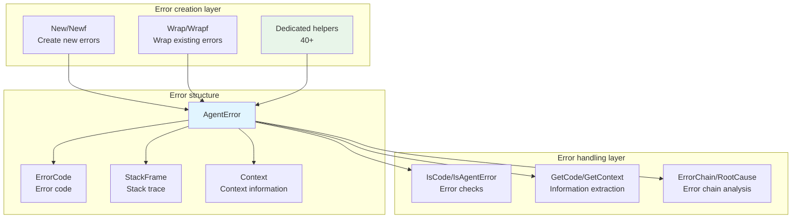
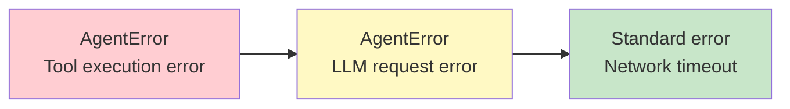

# errors: Error Handling System

[English](README.md) | [中文](README_CN.md)

This module is the unified error handling system of the goagent framework, providing structured, traceable error management.

## Package Scope

This package owns the framework error codes, fixed control signals, error messages and error constructors; protocol fields and default configuration remain in `constants/`.

| File | Contents |
|---|---|
| `codes.go` | `ErrorCode` and the category codes |
| `sentinel.go`, `sentinels.go` | The immutable `SentinelError` and the single definition of each sentinel |
| `management.go` | The `ErrManagement*` sentinels of the management service |
| `llm.go` | The `Message*` error messages actually in use, and the error context fields |
| `errors.go`, `helpers.go` | `AgentError`, error chains, category extraction and business constructors |

Business errors use `New`/`Newf`, `Wrap`/`Wrapf` or an existing dedicated constructor, adding the component, operation and context. Fixed control signals such as waiting, budget, locks and session conflicts use this package's `Err*` values; check identity with the standard library `errors.Is` and the category with this package's `GetCode`. Different sentinels may share a category code without becoming equal; they have no mutable Context, so never treat a shared signal as a modifiable business error.

Domain errors expose their category through `CodedError.ErrorCode()`; the `AgentError.Code` field is kept. Formatted business errors without `%w` use `Newf`, and `Wrapf` can be used when carrying an original error; existing valid `%w` wrapping keeps the error-tree semantics of the standard `fmt.Errorf`. The standard library `Is`, `As` and `Join` keep their usual behavior, and the custom `As` projection onto `AgentError` still works. `GetCode` takes the first framework category in the error chain's traversal order, so outer business wrappers win; unknown errors return `CodeInternal`. Independent boundaries such as codec, harness/env, command-line and test tools keep standard library errors; the exact scope is enforced by the import checker.

The old domain sentinels and error-constant forwarding have been removed, and the main repository and known related repositories have been migrated. See the [Error Handling Migration Guide](../docs/guides/ERROR_HANDLING_MIGRATION.md) for the migration path.

## Contents

- [Architecture](#architecture)
- [Error Codes](#error-codes)
- [Core Types](#core-types)
- [Usage](#usage)
- [API Reference](#api-reference)
- [Code Structure](#code-structure)

## Architecture

### System Architecture Diagram



### Error Chain Model



## Error Codes

There are 65 `ErrorCode` constants, listed by category (constant names are `Code` plus the CamelCase form, e.g. `CodeLLMRateLimit`):

| Category | Error codes |
|------|---------|
| Agent | `AGENT_EXECUTION`, `AGENT_VALIDATION`, `AGENT_NOT_FOUND`, `AGENT_INITIALIZATION` |
| Tool | `TOOL_EXECUTION`, `TOOL_NOT_FOUND`, `TOOL_VALIDATION`, `TOOL_TIMEOUT`, `TOOL_RETRY_EXHAUSTED` |
| Middleware | `MIDDLEWARE_EXECUTION`, `MIDDLEWARE_CHAIN`, `MIDDLEWARE_VALIDATION` |
| State | `STATE_LOAD`, `STATE_SAVE`, `STATE_VALIDATION` |
| Stream | `STREAM_READ`, `STREAM_WRITE`, `STREAM_TIMEOUT`, `STREAM_CLOSED` |
| LLM | `LLM_REQUEST`, `LLM_RESPONSE`, `LLM_TIMEOUT`, `LLM_RATE_LIMIT` |
| Context | `CONTEXT_CANCELED`, `CONTEXT_TIMEOUT` |
| General | `INVALID_INPUT`, `INVALID_CONFIG`, `NOT_IMPLEMENTED`, `INTERNAL_ERROR` |
| Distributed | `DISTRIBUTED_CONNECTION`, `DISTRIBUTED_SERIALIZATION`, `DISTRIBUTED_COORDINATION`, `DISTRIBUTED_SCHEDULING`, `DISTRIBUTED_HEARTBEAT`, `DISTRIBUTED_REGISTRY` |
| RAG | `RETRIEVAL_SEARCH`, `RETRIEVAL_EMBEDDING`, `DOCUMENT_NOT_FOUND`, `VECTOR_DIM_MISMATCH` |
| Parser | `PARSER_FAILED`, `PARSER_INVALID_JSON`, `PARSER_MISSING_FIELD` |
| Store | `STORE_CONNECTION`, `STORE_SERIALIZATION`, `STORE_NOT_FOUND` |
| Router | `ROUTER_NO_MATCH`, `ROUTER_FAILED`, `ROUTER_OVERLOAD` |
| Plugin/type | `TYPE_MISMATCH`, `ALREADY_EXISTS`, `NOT_FOUND`, `INVALID_OUTPUT` |
| Control signals | `WAITING`, `BUDGET_EXCEEDED`, `REPLAY_ONLY`, `ATTENTION_REQUIRED`, `APPROVAL_REQUIRED`, `LOCK_UNAVAILABLE`, `LEASE_LOST`, `SCOPE_REMOVED`, `CIRCUIT_OPEN`, `CONFLICT`, `EXECUTION_LIMIT`, `OVERLOADED`, `ACCESS_DENIED` |

## Core Types

### AgentError Structure

```go
type AgentError struct {
    Code      ErrorCode              // error code
    Message   string                 // error message
    Operation string                 // operation name
    Component string                 // component name
    Context   map[string]interface{} // context information
    Cause     error                  // underlying error
    // The call stack at creation records only program counters; StackFrames()/FormatStack() resolve it on demand
}

type StackFrame struct {
    File     string // source file path
    Line     int    // line number
    Function string // function name
}
```

### Method Chaining

```go
err := errors.New(errors.CodeLLMRateLimit, "rate limit exceeded").
    WithComponent("llm_client").
    WithOperation("request").
    WithContext("provider", "openai").
    WithContext("model", "gpt-4").
    WithContext("retry_after_seconds", 60)
```

## Usage

### Basic Usage

```go
// Option 1: create an error directly
err := errors.New(errors.CodeLLMTimeout, "request timed out after 30 seconds").
    WithComponent("llm").
    WithContext("timeout_seconds", 30)

// Option 2: use a dedicated helper (recommended)
err := errors.NewLLMTimeoutError("openai", "gpt-4", 30)

// Option 3: wrap an existing error
underlyingErr := fmt.Errorf("network error")
err := errors.Wrap(underlyingErr, errors.CodeLLMRequest, "LLM request failed").
    WithComponent("llm_client").
    WithContext("provider", "openai")
```

### Error Checks

```go
// Check the error code
if errors.IsCode(err, errors.CodeDocumentNotFound) {
    return 404, "Not Found"
}

if errors.IsCode(err, errors.CodeLLMRateLimit) {
    ctx := errors.GetContext(err)
    retryAfter := ctx["retry_after_seconds"].(int)
    time.Sleep(time.Duration(retryAfter) * time.Second)
}

// Check whether it is an AgentError
if errors.IsAgentError(err) {
    agentErr := err.(*errors.AgentError)
    fmt.Println(agentErr.FormatStack())
}
```

### Error Chain Handling

```go
// Inspect the full error chain
chain := errors.ErrorChain(wrappedErr)
for i, e := range chain {
    fmt.Printf("[%d] %v\n", i, e)
}

// Get the root cause
root := errors.RootCause(wrappedErr)
fmt.Printf("Root cause: %v\n", root)
```

### Retry Logic

```go
for attempt := 1; attempt <= maxAttempts; attempt++ {
    err := doOperation()
    if err == nil {
        return nil
    }

    if errors.IsCode(err, errors.CodeLLMRateLimit) {
        ctx := errors.GetContext(err)
        retryAfter := ctx["retry_after_seconds"].(int)
        time.Sleep(time.Duration(retryAfter) * time.Second)
        continue
    }

    // Non-retryable error
    return errors.NewToolRetryExhaustedError("operation", attempt, err)
}
```

### HTTP Status Code Mapping

```go
func errorToHTTPStatus(err error) (int, string) {
    switch errors.GetCode(err) {
    case errors.CodeDocumentNotFound:
        return 404, "Not Found"
    case errors.CodeInvalidInput:
        return 400, "Bad Request"
    case errors.CodeLLMRateLimit:
        return 429, "Too Many Requests"
    case errors.CodeLLMTimeout:
        return 504, "Gateway Timeout"
    default:
        return 500, "Internal Server Error"
    }
}
```

### Error() Text and Structured Logging

`Error()` outputs only `[CODE] [component] operation=xxx: message: cause` and does not include `Context`. Error text flows into logs, event Messages and model input, and URLs, model parameters, user input and similar data in `Context` should not propagate with it; read them with `GetContext` when needed, or hand them to structured logging.

`*AgentError` implements `slog.LogValuer`: as an slog attribute value it is output as a group with `code`, `component`, `operation`, `message`, `context` and `cause` (empty fields omitted). It also implements `zapcore.ObjectMarshaler`, so zap (including the zap engine of kart-io/logger) outputs the same fields as an object. With `fmt` formatting, `%v`/`%s` equal `Error()`, and `%+v` appends `context: k=v, ...` sorted by key; it is only for local debugging and logs and must not be passed to the model.

### URL Redaction

- `RedactURL(raw)`: strips userinfo, query and fragment before an address is written to `Context` or logs. Comma-separated multi-address values (such as NATS clusters) are processed segment by segment; when a password contains an unescaped `/`, `?` or `#`, everything from after the scheme up to the last `@` is dropped (a `host:port/path` address whose path contains `@` is over-trimmed); key=value DSNs keep only `host`, `port` and `dbname`. It does **not** handle URLs that carry credentials in the path (such as Slack webhooks or Telegram bot tokens); such addresses must not be written to errors or logs.
- `RedactURLError(err)`: the text of a `*url.Error` returned by resty or net/http contains the full request URL (whose query may hold an api key/token). Call it before returning to the caller, writing `ToolOutput.Error` or logging, to get a new error with the URL redacted. The original error is not modified, `Unwrap` still yields the original underlying error, `errors.Is(context.DeadlineExceeded)`, `Timeout()` and the Code of an outer `*AgentError` are unaffected, and if the chain has no `*url.Error` the error is returned unchanged.

```go
// slog logs *AgentError directly; Context is output grouped as err.context
slog.Error("operation failed", "err", agentErr)

// zap / the zap engine of kart-io/logger: output as an object, including context
logger.Errorw("operation failed", "error", agentErr)

// Redact the underlying HTTP error before wrapping
resp, err := client.R().Get(rawURL)
if err != nil {
    return errors.Wrap(errors.RedactURLError(err), errors.CodeToolExecution, "request failed")
}

// Other logging libraries can extract fields one by one
logger.Error("operation failed",
    "error_code", errors.GetCode(err),
    "component", errors.GetComponent(err),
    "operation", errors.GetOperation(err),
    "context", errors.GetContext(err),
)

// Print the stack trace
if agentErr, ok := err.(*errors.AgentError); ok {
    fmt.Println(agentErr.FormatStack())
}
```

### Model Argument Errors and Panics

- `MarkModelArgument()` marks an error as caused by invalid model-generated arguments, and `ModelArgumentMessage()` returns a `Message` that can be handed back to the model verbatim for correction (the second return value is false when unmarked). The `Message` of a marked error must not contain internal details; marking does not change `Error()`, the error code or the type.
- `PanicError` (`NewPanicError(op, value)`) is an error recovered from a panic, keeping `Op`, `Value` and `Stack`. `Error()` contains only the location; use `errors.As` to get the value and call stack when investigating.

## API Reference

### Constructors

```go
// Create a new error
New(code ErrorCode, message string) *AgentError
Newf(code ErrorCode, format string, args ...interface{}) *AgentError

// Wrap an existing error
Wrap(err error, code ErrorCode, message string) *AgentError
Wrapf(err error, code ErrorCode, format string, args ...interface{}) *AgentError
```

When `err` is nil, `Wrap`/`Wrapf` and the helpers that take a cause return a nil `*AgentError`, and subsequent chained `With*` calls are nil-safe. However, a nil `*AgentError` stored in an `error` interface is not equal to nil, so when the cause may be nil, check before wrapping:

```go
if err != nil {
    return errors.Wrap(err, errors.CodeToolExecution, "tool failed")
}
return nil
```

### Fluent Methods

```go
func (e *AgentError) WithOperation(operation string) *AgentError
func (e *AgentError) WithComponent(component string) *AgentError
func (e *AgentError) WithContext(key string, value interface{}) *AgentError
func (e *AgentError) WithContextMap(ctx map[string]interface{}) *AgentError
func (e *AgentError) LogValue() slog.Value
func (e *AgentError) MarshalLogObject(enc zapcore.ObjectEncoder) error
func (e *AgentError) Format(s fmt.State, verb rune)
func (e *AgentError) StackFrames() []StackFrame // call stack at creation, resolved when called
func (e *AgentError) FormatStack() string
func (e *AgentError) MarkModelArgument() *AgentError
func (e *AgentError) ModelArgumentMessage() (string, bool)

// Redact a URL before writing it to Context
RedactURL(raw string) string
// Redact the URL of a *url.Error in the error chain
RedactURLError(err error) error
```

### Check Functions

```go
// Error code checks: nil returns an empty string; returns CodeInternal when the chain has no framework category
GetCode(err error) ErrorCode
IsCode(err error, code ErrorCode) bool

// Type check
IsAgentError(err error) bool

// Information extraction
GetOperation(err error) string
GetComponent(err error) string
GetContext(err error) map[string]interface{}

// Error chain
ErrorChain(err error) []error
RootCause(err error) error
```

### Dedicated Helpers

```go
// Agent
NewAgentExecutionError(agentName, operation string, cause error) *AgentError
NewAgentValidationError(agentName, reason string) *AgentError
NewAgentNotFoundError(agentName string) *AgentError
NewAgentInitializationError(agentName string, cause error) *AgentError

// Tool
NewToolExecutionError(toolName, operation string, cause error) *AgentError
NewToolNotFoundError(toolName string) *AgentError
NewToolValidationError(toolName, reason string) *AgentError
NewToolTimeoutError(toolName string, timeoutSeconds int) *AgentError
NewToolRetryExhaustedError(toolName string, attempts int, lastError error) *AgentError

// LLM
NewLLMRequestError(provider, model string, cause error) *AgentError
NewLLMResponseError(provider, model, reason string) *AgentError
NewLLMTimeoutError(provider, model string, timeoutSeconds int) *AgentError
NewLLMRateLimitError(provider, model string, retryAfterSeconds int) *AgentError

// Stream
NewStreamReadError(cause error) *AgentError
NewStreamWriteError(cause error) *AgentError
NewStreamTimeoutError(operation string, timeoutSeconds int) *AgentError
NewStreamClosedError(operation string) *AgentError

// RAG
NewRetrievalSearchError(query string, cause error) *AgentError
NewRetrievalEmbeddingError(text string, cause error) *AgentError
NewDocumentNotFoundError(docID string) *AgentError
NewVectorDimMismatchError(expected, actual int) *AgentError

// The remaining categories each have helpers as well:
// Middleware:  NewMiddlewareExecutionError / NewMiddlewareChainError / NewMiddlewareValidationError
// State:       NewStateLoadError / NewStateSaveError / NewStateValidationError
// Context:     NewContextCanceledError / NewContextTimeoutError
// General:     NewInvalidInputError / NewInvalidConfigError / NewNotImplementedError / NewInternalError
// Distributed: NewDistributedConnectionError / NewDistributedSerializationError / NewDistributedCoordinationError
// Parser:      NewParserError / NewParserInvalidJSONError / NewParserMissingFieldError
// Store:       NewStoreConnectionError / NewStoreSerializationError / NewStoreNotFoundError
// Router:      NewRouterNoMatchError / NewRouterFailedError / NewRouterOverloadError

// Generic utilities: return a new error with extra information without modifying err; if the chain already has an AgentError, its error code is reused
ErrorWithRetry(err error, attempt, maxAttempts int) *AgentError
ErrorWithDuration(err error, durationMs int64) *AgentError
```

## Code Structure

```text
errors/
├── errors.go       # core types and basic methods
│                   # - AgentError struct
│                   # - constructors and fluent methods
│                   # - error check and extraction functions, URL redaction
│
├── codes.go        # ErrorCode type and Code* error codes
├── llm.go          # model error fields and messages
├── sentinel.go     # immutable coded sentinel type
├── sentinels.go    # single object definitions of the framework's fixed signals
├── management.go   # ErrManagement* sentinels of the management service
│
├── helpers.go      # dedicated error constructors
│
└── panic.go        # PanicError
```

## Design Features

### Structured Errors

- **Error code categories**: error codes are categorized by component
- **Context information**: flexible key-value storage
- **Stack traces**: call stacks captured automatically

### Error Chain Support

- Implements `Unwrap()` to support `errors.Is()` and `errors.As()`
- Provides the `ErrorChain()` and `RootCause()` convenience functions

### Easy Integration

- Fully compatible with the Go standard library `errors` package
- Easy to integrate into logging, monitoring and alerting systems

## Further Reading

- [core](../core/) - core execution engine
- [observability](../observability/) - observability
- [middleware](../middleware/) - middleware
