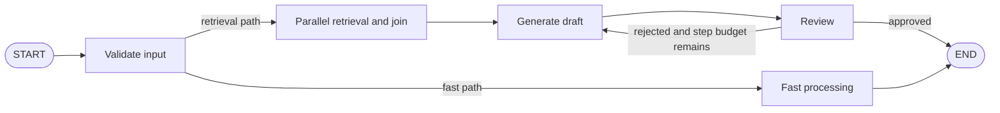

# General Flow Orchestration

[English](README.md) | [中文](README_CN.md)

`workflow.Graph[T]` compiles sequential nodes, conditional branches, explicit parallel joins, and bounded loops into a `core.StreamRunnable[T,T]`. All nodes share the same state type T; Agents with different input/output types are converted explicitly with Adapt.

Human-in-the-loop uses the durable graph's `ApprovalNodes`, `Snapshot`, and `Resume`; `WithResumeHandler` validates human input and modifies business state, and the state and the release are persisted together in one write before the node runs. See [Pause, Resume, and Checkpoints](../docs/guides/HUMAN_IN_THE_LOOP.md) and the [offline example](../examples/human-in-the-loop/README.md).

```go
// Import github.com/kart-io/goagent/constants.
graph := workflow.NewGraph[int](workflow.Config{MaxSteps: 20, MaxConcurrency: 4})
err := graph.AddNode("increment", func(ctx context.Context, value int) (int, error) {
    return value + 1, nil
})
if err != nil { return err }
if err := graph.AddEdge(constants.WorkflowStart, "increment"); err != nil { return err }
if err := graph.AddBranch("increment", func(ctx context.Context, value int) (string, error) {
    if value >= 3 { return constants.WorkflowEnd, nil }
    return "increment", nil
}, "increment", constants.WorkflowEnd); err != nil { return err }
run, err := graph.Compile(ctx)
if err != nil { return err }
result, err := run.Invoke(ctx, 0) // 3
```

## Building and Compiling Graphs

| API | Purpose |
|---|---|
| `AddNode(name, Node[T])` | Register a synchronous state transformation function |
| `AddRunnable(name, core.Runnable[T,T])` | Plug in an existing Runnable or subgraph, keeping its events |
| `Adapt(runnable, input, output)` | Map a Runnable[I,O] to a Runnable[T,T] |
| `AdaptStream(runnable, input, output, intermediate)` | Explicitly convert intermediate Data/Event; the final state is still validated separately |
| `AddEdge(from, to)` | The single ordinary successor |
| `AddBranch(from, router, targets...)` | Choose one pre-declared successor from the node's output |
| `AddParallel(name, ParallelConfig[T])` | Register parallel branches with an explicit join |
| `Compile(ctx)` | Validate and produce a Runnable |

START allows only one entry edge; END has no successors. Each node has exactly one ordinary edge or one conditional branch. Compile rejects unknown references, missing successors, unreachable nodes, and loops with no structural exit; duplicate names, duplicate routes, and reserved names are rejected while building the graph.

Loops with an exit are allowed, but runtime routing may still never choose the exit. MaxSteps defaults to 100; each node execution counts as one step, and START/END do not count; exceeding the limit returns `errors.ErrWorkflowMaxSteps`, which can be checked with errors.Is. A parallel node counts as one step, and branches and nested subgraphs each have their own execution bounds. The framework does not automatically retry nodes or roll back side effects that have already happened.

Multiple ordinary incoming edges mean different paths can reach the same node; only the selected path is executed, without waiting for other paths. An AND join must use AddParallel, not multiple ordinary edges.

Compile copies the graph definition, so compiled results are not affected by later changes to the graph; function closures and Runnable resources still belong to the caller. The Graph Builder does not support concurrent modification. Compiled results can execute concurrently, but node resources and input state must support such use. A Builder Agent with session state should not be shared as multiple independent sessions.

## Parallelism and State Isolation

```go
err := graph.AddParallel("lookup", workflow.ParallelConfig[State]{
    Branches: []workflow.Branch[State]{
        {Name: "documents", Run: lookupDocuments},
        {Name: "orders", Run: lookupOrders},
    },
    Clone: cloneState,
    Merge: func(ctx context.Context, original State, results []State) (State, error) {
        // results[0] is always documents, results[1] is always orders.
        return combine(original, results), nil
    },
})
```

Clone and Merge are both required. Before starting workers, the framework calls Clone serially to prepare each branch's input. When T contains maps, slices, or pointers, the caller must deep-copy whatever a branch might modify; scalar or immutable state can be returned as is. Merge receives the original input and the successful results ordered by registration; the order in which branches finish does not change the result order.

MaxConcurrency defaults to 4 and limits the number of workers per parallel node. Batch concurrency is independent of this limit; multiple graph executions or nested parallel nodes do not share a global concurrency quota.

If any branch errors or panics, the other tasks in the group are canceled, scheduling stops, already-started workers are awaited, and Merge does not run. Business functions must honor context; a function that does not respond to cancellation prevents the parallel node from finishing. Panics in Clone/routing/Merge are also turned into an error of the whole graph. There are no transactions or side-effect compensation here.

## Plugging in a Builder Agent

```go
node, err := workflow.Adapt(agent.AsRunnable(),
    func(s State) (any, error) { return s.Question, nil },
    func(s State, answer *builder.AgentOutput) (State, error) {
        s.Answer = fmt.Sprint(answer.Result)
        return s, nil
    },
)
// After checking err: graph.AddRunnable("answer", node)
```

Input/output conversion errors propagate directly. Adapt waits for a valid node final state and the end of the stream before converting the output, without dropping the final result. Intermediate events such as text, sources, and usage pass through; intermediate Data of different types is not implicitly converted. When parallel branches need to call an Agent, call Invoke on the adapted node inside Branch.Run; in that case the parallel layer provides branch start/end events and does not pass through the branch's internal token events.

## Execution and Events

Compiled results support Invoke, Stream, Batch, Pipe, WithConfig, and WithCallbacks. Synchronous and streaming execution use the same source. `StreamMode()` is steps; existing text events from nodes pass through, but the state on an edge is always delivered downstream only after the node completes successfully.

| Event.Type | Event.Step |
|---|---|
| `node_start` / `node_end` | node name |
| `branch_start` / `branch_end` | parallel node name/branch name |
| the node's own events | node name/original Step; only the node name when the original Step is empty |

A node's Done is not passed off as graph completion. Only after all selected nodes and the graph completion callbacks succeed is a single error-free Done emitted, with Data being the final T. On error, the stream ends with a final chunk carrying Error; for cancellation ctx.Err() is authoritative, and sending the error final chunk is best effort. Stopping consumption early requires canceling the context.

A custom Runnable must close its stream and provide exactly one final chunk. A missing/duplicate final chunk, data or errors after the final chunk, or a nil stream all fail, and downstream does not run. User-provided Runnables or Nodes must stop any background work they start. Usage in node events is a cumulative snapshot reported by that node, with Step identifying the scope; the graph does not automatically add up usage across nodes, and cross-node aggregation is up to the application.

## Examples and Verification

```sh
go run ./examples/workflow
go run ./examples/workflow -stream
go test -race ./workflow -count=1
```

The example needs no model or API key; it demonstrates input validation, choosing a fast path/retrieval path, a two-branch retrieval join, a draft review loop, and the final result. For more detailed execution boundaries see the [Execution Contract](../docs/guides/EXECUTION_CONTRACT.md).



Not currently provided: automatic type inference for heterogeneous nodes, a field-mapping DSL, cross-node Collect/Transform, or distributed scheduling. `Compile` executes in memory; node-boundary recovery uses `CompileDurable` described below. `core/durable.Runner` is still used for explicitly recoverable sequential steps.

## Durable Recovery at Node Boundaries

`CompileDurable` uses the same graph definition and a `core/durable.Store`. It supports sequential nodes, conditional branches, bounded loops, pre-node approval, and single-machine restart recovery. `AddParallel` saves each branch's input and successful result; on recovery, saved branches are skipped and the join happens in registration order. The in-memory execution and streaming semantics of the original `Compile` are unchanged.

```go
store, err := durable.NewFileStore("./checkpoints")
if err != nil { return err }
runnable, err := graph.CompileDurable(ctx, workflow.DurableConfig{
    Store: store,
    Version: "order-flow-v1",
    ApprovalNodes: []string{"issue_refund"},
})
if err != nil { return err }
snapshot, err := runnable.Run(ctx, runID, initialState, "")
if errors.Is(err, agentErrors.ErrApprovalRequired) { // agentErrors is github.com/kart-io/goagent/errors
    // The durable wait has been saved. Pass back snapshot.Key only after the host completes authentication and business authorization.
    // Next call: runnable.Run(ctx, runID, initialState, snapshot.Key)
}
// On success snapshot.Done=true, and the final business state is in snapshot.State.
```

State must round-trip losslessly through JSON; use named structs to avoid losing concrete types in interface fields. Recovery ignores a new initialState. Changes to node code, state structure, or business policy require bumping `Version`; changes to nodes, edges, candidate routes, execution budgets, and approval configuration automatically cause a plan fingerprint mismatch and old checkpoints are rejected.

The intent is persisted before execution, the output is saved after the node succeeds, and the next route is saved separately. Therefore a routing failure does not re-run an already saved node. Routers must be side-effect free, since they may be replayed after a crash; modifications a Router makes to its input are not saved. `MaxSteps` accumulates across restarts. The approval key is bound to the run, the versioned plan, and the specific node visit, and each loop iteration uses a different key; it is not an authentication credential.

When the host needs to check external data before an approval takes effect (for example, whether a SQL ticket was changed while paused for approval), register a pre-check with `g.CompileDurable(ctx, cfg, workflow.WithBeforeApprove(fn))`. It is called inside the run lock, after the approval key matches and before the approval is written; `snap` is an independent copy of the latest checkpoint inside the lock, which covers the window between calling `Snapshot` and then `Run`. If it returns an error, the approval is rejected, the checkpoint stays Waiting with the approval key unchanged, and `*workflow.ApprovalRejectedError` is returned (its text is `批准前置校验拒绝: ...`, and `Unwrap` yields the original error); if the hook panics, `*errors.PanicError` is returned, which is not a rejection. Both the `Run` and `AsRunnable` entry points call it; resumes without an approval key do not. The hook does not take part in the plan fingerprint. Do not call `Snapshot`/`Run` on the same run inside the hook, since the run lock is already held. The `BeforeApprove` field of `durable.Runner` has the same semantics.

Other entry points: `Graph.Describe()` validates and returns a deterministically ordered topology description; `DurableGraph.Snapshot(ctx, id)` reads the most recently committed checkpoint; `Diagnose(ctx, id, refs...)` performs read-only diagnosis of continuation metadata; `AsChildRunnable()` lets a durable graph be nested as a subflow (for example wrapped as a resumable tool via `tools.NewRunnableToolFactory`), with checkpoints written to the Store of the parent operation journal; an approval pause returns `*durable.WaitError`, whose `ChildContinuation` gives the approval key needed to continue, and a mismatched approval key yields `ErrApprovalMismatch`.

Nodes read a stable execution key through `workflow.DurableKey(ctx)`. If a crash happens after an effect is committed but before the checkpoint is saved, the node may still re-run, so external services must deduplicate with this key or a stronger business request ID. Node functions are still re-executed from their entry; the Builder's native tool loop using Dispatcher.Tools recovers by model turn and tool call, as described below. It does not restore arbitrary Go call stacks. `AsRunnable` provides Invoke/Stream/Batch for durable graphs; an approval pause returns a state with Waiting=true and Done=false. The compatible `Run` still returns the approval sentinel error. Real-time events are not guaranteed to be replayed durably. FileStore provides only local locking and atomic file saves, with no cross-host leases or takeover. Merge must be side-effect free; it may still re-run after effects complete but before the branch checkpoint is saved, so business services must be idempotent.

```sh
go test -race ./workflow -run DurableGraph
```

This includes a test where a real subprocess exits after an effect is persisted and a restart produces only one effect, as well as tests for approval, loop budgets, routing failures, save failures, cancellation while waiting, and corrupted checkpoints.

## Native Tools and a Unified Recovery Entry Point

`tools.Dispatcher.AsRunnable()` can be registered as a graph node via Adapt; `dispatcher.Tools()` can be registered with the Builder. Both share argument validation, authorization hooks, timeouts, and concurrency limits, and neither retries automatically. The execution key of a durable node/branch is automatically injected into ToolInput.ExecutionKey. For full configuration, recovery semantics, and a runnable refund case see [Native Orchestration and the Tool System](../docs/guides/NATIVE_ORCHESTRATION.md).


## Model and Multi-Tool Recovery Within a Single Node

Durable graphs and `core/durable.Runner` automatically inject the operation journal into the node context. The Builder must set `WithDurableScope("agent-name")`, and different logical calls within the same node use different stable names. The Builder's native tool loop first saves the model plan (call IDs, arguments, usage, provider continuation state) and executes tools only after the whole turn passes Schema pre-checks; recovery first replays the plan and the completed tool results. Tools must be plugged in through `Dispatcher.Tools()` or an adapter implementing `interfaces.DurableCallTool`; bare Tools are rejected before the paid request.

Hand-written multi-tool nodes use a stable host-generated `ToolInput.CallID`, for example `"reserve"` and `"notify"`. The Dispatcher derives `parent execution key + tool/CallID` into an independent child key and injects it into the tool's context and ExecutionKey. Completed calls read their results directly; calls whose effect was committed but whose result was not saved can only rely on the target service deduplicating on the same child key. The legacy empty CallID keeps single-effect node behavior.

A failed model turn is not retried automatically; `durable.InspectOperation` can read the status and known usage in the Agent's sub-scope context, and later recovery returns `errors.ErrOperationAttention`. A tool's `MaxAttempts` defaults to 3 and limits the total attempts across explicit recoveries; a single Invoke does not retry in a loop. For detailed constraints and code see the [operation journal guide](../docs/guides/NATIVE_ORCHESTRATION.md#tool-call-journaling-and-recovery).

The intermediate callback of `AdaptStream` receives the original state and the intermediate chunk and can explicitly keep Data and Event; it cannot return Done and cannot modify the shared original state. Intermediate chunks are only previews and may be replayed on recovery; they do not drive successor nodes or write graph state. The final output still waits for a complete, valid stream; a mapping failure cancels upstream.


The durable graph's `AsRunnable().Stream` likewise keeps the typed previews of `AdaptStream`: intermediate chunks have `Data.Preview=true`, with the preview value in `Data.State`. They are not dropped even when there is no Event or the data is a zero value. Previews are not written to checkpoints; after failure or cancellation `Snapshot` still returns the last committed state with Preview=false. The final success chunk also has Preview=false, so business completion must still check Data.Done.

Durable entry points now support model journaling and recovery for tool-less `llm.Client`. Old unscoped model journals are not automatically migrated to new keys; add a scope, reconcile existing business effects, and bump Version; see [integration constraints](../docs/guides/NATIVE_ORCHESTRATION.md#multi-agent-scopes-and-entry-constraints).

## Read-Only Recovery Diagnostics

`Diagnose` and `CheckCompatibility` share with the executor the structural checks for nodes, routes, parallel inputs and outputs, interrupts, and approval bindings. Ordinary, post-approval, parallel, and nested dynamic interrupts are all valid waits; recovery is still blocked when an interrupt's key, ID, information, or binding state is corrupted. Structural checks examine only the raw JSON: they do not decode business state, do not run nodes or the host's `UnmarshalJSON`, and do not write to the Store or acquire the execution lock. Whether the business state type can be decoded is still verified when recovery actually runs.
