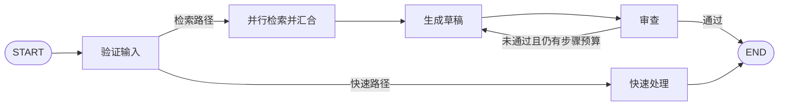

# 通用流程编排

`workflow.Graph[T]` 将串行节点、条件分支、显式并行汇合与有界循环编译为 `core.StreamRunnable[T,T]`。节点共享同一状态类型 T；不同输入/输出的 Agent 使用 Adapt 显式转换。

```go
graph := workflow.NewGraph[int](workflow.Config{MaxSteps: 20, MaxConcurrency: 4})
err := graph.AddNode("increment", func(ctx context.Context, value int) (int, error) {
    return value + 1, nil
})
if err != nil { return err }
if err := graph.AddEdge(workflow.START, "increment"); err != nil { return err }
if err := graph.AddBranch("increment", func(ctx context.Context, value int) (string, error) {
    if value >= 3 { return workflow.END, nil }
    return "increment", nil
}, "increment", workflow.END); err != nil { return err }
run, err := graph.Compile(ctx)
if err != nil { return err }
result, err := run.Invoke(ctx, 0) // 3
```

## 构图与编译

| API | 用途 |
|---|---|
| `AddNode(name, Node[T])` | 注册同步状态变换函数 |
| `AddRunnable(name, core.Runnable[T,T])` | 接入已有 Runnable、子图并保留事件 |
| `Adapt(runnable, input, output)` | 将 Runnable[I,O] 映射为 Runnable[T,T] |
| `AdaptStream(runnable, input, output, intermediate)` | 显式转换中间 Data/Event，终态仍单独校验 |
| `AddEdge(from, to)` | 唯一普通后继 |
| `AddBranch(from, router, targets...)` | 从节点输出选择一个预先声明的后继 |
| `AddParallel(name, ParallelConfig[T])` | 注册并行分支及显式汇合 |
| `Compile(ctx)` | 验证并生成 Runnable |

START 只允许一条入口边；END 无后继。每个节点恰好配置一条普通边或一个条件分支。Compile 拒绝未知引用、无后继、不可达节点和没有结构性出口的循环；重复名称、重复路由及保留名称在构图时拒绝。

允许存在出口的循环，运行时路由仍可能一直不选出口。MaxSteps 默认 100，每次节点执行计一步，START/END 不计；超限返回 `workflow.ErrMaxSteps`，可通过 errors.Is 检查。一个并行节点计一步，分支和嵌套子图各有自己的执行边界。框架不自动重试节点或回滚已发生的副作用。

普通多入边表示不同路径可以到达同一个节点，只执行被选中的路径，不等待其他路径。AND 汇合必须使用 AddParallel，而非添加多条普通边。

Compile 复制图定义，已编译结果不受后续构图修改影响；函数闭包和 Runnable 资源仍属于调用方。Graph Builder 不支持并发修改。编译结果可以并发执行，但节点资源和输入状态必须支持这种用法。一个有会话状态的 Builder Agent 不应被当成多个独立会话共用。

## 并行与状态隔离

```go
err := graph.AddParallel("lookup", workflow.ParallelConfig[State]{
    Branches: []workflow.Branch[State]{
        {Name: "documents", Run: lookupDocuments},
        {Name: "orders", Run: lookupOrders},
    },
    Clone: cloneState,
    Merge: func(ctx context.Context, original State, results []State) (State, error) {
        // results[0] 始终是 documents，results[1] 始终是 orders。
        return combine(original, results), nil
    },
})
```

Clone 和 Merge 均为必填。框架在启动 worker 前串行调用 Clone 为每个分支准备输入。T 包含 map、slice、pointer 时，调用方需深复制分支可能修改的内容；标量或不可变状态可原样返回。Merge 获得原始输入和按注册顺序排列的成功结果；分支完成顺序不改变结果顺序。

MaxConcurrency 默认 4，限制每个并行节点的 worker 数量。Batch 并发与此限制相互独立；多个图执行或嵌套并行不会共享全局并发额度。

任意分支出错或 panic，取消同组其他任务，停止调度并等待已启动 worker 退出，Merge 不执行。业务函数必须遵守 context；不响应取消的函数会阻止该并行节点结束。Clone/路由/Merge 的 panic 也会转为整个图的错误。这里没有事务或副作用补偿。

## 接入 Builder Agent

```go
node, err := workflow.Adapt(agent.AsRunnable(),
    func(s State) (any, error) { return s.Question, nil },
    func(s State, answer *builder.AgentOutput) (State, error) {
        s.Answer = fmt.Sprint(answer.Result)
        return s, nil
    },
)
// 检查 err 后：graph.AddRunnable("answer", node)
```

输入/输出转换错误直接传播。Adapt 等待合法的节点终态和流结束后再转换输出，不丢弃最终结果。中间文本、来源、用量等事件透传；不同类型的中间 Data 不做隐式转换。并行分支需要调用 Agent 时，可在 Branch.Run 中调用已适配节点的 Invoke；这时并行层提供分支起止事件，不透传分支内部 Token 事件。

## 执行与事件

编译结果支持 Invoke、Stream、Batch、Pipe、WithConfig、WithCallbacks。同步和流式执行使用同一源。`StreamMode()` 为 steps；节点已有文本事件会透传，但边上的状态始终在节点成功完成后才交付给下游。

| Event.Type | Event.Step |
|---|---|
| `node_start` / `node_end` | 节点名 |
| `branch_start` / `branch_end` | 并行节点名/分支名 |
| 节点原有事件 | 节点名/原 Step，原 Step 为空时只有节点名 |

节点 Done 不向外冒充图完成。只有全部选中节点及图完成回调成功后，才发一个无错误 Done，Data 为最终 T。错误时以带 Error 的终态结束；取消以 ctx.Err() 为准，错误终态为尽力发送。提前停止消费必须取消 context。

自定义 Runnable 必须关闭流，并且恰好提供一个终态。缺失/重复终态、终态后的数据或错误、nil 流均失败，不运行下游。用户提供的 Runnable 或 Node 必须停止自己启动的后台工作。节点事件中的 usage 是该节点报告的累计快照，Step 标识作用域；图不将不同节点的用量自动累加，跨节点汇总由应用处理。

## 示例与验证

```sh
go run ./examples/workflow
go run ./examples/workflow -stream
go test -race ./workflow -count=1
```

示例无需模型或 API Key，演示验证输入、选择快速路径/检索路径、双分支检索汇合、草稿审查循环和最终结果。更详细的执行边界见[执行契约](../docs/guides/EXECUTION_CONTRACT.md)。



当前不提供异构节点自动类型推断、字段映射 DSL、跨节点 Collect/Transform 或分布式调度。`Compile` 为内存执行；节点边界恢复使用下文的 `CompileDurable`。`core/durable.Runner` 仍用于显式可恢复顺序步骤。

## 节点边界的持久化恢复

`CompileDurable` 使用相同图定义和 `core/durable.Store`。支持串行节点、条件分支、有界循环、节点前审批和单机重启恢复。`AddParallel` 会保存各分支输入与成功结果，恢复时跳过已保存的分支，按注册顺序汇合。原 `Compile` 的内存执行和流式语义保持不变。

```go
store, err := durable.NewFileStore("./checkpoints")
if err != nil { return err }
runnable, err := graph.CompileDurable(ctx, workflow.DurableConfig{
    Store: store,
    Version: "order-flow-v1",
    ApprovalNodes: []string{"issue_refund"},
})
if err != nil { return err }
snapshot, err := runnable.Run(ctx, runID, initialState, "")
if errors.Is(err, durable.ErrApprovalRequired) {
    // 持久化等待已保存。宿主完成身份认证和业务授权后，才传回 snapshot.Key。
    // 下次调用：runnable.Run(ctx, runID, initialState, snapshot.Key)
}
// 成功时 snapshot.Done=true，最终业务状态在 snapshot.State。
```

状态必须可无损 JSON 往返，使用具名结构体，避免接口字段中的具体类型丢失。恢复忽略新 initialState。节点代码、状态结构或业务策略变化须增加 `Version`；节点、边、候选路由、执行预算和审批配置的变化自动导致计划指纹不匹配并拒绝旧检查点。

执行前持久化意图，节点成功后保存输出，再单独保存下一条路由。因此路由失败不会重跑已保存的节点。Router 必须无副作用，其执行可能在崩溃后重放；Router 对输入的修改不保存。`MaxSteps` 跨重启累计。审批键绑定 run、版本计划和具体节点访问，循环每轮使用不同键；它不是身份认证凭证。

节点通过 `workflow.DurableKey(ctx)` 读取稳定执行键。效果提交后、检查点保存前发生崩溃时节点仍可能重跑，外部服务必须用该键或更强的业务请求 ID 去重。节点函数仍从入口重新执行；使用 Dispatcher.Tools 的 Builder 原生工具循环会按模型回合和工具调用恢复，详见下文。它不恢复任意 Go 调用栈。`AsRunnable` 为持久图提供 Invoke/Stream/Batch；审批暂停返回 Waiting=true、Done=false 的状态。兼容 `Run` 仍返回审批哨兵错误。实时事件不承诺持久化重放。FileStore 只提供本地锁与原子文件保存，不提供跨主机租约或接管。Merge 必须无副作用；效果完成后但分支检查点保存前仍可能重跑，业务服务须执行幂等。

```sh
go test -race ./workflow -run DurableGraph
```

包含真实子进程在效果落盘后退出、重新启动仅产生一个效果的测试，以及审批、循环预算、路由失败、保存失败、取消等待与损坏检查点测试。

## 原生工具与统一恢复入口

`tools.Dispatcher.AsRunnable()` 可通过 Adapt 注册为图节点；`dispatcher.Tools()` 可注册给 Builder。两者共享参数校验、授权钩子、超时与并发限制，且不自动重试。持久节点/分支的执行键会自动注入 ToolInput.ExecutionKey。完整配置、恢复语义及可运行退款案例见[原生编排与工具体系](../docs/guides/NATIVE_ORCHESTRATION.md)。


## 单节点内的模型与多工具恢复

持久图和 `core/durable.Runner` 自动向节点 context 注入操作日志。Builder 的原生工具循环会先保存模型计划（调用 ID、参数、用量、Provider 续接状态），整轮 Schema 预检通过后才执行工具；恢复先重放计划和已完成工具结果。工具必须经 `Dispatcher.Tools()` 或实现 `interfaces.DurableCallTool` 的适配器接入；裸 Tool 在付费请求前被拒绝。

手写多工具节点使用宿主生成的稳定 `ToolInput.CallID`，例如 `"reserve"`、`"notify"`。Dispatcher 将 `父执行键 + tool/CallID` 派生为独立子键，注入工具的 context 与 ExecutionKey。已完成调用直接读取结果；效果已提交但结果未保存的调用只能依靠目标服务对同一子键去重。旧的空 CallID 保持单效果节点行为。

失败模型回合不会自动重试，`durable.InspectOperation` 可读取状态与已知用量，后续恢复返回 `durable.ErrOperationAttention`。工具的 `MaxAttempts` 默认 3，限制跨显式恢复的总尝试数，单次 Invoke 不循环重试。详细约束与代码见[操作日志指南](../docs/guides/NATIVE_ORCHESTRATION.md#工具调用级日志与恢复)。

`AdaptStream` 的 intermediate 回调接收原状态和中间 chunk，可显式保留 Data 与 Event；它不能返回 Done，也不能修改共享原状态。中间块只是预览，可能在恢复时重放，不驱动后继节点或写入图状态。最终 output 仍需等待完整合法流；映射失败会取消上游。
